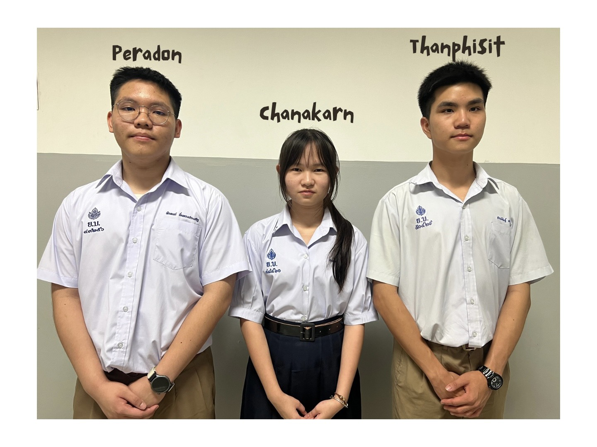

# YBR-SUNFLOWER 🌻

### WRO 2026 · Future Engineers · Self-Driving Cars

**Thailand · Yothinburana School · Science–Mathematics English Program**

---

## Project at a Glance

YBR-SUNFLOWER is developing a self-driving robotic car for the **World Robot Olympiad (WRO) 2026 Future Engineers** category. The robot is designed to navigate an unfamiliar track autonomously, interpret its surroundings, steer around traffic signs, and perform the required maneuvers using onboard computation and sensors. Our engineering work brings together mechanical design, electrical integration, perception, planning, control, and practical testing.

This repository shares our robot design and source code alongside the reasoning and evidence behind engineering choices. The detailed technical material is organized into **five integrated engineering records** under [`engineering_journal/`](engineering_journal/). Each record combines design explanations, calculations, development decisions, experiments, results, and reproduction information for its subject.

| Project detail | Overview |
|:---|:---|
| Competition | WRO 2026, Future Engineers |
| Team | YBR-SUNFLOWER, Yothinburana School, Thailand |
| robot | Four-wheeled autonomous car with controlled steering and driven wheels |
| Main controller | Raspberry Pi 5 (8 GB) |
| Perception | LiDAR and fisheye camera |
| Current stage | Revised robot in development; final assembly and validation pending |

---

## Explore Our Engineering Work

Each link below leads to **one complete record**. The records are organized by engineering responsibility, with testing evidence and design decisions included where they belong.

| Engineering record | What it covers |
|:---|:---|
| **[1-Mobility and Mechanical Design](engineering_journal/1-mech.md)** | Chassis, drivetrain, steering geometry, mechanical iterations, CAD, fabrication, assembly, and measured mechanical performance |
| **[2-Power and Sensor Architecture](engineering_journal/2-elec.md)** | Power distribution, circuits, wiring, components, electronic interfaces, sensors, calibration, and electrical tests |
| **[3-Software Architecture and Obstacle Strategy](engineering_journal/3-software.md)** | Software architecture, perception, localization, motion planning, obstacle handling, control, parking, and test results |
| **[4-Build and Reproduction Guide](engineering_journal/4-build.md)** | Parts and fabrication files, step-by-step physical assembly, electrical checks, dependencies, setup, configuration, launch procedures, and verification |

---

## Our Team

All photos are in [`t-photos/`](t-photos/)

| Member | Primary responsibility | Supporting responsibilities |
|---|---|---|
| **Peradon Nimsongprasert (Tun)** | Robot construction and software development | Testing, debugging, and optimization |
| **Chanakarn Yimsakul (Indy)** | Engineering documentation and technical writing | Development records and software support |
| **Thanphisit Sakulvitulthai (Peach)** | Hardware development and electrical systems | Assembly, tests, and documentation |

**Mentor:** Mr. Punnapon Tanasnitikul

All team members contribute to the engineering process through collaborative design reviews, integration, testing, and documentation. The repository is intended to communicate how the robot is constructed and how technical decisions are evaluated, not simply to display the final result.

---

## Our Robot

Our robot combines a Raspberry Pi computer, range and vision sensors, a geared drive motor with encoder feedback, and servo-controlled steering. The computer processes observations and coordinates the car's motion through the onboard software and electrical interfaces. Full component specifications, circuit diagrams, pin assignments, mechanical dimensions, tuning parameters, and validation results belong in the engineering records above.

**[TO DO]** Add representative version 2.0 photographs once the physical car is complete

All sides are in [`v-photos/`](v-photos/)

### Standard Views

| Front | Left | Top |
|---|---|---|
| **[TODO]** Front-view photo | **[TODO]** Right-side photo | **[TODO]** Rear-view photo |

| Rear | Right | Bottom |
|---|---|---|
| **[TODO]** Left-side photo | **[TODO]** Top-view photo | **[TODO]** Bottom-view photo |

### Photoshoot

| Right-front | Right-rear | Left-front | Left-rear |
|---|---|---|---|
| **[TODO]** Photo | **[TODO]** Photo | **[TODO]** Photo | **[TODO]** Photo |

### Versions

| Version | Short description | Status |
|:---|:---|:---|
| **[1.0](history/README.md)** | The completed robot used in the **WRO Thailand 2026 Future Engineers National Final**. | Completed |
| **2.0** | The redesigned robot for the **WRO 2026 Future Engineers International Final**. | In progress |

*robot shown: version 1.0. A version 2.0 photograph will be added after assembly.*

---

## Project Files

The technical records explain **why** decisions were made; the source and supporting materials show **what** was built and implemented. This distinction helps readers follow a design from documentation to an actual component, configuration, or test.

| Resource | Location |
|:---|:---|
| Engineering records | [`engineering_journal/`](engineering_journal/) |
| Competition records | [`history/`](history/) |
| Robot CAD models and PNG model images | [`models/`](models/) |
| Supporting resources | [`other/`](other/) |
| Circuit and wiring diagrams | [`schemes/`](schemes/) |
| Program source | [`src/`](src/) |
| Team photographs | [`team-photos/`](t-photos/) |
| Robot photographs | [`robot-photos/`](v-photos/) |
| Demonstration videos | [`video/`](video/) |
| License | [`LICENSE.md`](LICENSE.md) |
| Project overview and repository guide| [`README.md`](README.md) |

---

## Official References

- [WRO International Association — 2026 season rules and resources](https://wro-association.org/competition/2026-season/) — Future Engineers general rules, competition material, and documentation rubric.
- [WRO official Questions & Answers](https://wro-association.org/competition/questions-answers/) — official clarifications and additions that may affect the international competition.
- [WRO International Association — main website](https://wro-association.org/) — organizational and competition information.
