# YBR-SUNFLOWER 🌻

### WRO 2026 · Future Engineers · Self-Driving Cars

**Thailand · Yothinburana School · Science–Mathematics English Program**

---

## Project at a Glance

YBR-SUNFLOWER is developing a self-driving robotic car for the **World Robot Olympiad (WRO) 2026 Future Engineers** category. The robot is designed to navigate an unfamiliar track autonomously, interpret its surroundings, steer around traffic signs, and perform the required maneuvers using onboard computation and sensors. Our engineering work brings together mechanical design, electrical integration, perception, planning, control, and practical testing.

This repository shares the robot's design, source code, calculations, simulations, engineering decisions, and available verification evidence. The technical material is organized into **five engineering records** in [`engineering_journal/`](engineering_journal/). Some records and physical validations remain under development; planned work and modeled outcomes should not be read as completed competition tests.

| Project detail | Overview |
|:---|:---|
| Competition | WRO 2026, Future Engineers |
| Team | YBR-SUNFLOWER, Yothinburana School, Thailand |
| Robot | Four-wheeled autonomous car with controlled steering and driven wheels |
| Main controller | Raspberry Pi 5 (8 GB) |
| Perception | LiDAR and fisheye camera |
| Current stage | International-final robot revision in development; final assembly and validation completed |
| Engineering modeling | Offline MATLAB electrical-system calculations and simulations, with published source code and figures |

---

## Explore Our Engineering Work

The five linked journals cover the project from overall system architecture to fabrication and reproduction. **Read the status and evidence labels within each journal:** a simulation, a supplier specification, a proposed test, and a physical measurement are different kinds of evidence.

| Engineering record | What it covers |
|:---|:---|
| **[0 Project Overview](engineering_journal/0-overview.md)** | Project scope, operating challenges, subsystem relationships, engineering progress, and evidence map. |
| **[1 Mobility and Mechanical Design](engineering_journal/1-mech.md)** | Chassis, drivetrain, steering geometry, mechanical iterations, CAD, fabrication, assembly, and verification plans. |
| **[2 Power and Sensor Architecture](engineering_journal/2-elec.md)** | Power distribution, schematics, wiring, component selection, electronic interfaces, sensor considerations, electrical measurements, and MATLAB modeling. |
| **[3 Software Architecture and Obstacle Strategy](engineering_journal/3-software.md)** | Onboard Python architecture, perception, localization, motion planning, obstacle handling, control, parking, and simulation/testing interfaces. |
| **[4 Build and Reproduction Guide](engineering_journal/4-build.md)** | Bill of materials, printed parts, physical assembly, electrical checks, software setup, configuration, startup procedures, and verification checklists. |

For direct access to implementation and assets, see [Raspberry Pi source](src/Raspberrypi/), [3D-printable CAD models](models/CAD/), [schematics](schemes/), and the [MATLAB source scripts](engineering_journal/matlab/figures/).

---

## Our Team

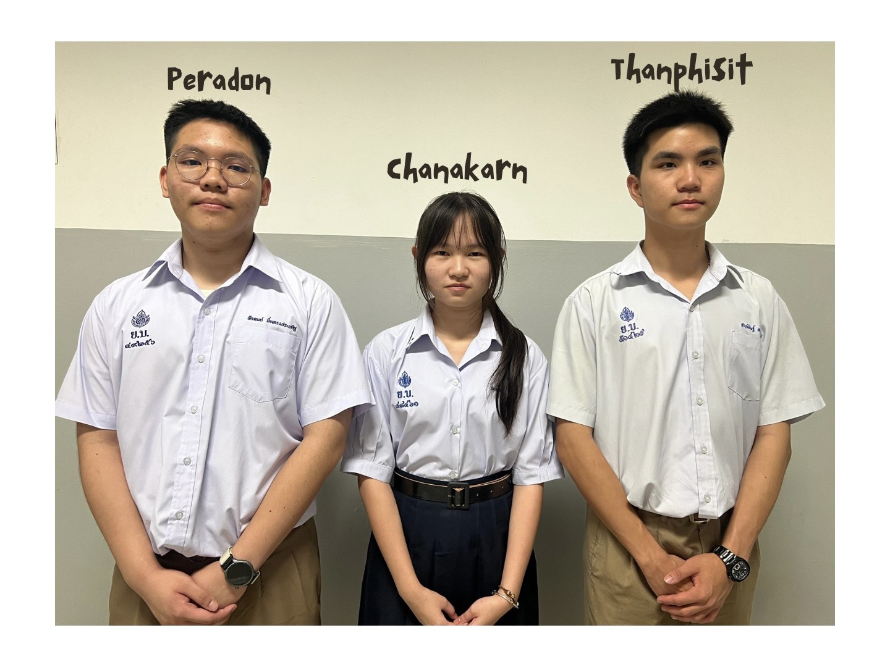

Team photographs: [`t-photos/`](t-photos/).

| Member | Primary responsibility | Supporting responsibilities |
|---|---|---|
| **Peradon Nimsongprasert (Tun)** | Robot construction and software development | Testing, debugging, and optimization |
| **Chanakarn Yimsakul (Indy)** | Engineering documentation and technical writing | Development records and software support |
| **Thanphisit Sakulvitulthai (Peach)** | Hardware development and electrical systems | Assembly, tests, and documentation |

**Mentor:** Mr. Punnapon Tanasnitikul

All team members contribute to the engineering process through collaborative design reviews, integration, testing, and documentation. The repository is intended to communicate how the robot is constructed and how technical decisions are evaluated, not simply to display a final result.

---

## Our Robot

Our robot combines a Raspberry Pi computer, range and vision sensors, a geared drive motor with encoder feedback, and servo-controlled steering. The computer processes observations and coordinates the car's motion through the onboard software and electrical interfaces. Full component specifications, circuit diagrams, pin assignments, mechanical dimensions, tuning parameters, and available validation results are recorded in the engineering journals.

### Standard Views

| Front | Left | Top |
|---|---|---|
| 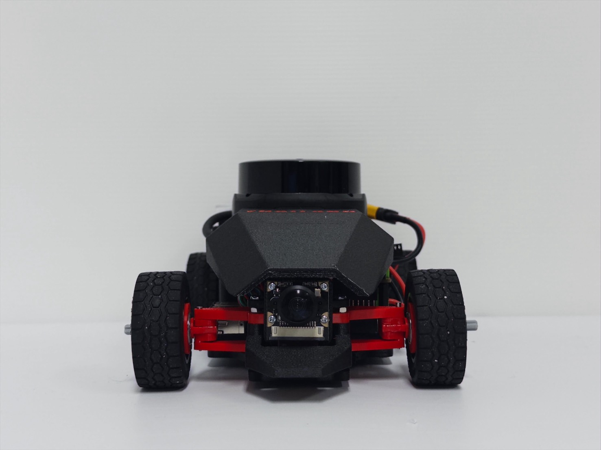 | 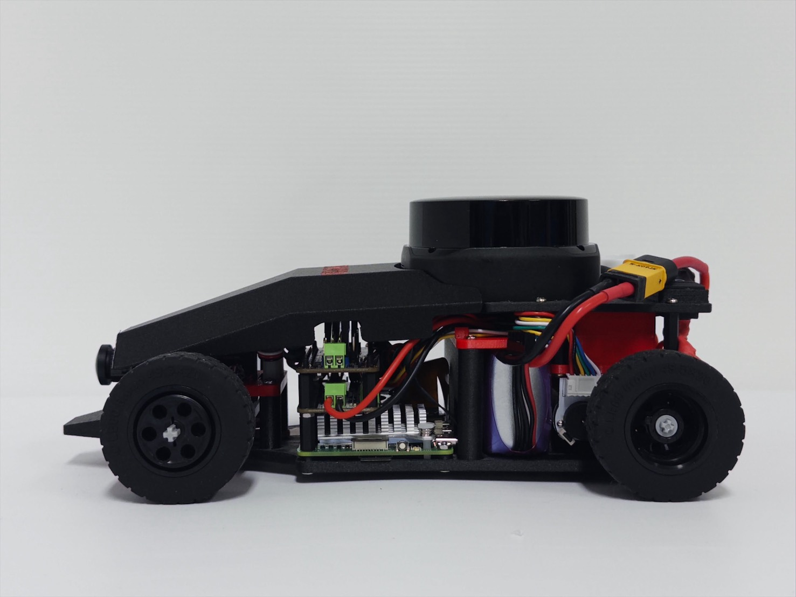 | 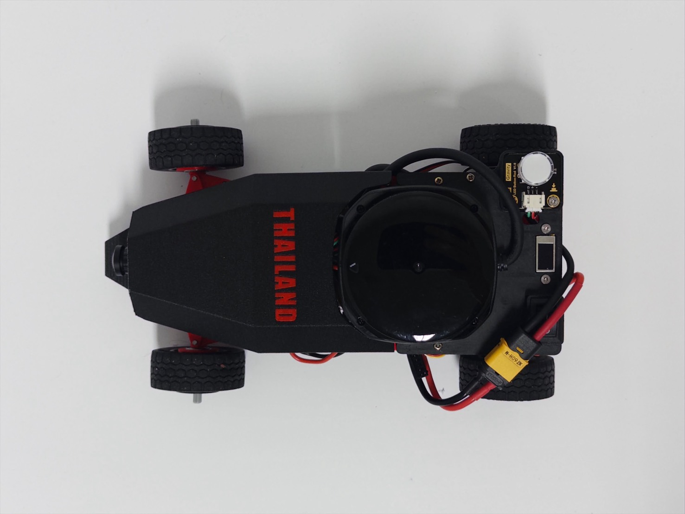 |

| Rear | Right | Bottom |
|---|---|---|
| 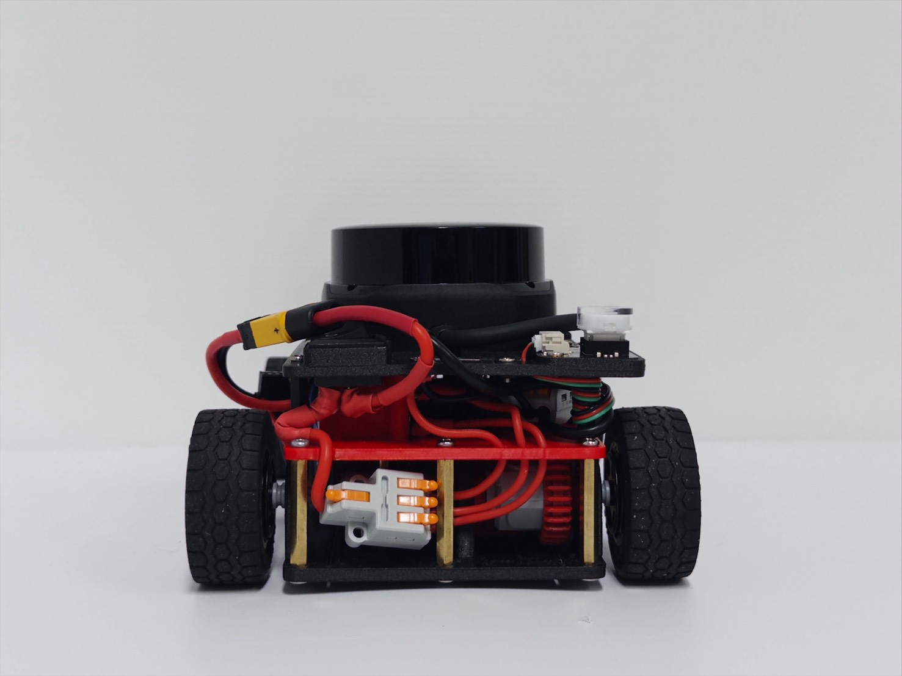 | 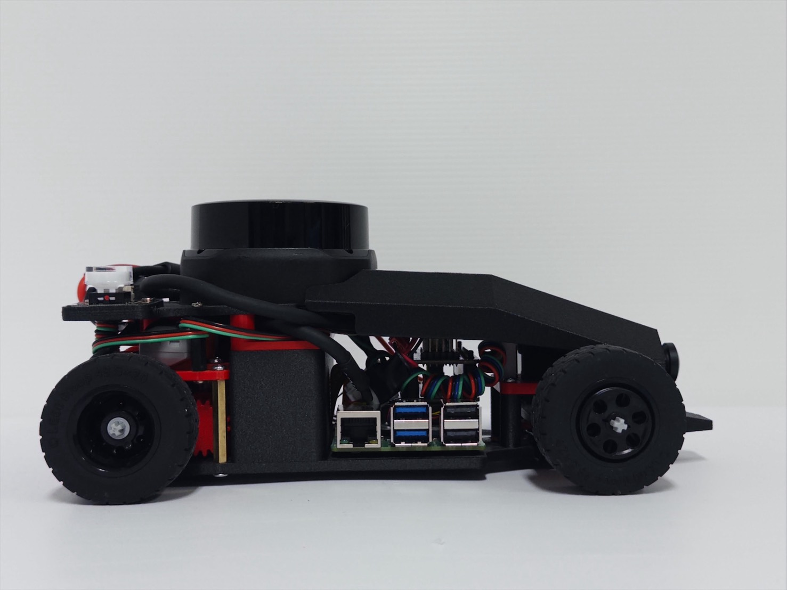 | 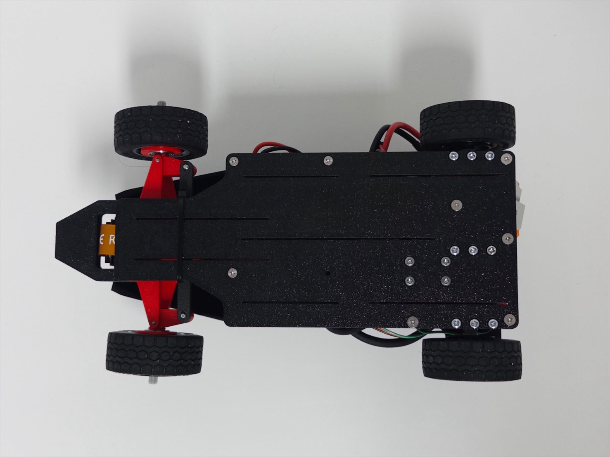 |

Robot photographs: [`v-photos/`](v-photos/).

### Versions

| Version | Short description | Status |
|:---|:---|:---|
| **[1.0](history/history_README.md)** | Robot used in the **WRO Thailand 2026 Future Engineers National Final**. | Completed |
| **2.0** | Redesigned robot for the **WRO 2026 Future Engineers International Final**. | Completed |

| Ver 1.0 | Ver 2.0 |
|---|---|
| 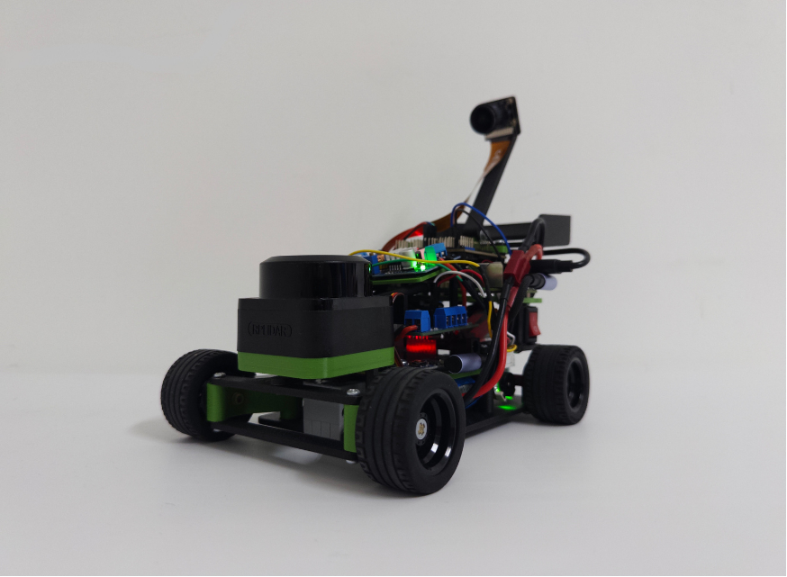 | 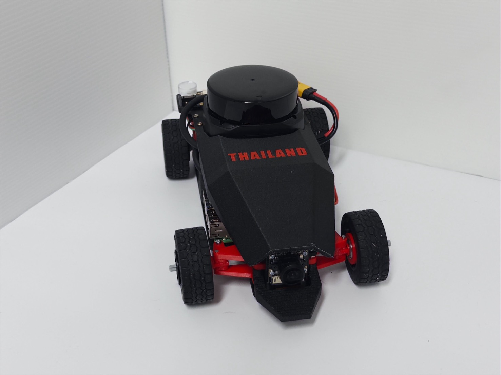 |

### Version 1 — National Final Robot Design

The first version of our robot was designed without LiDAR in mind. Since this was our first time designing this type of robot, we used our senior team's previous robot as a reference and explored which design elements could be adapted to suit our needs.

We initially chose an Arduino for motor and servo control because we were concerned that assigning these tasks to the Raspberry Pi might place too much computational load on it. This concern was based on an issue our senior team had encountered. However, after taking inspiration from other teams at the previous year's competition, we decided to adopt the Raspberry Pi for our system.

After completing the first prototype, we decided to integrate a LiDAR sensor. At the time, the RPLiDAR C1 was the only model available to us. Its compact size made it a suitable choice for our robot.

However, the initial layout introduced one major limitation: parts of the robot obstructed the LiDAR's rear field of view, preventing it from detecting the area behind the robot. Although the LiDAR remained usable, this restricted rear-side perception and affected the robot's parking performance.

### Version 2 — Current Robot Design

By the second version, we had gained more experience and a clearer understanding of our design requirements. We therefore carried out a major redesign, building the robot around a design philosophy that we believed would best suit our needs.

Our main principle was to design the robot around the LiDAR sensor and aim for an unobstructed 360-degree horizontal scan field. To achieve this, we arranged the other components below the intended scan plane, while leaving installed mounting geometry and physical scan coverage subject to verification.

---

## Performance Videos

| Challenge | Status / reference |
|---|---|
| Open Challenge | [LINK](https://youtu.be/SlxmnO9ZnVM?si=7TLQcImkOCNDJs5n) |
| Obstacle Challenge | [LINK](https://youtu.be/5n_M14UXSpM?si=iSTkrHQxrhAiyLdt) |

Video records: [final challenge video index](video/final.md) and [run-test index](video/runtest.md). 

---

## MATLAB Modeling — MathWorks Modeling Award (Future Engineers)

### Engineering problem and modeling strategy

Our robot uses a **4S 15.2 V nominal LiHV battery**, a DFR1202 5 V regulator for computing and sensing loads, and a DFR1208 12 V regulator for the motor supply. We used **MATLAB as an offline engineering-analysis tool** to investigate the electrical load budget, converter input-voltage limits, illustrative battery behavior, and potential Raspberry Pi supply-path voltage drop.

MATLAB was appropriate for these tasks because numerical assumptions can be made explicit, equations can be evaluated consistently across scenarios, and plots can be regenerated by editing documented parameters. The models help us identify risks and plan measurements; they do **not** replace testing on the assembled robot. Competition navigation and actuator control are implemented in [Python on the Raspberry Pi](src/Raspberrypi/), **not in MATLAB or Simulink**. No Simulink model is included in the current published work.

### Published MATLAB models, code, and figures

The repository contains **eight standalone MATLAB `.m` scripts** and their eight corresponding published PNG images. Figures **01, 02, 07, and 08** are discussed in detail in [the electrical engineering journal, Section 8](engineering_journal/2-elec.md#8-matlab-evidence-selected-for-the-electrical-chapter). Figures **03–06** provide supporting battery-current and battery-state scenarios.

| Figure | Engineering question | Source code | Published figure | Evidence type |
|:---:|---|---|---|---|
| **01** | How much electrical power might the selected components require? | [Load-budget script](engineering_journal/matlab/figures/figure01_electrical_load_budget.m) | [Load-budget plot](engineering_journal/matlab/visualization/01_assumed_load_budget.png) | Supplier operating points + assumed loads |
| **02** | Are the selected buck converters compatible with the battery voltage range? | [Input-range script](engineering_journal/matlab/figures/figure02_converter_input_range.m) | [Input-range plot](engineering_journal/matlab/visualization/02_input_range_screen.png) | Published specifications + illustrative sweep |
| **03** | How does assumed battery-side current vary with supply voltage and demand? | [Battery-current script](engineering_journal/matlab/figures/figure03_battery_side_current.m) | [Battery-current plot](engineering_journal/matlab/visualization/03_estimated_input_current.png) | Calculated scenario |
| **04** | How could battery open-circuit voltage vary with state of charge? | [OCV–SOC script](engineering_journal/matlab/figures/figure04_battery_ocv_soc.m) | [OCV–SOC plot](engineering_journal/matlab/visualization/04_assumed_voltage_vs_soc.png) | Illustrative, unmeasured battery model |
| **05** | How might modeled battery terminal voltage change over time under different loads? | [Voltage–time script](engineering_journal/matlab/figures/figure05_battery_voltage_time.m) | [Voltage–time plot](engineering_journal/matlab/visualization/05_voltage_vs_time_scenarios.png) | Simulated battery scenarios |
| **06** | How could modeled state of charge and battery current change together? | [SOC/current script](engineering_journal/matlab/figures/figure06_soc_and_current.m) | [SOC/current plot](engineering_journal/matlab/visualization/06_soc_and_current.png) | Simulated battery scenarios |
| **07** | How quickly might the 12 V regulator lose its specified input-voltage margin? | [12 V headroom script](engineering_journal/matlab/figures/figure07_12v_input_headroom.m) | [12 V headroom plot](engineering_journal/matlab/visualization/07_12v_input_headroom.png) | Simulated sensitivity study |
| **08** | How might assumed wiring resistance and load steps affect the Pi-side 5 V supply? | [5 V wiring script](engineering_journal/matlab/figures/figure08_5v_wiring_sensitivity.m) | [5 V sensitivity plot](engineering_journal/matlab/visualization/08_transient_timeline.png) | Resistive load-step sensitivity model |

Two representative results are illustrated below. Their full assumptions, calculations, and interpretations belong in [the electrical journal](engineering_journal/2-elec.md) and the linked source scripts.

| Figure 02 — Converter input-voltage screening | Figure 07 — Simulated 12 V input headroom |
|:---:|:---:|
| 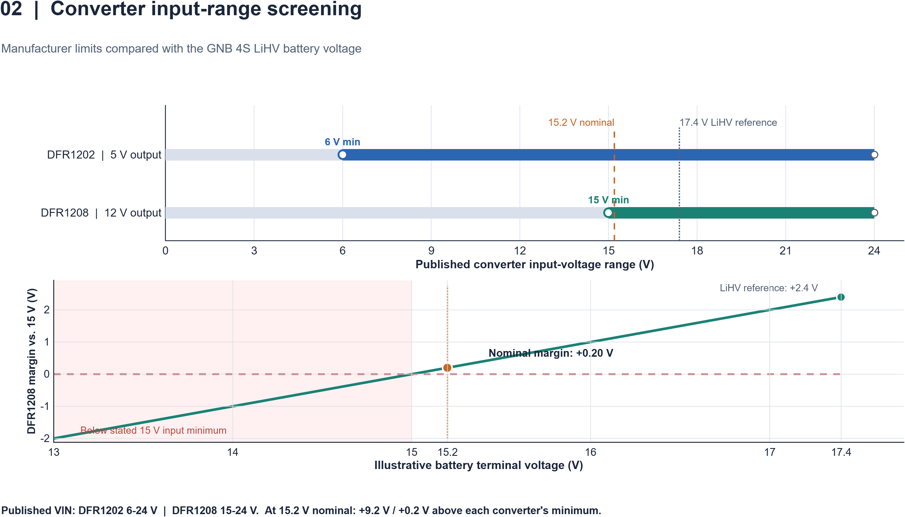 | 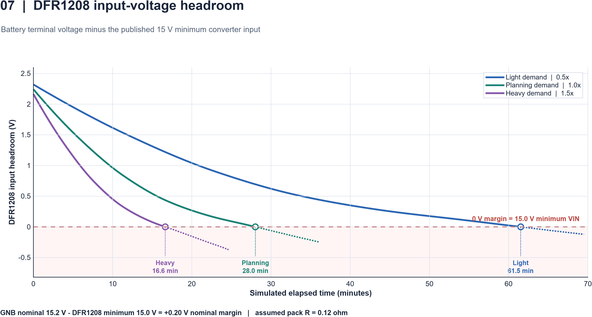 |

### Key findings, testing, and verification status

**Key modeling finding — limited 12 V input headroom.** The DFR1208 converter's **published minimum input is 15.0 V**, only **0.20 V below the battery's 15.2 V nominal label voltage**. Its operating input may therefore fall outside the published range as battery terminal voltage decreases under load or discharge. The battery curves and crossing times in Figures 04–07 depend on illustrative OCV, resistance, efficiency, and load assumptions; they are **not measured discharge performance or verified competition runtime**.

**Other modeled risks.** Figures 01–03 examine the consequences of assumed component loads and conversion efficiency. Figure 08 demonstrates how higher effective resistance in a modeled USB-C supply path can reduce Pi-side voltage during hypothetical changes in current draw. These plots are analytical screening tools, not oscilloscope captures or measured motor/servo transients.

**Available physical evidence.** The [electrical journal, Section 6.4](engineering_journal/2-elec.md#64-multimeter-observations-at-the-converter-outputs) records team-reported **5.1 V** at the DFR1202 output and **12.1 V** at the DFR1208 output, measured with a multimeter. Those two point readings are **not** a measurement of battery discharge, actual dynamic load regulation, or voltage at the Raspberry Pi's USB-C connector or the motor-driver supply terminals. The journal separately discusses the 12.1 V reading relative to the motor driver's stated supply range.

**Deployment and validation boundary.** MATLAB models informed electrical risk assessment and proposed verification; the `.m` programs are **not deployed on the robot**. The present published evidence does not establish that the battery models were calibrated against measured discharge data, that all output rails remain within specifications under actuation, or that a particular hardware modification was completed because of these analyses. Additional loaded-voltage checks, transient observations, and run-condition measurements are needed to close those gaps. See the [electrical verification reference](engineering_journal/2-elec.md#182-verification-and-calibration-reference).

### Reproducing the analyses

1. Open any `.m` file in [`other/matlab/`](other/matlab/). The scripts specify **base MATLAB R2020a or newer** as their intended execution environment.
2. Review the parameters and source-status comments near the beginning of the script. Separate manufacturer specifications from scenario assumptions before changing a value.
3. Run the **complete script**. Each script is written as a standalone analysis and exports a PNG to its local `results/` directory; the versions of the figures selected for publication are stored in [`engineering_journal/matlab/visualization/`](engineering_journal/matlab/visualization/).
4. Compare the output with the figure and the interpretation in the electrical journal. Re-running a script verifies model execution and numerical behavior under its assumptions; it does not establish physical accuracy.

**Output-file caution:** The current scripts also use the common name `results/simulation_inputs.mat`. Running another script can overwrite that file. Preserve model-specific inputs separately if archiving results from multiple runs. The scripts themselves retain their declared parameters and equations.

### Lessons learned and potential product feedback

The modeling work highlighted how **a component's nominal operating point can hide an input-range vulnerability**, and why calculated battery-current, power-path, and voltage results must be clearly distinguished from measurements. It also showed the value of keeping source code, assumptions, images, and interpretations available together for review.

A potential MATLAB enhancement relevant to this workflow would be an **export option that bundles each figure with its input parameters, units, assumption/evidence labels, and source-script reference**. That would make it easier to publish traceable modeling results on GitHub without manually repeating provenance information in code comments and report captions.

The analysis, limitations, and remaining verification work are discussed further in [Power and Sensor Architecture](engineering_journal/2-elec.md). Additional validated findings will be documented as testing progresses.

---

## Project Files

The technical records explain **why** decisions were made; the source and supporting materials show **what** was designed, implemented, or modeled. The evidence labels indicate what has been tested and what remains to be verified.

| Resource | Location |
|:---|:---|
| Engineering records | [`engineering_journal/`](engineering_journal/) |
| Competition records | [`history/history_README.md`](history/history_README.md) |
| Robot CAD/STL models and previews | [`models/`](models/) |
| MATLAB source scripts | [`other/matlab/`](other/matlab/) |
| Published MATLAB figures | [`engineering_journal/matlab/visualization/`](engineering_journal/matlab/visualization/) |
| Supporting resources | [`other/`](other/) |
| Circuit and wiring diagrams | [`schemes/`](schemes/) |
| Raspberry Pi source and configuration | [`src/Raspberrypi/`](src/Raspberrypi/) |
| Team photographs | [`t-photos/`](t-photos/) |
| Robot photographs | [`v-photos/`](v-photos/) |
| Demonstration and test-video index | [`video/`](video/) |
| License | [`LICENSE.md`](LICENSE.md) |
| Repository introduction and navigation | [`README.md`](README.md) |

---

## Use of Artificial Intelligence

Our team has used generative AI tools in **documentation and offline engineering-analysis work**. This assistance includes editing grammar and clarity, organizing technical explanations, and helping create or refine some of the **MATLAB scripts, plots, and descriptions** published for the MathWorks Modeling Award. The MATLAB models contain explicit assumptions and source references; their outputs must be interpreted according to the evidence limitations stated above.

The **onboard competition robot runs Raspberry Pi/Python software** for sensing, navigation, planning, and control. The published MATLAB scripts are **offline calculations and simulations**, not onboard control programs. AI-generated text, analysis, or code does not independently validate hardware performance or constitute a successful competition run.

The introductory segment of our project-explanation video also uses **AI-cloned voice narration prepared by a team member**; this is a presentation element, not part of autonomous robot operation. The project video remains in production.

The team retains responsibility for the design decisions, published code, technical claims, testing, and verification. AI-assisted material should be reviewed against source code, component specifications, and physical observations before being relied upon as engineering evidence.

---

## Official References

- [WRO International Association — 2026 season rules and resources](https://wro-association.org/competition/2026-season/) — Future Engineers rules, competition resources, and documentation requirements.
- [WRO official Questions & Answers](https://wro-association.org/competition/questions-answers/) — official clarifications that may affect the international competition.
- [MathWorks — World Robot Olympiad student competition resources](https://www.mathworks.com/academia/student-competitions/world-robot-olympiad.html) — MATLAB/Simulink resources for WRO teams.
- [WRO International Association — main website](https://wro-association.org/) — organization and event information.
