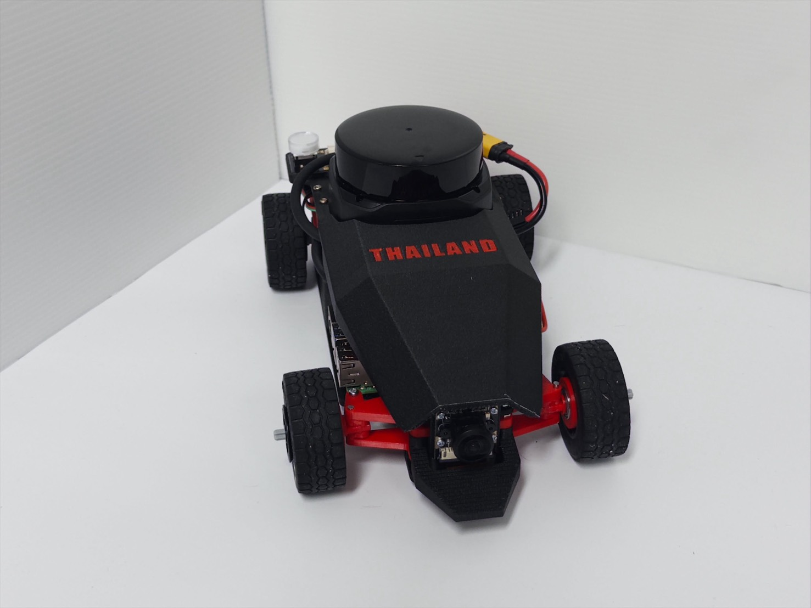
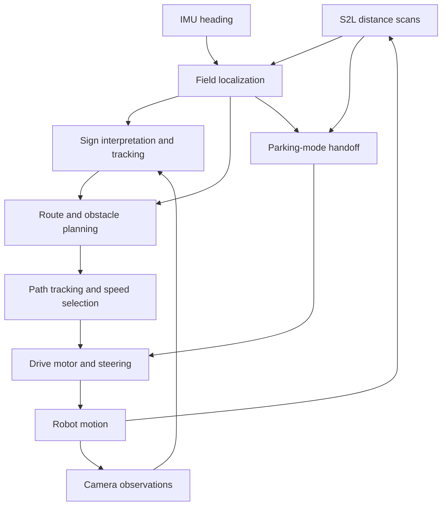
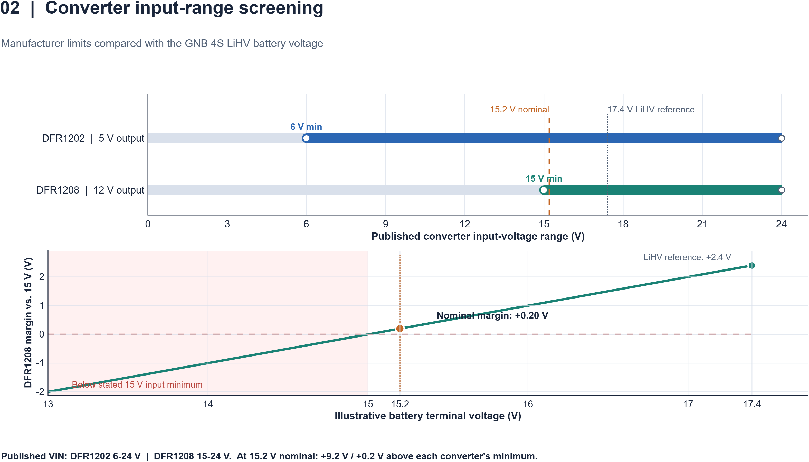

# Project Overview — YBR-SUNFLOWER

**WRO 2026 Future Engineers · Yothinburana School · Thailand**

<p align="center">
  
</p>

*The second-generation YBR-SUNFLOWER robot. The mechanical journal identifies the development sequence as V2.1–V2.4; “Version 2.0” denotes this robot family.*

---

[← Project README](../README.md)

[← Mobility and Mechanical Design](1-mech.md)

[← Power and Sensor Architecture](2-elec.md)

[← Software Architecture and Obstacle Strategy](3-software.md)

[← Build and Reproduction Guide](4-build.md)

---

## Contents

1. [Project purpose](#1-project-purpose)
2. [Robot and engineering records](#2-robot-and-engineering-records)
3. [System architecture](#3-system-architecture)
4. [Autonomous challenge strategies](#4-autonomous-challenge-strategies)
5. [Engineering decisions and iterations](#5-engineering-decisions-and-iterations)
6. [Cross-system constraints](#6-cross-system-constraints)
7. [Modeling and physical evidence](#7-modeling-and-physical-evidence)
8. [Reproduction and verification](#8-reproduction-and-verification)
9. [Documentation evidence map](#9-documentation-evidence-map)
10. [References](#10-references)

---

## 1. Project purpose

YBR-SUNFLOWER is an autonomous car that combines a custom printed chassis, mechanically connected rear-wheel propulsion, front-wheel steering, LiDAR localization and camera-based traffic-sign interpretation. A Raspberry Pi 5 runs the perception, navigation and control software. The repository documents the robot's construction, software organization, design reasoning and test methods.

The first-generation robot placed first at the WRO Thailand 2026 Future Engineers National Final on 3–4 September. The [competition record](../history/history_README.md) distinguishes that result from the international-final redesign. The second-generation design reorganizes the robot around the LiDAR scan plane, consolidates control on the Pi with interface HATs, and uses revised steering, gearing and electrical packaging.

The engineering objective is repeatable autonomous navigation: estimate the robot's location, construct a feasible path, obey traffic-sign instructions, and execute the parking sequence. Speed matters together with clearance, perception quality and the ability to reproduce the configuration.

---

## 2. Robot and engineering records

### 2.1 Robot specification

| Item | Documented configuration |
|---|---|
| Body dimensions | 248 × 140 × 120 mm, team-reported length × width × height |
| Wheelbase | 165 mm |
| Front / rear track | 115 / 120 mm |
| Ground clearance | 5 mm |
| Mass with / without battery | 963 / 828 g |
| Tires | 49.5 × 20 mm |
| Propulsion | CHP-20GP-180 encoder-equipped motor, internal 19:1 gearbox |
| External transmission | 18T driver to 28T differential gear |
| Steering | SURPASS Hobby S0017M servo and printed front linkage |
| Computing | Raspberry Pi 5, 8 GB |
| Interfaces | DFR0592 motor HAT and DFR0604 I/O expansion HAT |
| Perception | RPLIDAR S2L, OV5647 fisheye camera and SEN0253/BNO055 IMU |
| Battery | GNB 4S LiHV, 15.2 V nominal, 1,300 mAh |
| Regulation | DFR1202 nominal 5 V branch; DFR1208 nominal 12 V branch |
| Human interface | Main power switch, start button and battery-voltage display |

Dimensions and masses come from the [mechanical measurement table](1-mech.md#32-reported-robot-measurements). Electrical ratings and their conditions belong to [Power and Sensor Architecture](2-elec.md). A component rating, a configured model parameter and a physical measurement describe different quantities.

### 2.2 Reading map

| Record | Main engineering questions |
|---|---|
| [0 — Overview](0-overview.md) | How do the subsystems work together, and where is the supporting evidence? |
| [1 — Mechanical](1-mech.md) | Why these gears, bearings, tires, steering geometry and chassis layers? |
| [2 — Electrical](2-elec.md) | How are power, sensing and interfaces connected, and what limits matter? |
| [3 — Software](3-software.md) | How do observations become localization, paths, steering and parking actions? |
| [4 — Build](4-build.md) | Which parts, files, setup steps and checks reproduce the system? |
| [5 — Surprise Rule companion](5-surprise_rule.md) | How does altered sign height change classification and passing-side selection? |
| [MATLAB guide](matlab/README.md) | Which electrical models are published, how are they reproduced, and what do they establish? |

The two companion guides provide detail within the five-journal structure.

---

## 3. System architecture

### 3.1 Information and control



*Figure O-01. Functional information flow. Parking uses a distinct control mode; the diagram does not imply that the path tracker and parking controller command the actuators simultaneously.*

The localizer compares LiDAR observations with a model of the track and incorporates heading and motion information. Camera detections are transformed into the field coordinate system using the estimated pose and the sensor offsets. The planner selects obstacle-passing goals; Pure Pursuit turns the resulting path into steering requests.

Software responsibilities are split among [navigation](../src/Raspberrypi/classes/navigation_manager.py), [image interpretation](../src/Raspberrypi/classes/object_solver.py), [block tracking](../src/Raspberrypi/classes/block_map.py), [GoalPlanner](../src/Raspberrypi/classes/goal_planner.py), [Pure Pursuit](../src/Raspberrypi/classes/pure_pursuit.py), [task execution](../src/Raspberrypi/tasks/path_task.py) and [actuation](../src/Raspberrypi/classes/motor_manager.py). Configuration is separate from the algorithms.

### 3.2 Power and interfaces

The battery feeds two regulated branches. The nominal 5 V branch supplies computing and sensing; the nominal 12 V branch supplies the propulsion HAT. Ground provides the common electrical reference. Motor power, servo supply and logic signals must be distinguished even when they share a board stack.

| Connection | Function |
|---|---|
| Pi I²C bus 1 → DFR0592 / DFR0604 | Motor and peripheral commands; configured addresses 0x11 / 0x10 |
| S2L UART → Pi | Range observations at the configured 1,000,000 baud |
| OV5647 CSI → Pi | Camera frames |
| SEN0253/BNO055 I²C → Pi | Orientation information |
| DFR0604 PWM3 → steering servo | Steering command |
| Digital 16 → start interface | Start-button state |
| Motor HAT → propulsion and encoder | Drive output and encoder-derived speed feedback |

The [schematic](../schemes/schematic_diagram.pdf), [power diagram](../schemes/modular_power_architecture.png) and [electrical journal](2-elec.md) provide the connection-level records. The selected motor/encoder channel is an implementation detail defined in `motor_manager.py`; the interface table above describes responsibilities rather than substituting for a terminal-by-terminal wiring check.

---

## 4. Autonomous challenge strategies

### 4.1 Open Challenge

The `qualification` task uses a rounded closed racing line and LiDAR-based localization. Pure Pursuit selects a point ahead on the path and computes steering from its position relative to the robot. Speed settings distinguish straight and curved travel, while pose confidence and front clearance influence motion.

Lap progress is derived from projection onto the closed route, including wrap-around. The configuration requests three laps. Distance-based stopping is a software mechanism; the physical finish position is evaluated from the robot on the field.

Implementation: [qualification configuration](../src/Raspberrypi/tasks/qualification/config.toml), [racing-line generator](../src/Raspberrypi/classes/racing_line.py), [shared path task](../src/Raspberrypi/tasks/path_task.py).

### 4.2 Obstacle Challenge

The final task adds camera observations, tracked traffic signs and obstacle-aware goals. GoalPlanner uses curvature-constrained connections and checks the modeled body envelope against obstacles and walls. A route that is geometrically compromised is treated differently from an unobstructed route.

The task also maintains sign memory across passes, rather than requiring every previously observed sign to remain visible. The camera identifies colour; the planner receives a passing-side interpretation together with location and clearance information.

The configured final sequence includes starting-bay departure, lap driving and the standalone LiDAR parking handoff. `parking.enabled = false` disables the legacy BayPark branch; `lidar_park.enabled = true` selects the separate parking module. These are different controls.

Implementation: [final task](../src/Raspberrypi/tasks/final/task.py), [final configuration](../src/Raspberrypi/tasks/final/config.toml), [unparking controller](../src/Raspberrypi/classes/parking.py), [LiDAR parking](../src/Raspberrypi/lidar_park/run.py).

### 4.3 Surprise-mode extension

Surprise mode adds sign-size interpretation before the existing passing-side planner. It is selected with `--surprise`; standard obstacle mode uses the ordinary interpretation. The [5 — Surprise Rule companion](5-surprise_rule.md) explains the official conditions, sensor geometry, current thresholds, decision logic and verification procedure.

This division keeps three questions separate: what colour is visible, what size the observations support, and which passing side the planner should follow. Changing the semantic interpretation of one sign does not require replacing the localization or path-tracking architecture.

### 4.4 International parking clarifications

The [official Q&A](https://wro-association.org/competition/questions-answers/) clarifies that parking-length measurement considers functionally relevant parts within 100 mm of the mat that can interact with the parking walls. The overall 248 mm body length should therefore not automatically be substituted for the judge's parking measurement. The robot must retain its size throughout the attempt. The parking-section outer-row sign positions are excluded at the International Final, and final parking may face opposite the driving direction.

These constraints explain why body geometry, the bay model and the field setup must be considered together.

---

## 5. Engineering decisions and iterations

| Problem / constraint | Alternatives and selected approach | Supporting evidence and consequence |
|---|---|---|
| Early gearing balanced speed against controllability | First-generation external gearing progressed through 28:28, 21:28 and 16:28; the current robot uses 18:28 | The mechanical journal reports improved low-speed control as first-generation reduction increased. The present ratio works with the revised tire/layout combination; no numerical improvement percentage is implied. |
| Rear structure obstructed the earlier C1 scan | Add a scanner to the old layout, or redesign the platform around sensing | The second generation places components below the intended scan plane and uses S2L. This addresses a documented packaging limitation affecting parking perception. |
| Controller layers increased wiring and packaging demands | Separate Pi/Arduino arrangement, or Pi with HAT interfaces | The current design removes the Arduino layer and communication harness while retaining dedicated driver/interface electronics. |
| A car cannot turn instantaneously | Pure point-to-point avoidance, or paths constrained by steering geometry | GoalPlanner uses feasible turning primitives and body-clearance checks; Pure Pursuit tracks the selected route. |
| Sign height and apparent range are coupled | Interpret every blob as a normal sign, or compare multiple size hypotheses | SignSizer combines corrected image shape with LiDAR context before changing the planner's interpretation. |
| A single erroneous size decision can persist across laps | Permanent latch, or evidence-based reversal | BlockMap can restore a normal classification when subsequent normal-height votes dominate. |
| Parking has different local geometry from lap driving | Continue global route tracking, or hand off to a local parking controller | The active parking module uses wall/blade geometry and its own movement sequence. |
| Nominal electrical ratings can conceal operating constraints | Compare labels only, or evaluate load and input-range assumptions | Eight MATLAB models expose voltage-headroom and supply-path sensitivities. These are analytical findings, not measured endurance. |

The drivetrain's external reduction is 28/18, approximately 1.56:1. Ideally, the differential input speed is 18/28 of the geared-motor output speed, while torque rises by 28/18 before transmission losses. The motor's internal 19:1 reduction is already included in its gearbox-output specification and must not be applied twice. See [drivetrain analysis](1-mech.md#5-drivetrain-and-external-gearing).

---

## 6. Cross-system constraints

| Interaction | Consequence for the robot |
|---|---|
| Wheelbase, steering and front overhang | The swept body can hit a wall even when the rear-axle path clears it. Planning uses an envelope rather than a point robot. |
| Sensor mounting and localization | Camera/LiDAR offset and heading errors move estimated obstacles and change which scan returns correspond to a sign. |
| Robot speed and sign classification | Motion consumes the available decision distance while frames and votes accumulate. A nominal slowdown setting only helps if it actually reduces the current request. |
| Power delivery and computation | Voltage at a buck output differs from voltage at the Pi after wiring and connector losses. |
| Rolling LiDAR scan and moving camera | Measurements have different timestamps and origins; SignSizer compensates scan age using the available motion estimate. |
| Global pose and local parking geometry | Lap navigation and parking use different observations and completion conditions, requiring explicit actuator ownership. |
| Physical dimensions and configuration | The final planner's 180 × 270 mm envelope differs from the documented 140 × 248 mm body. Its extents are model parameters; they must not be relabelled as body measurements. |

The [software chapter](3-software.md) describes confidence gates, speed selection, steering saturation and control flow. The [electrical chapter](2-elec.md) explains supply limits, current assumptions and failure-point analysis. These mechanisms and limits must be interpreted together when evaluating a physical run.

---

## 7. Modeling and physical evidence

### 7.1 MATLAB electrical analysis

The [MATLAB collection](matlab/README.md) contains eight standalone source scripts and eight published figures. It covers load allocation, converter input ranges, battery-side current, illustrative OCV/SOC behavior, voltage/time scenarios, SOC/current evolution, 12 V converter headroom and 5 V wiring sensitivity. MATLAB is an offline engineering tool; onboard navigation is Python.



*Figure O-02. Specification-based input-range comparison. The 15.2 V nominal battery label is 0.20 V above the DFR1208's published 15 V minimum input. This comparison does not measure loaded battery voltage or converter regulation.*

The electrical journal reports multimeter readings of 5.1 V and 12.1 V at the converter outputs. Those observations are distinct from the models' nominal rails and assumed currents. They do not establish discharge runtime, transient response or Pi-input voltage.

### 7.2 Physical recordings

| Recording | Purpose |
|---|---|
| [Open performance](https://youtu.be/SlxmnO9ZnVM) | Current-robot Open Challenge recording |
| [Obstacle performance](https://youtu.be/5n_M14UXSpM) | Current-robot obstacle/parking recording |
| [Surprise-mode field test](https://youtu.be/SZ7-qe57g4k) | Altered-sign scenario identified by the team |
| [Open speed test](https://youtu.be/CYVkDdoaMsE) | Speed-focused test of the latest robot |
| [Earlier clockwise test](https://youtu.be/MPv1s5uWH2Q) / [counterclockwise test](https://youtu.be/YH1zq7tGzv8) | Earlier robot without cover or parking implementation |

The recording labels preserve the team's stated test context. A field recording documents that attempt; it is not a repeated-trial reliability statistic or an official score certificate. The [video index](../video/final.md) groups the principal links.

### 7.3 Evidence conventions

| Evidence | Interpretation |
|---|---|
| Dimensions and masses | Team-reported physical quantities |
| Component specifications | Published operating limits or supplier values under their stated conditions |
| Configuration values | Inputs to the actual software model and controller |
| MATLAB and Python simulations | Calculated behavior under explicit assumptions |
| Bench diagnostics | Sensor/actuator observations for a defined setup |
| Field videos | Physical behavior in the recorded configuration and layout |

The distinction allows the journals to connect theory with implementation without treating a simulation as a physical measurement.

---

## 8. Reproduction and verification

The [build guide](4-build.md) contains the BOM, printed-part references, assembly sequence, wiring checks and Pi setup. [CAD files](../models/CAD/), [drawings](../schemes/) and [Python source](../src/Raspberrypi/) supply the implementation assets.

From `src/Raspberrypi/`, the documented task entry points are:

```bash
uv run python main.py qualification
uv run python main.py final
uv run python main.py final --surprise
```

Select the task and optional mode before the official start procedure. During the attempt, decisions are made onboard. Installation and configuration are preparation operations rather than external driving commands.

| Verification level | Tool / observation | Main question |
|---|---|---|
| Configuration inspection | `main.py qualification --dry-run` and final configuration | Which geometry and settings are selected? |
| Simulated localization | `test_navigation.py` | Does the estimator behave as expected with modeled observations? |
| Physical localization | `test_navigation.py --hardware` | Do installed sensors produce consistent scan/pose information? |
| Planning geometry | `test_goal_planner.py` | Are modeled paths feasible under the test's parameter profile? |
| Sign-size diagnostics | `test_sign_sizer.py` | Do shape, range hypotheses and votes agree with known sign placements? |
| Physical driving | Performance videos and controlled field trials | Does the assembled car execute the intended behavior? |
| Electrical behavior | Defined load-point measurements | Do installed supply paths satisfy their requirements? |

Parameter sweeps and tests must identify which configuration they exercise. A simulation profile is not automatically identical to the active final TOML. Reproduction connects source, dependencies, configuration, CAD and wiring to the same physical robot; a passing syntax check alone does not establish that connection.

---

## 9. Documentation evidence map

The [official documentation rubric](https://wro-association.org/wp-content/uploads/WRO-2026-Future-Engineers-Documentation-Rubric.pdf) defines five scoring areas. This map locates the team's material.

| Area | Repository evidence |
|---|---|
| Mobility and mechanical design | [Mechanical journal](1-mech.md): gearing, steering equations, bearing support, packaging and revision sequence; [CAD](../models/CAD/) |
| Power and sensor architecture | [Electrical journal](2-elec.md): circuits, load reasoning, mounting, interfaces and calibration methods; [MATLAB guide](matlab/README.md) |
| Software and obstacle strategy | [Software journal](3-software.md): modules, control flow, algorithms, edge cases and test tools; [Surprise companion](5-surprise_rule.md) |
| Systems thinking and decisions | Sections 5–7 here connect design changes, subsystem dependencies, risks, and evidence types. Related information is also integrated into the relevant chapters, organized according to the engineering area it concerns. |
| Reproducibility and repository quality | [Build guide](4-build.md), source/configuration links, [video index](../video/final.md), [history](../history/history_README.md) and [license](../LICENSE.md) |

---

## 10. References

- [WRO 2026 season resources](https://wro-association.org/competition/2026-season/)
- [2026 Future Engineers general rules](https://wro-association.org/wp-content/uploads/WRO-2026-Future-Engineers-Self-Driving-Cars-General-Rules.pdf)
- [Official Surprise Rule](https://wro-association.org/wp-content/uploads/WRO-2026-Future-Engineers-Extra-Task.pdf)
- [Official Q&A](https://wro-association.org/competition/questions-answers/)
- [Documentation rubric](https://wro-association.org/wp-content/uploads/WRO-2026-Future-Engineers-Documentation-Rubric.pdf)

---