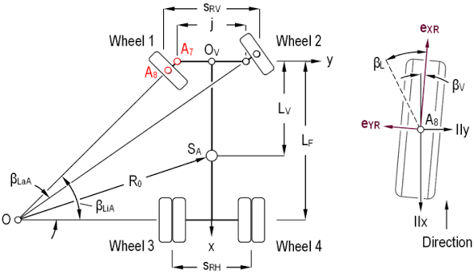

# Mobility and Mechanical Design

> **YBR-SUNFLOWER · WRO 2026 · Future Engineers · Engineering Journal 01**  
> **Current robot:** V2.4, developed through the V2.1–V2.4 overhaul. V1.1–V1.3 describe the first generation.

[← Project README](../README.md) 

[← Engineering Overview](0-overview.md)

[← Power and Sensor Architecture](2-elec.md)

[← Software Architecture and Obstacle Strategy](3-software.md)

[← Build and Reproduction Guide](4-build.md)

---


## Contents

1. [Mechanical design objectives and evidence policy](#1-mechanical-design-objectives-and-evidence-policy)
2. [Mechanical architecture and development](#2-mechanical-architecture-and-development)
3. [Mechanical components and vehicle geometry](#3-mechanical-components-and-vehicle-geometry)
4. [Chassis and structural layout](#4-chassis-and-structural-layout)
5. [Drivetrain and external gearing](#5-drivetrain-and-external-gearing)
6. [Differential, axles and bearings](#6-differential-axles-and-bearings)
7. [Steering mechanism and turning geometry](#7-steering-mechanism-and-turning-geometry)
8. [Sensor mounting and mechanical integration](#8-sensor-mounting-and-mechanical-integration)
9. [CAD models and part previews](#9-cad-models-and-part-previews)
10. [Materials and fabrication](#10-materials-and-fabrication)
11. [Assembly and mechanical interfaces](#11-assembly-and-mechanical-interfaces)
12. [Why we chose these components](#12-why-we-chose-these-components)
13. [Engineering decisions and trade-offs](#13-engineering-decisions-and-trade-offs)
14. [Mechanical verification and calibration](#14-mechanical-verification-and-calibration)
15. [Reproducibility and evidence map](#15-reproducibility-and-evidence-map)
16. [Technical references](#16-technical-references)

## 1. Mechanical design objectives and evidence policy

Our robot uses rear-wheel drive and servo-controlled front steering. The design prioritizes controllable motion, a compact chassis, accessible components and a clear LiDAR scan plane.

Dimensions and build details are team-reported. Equations describe ideal behavior under stated assumptions. Supplier ratings are identified separately from vehicle measurements, and unfinished tests are marked as pending.

## 2. Mechanical architecture and development

### 2.1 Version history

V0 is the senior team's previous-season reference robot. Our first generation progressed through V1.1–V1.3, previously called V1, V2 and V3. The overhaul uses V2.1–V2.4. “Version 2.0” elsewhere refers to this second-generation family.

| Revision | Gearing, driver : driven | Main development |
|---|---|---|
| V1.1 | 28:28 | Initial printed chassis, drivetrain and steering prototype |
| V1.2 | 21:28 | Ackermann-style steering and rear bearing support |
| V1.3 | 16:28 | Competition platform with reinforced supports and revised electronics mounting |
| V2.1 | Not recorded | Initial overhaul prototype |
| V2.2 | — | Upgraded steering and added sensor mounting points |
| V2.3 | — | Repositioned sensors and wiring |
| V2.4 | 18:28 | Added supporting parts and refined minor details |

The exact V2 revision that first introduced 18:28 gearing is not recorded.

The team reported better low-speed control as first-generation reduction increased. The original chassis later received a C1 LiDAR, but rear structures blocked part of its view and limited parking perception. This prompted a redesign around the scanner.

### 2.2 Main overhaul changes

| Subsystem | First generation | Current robot |
|---|---|---|
| External gearing | 16T driver and 28T differential | 18T driver and 28T differential |
| LiDAR | RPLIDAR C1 | RPLIDAR S2L |
| Control | Raspberry Pi and Arduino UNO R4 | Pi 5 with DFR0592 and DFR0604 HATs |
| Steering servo | GEEKSERVO | SURPASS Hobby S0017M |
| Power converters | LM2596 and XL4015 arrangement | DFR1202 5 V and DFR1208 12 V modules |
| Structure | Separate Arduino and Pi layers | Main base, electrical plate and top plate |

The new layout places surrounding components below the LiDAR scan plane where practical. Removing the Arduino also removes its separate mounting layer and communication harness.

## 3. Mechanical components and vehicle geometry

### 3.1 Main components

| Component | Configuration |
|---|---|
| Drive motor | CHP-20GP-180 with encoder and internal 19:1 gearbox |
| External transmission | 18T printed driver and LEGO Technic 28T differential |
| Steering servo | SURPASS Hobby S0017M |
| Front bearings | 8 × 14 × 4 mm, quantity 2 |
| Rear bearings | 8 × 16 × 5 mm, quantity 3 |
| Wheels | Four LEGO Tires 49.5 x 20 (56145 / 15413) |
| Printed models | 26 STL files with matching previews |

Component specifications and quantities are listed in the [build BOM](4-build.md#3-bill-of-materials).

### 3.2 Reported vehicle measurements

| Quantity | Symbol | Team-reported value |
|---|---|---|
| Length × width × height | $l_{body},w_{body},h_{body}$ | 248 × 140 × 120 mm |
| Wheelbase | $L$ | 165 mm |
| Front track | $t_f$ | 115 mm |
| Rear track | $t_r$ | 120 mm |
| Tire outside diameter | $d_w$ | 49.5 mm|
| Ground clearance | $h_g$ | 5 mm |
| Front overhang | $o_f$ | 53 mm |
| Rear overhang | $o_r$ | 30 mm |
| Mass with battery | $m$ | 963 g |
| Mass without battery | $m_{dry}$ | 828 g |

## 4. Chassis and structural layout


**Figure M-01.** The main base supports the Pi and lower assemblies, the electrical plate holds the converters and wiring, and the top plate carries the LiDAR and controls.

Separate printed plates allow individual components to be replaced or redesigned. Spacers provide board clearance and access, while rigid joints help preserve sensor alignment.

## 5. Drivetrain and external gearing

### 5.1 Transmission path

**Motor → internal 19:1 gearbox → 18T driver → 28T differential → rear axles → wheels.**

The internal gearbox and external gear pair are separate reductions.

### 5.2 Speed and torque

Let $n_g$ be gearbox-output speed, $n_c$ differential-carrier speed and $\eta_{ext}$ external transmission efficiency.

```math
i_{ext}=\frac{28}{18}\approx1.556,
\qquad
n_c=\frac{18}{28}n_g,
\qquad
i_{total}=19\frac{28}{18}\approx29.56.
```

For an ideal symmetric differential, $n_L$ and $n_R$ are the left and right rear-wheel speeds:

```math
n_c=\frac{n_L+n_R}{2},
\qquad
\tau_c=\eta_{ext}\,i_{ext}\,\tau_g.
```

Here $\tau_g$ is gearbox-output torque and $\tau_c$ is total carrier torque. For straight rolling without slip, with effective wheel radius $r_w$ in metres and speed $n_c$ in rpm:

```math
v=\frac{2\pi r_w n_c}{60}.
```

The 49.5 mm tire diameter gives a nominal radius of **24.75 mm** and circumference of **155.5 mm**. Use measured travel per wheel revolution to calibrate the effective rolling radius $r_w$ under vehicle load.

The supplier gearbox-output speeds cited in the electrical journal are 780 rpm no-load and 680 rpm rated. The external ratio converts these to approximately **501 rpm** and **437 rpm** at the carrier. These calculated values are not measured vehicle speeds.

### 5.3 Change from 16:28 to 18:28

| Quantity | V1.3: 16:28 | Current: 18:28 |
|---|---:|---:|
| External reduction | 1.750:1 | 1.556:1 |
| Total reduction | 33.25:1 | 29.56:1 |
| Carrier speed / gearbox-output speed | 0.5714 | 0.6429 |
| Ideal carrier torque multiplier | 1.750 | 1.556 |

At equal gearbox-output speed, 18:28 gives **12.5% higher carrier speed**. At equal input torque and efficiency, it gives **11.1% less carrier torque**. The 12.5% figure describes the gearing change alone. The larger tires also increase travel per wheel revolution, so both changes must be included in the encoder distance calibration.

We changed to 18:28 to fit the new drivetrain layout. With the larger tires, the team observed noticeably higher speed while retaining low-speed control. This is a qualitative driving observation rather than a measured speed comparison.

## 6. Differential, axles and bearings

The differential lets the rear wheels turn at different speeds through a corner. Bearings support the rotating axles, printed mounts hold the bearings, and sleeves locate the axle assembly.

The motor bracket must maintain gear alignment. Tight mesh, binding bearings or misplaced sleeves increase friction and motor load. Check free rotation and axle play before powered testing.

## 7. Steering mechanism and turning geometry

### 7.1 Ackermann geometry

<p align="center">
  
</p>

**Figure M-02.** The inside front wheel follows a tighter radius and needs a larger steering angle than the outside wheel. Ackermann geometry aligns the wheel-plane normals toward a common turning center to reduce tire scrub.

The figure's $L_F$ and $S_{RV}$ correspond to our wheelbase $L$ and front track $t_f$. Our $R$ is measured to the rear-axle midpoint and differs from the figure's $R_0$.

### 7.2 Turning equations

For low-speed planar motion with negligible tire slip, an equivalent bicycle steering angle $\delta$ gives:

```math
R=\frac{L}{\tan\delta}.
```

For positive inner and outer steering-angle magnitudes:

```math
\tan\delta_{in}=\frac{L}{R-t_f/2},
\qquad
\tan\delta_{out}=\frac{L}{R+t_f/2}.
```

Equivalently:

```math
\cot\delta_{out}-\cot\delta_{in}=\frac{t_f}{L}.
```

These are ideal relationships. Measure the assembled linkage to determine actual wheel angles and steering limits. Servo angle is not wheel angle, and body overhang makes the swept vehicle envelope larger than the rear-axle path alone.

## 8. Sensor mounting and mechanical integration

The S2L sits on the top plate. Keep its rotating area clear and check the scan plane for chassis and cable obstructions. Camera and IMU mounts must retain their orientation after maintenance, and their recorded poses must match the software calibration.

The Pi 5 runs the main software and communicates with the HATs. The HATs retain their onboard interface controllers after the Arduino is removed.

| Device | Connection | Mounting requirement |
|---|---|---|
| Motor and encoder | DFR0592 M1/E1 | Leads clear of gears and axles |
| S0017M servo | DFR0604 PWM3 | Rigid base and clearance throughout steering travel |
| S2L LiDAR | Regulated 5 V and UART | Level, rigid mount and clear scan plane |
| Camera | Pi CSI ribbon | Secure holder and protected cable route |
| BNO055 IMU | I²C | Fixed orientation matching software axes |
| Start button | Digital 16 | Accessible location and secured lead |
| Pi/HAT stack | Pi header | Board, connector and cooling clearance |

Detailed wiring is in the [electrical journal](2-elec.md).

## 9. CAD models and part previews

Each STL below has a matching preview. The catalog includes the unused wing concept, so the final printed-parts list must identify installed parts and quantities.

### 9.1 Structure and mounting

| Part / STL | Model preview | Function |
|---|---|---|
| [`Base.stl`](../models/CAD/Base.stl) |  | Main chassis mounting structure |
| [`bottom_buck.stl`](../models/CAD/bottom_buck.stl) |  | Covers and holds the buck converter |
| [`buck_spacer.stl`](../models/CAD/buck_spacer.stl) |  | Converter-stack spacer |
| [`top_buck.stl`](../models/CAD/top_buck.stl) |  | Buck-converter mounting component |
| [`elec_base.stl`](../models/CAD/elec_base.stl) |  | Mounts converters and wiring |
| [`top_plate.stl`](../models/CAD/top_plate.stl) |  | Mounts LiDAR and controls |
| [`IMU_plate.stl`](../models/CAD/IMU_plate.stl) |  | IMU mounting plate |
| [`cam_holder.stl`](../models/CAD/cam_holder.stl) |  | Camera support |
| [`cam_plate.stl`](../models/CAD/cam_plate.stl) |  | Camera mounting plate |

### 9.2 Drivetrain

| Part / STL | Model preview | Function |
|---|---|---|
| [`Mid_axle_sleeve.stl`](../models/CAD/Mid_axle_sleeve.stl) |  | Intermediate axle positioning component |
| [`axle_sleeve.stl`](../models/CAD/axle_sleeve.stl) |  | Axle positioning component |
| [`bearing_mount.stl`](../models/CAD/bearing_mount.stl) |  | Rear bearing support |
| [`gear.stl`](../models/CAD/gear.stl) |  | 18T motor driver gear |
| [`motor_bracket.stl`](../models/CAD/motor_bracket.stl) |  | Motor mounting and gear alignment |

### 9.3 Steering components

| Part / STL | Model preview | Function |
|---|---|---|
| [`servo_base.stl`](../models/CAD/servo_base.stl) |  | Servo and steering assembly mounting |
| [`bottom_knuckle.stl`](../models/CAD/steering/bottom_knuckle.stl) |  | Lower steering-knuckle component |
| [`steering_arm.stl`](../models/CAD/steering/steering_arm.stl) |  | Steering-linkage component. |
| [`steering_hub.stl`](../models/CAD/steering/steering_hub.stl) |  | Steering hub |
| [`steering_rack.stl`](../models/CAD/steering/steering_rack.stl) |  | Steering linkage/rack component |
| [`steering_support.stl`](../models/CAD/steering/steering_support.stl) |  | Support attaching steering assembly to the base |
| [`top_knuckle.stl`](../models/CAD/steering/top_knuckle.stl) |  | Upper steering-knuckle component |
| [`wheel_connector.stl`](../models/CAD/steering/wheel_connector.stl) |  | Front wheel and bearing connection |

### 9.4 Essential Parts

| Part / STL | Model preview | Function |
|---|---|---|
| [`cap.stl`](../models/CAD/cap.stl) |  | Covers and protects the main components |
| [`bumper.stl`](../models/CAD/bumper.stl) |  | Covers and protects the main components |
| [`wing.stl`](../models/CAD/wing.stl) |  | Front wing/bumper concept, unused in the final robot |
| [`magnet_holder.stl`](../models/CAD/magnet_holder.stl) |  | Holds the magnets that attach the protective cap |


## 10. Materials and fabrication

We print with a **Bambu Lab H2D**, using **Polymaker ABS Pro** for general structural and impact-tolerant parts and **Bambu Lab ABS-GF** where greater stiffness and dimensional stability are required.

### 10.1 Team-supplied slicer settings

| Setting | ABS Pro | ABS-GF |
|---|---|---|
| Wall loops | 4 | 4 |
| Infill pattern | Rectilinear | Rectilinear |
| Infill | 15% | 15% |
| Supports | Automatic | Automatic |
| Nozzle diameter | 0.4 mm | 0.4 mm |
| Build plate | Textured PEI | Textured PEI |
| Nozzle temperature | 240–260°C | 260–280°C |
| Bed temperature | 110°C | 105°C |
| Chamber temperature | 65°C | 65°C |

## 11. Assembly and mechanical interfaces

Follow the [photographic build guide](4-build.md#8-mechanical-assembly).

| Assembly | Check before continuing |
|---|---|
| Steering | Free wheel rotation and no linkage binding |
| Electrical plate | Secure converters and clearance beneath boards |
| Top plate | Rigid LiDAR mount and clear rotation/scan area |
| Drivetrain | Smooth differential rotation and correct gear engagement |
| Complete robot | Secure fasteners and cables clear of moving parts and exposed circuits |

## 12. Why we chose these components

### 12.1 Selection priorities

We select components around steering response, low-speed drive control, available space, sensor coverage and compatibility with the Pi-based system.

### 12.2 Steering servo — SURPASS Hobby S0017M

We chose the S0017M for its faster response, higher torque and smaller size compared with our previous servo. It fits the compact chassis better, and its metal gears provide a more robust steering drive.

### 12.3 Main computer — Raspberry Pi 5, 8 GB

We chose the Pi 5 for its computing power and established hardware and software ecosystem. It runs perception, planning and control, while its camera and HAT interfaces simplify integration. Our robot uses the 8 GB model. Removing the Arduino reduces the controller hardware and wiring.

### 12.4 Drive motor — CHP-20GP-180

The 19:1 gearbox provides reduction in a compact motor, and the integrated encoder supplies rotation feedback. External gearing lets us adjust the speed/torque balance while retaining the motor. Ground-distance calibration still depends on tire size and slip.

### 12.5 Motor-control board — DFR0592

We chose the DFRobot DFR0592 because we trusted the brand's reliability and wanted Pi-compatible motor and encoder control with little additional wiring. Its HAT format supports the M1/E1 propulsion channel without a separate Arduino. Motor-current limits remain relevant, as discussed in Section 13.

### 12.6 I/O board — DFR0604

We chose the DFRobot DFR0604 for the same reliability preference and direct Pi integration. It groups servo PWM, LiDAR UART, IMU I²C and the start-button input on one HAT, reducing separate wiring and breakout boards.

### 12.7 Buck converters — DFR1202 and DFR1208

An Arduino failed during V1 development, possibly because of a faulty step-down converter. The cause was not confirmed, but the experience made reliability a priority. We selected the compact DFRobot DFR1202 and DFR1208 modules for the new layout. They supply the 5 V computing/sensing branch and 12 V motor-driver branch respectively.

### 12.8 LiDAR — RPLIDAR S2L

We upgraded from C1 to S2L to obtain better range readings and finer scan detail for mapping and navigation. The new top-plate layout also keeps surrounding structures below the scan plane to preserve rear visibility. These were the selection goals, with the improvement still to be quantified in testing.

### 12.9 Supporting parts

| Component | Reason for its role |
|---|---|
| OV5647 camera | Provides visual traffic-sign information alongside LiDAR range data |
| BNO055 IMU | Provides inertial orientation information |
| 4S LiHV battery | Supplies onboard energy to both converter branches |
| Pi Active Cooler | Cools the computer during onboard processing |
| Differential | Allows different rear-wheel speeds during turns |
| Bearings | Support rotating shafts without direct sliding against printed mounts |
| ABS Pro and ABS-GF | Provide material choices for toughness and stiffness |
| Magnetic cap attachment | Holds the protective cap while allowing removal |

## 13. Engineering decisions and trade-offs

| Decision | Benefit | Trade-off |
|---|---|---|
| 18:28 instead of 16:28 | Fits the new layout and gives 12.5% more theoretical output speed at equal input speed | 11.1% less torque multiplication at equal input torque and efficiency |
| Larger tires | More travel per wheel revolution | Less wheel-ground drive force for the same wheel torque |
| LiDAR-centered layout | Places structures below the intended scan plane | Constrains component placement and height |
| Pi with HATs | Removes the separate Arduino layer | Requires stack clearance, cooling and correct interfaces |
| Modular printed plates | Easier replacement and redesign | More fasteners and joints |

Two electrical limits also affect mechanical loading. The electrical journal flags a possible motor-stall/current mismatch with the DFR0592, and DFR1208's 15–24 V input range leaves little margin below the battery's 15.2 V nominal voltage. Gear binding, acceleration load and battery sag must therefore be considered together. See [electrical operating limits](2-elec.md#172-electrical-operating-limits-and-protection-considerations).

## 14. Mechanical verification and calibration

### 14.1 Verification plan

The following tests require recorded results.

| Test | What to record |
|---|---|
| Geometry | Confirm software dimensions match the reported 248 mm length and 165 mm wheelbase |
| Steering | Command versus both wheel angles, center, limits and backlash |
| Turning | Left/right turning radii and outer-body clearance |
| Encoder calibration | Measured travel per count using the installed tires and gearing |
| Drivetrain | Gear engagement, axle play, loaded speed and motor current |
| Sensor mounting | Installed poses, scan height and blocked sectors |

V1 steering and encoder calibrations must be checked again after the servo, chassis and gear changes.


## 15. Reproducibility and evidence map

| Resource | Location |
|---|---|
| CAD and previews | [Models](../models/) and Section 9 |
| Components, quantities and assembly | [Build guide](4-build.md) |
| Power, wiring and actuator limits | [Electrical journal](2-elec.md) |
| Geometry and control configuration | [Software journal](3-software.md) |
| Robot photographs | [Vehicle photos](../v-photos/) |
| Test videos | [Video folder](../video/) |

Use one revision for the final CAD, parts list, configuration and test evidence. The 26 published STL designs are not a complete printed-instance quantity list.

## 16. Technical references

- [Project README](../README.md) — development history and robot overview.
- [Build and reproduction guide](4-build.md) — components and assembly photographs.
- [Power and sensor architecture](2-elec.md) — electrical interfaces and component specifications.
- [Ackermann geometry image](../other/Pic/Ackermann_Geometry.png) — Figure M-02.
- [CAD files](../models/CAD/) and [previews](../models/pic/) — printed-part designs.
- [Software architecture](3-software.md) — motion control and calibration integration.

Vehicle measurements, revision changes and print settings follow the team's supplied draft.
