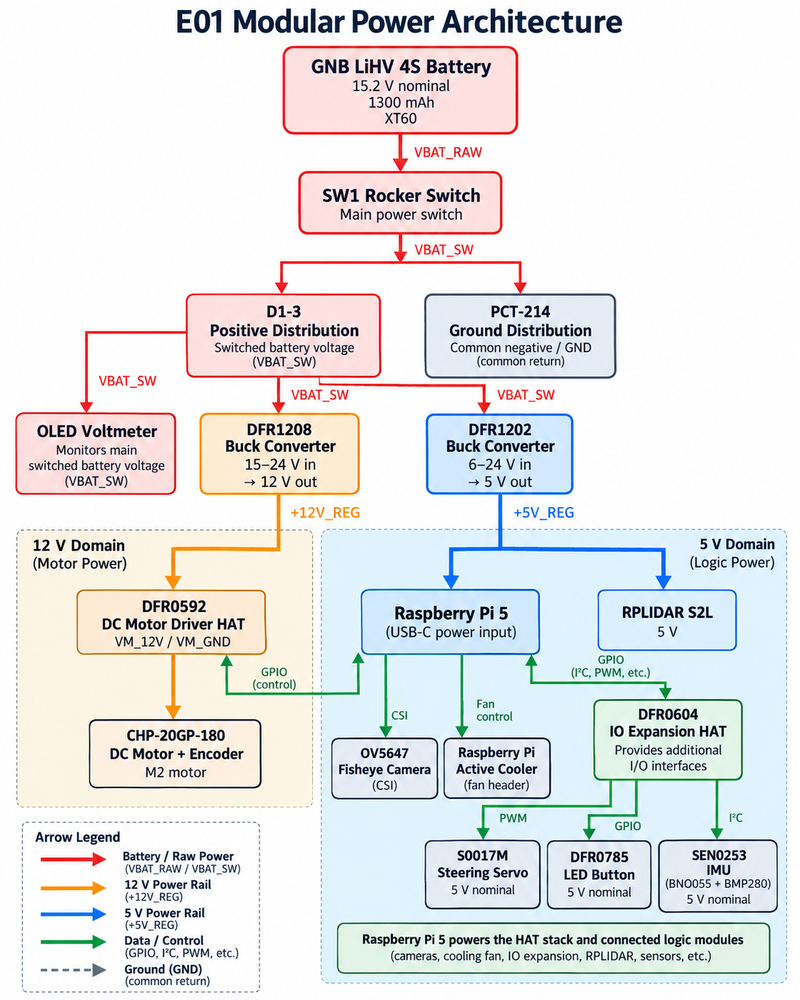
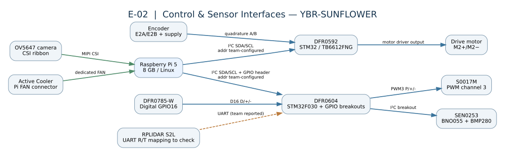
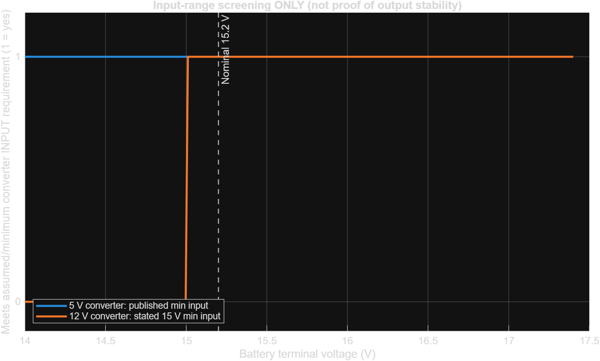
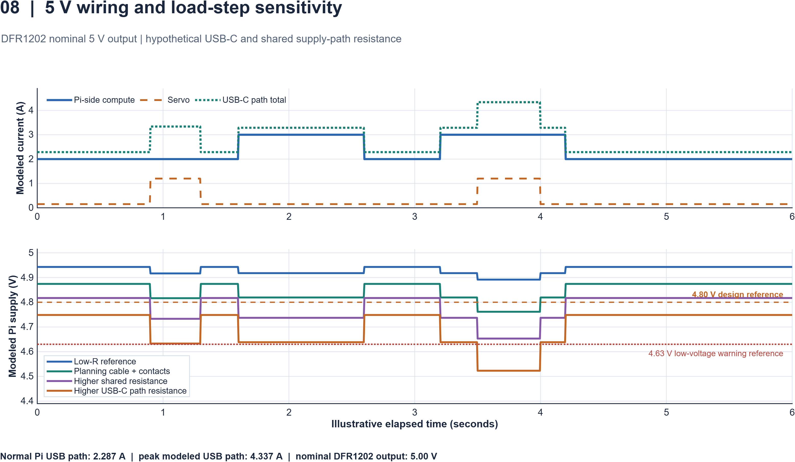
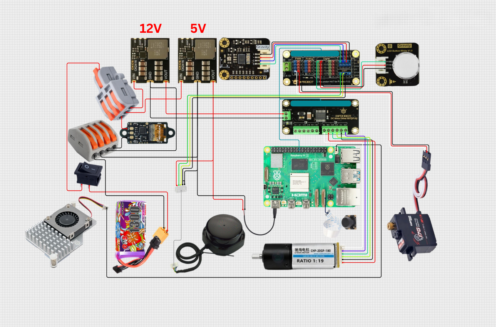
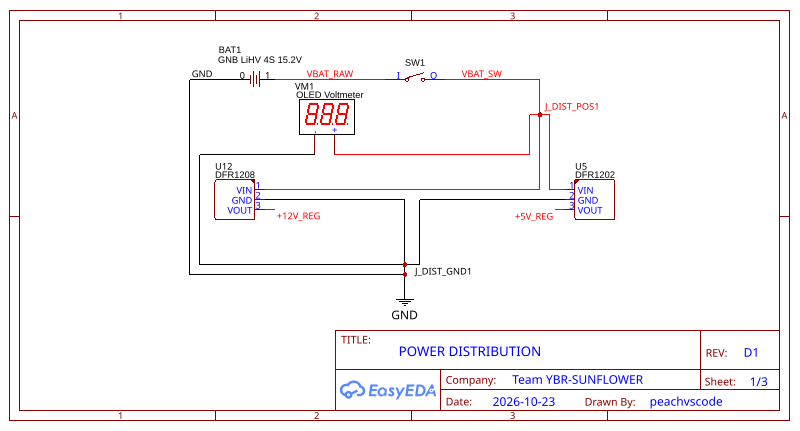
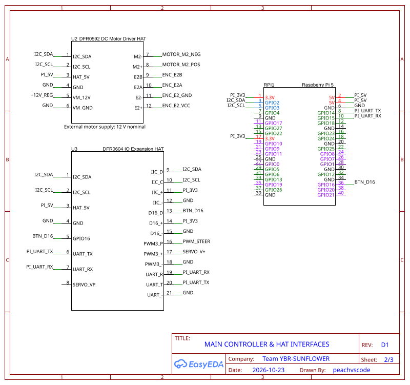
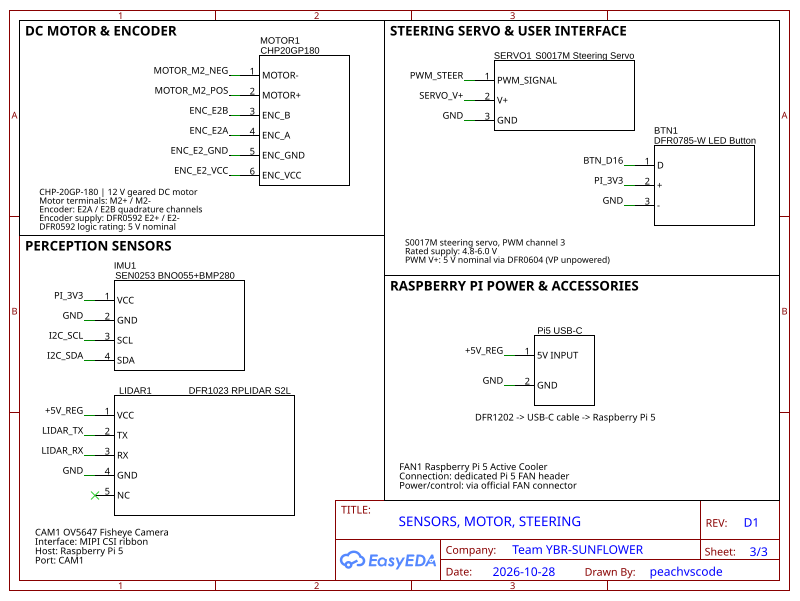

# Power and Sensor Architecture

> **Scope:** Electrical design, power distribution, computing hardware, interfaces, wiring, component selection, engineering calculations and MATLAB modeling. The team uses commercially assembled modules; **no custom PCB or power-distribution PCB was designed**.
>
> **Evidence policy:** **Team-reported** means supplied by the team; **Datasheet** means a published part specification; **Model / MATLAB** means a calculation or simulation with stated assumptions; **Measured** means an observed value with test conditions, instruments and a repeatable procedure. No simulated value below is presented as a physical measurement. `[TODO]` identifies information or evidence not yet supplied.

[← Project README](../README.md) · [← Engineering overview](0-overview.md) · [Mechanical design](1-mech.md) · [Software](3-software.md)

---

## Contents

1. [Electrical design objectives and evidence policy](#1-electrical-design-objectives-and-evidence-policy)
2. [System architecture](#2-system-architecture)
3. [Component inventory and technical specifications](#3-component-inventory-and-technical-specifications)
4. [Battery selection and nominal energy](#4-battery-selection-and-nominal-energy)
5. [Physical power distribution](#5-physical-power-distribution)
6. [Regulated rails, input headroom and servo power](#6-regulated-rails-input-headroom-and-servo-power)
7. [Electrical calculations and evidence-labeled load budget](#7-electrical-calculations-and-evidence-labeled-load-budget)
8. [MATLAB evidence selected for the electrical chapter](#8-matlab-evidence-selected-for-the-electrical-chapter)
9. [Schematic and pictorial wiring documentation](#9-schematic-and-pictorial-wiring-documentation)
10. [Complete team-reported electrical connections](#10-complete-team-reported-electrical-connections)
11. [Raspberry Pi, HATs and communication buses](#11-raspberry-pi-hats-and-communication-buses)
12. [RPLIDAR S2L](#12-rplidar-s2l)
13. [OV5647 camera and active cooler](#13-ov5647-camera-and-active-cooler)
14. [SEN0253 IMU and DFR0785-W button](#14-sen0253-imu-and-dfr0785-w-button)
15. [Motor driver, geared motor and encoder](#15-motor-driver-geared-motor-and-encoder)
16. [Steering-servo interface](#16-steering-servo-interface)
17. [Electrical reliability and design trade-offs](#17-electrical-reliability-and-design-trade-offs)
18. [Reproducibility and remaining team-specific records](#18-reproducibility-and-remaining-team-specific-records)
19. [Technical references](#19-technical-references)

---

## 1. Electrical design objectives and evidence policy

### 1.1 Engineering problem

The robot must supply a Linux computer, sensing modules, communication interfaces, a steering actuator and a geared propulsion motor from **one removable 4S LiHV battery**. Unlike a commercial car ECU, the robot integrates individual off-the-shelf modules and therefore requires deliberate electrical partitioning:

- A switched **battery-voltage input domain** for the two buck converters and the battery display.
- A nominal **5 V domain** for the Raspberry Pi 5 (via USB-C) and RPLIDAR S2L. The Pi and I/O HAT distribute logic and sensor supply to additional modules.
- A nominal **12 V motor domain** for the DFR0592 motor-driver input, not a general 12 V rail for the servo or Raspberry Pi.
- **3.3 V signal/sensor interfaces** on the DFR0604 digital and I²C breakouts, plus separately identified encoder and servo power connections.
- A **common negative/ground reference**, with attention to return-current routing, connector polarity, motor transients and the constraints of a 5 V Raspberry Pi input.

The main architectural decision was to use **commercial Raspberry Pi HATs and external buck modules instead of a custom PCB**. This reduces PCB-design and fabrication work and allows the team to replace modules separately. In return, the design depends on external wiring, connectors, module pinouts and voltage compatibility. These dependencies are explicitly documented in the electrical figures.

### 1.2 Evidence classification

| Evidence label | Meaning | Example in this chapter |
|---|---|---|
| **Manufacturer / supplier specification** | Published rating for a named product or module; may depend on stated test conditions | DFR1202 5 V output, S2L 400 mA working current |
| **Team-reported installation** | The team described or drew this connection on its current vehicle | DFR0592 M2+/M2− and six-colored motor/encoder cable |
| **Calculated** | Deterministic result of a documented equation and inputs | 19.76 Wh nominal battery energy, 0.2 V nominal 12 V-converter headroom |
| **Assumption-based MATLAB simulation** | Synthetic scenario generated by team source code; **not measured telemetry** | Power budget, hypothetical battery-discharge curves, 5 V wiring sensitivity |
| **Measured** | A reading or observation from the assembled robot with test conditions and instruments | No measured voltage, current or discharge curves are claimed in this chapter |

A published **maximum** current is not a measured operating current. An assumed current used for a plot is not a new component specification. We do not infer hardware protection, cable cross-section or software state from an EasyEDA symbol alone.

## 2. System architecture

### 2.1 Power-flow architecture — Figure E-01



**Figure E-01.** Functional power distribution. Battery positive passes through the rocker switch to the **D1-3 positive splitter**; battery negative passes **directly** to the **PCT-214 ground splitter**. Both converters share the switched input supply and return but provide separate 5 V and 12 V outputs. The Pi receives regulated 5 V through USB-C, while the motor driver receives regulated 12 V. The signal connections and breakout power details are described in Figure E-02 and the schematic; the block diagram is not a connector-level wiring instruction.

Figure E-01 keeps battery-positive wiring and the ground-return path visually separate; its common-ground trunk is a functional abstraction, not a separate physical ground connector. The actual negative connector is the single PCT-214.

The rail names from the EasyEDA schematic are `VBAT_RAW` (battery positive before SW1), `VBAT_SW` (switched positive), `+5V_REG` (DFR1202 output), `+12V_REG` (DFR1208 output), `PI_5V`, `PI_3V3` and `GND`. `PI_5V` denotes the Pi/header side of the 5 V power path; it is not a second independent buck converter.

### 2.2 Controller and signal architecture — Figure E-02



**Figure E-02.** Raspberry Pi 5 controls the DFR0592 motor-driver HAT and DFR0604 I/O-expansion HAT over I²C; the expansion HAT exposes GPIO16, UART and I²C interfaces and provides onboard STM32-generated servo PWM. The Pi also has dedicated CSI camera and fan interfaces. The motor/encoder, steering servo, IMU, button and LiDAR are physically connected as described in Section 10. The diagram is **logical**, not a claim that every serial lead or logic voltage has been bench-measured.

## 3. Component inventory and technical specifications

Values in the following tables are **datasheet or supplier ratings**, unless explicitly marked **team-reported**. They are not independently measured installed-unit performance.

### 3.1 Computing, power and actuation

| Component / quantity | Published or team-specified values | Electrical role |
|---|---|---|
| **Raspberry Pi 5, 8 GB — 1** | BCM2712 quad Cortex-A76 2.4 GHz; 40-pin GPIO, two 4-lane MIPI camera/display interfaces; recommended **5 V / 5 A-capable USB-C supply** | High-level perception, decision-making and peripheral host [R1] |
| **GNB13004S120AHV 4S LiHV — 1** | 15.2 V nominal, 1,300 mAh, 4S1P, 120C label, XT60; 129 ± 4 g supplier value | Battery supply [R2] |
| **DFR1202 5 V buck — 1** | DC **6–24 V input**; **5 V ±1%** output; **16 A advertised maximum**; published efficiency >90% at 12 V input under stated loads; output ripple <20 mV under stated conditions | Raspberry Pi USB-C and LiDAR 5 V supply [R3] |
| **DFR1208 12 V buck — 1** | DC **15–24 V input**; **12 V ±1%** output; **12 A advertised maximum**; >95% efficiency *at 24 V input* under stated load conditions; output ripple <50 mV under stated conditions | DFR0592 motor input [R4] |
| **DFR0592 motor-driver HAT V1.0 — 1** | STM32 + TB6612FNG; 7–12 V external motor input; 5 V HAT logic; I²C; default `0x10`; two drive channels | Propulsion drive through **M2** and feedback through **E2** [R5] |
| **DFR0604 I/O-expansion HAT — 1** | STM32F030, 5 V board supply, nominal 3.3 V sensor breakout supply; GPIO, I²C, UART and PWM; default `0x10`; optional external PWM/servo rail **6–12 V** | Interface to servo, IMU, button and LiDAR UART [R6] |
| **CHP-20GP-180 geared DC motor with encoder — 1** | 12 V; *internal gearbox* ratio **19:1**; no-load output speed 780 rpm; rated output speed 680 rpm; ≤280 mA no-load, ≤550 mA rated, ≤2.7 A stall; 0.40 kgf·cm rated torque, ≥2.0 kgf·cm stall torque | Rear propulsion and quadrature encoder [R7] |
| **SURPASS Hobby S0017M servo — 1** | 4.8–6.0 V operating supply; 0.23 s/60° at 4.8 V and 0.20 s/60° at 6 V; seller-advertised stall torque 1.5 and 1.8 kgf·cm respectively. **0.10–0.20 A no-load and 0.8–1.2 A stall are team-supplied generic planning ranges, not authenticated S0017M ratings** | Steering via PWM3 [R8] |
| **Raspberry Pi 5 Active Cooler — 1** | 5 V via dedicated 4-pin fan header; PWM/tachometer support; published maximum fan speed 8000 rpm ±15% | Computing thermal management [R9] |

**DFR0592 current-rating caution:** DFRobot's specification table lists **2 A continuous**, while its descriptive driver documentation states **1.2 A continuous and 2 A peak** per TB6612FNG channel. The CHP motor supplier states **up to 2.7 A stall current**. This documentation inconsistency and potential stall mismatch remain an engineering design risk; the advertised **12 A converter output** does not remove the driver's channel limit. [R5, R7]

### 3.2 Perception, display and user controls

| Component / quantity | Published specification | Function |
|---|---|---|
| **DFR1023 RPLIDAR S2L — 1** | 5 V, **400 mA working**, 40 mA sleep, TTL UART at **1 Mbps**; 360°; about 10 Hz scan; 32 kHz sample rate; up to 18 m on stated white targets; accuracy ±30 mm | 2D ranging/obstacle perception [R10] |
| **OV5647 5 MP fisheye camera — 1** | OV5647 sensor; seller-advertised 222° lens FoV and 2.1 mm focal length; ribbon-based camera connection | Wide-angle visual perception [R11] |
| **SEN0253 BNO055 + BMP280 — 1** | 3.3–5 V, approximately 5 mA; Gravity-I²C; BNO055 IMU plus BMP280 pressure/temperature | Orientation and environmental sensing [R12] |
| **DFR0785-W LED pushbutton — 1** | 3.3–5 V, **3.3 V recommended**; PH2.0 three-pin digital output; pressed state reported HIGH in vendor example | Human/start control [R13] |
| **0–30 V mini voltmeter — 1** | 3.5–30 V supply, 0–30 V measurement range, <20 mA specified; approximately 0.7% seller accuracy | Observes switched battery voltage [R14] |

**FoV clarification:** 222° is a **seller-stated lens specification**, not a measured usable field of view on the team's Pi 5 and not a calibrated mapping from pixels to bearings. The camera's software calibration belongs to the software journal; the electrical chapter documents only the CSI attachment and hardware interface.

### 3.3 Distribution and cabling

| Device | Team-reported role | Specification/documentation boundary |
|---|---|---|
| **XT60 battery connector** | Main removable battery pair | Polarity must match the actual harness [R2] |
| **KCD5-101-style SPST rocker switch** | Main switch in positive battery lead | Published example **6 A at 125 VAC / 3 A at 250 VAC** are **AC ratings**, not evidence of an equivalent DC/inrush rating [R15] |
| **D1-3 push-type splitter** | Battery-switched **positive-only** distribution | Commercial three-way splitter; supplier listing gives dimensions but no substantiated DC load-current rating for this particular item [R16] |
| **PCT-214 four-terminal lever connector** | Common **negative/ground-only** distribution | A seller quotes 32 A for its product; that listing does not verify this specific assembled connector, conductor cross-section or DC application [R17] |
| **USB-C power lead** | DFR1202 output to Pi 5 USB-C port | Functional two-wire depiction in EasyEDA is **not** a complete USB-C pin/CC circuit |
| **XH2.54 5-position LiDAR breakout** | Custom LiDAR power and UART cable | Team-specific leads and connector orientation are documented in Section 10; no new custom PCB |
| **Camera CSI ribbon, Pi 5 FAN connector, HAT header** | Dedicated commercial interconnects | Not generic GPIO signal wires |

## 4. Battery selection and nominal energy

The single GNB pack supplies **15.2 V nominal** at **1.30 Ah**. The manufacturer's label supports a nominal stored-energy calculation:

```math
E_{\mathrm{nom}} = V_{\mathrm{nom}} C_{\mathrm{Ah}} = (15.2\ \mathrm{V})(1.30\ \mathrm{Ah}) = 19.76\ \mathrm{Wh}.
```

This is a **nameplate-based nominal energy estimate**; it is not a measured usable energy capacity or verified competition runtime. Usable output depends on load, temperature, cell balance, resistance, converter operation and the team's safe operating window.

The published **120C** label is an advertised battery discharge-rate designation, **not** a safe continuous-current rating for the rocker switch, connectors, wire, 5 V USB-C cable or motor driver. Those components must be assessed individually.

Battery voltage changes as the pack discharges and under load. A useful illustrative lumped-resistance relation is:

```math
V_{\mathrm{terminal}}(t) = V_{\mathrm{OC}}\!\left(SOC(t)\right) - I_{\mathrm{battery}}(t)R_{\mathrm{pack}}.
```

Here `V_OC(SOC)` and `R_pack` are **model inputs**, not measured battery data. The model explains why the battery's nominal voltage must not be substituted for its guaranteed terminal voltage at every instant. See Section 8 and the currently published [headroom-model script (Figure 07)](../other/matlab/figure07_12v_input_headroom.m).

## 5. Physical power distribution

The wiring architecture is based on the team's latest reported assembly, not the older national-round schematic.

1. Battery positive `BAT+` passes through **SW1**. Its switched output `VBAT_SW` enters the **D1-3 positive distribution connector**.
2. Battery negative `BAT−` enters the **PCT-214 ground distribution connector directly**, without passing through SW1.
3. The D1-3 distributes positive input to the **DFR1202 VIN**, **DFR1208 VIN** and **voltmeter +**.
4. The PCT-214 provides the corresponding **input GND** branches and the voltmeter return. The buck output grounds and the rest of the robot share the common reference specified by the team's wiring.
5. DFR1202 **VOUT 5 V** supplies the Pi 5 through USB-C and the RPLIDAR power cable.
6. DFR1208 **VOUT 12 V** supplies the DFR0592 external motor supply. Its M2 channel drives the CHP motor.

The different buck converters are **not** connected output-to-output. The 12 V motor rail is not a steering-servo supply rail. The Pi's 3.3 V GPIO is not a 5 V-tolerant general-purpose input domain.

The voltmeter is connected between `VBAT_SW` and `GND`: it shows the **switched battery input**, not the 5 V or 12 V regulated outputs. The display's approximate 0.7% accuracy is a seller claim, not an individually calibrated measurement.

### 5.1 Distribution-connector limits

The team uses commercially available distribution connectors instead of a custom PDB. This is a valid modular design decision, but the **D1-3 connector's current capacity cannot be established from the dimensions alone**. The PCT-214's seller rating is not a substitute for the actual conductor, termination and temperature ratings. Likewise, the rocker switch's published **AC** current rating is not automatically its **DC switching** rating. No battery-side fuse is asserted unless the installed assembly actually includes one.

## 6. Regulated rails, input headroom and servo power

### 6.1 DFR1202 — computing and LiDAR 5 V rail

The DFR1202's manufacturer specifications are **6–24 V input**, **5 V ±1% output** and **16 A advertised maximum** output. This comfortably covers a **nominal 15.2 V pack input range check**, but does not prove the voltage delivered through the Pi USB-C cable under sudden load.

The Raspberry Pi 5 is intended for a **5 V, 5 A-capable power supply**. This is the official *supply recommendation*, not a claim that the Pi consumes 5 A continuously. The team's use of a 5 V buck and custom USB-C lead must distinguish **converter capacity** from **Pi-side voltage and USB-C supply identification behavior**. [R1, R3]

### 6.2 DFR1208 — 12 V motor rail and the headroom limitation

The DFR1208's stated input range is **15–24 V**, while the battery's nominal rating is **15.2 V**. Hence:

```math
M_{12,\mathrm{nom}} = V_{\mathrm{battery,nom}} - V_{\mathrm{DFR1208,min}} = 15.2 - 15.0 = 0.2\ \mathrm{V}.
```

For a loaded pack the applicable relation is:

```math
M_{12}(t) = V_{\mathrm{terminal}}(t) - 15.0\ \mathrm{V}.
```

If this margin is negative, the converter input is **outside its manufacturer's stated operating input range**. It does **not** follow that the output instantly falls to zero, and we cannot claim that the installed converter maintains 12 V outside its specified range.

**Engineering finding:** The nominal 0.2 V headroom is intrinsically small. The DFR1208 may encounter an out-of-spec input condition during discharge or current-related voltage sag. This is a published-specification **architecture limitation**, not an experimental failure claim. DFRobot's stated **>95% efficiency at 24 V input** cannot be applied as a guaranteed efficiency at 15.2 V. [R4]

### 6.3 Steering-servo rail — distinct from 12 V propulsion

The S0017M's supplier specifies **4.8–6.0 V** operation. DFRobot documents the DFR0604 PWM `+` rail as **5 V nominal when external VP is unpowered**; when VP is externally supplied, PWM `+` follows that external **6–12 V** source. [R6, R8]

The drawing therefore records `SERVO_V+` as a separate functional servo supply, with **5 V nominal under the manufacturer's *VP-unpowered configuration***. A 12 V motor converter output must **never** be shown as connected to the S0017M supply. The physical VP wiring state remains a team-configuration fact rather than a datasheet fact (Section 18).

### 6.4 Supply-domain summary

| Domain | Nominal value | Distribution and consumers | Status |
|---|---:|---|---|
| `VBAT_RAW` | 15.2 V nameplate | Battery positive → SW1 input | Team-reported |
| `VBAT_SW` | Battery terminal voltage after switch | D1-3 → both buck inputs, voltmeter | Team-reported |
| `+12V_REG` | 12 V | DFR1208 → DFR0592 motor supply | Manufacturer nominal, with headroom warning |
| `+5V_REG` | 5 V | DFR1202 → Pi USB-C and RPLIDAR | Manufacturer nominal |
| `PI_5V` | Pi 5 V header domain | Logic/HAT interfaces fed through Pi's power system | Functional schematic abstraction |
| `PI_3V3` | 3.3 V | DFR0604 IIC+ and D16+ → SEN0253/DFR0785 | Manufacturer breakout specification; team-reported |
| `SERVO_V+` | **5 V conditional** | DFR0604 PWM3+ → S0017M | Manufacturer VP-unpowered mode; team state in Section 18 |
| `GND` | 0 V reference | PCT-214, converter returns, Pi and other peripherals | Team-reported common return |

## 7. Electrical calculations and evidence-labeled load budget

The load model was revised to match the selected [Figure 01 MATLAB source](../other/matlab/figure01_electrical_load_budget.m). It uses **published operating points where available** and identifies every other current as a **scenario assumption**, not an instrument reading. Component input power is calculated from each supply domain using:

```math
P_k=V_k I_k,\qquad P_{\mathrm{branch}}=\sum_k P_k.
```

### 7.1 Component-by-component current allocation

| Electrical load | Nominal modeled voltage | Current used | Calculated load power | Evidence class |
|---|---:|---:|---:|---|
| Raspberry Pi 5 + OV5647 + active cooler | 5.0 V | 2.00 A | **10.00 W** | **Assumed** aggregate operating demand; not the Pi 5 PSU's 5 A capacity |
| RPLIDAR S2L | 5.0 V | 0.400 A | **2.00 W** | DFRobot published **working** current |
| DFR0592 + DFR0604 HAT logic | 5.0 V | 0.120 A | **0.600 W** | **Assumed** electronic-logic demand |
| S0017M steering servo (normal scenario) | 5.0 V | 0.150 A | **0.750 W** | **Assumed** representative no-load point; valid as a 5 V rail allocation **only if external VP is unpowered** |
| DFR0785-W button | 3.3 V | 0.020 A | **0.066 W** | **Assumed** illuminated-button consumption |
| SEN0253 IMU | 3.3 V | 0.005 A | **0.0165 W** | DFRobot published operating current |
| CHP-20GP-180 motor (rated-current upper bound) | 12.0 V | ≤0.550 A | **≤6.60 W** | Supplier upper bound at rated condition, **not a measured running demand** |
| Mini voltmeter | 15.2 V switched battery | 0.015 A | **0.228 W** | **Assumed** consumption; direct pack branch |

The 3.3 V subloads draw from the Pi/logic supply, which itself is ultimately fed by the 5 V buck. Their **output-load** powers are included once in a lossless first-order upstream budget; the model does not characterize the Pi's 3.3 V internal-conversion loss. The motor rated current is an upper bound and therefore **not** a guaranteed operational point.

```math
P_{5,\mathrm{model}}=(5)(2.00+0.400+0.120+0.150)+(3.3)(0.020+0.005)=13.4325\ \mathrm{W}.
```

```math
P_{12,\mathrm{model}}=(12)(0.550)=6.60\ \mathrm{W}.
```

Both buck converters are modeled at **90% constant efficiency as a planning assumption**; DFR1208's higher published efficiency at a specified **24 V test input** must not be substituted as its efficiency on this 15.2 V battery.

```math
P_{\mathrm{battery,model}}=\frac{13.4325}{0.90}+\frac{6.60}{0.90}+0.228
\approx22.49\ \mathrm{W}.
```

```math
I_{\mathrm{battery,nom\ scenario}}=\frac{22.4863}{15.2}\approx1.48\ \mathrm{A}.
```

The user-provided **generic S0017M servo planning envelope** is approximately 0.10–0.20 A no-load and 0.8–1.2 A stall; these are **not verified model-specific specifications or robot measurements**. Substituting **1.20 A** for the modeled **0.15 A** servo normal current increases the 5 V branch by 5.25 W, and increases estimated battery power to approximately **28.32 W** (1.86 A at 15.2 V) if all other assumptions and converter efficiencies remain unchanged. The servo-current upper scenario is not a continuous-duty recommendation.

### 7.2 Wiring voltage drop and resistive dissipation

```math
\Delta V=I R_{\mathrm{path}},\qquad P_{\mathrm{loss}}=I^2 R_{\mathrm{path}}.
```

In Figure 08's separate **USB-C branch** model, the RPLIDAR is **not** counted in the Pi power cable current: it receives a distinct branch from the DFR1202. The modeled USB-C current is:

```math
I_{\mathrm{USB,normal}}=2.00+0.120+\frac{3.3}{5.0}(0.005+0.020)+0.150=2.2865\ \mathrm{A}.
```

A simultaneous additional **1.00 A assumed Pi processing load** and increase of the servo from **0.15 A to 1.20 A** gives a peak modeled USB-C path current of **4.3365 A**. This is an *illustrative coincidence of independent assumed load events*, not a measured Pi 5 current.

### 7.3 Why nameplate energy is not competition runtime

For the 4S LiHV pack, nominal label energy is:

```math
E_{\mathrm{nom}}=15.2\ \mathrm{V}\times 1.30\ \mathrm{Ah}=19.76\ \mathrm{Wh}.
```

An energy-over-average-power quotient is only an idealized arithmetic comparison. It does **not** establish usable energy, battery voltage trajectory, output regulation or the duration of a WRO run. In particular, DFR1208 may leave its specified **15–24 V input window** while the pack still has charge; Figure 07 explicitly analyzes that design constraint.

## 8. MATLAB evidence selected for the electrical chapter

The journal intentionally displays **four decision-relevant figures**, not every exploratory visualization. The selected figures support a traceable power budget, component compatibility, 12 V input headroom, and 5 V wiring risk. No plots are represented as measured voltage, current or battery-run records. **The actual public scripts are the standalone `.m` files in [`other/matlab/`](../other/matlab/)**; the previous `electrical_figures/FigureXX/` subdirectories and per-figure READMEs are **not present on the current public branch**.

### 8.1 Figure E-03 — electrical load budget (MATLAB Figure 01)


**Figure E-03.** Per-component calculated demand at a stated supplier current or planning point. Supplier-labeled motor current is a **rated upper bound**, while the assumed Pi/servo/HAT currents are **not published consumption values**. The summary is **13.4325 W on the modeled 5 V branch including downstream 3.3 V loads**, **6.60 W at the motor's supplier rated-current bound**, and approximately **22.49 W / 1.48 A on the nominal battery side** with 90% assumed efficiencies. [MATLAB source and documented assumptions](../other/matlab/figure01_electrical_load_budget.m).

### 8.2 Figure E-04 — converter input compatibility (MATLAB Figure 02)



**Figure E-04.** Manufacturer input ranges: DFR1202 **6–24 V**; DFR1208 **15–24 V**. The GNB battery is **15.2 V nominal** and **17.4 V** is an illustrative LiHV full-charge chemistry reference. The DFR1208 has only **+0.20 V nominal margin above the minimum input**; this is an input-compatibility check, not evidence of output regulation. The illustrative 13 V x-axis lower bound is **not a recommended battery cutoff**. [MATLAB source and documented assumptions](../other/matlab/figure02_converter_input_range.m).

### 8.3 Figure E-05 — simulated DFR1208 input headroom (MATLAB Figure 07)

The battery screening model uses an assumed LiHV voltage-versus-state-of-charge function, assumed **0.12 Ω** pack resistance, constant converter efficiency and 0.5×/1.0×/1.5× load multipliers. Its battery terminal voltage is computed from an equivalent-circuit model, **not measured** on the vehicle:

```math
V_{\mathrm{terminal}}=V_{\mathrm{OC}}(SOC)-I_{\mathrm{battery}}R_{\mathrm{pack}},\qquad
M_{12}(t)=V_{\mathrm{terminal}}(t)-15\ \mathrm{V}.
```


**Figure E-05.** Model crossings of the **15 V input threshold** occur at approximately **61.5 min (light)**, **28.0 min (planning)** and **16.6 min (heavy)**. These **are not usable vehicle runtimes**. Dotted portions below the threshold are invalid-region extrapolations that cannot establish a regulated 12 V output. The first negative margin indicates only that the model has left the DFR1208's stated operating-input region. [MATLAB source and documented assumptions](../other/matlab/figure07_12v_input_headroom.m).

### 8.4 Figure E-05B — 5 V USB-C wiring and load-step sensitivity (MATLAB Figure 08)



**Figure E-05B.** A deliberately simplified **resistive** model, not an oscilloscope trace or detailed DFR1202 switching-regulator transient simulation. It uses an assumed 5.00 V supply, the Figure 01 current inventory, synthetic compute/servo events and four hypothetical end-to-end path-resistance cases. It screens:

```math
V_{\mathrm{Pi}}(t)=5.00\ \mathrm{V}-I_{\mathrm{USB}}(t)
\left(R_{\mathrm{USB}}+R_{\mathrm{shared}}\right).
```

| Assumed path condition | Total assumed path resistance | Modeled minimum Pi voltage |
|---|---:|---:|
| Low-resistance reference | 0.025 Ω | **4.892 V** |
| Planning cable and contacts | 0.055 Ω | **4.761 V** |
| Higher shared resistance | 0.080 Ω | **4.653 V** |
| Higher USB-C path resistance | 0.110 Ω | **4.523 V** |

The **4.80 V** design reference and **4.63 V** nominal undervoltage-warning reference are comparisons, not inferred exact trip voltages. As the converter voltage regulation, supply identification, actual wiring resistance and Pi response are not modeled, these results demonstrate **sensitivity**, not a proven malfunction. The model's servo path is applicable **only if the DFR0604 VP input is unpowered**. [MATLAB source and documented assumptions](../other/matlab/figure08_5v_wiring_sensitivity.m).

### 8.5 Figure provenance and reproducibility

| Embedded figure | Source code | Purpose and evidence class |
|---|---|---|
| E-03 / MATLAB 01 | [`figure01_electrical_load_budget.m`](../other/matlab/figure01_electrical_load_budget.m) | Supplier operating points + assumed allocation |
| E-04 / MATLAB 02 | [`figure02_converter_input_range.m`](../other/matlab/figure02_converter_input_range.m) | Published converter input windows + voltage arithmetic |
| E-05 / MATLAB 07 | [`figure07_12v_input_headroom.m`](../other/matlab/figure07_12v_input_headroom.m) | Synthetic battery equivalent-circuit model |
| E-05B / MATLAB 08 | [`figure08_5v_wiring_sensitivity.m`](../other/matlab/figure08_5v_wiring_sensitivity.m) | Synthetic Pi power-path resistance model |

**Figure provenance and reproduction procedure:** The public `main` branch checked for D5 contains all four displayed figure PNGs **and** their respective MATLAB scripts. A PNG alone does not establish which application exported it, so MATLAB origin is not asserted solely from the image. The underlying calculations are reproducible from the standalone `.m` files, and **none of the plotted results represents measured telemetry**. In MATLAB R2020a or later, open one `figureXX_*.m` script, run the **entire script**, then take the resulting `results/XX_*.png` and replace the same-named repository image under `engineering_journal/visualization/`. The local scripts also export `simulation_inputs.mat` alongside the PNG; they do not require CSV data files. If the team edits any assumed input, update the PNG, script and journal table/caption together.

Figures 03–06 were useful exploratory calculations but are intentionally **not embedded or required** for the final electrical discussion. The older Figures 09–11 are likewise not used; non-electrical plots 12–29 belong to their respective other engineering disciplines.

## 9. Schematic and pictorial wiring documentation

### 9.1 Figure E-06 — Pictorial assembled-module wiring



**Figure E-06.** Team-reported physical module layout and wire-color mapping. It complements, rather than replaces, the schematic. The image describes connections; it does not prove connector contact order, conductor gauge or current-carrying capacity.

### 9.2 Figure E-07 — EasyEDA modular electrical schematic

The three-sheet EasyEDA drawing is the team's **module-level electrical schematic**. It documents externally available module terminals and named nets rather than drawing a fictional custom PDB or redesigning the internal circuits of commercial HATs.

**Sheet 1/3 — Power Distribution**



**Sheet 2/3 — Main Controller & HAT Interfaces**



**Sheet 3/3 — Sensors, Motor & Steering**



**[Open/download the complete E-07 three-page PDF](../schemes/schematic_diagram.pdf).** The original SVG exports retain their readable individual sheet layouts and may be opened separately for closer inspection.

**Schematic interpretation:** Pin numbers on the team's custom rectangular HAT/peripheral symbols are **EasyEDA logical symbol identifiers**, not guaranteed manufacturer physical connector-contact numbers. The Pi 40-pin symbol uses physical GPIO-header numbering. Matching net labels across sheets are deliberate functional connectivity references. The USB-C power block is a **two-rail abstraction**, not the full USB-C pinout. The camera ribbon and official cooler fan header are annotated as their actual separate interfaces.

### 9.3 Why there is no separate Figure E-08

The detailed **terminal-to-terminal and cable-color record is included directly in Section 10**, with E-06 providing the physical pictorial view and E-07 providing electrical connectivity. A further standalone cable-map poster would duplicate the same information without adding measured harness contact order or a new technical result. This is a deliberate documentation choice, **not a missing schematic**.

## 10. Complete team-reported electrical connections

The following records use the wiring description supplied by the team for its redesigned robot and the matching EasyEDA module nets. **Wire colors are physical cable colors as reported; EasyEDA's default green wires are drawing objects, not a cable-color specification.** Connector pin *numbers* are omitted unless directly supported by the Pi's published physical header map.

### 10.1 Battery, regulator and return wiring

| From / terminal | To / terminal | Net or function | Team-reported cable |
|---|---|---|---|
| GNB battery `+` (XT60 positive) | SW1 rocker input | `VBAT_RAW` | Red / positive |
| SW1 switched output | D1-3 positive splitter | `VBAT_SW` | Red / positive |
| GNB battery `−` (XT60 negative) | PCT-214 common-ground splitter | `GND` | Black / negative |
| D1-3 output | Mini voltmeter `+` | Switched battery reading | Positive lead |
| PCT-214 output | Mini voltmeter `−` | Common return | Black |
| D1-3 output | DFR1208 `VIN` | Switched input to 12 V buck | Positive lead |
| PCT-214 output | DFR1208 `GND` | 12 V buck input return | Black |
| D1-3 output | DFR1202 `VIN` | Switched input to 5 V buck | Positive lead |
| PCT-214 output | DFR1202 `GND` | 5 V buck input return | Black |
| DFR1208 `VOUT` / `GND` | DFR0592 `VM+` / `VM−` | `+12V_REG` / `GND` | Positive / black return |
| DFR1202 `VOUT` / `GND` | Raspberry Pi 5 USB-C power lead | `+5V_REG` / `GND` | Positive / black return |
| DFR1202 `VOUT` / `GND` | RPLIDAR S2L 5 V / power-ground leads | `+5V_REG` / `GND` | Red / black |

The team's drawing shows both buck output negatives referenced to common ground, and the LiDAR's additional ground lead tied into the custom breakout. There is **no battery-positive connection to PCT-214** and **no battery-negative connection to D1-3**.

### 10.2 DFR0592 M2 drive and E2 encoder harness

| DFR0592 marking | CHP-20GP-180 interface | Team wire color | EasyEDA net |
|---|---|---|---|
| `M2−` | DC motor negative lead | **White** | `MOTOR_M2_NEG` |
| `M2+` | DC motor positive lead | **Red** | `MOTOR_M2_POS` |
| `E2B` | Encoder phase B | **Green** | `ENC_E2B` |
| `E2A` | Encoder phase A | **Yellow** | `ENC_E2A` |
| `E2−` | Encoder return | **Black** | `ENC_E2_GND` |
| `E2+` | Encoder positive supply | **Blue** | `ENC_E2_VCC` |

The motor terminal and encoder supply are **not** the same supply connection. The motor receives PWM drive at M2, while the encoder has separate E2+/E2− supply/return and E2A/E2B feedback pins. **The encoder supply voltage and counts-per-revolution are not established merely by knowing that the motor is a 12 V geared unit**.

### 10.3 DFR0604 I²C, button, servo and UART breakouts

| DFR0604 connector | External module and terminal | Wire color | Schematic net / function |
|---|---|---|---|
| `IIC D` | SEN0253 `SDA` | Green | `I2C_SDA` |
| `IIC C` | SEN0253 `SCL` | Blue | `I2C_SCL` |
| `IIC +` | SEN0253 `VCC` | Red | `PI_3V3` |
| `IIC −` | SEN0253 `GND` | Black | `GND` |
| `Digital 16 D` | DFR0785-W `D` | Green | `BTN_D16` / GPIO16 |
| `Digital 16 +` | DFR0785-W `+` | Red | `PI_3V3` |
| `Digital 16 −` | DFR0785-W `−` | Black | `GND` |
| `PWM3 P` | S0017M PWM/signal | White | `PWM_STEER` |
| `PWM3 +` | S0017M positive | Red | `SERVO_V+` |
| `PWM3 −` | S0017M ground | Black | `GND` |
| `UART R` | Custom RPLIDAR breakout **green lead** | Green | Pi UART receive terminal, team-reported destination |
| `UART T` | Custom RPLIDAR breakout **yellow lead** | Yellow | Pi UART transmit terminal, team-reported destination |
| `UART −` | RPLIDAR ground via custom breakout | Black | `GND` |
| `UART +` | Not used in team's LiDAR power connection | — | **Unconnected**; LiDAR 5 V comes directly from DFR1202 |

**LiDAR custom cable note:** The team reported **two black ground conductors joined at its XH2.54 five-position breakout**. The spare lead is documented as the team's cable modification, not automatically as a fifth ground pin inside the manufacturer's scanner. The actual **scanner-side TX/RX identities** of the green and yellow leads are not proven by wire colors; the team-reported HAT terminal connections are preserved without making an unsupported assertion about the internal scanner pin order.

### 10.4 Pi interface, camera and cooling

| Physical host interface | External connection | Function |
|---|---|---|
| Pi 5 USB-C power port | DFR1202 regulated 5 V supply via custom cable | Processor/board supply |
| Raspberry Pi 40-pin header: physical 3, GPIO2 | I²C SDA of HATs / SEN0253 breakout | `I2C_SDA` |
| Raspberry Pi 40-pin header: physical 5, GPIO3 | I²C SCL of HATs / SEN0253 breakout | `I2C_SCL` |
| Raspberry Pi 40-pin header: physical 36, GPIO16 | DFR0604 Digital 16 signal / LED button | `BTN_D16` |
| Raspberry Pi 40-pin header: physical 8, GPIO14 | DFR0604 UART T / TX | `PI_UART_TX` |
| Raspberry Pi 40-pin header: physical 10, GPIO15 | DFR0604 UART R / RX | `PI_UART_RX` |
| Raspberry Pi 40-pin header: physical 2/4 | HAT 5 V logic domain | `PI_5V` |
| Raspberry Pi 40-pin header: physical 1/17 | 3.3 V reference / breakout supply | `PI_3V3` |
| A Raspberry Pi 40-pin GND contact | Both HAT logic grounds | `GND` |
| Raspberry Pi 5 CAM/DSI ribbon connector | OV5647 fisheye camera | MIPI CSI interface; camera port as team installed |
| Raspberry Pi 5 dedicated FAN header | Official Raspberry Pi Active Cooler | 5 V, PWM fan control and tachometer via official connector |

The DFR0592 and DFR0604 share the Raspberry Pi's I²C interface *as represented by the team's schematic*. Their internal MCU functions are not reconstructed into fictional individual Raspberry Pi control lines.

## 11. Raspberry Pi, HATs and communication buses

### 11.1 Controller choice

The Raspberry Pi 5 (8 GB) is used as the main Linux computing platform. The Pi's two MIPI camera/display connectors, 40-pin GPIO header and ability to interface with I²C/UART modules support the robot's chosen camera, motor driver, IMU, LiDAR and start-button arrangement. The active cooler uses the **Pi 5 dedicated fan connector**, not an ad-hoc motor-driver output. [R1, R9]

### 11.2 I²C address map and the two HATs

| I²C module | Published default address | Team-system qualification |
|---|---|---|
| DFR0592 | `0x10` | Team has reported resolving collision; final address and/or bus arrangement is not yet in the electrical record |
| DFR0604 | `0x10` | Same default as DFR0592; team reports resolution |
| SEN0253 BNO055 | `0x28` | Module default; depends on configuration |
| SEN0253 BMP280 | `0x76` | Module default; depends on configuration |

The two HATs' published defaults conflict **if both are present at `0x10` on the same physical I²C bus**. The team states that the issue has been resolved. It would be incorrect to replace the manufacturer's default addresses with guessed final values; the specific final implementation is recorded as a **single team-specific documentation item in Section 18**. The BNO055 and BMP280 defaults are separate devices within SEN0253. [R5, R6, R12]

### 11.3 GPIO and UART

The DFR0604 Digital 16 signal connects to Raspberry Pi **BCM GPIO16**. The UART expansion breakout exposes Raspberry Pi UART transmit and receive, nominally Pi physical GPIO header pins **8 (TXD0/GPIO14)** and **10 (RXD0/GPIO15)** in the team drawing. **A UART transmitter must be received by a receiver at the other device**, but the exact manufacturer TX/RX identity of the team's customized LiDAR cable cannot be safely inferred from conductor color alone.

### 11.4 Logic-voltage separation

The DFR0604 sensor `+` breakout nominally supplies **3.3 V**; this is the preferred rail for the LED button and an allowed supply for SEN0253. The LiDAR receives its **separate regulated 5 V**, not power from the UART `+` contact. The motor driver receives its **separate 12 V motor supply**, while the servo uses the **PWM+ rail** subject to the VP condition discussed above. Do not interpret the presence of a common ground as permission to join these positive rails.

## 12. RPLIDAR S2L

The DFR1023 RPLIDAR S2L is a 360° direct time-of-flight ranging sensor. DFRobot lists **5 V**, **400 mA operating**, **40 mA sleep**, **10 Hz scan frequency**, **32 kHz sampling**, a stated **0.05–18 m** white-target range and **±30 mm** ranging accuracy. The host interface is **TTL UART at 1 Mbps**; these are manufacturer specifications, not YBR-SUNFLOWER field measurements. [R10]

The team's electrical design powers the scanner directly from the **DFR1202** rather than from the DFR0604 UART `+` breakout. Its UART data goes through the DFR0604 breakout to the Pi. The custom cable uses an XH2.54 five-position connector and the conductor colors described in Section 10.3. The host software's packet parsing, coordinate transformations and pillar-detection algorithm are outside the scope of this chapter.

Electrical integration considerations are stable 5 V supply, common UART return and correct TX/RX signal pairing. The published maximum range is not a guarantee for every dark, transparent or highly reflective competition object.

## 13. OV5647 camera and active cooler

### 13.1 Fisheye camera

The team's camera is an **OV5647 5 MP fisheye module** advertised by its seller as approximately **222° FoV** with a **2.1 mm lens**. It uses a ribbon connection to one of the Raspberry Pi 5's MIPI CSI interfaces. This wide-angle claim is a **vendor assertion**; actual pixel-to-bearing calibration and usable corner coverage are not established by this electrical documentation. [R11]

The camera module is **not** shown as a Pi GPIO pin group. The physical camera port and flex-ribbon adapter are part of the Pi's separate CAM/DSI interface. Camera exposure, image calibration and parking perception are software/mechanical integration topics.

### 13.2 Raspberry Pi 5 Active Cooler

The official Active Cooler connects to the Pi 5 **dedicated four-pin FAN header**, receives **5 V from the Pi** and supports fan PWM/tachometer operation. The manufacturer describes a temperature-controlled fan and aluminium heatsink. [R9]

The cooler is documented as a native Pi accessory; it does **not** require an independent hand-wired fan supply from either buck converter.

## 14. SEN0253 IMU and DFR0785-W button

### 14.1 SEN0253 BNO055 + BMP280

The SEN0253 combines the BNO055 accelerometer, gyroscope and magnetometer with a BMP280 pressure/temperature sensor. DFRobot specifies **3.3–5 V**, about **5 mA**, and a Gravity-I²C connector. The module provides fused orientation and environmental readings; the datasheet's accuracy and range statements depend on sensor mode and calibration, and are **not** measured pose accuracy of the vehicle. [R12]

The team's connection uses the DFR0604 IIC `D/C/+/-` terminals with green SDA, blue SCL, red 3.3 V and black GND leads. The BNO055 (`0x28`) and BMP280 (`0x76`) defaults are recorded in Section 11. Magnetic disturbance from the motor, current conductors or nearby ferrous materials can affect magnetometer readings; such effects should not be labeled as tested or eliminated without evidence.

### 14.2 DFR0785-W illuminated button

The DFR0785-W is a **digital-output, illuminated pushbutton** using a three-pin PH2.0 interface. DFRobot specifies **3.3–5 V** and recommends **3.3 V**. The team's Digital 16 connection is signal **D** (green), positive **+** (red) and ground **−** (black), mapped to `BTN_D16`, `PI_3V3` and `GND`. [R13]

The button is part of the human/start interface; its software debounce, start-state logic and competition behavior belong to the software journal.


### 14.3 Sensor selection, placement geometry and calibration method — rubric evidence boundary

The LiDAR provides planar 360° range observations, the camera supplies a wide-angle visual view for colored objects/parking, and the IMU provides short-term orientation estimates. These **functional selection reasons** complement the interconnect schematic but do not determine physical sensor pose or calibration from a product listing. The wide-angle fisheye vendor claim and S2L's target-dependent ranging limits are discussed in Sections 12 and 13.

#### Sensor choice rationale and geometric constraints

The three sensors are **complementary, not interchangeable**. The following matrix states defensible engineering reasons for the selected sensor types; it is a functional analysis, **not** an invented record of alternatives that the team physically tested.

| Installed sensor | Reason it contributes | Important limitation / design trade-off |
|---|---|---|
| RPLIDAR S2L (planar 360° dToF) | Range returns can support wall proximity and planar obstacle geometry, including directions outside a forward-facing camera image | Only one scanning plane; chassis/servo mounting can occlude beams; reported range/accuracy depend on target material and environment |
| OV5647 fisheye camera | Image color and texture can distinguish red/green markers and provide visual context for parking | Seller-stated 222° does **not** establish calibrated usable FoV; lens distortion, lighting and image exposure affect detection |
| SEN0253 BNO055/BMP280 | Short-term angular/orientation information complements range and image observations | Magnetometer disturbance and orientation biases require placement-aware calibration; orientation alone cannot locate field walls |

The **WRO 2026 General Rules** specify track-border spacing that may vary between approximately **600 mm and 1000 mm in the Open Challenge**, with a nominal **1000 mm** spacing in the Obstacle Challenge; the parking-space width is **200 mm**. These field dimensions motivate checking side coverage, near-wall blind spots, and camera visibility near the parking area. They **do not** prove coverage without the team's actual sensor coordinates, yaw/pitch and occlusion geometry.

A valid calibration record would include the camera lens model and its frame transform, LiDAR scan-plane origin/heading relative to the chassis, and IMU mounting-frame orientation/heading treatment. These are **documentation requirements, not claims that such calibration has been completed**.

For reproducibility and the **2026 WRO Power & Sensor Architecture rubric**, sensor-frame locations and calibration methods should be documented with the same evidence discipline as wiring. In particular, a camera's 222° seller claim is not usable angle-per-pixel calibration; the 360° LiDAR coverage does not by itself establish unoccluded coverage after mounting. The motor/metal hardware may also bias the IMU magnetometer.

- **Sensor placement — see Section 18, TODO 6:** Supply measured or CAD-defined LiDAR origin/height/yaw and camera optical-center/height/tilt relative to the robot's chassis frame, plus one concise note explaining the intended front/side/parking field coverage. If available, include mounting obstruction/occlusion considerations. These details are **not safely recoverable from component datasheets**.
- **Calibration method — see Section 18, TODO 7:** Describe which calibration was actually used: camera intrinsics/fisheye mapping, camera-to-robot transform, LiDAR-to-robot transform, IMU bias/heading orientation, and any resulting files/settings, with a reference to the software/mechanical chapter as appropriate. If a method was not completed, state that explicitly instead of claiming successful calibration.

No placement, accuracy or calibration-validation measurements are invented in this chapter. These two specific records are important for rubric completeness and interface reproducibility.

## 15. Motor driver, geared motor and encoder

### 15.1 Why the DFR0592 M2/E2 channels are used

The DFR0592 contains an STM32 I²C controller and TB6612FNG H-bridge stage. On the team's vehicle, **M2+ / M2−** drive the CHP motor while **E2A / E2B / E2+ / E2−** provide the encoder interface. The motor's 19:1 reduction is **inside the purchased gearbox**; multiplying speed or torque by 19 a second time would be a modeling error. [R5, R7]

### 15.2 Motor rated points and torque conversion

Manufacturer/supplier figures at 12 V are **780 rpm no-load**, **680 rpm rated**, **≤550 mA rated current**, **0.40 kgf·cm rated torque**, **≤2.7 A stall current** and **≥2.0 kgf·cm stall torque**. These are not measurements of the installed vehicle.

Using `1 kgf·cm = 0.0980665 N·m`:

```math
\tau_{\mathrm{rated}} = 0.40\ \mathrm{kgf\!\cdot\!cm}\times 0.0980665 \approx 0.0392\ \mathrm{N\!\cdot\!m}.
```

```math
\tau_{\mathrm{stall,supplier}} \ge 2.0\times 0.0980665 \approx 0.196\ \mathrm{N\!\cdot\!m}.
```

The supplier's rated current upper bound implies a **rated-point electrical input of at most 12 × 0.55 = 6.6 W** under the stated rating conditions; this is not motor shaft output or combined vehicle power. Stall behavior can demand substantially more current and impose a larger load on the TB6612FNG channel. The difference between the motor's stall-current limit and the DFR0592's published current figures is a real design constraint, not a task that can be cleared by a larger buck converter.

### 15.3 Encoder count conversion

Let `N` be counted encoder events over sampling time `Delta_t`, and let `C_w` be **the effective encoder counts per wheel-output revolution for the team's selected decoding mode**. Then:

```math
n_{\mathrm{wheel}} = \frac{60N}{C_{w}\,\Delta t},\qquad
v_{\mathrm{wheel}} = \frac{2\pi r\,N}{C_{w}\,\Delta t}.
```

No numeric encoder **counts-per-revolution** is invented: it depends on the encoder pulse definition, quadrature decoding (×1, ×2 or ×4), gearbox and software configuration. **No `encoder_calibration.m` script exists in the current public `other/matlab/` directory**; consequently the electrical journal does not link to an obsolete path or present an unrelated battery-current script as an encoder study. Keep `C_w` symbolic until the installed motor/encoder configuration supplies a defensible value.

## 16. Steering-servo interface

The S0017M is driven by the DFR0604 onboard STM32-generated PWM channel **3**, not by applying 12 V motor power to a Raspberry Pi GPIO output. The team reports:

- `PWM3 P` → servo PWM signal, white.
- `PWM3 +` → servo supply, red.
- `PWM3 −` → servo return, black.

The supplier's **4.8–6 V** rating and advertised 0.20 s/60° at **6 V** are referenced values, not a measured steering-wheel response. The DFR0604's VP-unpowered supply configuration makes PWM+ **5 V nominal**; externally powering VP at 6–12 V would instead pass that voltage to PWM+, potentially exceeding the servo rating. The servo's output-shaft angle is not automatically equal to the road-wheel angle because of the steering linkage. For planning plots only, the team supplied approximately **0.10–0.20 A no-load current** and **0.8–1.2 A possible stall current** as generic 17 g digital-servo ranges. Their precision and applicability to this exact S0017M revision are **not authenticated by the cited seller specification**; Figure E-03 assumes 0.15 A and Figure E-05B assumes a transient 1.20 A scenario. These are electrical/mechanical interface facts, not a claimed servo calibration. [R6, R8]

## 17. Electrical reliability and design trade-offs

### 17.1 Risk register — findings supported without invented measurements

| Topic | Supported engineering conclusion | What the figure/specification cannot prove |
|---|---|---|
| **DFR1208 input headroom** | 15.2 V pack nominal minus 15.0 V minimum input = **0.2 V nominal margin**; battery sag/discharge can remove it | Actual shutdown point or delivered output under out-of-spec input |
| **Motor-driver current capacity** | DFR0592 documentation contains a 1.2 A continuous/2 A peak statement alongside a 2 A table figure; motor supplier gives ≤2.7 A stall | That the real vehicle stalls, that the driver survives every stall, or the actual channel current |
| **Servo VP and PWM+** | Servo requires 4.8–6 V; DFR0604 gives PWM+ = 5 V when VP unpowered | Which VP terminal wiring is present on this assembled robot |
| **USB-C / Pi 5 V** | Official Pi 5 supply recommendation is 5 V/5 A capable; DFR1202 is rated 5 V up to 16 A | That the custom lead identifies as a 5 A source or stays above Pi input limits under load |
| **Battery switch / connectors** | Switch seller lists AC ratings; splitter seller lists nominal ratings | An equivalent DC interrupt rating or correctly specified crimp/wire capacity |
| **I²C defaults** | Both HATs default to `0x10`; collision is possible on one bus | Which new address, bus or resolution method the team installed |
| **LiDAR UART / cable** | Scanner uses TTL UART; team provided destination R/T terminals and conductor colors | Scanner-side TX/RX identity based on cable color alone |
| **Motor and IMU interference** | Motor currents, return-path resistance and magnetic fields can affect electrical or sensor performance | Actual interference magnitude in the assembled chassis |

### 17.2 Practical design choices

The 5 V and 12 V supplies are separated to avoid applying the motor-driver supply directly to the Pi, LiDAR or servo. A common ground enables logical reference between modules but means return-current layout still matters. Ready-made HATs reduce custom electronics fabrication effort; their rated voltage/current limits and default address behavior must be read from their own documentation rather than assumed from a generic Raspberry Pi header drawing.

Electrical power quality and thermals are related. The DFR1202 and DFR1208 have published short-circuit and over-temperature protections, but those features do not establish protection of an upstream XT60 lead, switch or terminal block. Do not claim an installed inline fuse unless it actually exists. Connector integrity, wire strain relief, thermal airflow and correct supply polarity are still appropriate engineering practices even in a schematic-focused chapter.

### 17.3 Scope and evidence limitations

The chapter provides an as-described **module-level architecture**, its actual pin/terminal naming and cable colors, **manufacturer specifications**, **reproducible MATLAB screening models**, and candid limitations. It does not claim custom PCB development, measured transient stability, calibrated sensor accuracies or battery endurance. Measured observations and iteration records would strengthen the WRO rubric evidence but must only be added when performed by the team. The present documentation remains reproducible as a design/model record, without claiming final validation.

### 17.4 WRO 2026 rubric evidence map and iteration status

The uploaded WRO 2026 documentation rubric scores **Power & Sensor Architecture** on power/current reasoning, justified sensor selection and **field-geometry-based placement**, a calibration method, wiring diagrams, failure considerations, and **evidence of iteration**. Electrical evidence also contributes to the cross-cutting **Systems Thinking** and **Reproducibility** criteria.

| Rubric expectation | Evidence in this chapter | Honest status |
|---|---|---|
| Regulated power architecture and current budget | E-01, Sections 3–7, MATLAB Figures 01 and 02 | Documented using named rails, published limits and clearly marked assumptions |
| Wiring and reproducible circuit description | E-02, E-06, three EasyEDA E-07 sheets, Sections 9–11 | Documented as team-reported connections; actual connector-level unknowns retained in Section 18 |
| Sensor selection and operating trade-offs | Sections 12–14, including sensing modality comparison | Reasoned from equipment characteristics; no fictitious comparative field trials |
| Physical sensor pose and track coverage | Section 14.3; WRO field geometry | **Team evidence still required (TODO 6)** |
| Calibration procedure actually applied | Section 14.3 | **Team evidence still required (TODO 7)** |
| Failure mechanisms and mitigation choices | Section 17.1 and figures on 12 V headroom and 5 V voltage drop | Model-backed risk identification; mitigation proposals are not presented as completed tests |
| Design evolution and iteration evidence | National-final architecture distinguished from current modular rebuild, I²C conflict reported resolved | The revision itself is documented; outcomes, dates and observations of on-robot iteration are not invented |

**Documented design trade-offs:** separate 5 V and 12 V buck modules improve supply-domain separation but leave the DFR1208's 15 V minimum-input conflict with a 15.2 V nominal battery; modular commercial HATs simplify replacement but introduce shared I²C address planning and an externally controlled servo VP domain. A *possible future* alternative is a motor supply regulator with a manufacturer-rated input range spanning the intended 4S battery voltage window. **This is a design option, not a claim that a different regulator has been installed**. Similarly, shortening USB-C power wiring and verifying proper power-source signaling are mitigations to consider, not verified existing test results.

For an evidence-supported **6-point Criterion 2** case, the team should supply actual sensor-placement justification, the performed calibration method, and one concise real iteration record (change, reason, observation). This chapter cannot legitimately manufacture those observations. Remaining mechanical/software criteria are documented in their own journals.

## 18. Reproducibility and remaining team-specific records

### 18.1 Files available in the public repository

| Record | Path |
|---|---|
| Functional power architecture | [`schemes/modular_power_architecture.png`](../schemes/modular_power_architecture.png) |
| Controller/sensor interfaces | [`schemes/control_sensor_interfaces.svg`](../schemes/control_sensor_interfaces.svg) |
| Team-reported pictorial wiring | [`schemes/wiring_diagram.png`](../schemes/wiring_diagram.png) |
| Power Distribution EasyEDA sheet | [`schemes/power_distribution.svg`](../schemes/power_distribution.svg) |
| Controller/HAT EasyEDA sheet | [`schemes/main_controller_hat_interfaces.svg`](../schemes/main_controller_hat_interfaces.svg) |
| Sensors/Motor/Steering EasyEDA sheet | [`schemes/sensors_motor_steering.svg`](../schemes/sensors_motor_steering.svg) |
| Three-sheet EasyEDA PDF | [`schemes/schematic_diagram.pdf`](../schemes/schematic_diagram.pdf) |
| **Selected MATLAB electrical scripts** | [`Figure 01`](../other/matlab/figure01_electrical_load_budget.m), [`Figure 02`](../other/matlab/figure02_converter_input_range.m), [`Figure 07`](../other/matlab/figure07_12v_input_headroom.m), [`Figure 08`](../other/matlab/figure08_5v_wiring_sensitivity.m) — all directly in `other/matlab/` |
| **MATLAB figures actually displayed in this journal** | [`01`](visualization/01_assumed_load_budget.png), [`02`](visualization/02_input_range_screen.png), [`07`](visualization/07_12v_input_headroom.png), [`08`](visualization/08_transient_timeline.png) |

For full native EasyEDA editing, retain/export the original `.json`/project source separately from the PDF/SVG visuals. The exported figures alone are publication-ready descriptions but do not encode every native editor setting.

### 18.2 Remaining facts that cannot be recovered from generic datasheets

Only the following **team-specific facts** are marked for completion. They are not missing component manufacturer ratings or blanket requests for new experiments.

1. **[TODO — actual I²C setup]** Record the final DFR0592 and DFR0604 bus numbers and addresses, or the exact method used to resolve the duplicate default `0x10` address. A concise `i2cdetect` result or configuration note is sufficient.
2. **[TODO — physical PWM VP configuration]** State whether DFR0604 external VP is physically unconnected. If it is, the manufacturer's nominal PWM+ is 5 V; if it is connected, record the actual source/voltage to avoid publishing a potentially unsafe assumption.
3. **[TODO — custom LiDAR cable mapping]** State what the **green and yellow conductors mean at the RPLIDAR connector itself** (scanner TX or scanner RX) and clarify the two ground conductors joined at the XH2.54 breakout. The HAT-side R/T destinations are already recorded.
4. **[TODO — upstream protection status]** Record whether there is an actual battery-side fuse/protection device and, if present, its type and current rating. Do not add a fictional device to the schematic.
5. **[TODO — encoder counts definition, only if numerical speed calibration is reported]** State the actual effective counts per output revolution and the decoding convention. Leave `C_w` symbolic until that information comes from the installed encoder/software configuration.
6. **[TODO — sensor pose and field coverage]** Record the installed LiDAR/camera placements and field-geometry justification described in Section 14.3; do not infer mounting coordinates from component dimensions.
7. **[TODO — calibration method actually used]** Record the performed/unfinished camera, LiDAR and IMU calibration processes, linking software or mechanical documentation as appropriate, as described in Section 14.3.

No other generic part rating should be labeled “to verify” simply because the team has not personally measured it. Estimates stay labeled **assumed** or **calculated**. Future measured voltages and currents may be appended if available, but no such values have been fabricated for this revision.

## 19. Technical references

### 19.1 WRO documentation and engineering methods

- [WRO Association — 2026 season rules](https://wro-association.org/competition/2026-season/) — use the **Future Engineers General Rules**, especially **Appendix C** (documentation rubric) and the game-field geometry
- [WRO Association — official questions and answers](https://wro-association.org/competition/questions-answers/)
- **Robot Profile submission:** The team should follow its National Organizer's current international-final instructions for the required Robot Profile and GitHub repository URL. The previously cited `wro.events` guide URL could not be verified, so no potentially broken guide link is retained here.
- [GitHub documentation — mathematical expressions](https://docs.github.com/en/get-started/writing-on-github/working-with-advanced-formatting/writing-mathematical-expressions) — this chapter uses fenced `math` blocks to render equations on GitHub.

### 19.2 Computing, power and actuation

- **[R1]** [Raspberry Pi 5 hardware documentation](https://www.raspberrypi.com/documentation/computers/raspberry-pi.html) and [Raspberry Pi 5 product specifications](https://www.raspberrypi.com/products/raspberry-pi-5/).
- **[R2]** [GNB LiHV 4S 15.2 V 1300 mAh battery](https://www.gaoneng.shop/products/gaoneng-gnb-lihv-4s-15.2v-1300mah-120c-xt60-lipo-battery).
- **[R3]** [DFR1202 DC-DC 5 V / 16 A buck converter](https://www.dfrobot.com/product-2907.html).
- **[R4]** [DFR1208 DC-DC 12 V / 12 A buck converter](https://www.dfrobot.com/product-2908.html).
- **[R5]** [DFR0592 motor-driver HAT reference and pinout](https://wiki.dfrobot.com/dfr0592/) and [driver protocol documentation](https://wiki.dfrobot.com/dfr0592/docs/19834).
- **[R6]** [DFR0604 I/O Expansion HAT reference](https://wiki.dfrobot.com/dfr0604/) and [PWM supply / board interface](https://wiki.dfrobot.com/dfr0604/docs/19728).
- **[R7]** [CHP-20GP-180 geared DC motor with encoder — supplier specifications](https://www.airsoftmotor.com/micro-dc-reduction-motor/planetary-gear-motor/chp-20gp-180-dc-planetary-gear-motor.html).
- **[R8]** [SURPASS S0017M steering servo — seller specification](https://www.amazon.sa/-/en/S0017M-Transmission-Digital-Servo-Suitable/dp/B0CP78SS71).
- **[R9]** [Raspberry Pi 5 Active Cooler](https://www.raspberrypi.com/products/active-cooler/).

### 19.3 Sensors, cables and distribution

- **[R10]** [DFR1023 RPLIDAR S2L — manufacturer/distributor specifications](https://www.dfrobot.com/product-2617.html).
- **[R11]** [OV5647 fisheye camera — vendor lens/FoV listing](https://www.amazon.com/dp/B07JPXBF3X).
- **[R12]** [DFRobot SEN0253 BNO055 + BMP280 IMU](https://wiki.dfrobot.com/sen0253/).
- **[R13]** [DFRobot DFR0785-W LED button](https://www.dfrobot.com/product-2362.html).
- **[R14]** [0–30 V mini OLED voltmeter supplier manual](https://manuals.plus/m/ab6837e825d941ff9cac34b823e7b44b2a35dc1b08c44d02f8004d9824bb13e7).
- **[R15]** [KCD5-101 rocker switch supplier specification](https://www.chinadaier.com/kcd5-101-small-black-on-off-rocker-switch/).
- **[R16]** [D1-3 positive splitter supplier listing](https://garmade.com/products/5pcs-d1-3-push-type-mini-wire-connection-splitter-quick-connect-terminal-blockorange).
- **[R17]** [PCT-214 terminal connector supplier listing](https://evelta.com/pct-214-splicing-connector-terminal-1-in-3-out-lever-splicing-connector/).

---

*Documentation status (D5): Manufacturer/supplier ratings, team-reported connections and four existing public MATLAB figures are documented with links matching the live GitHub `main` layout. The simulation plots remain non-measured evidence. Sensor placement, performed calibration, physical configuration and iteration outcomes are not invented; outstanding team-specific records are listed in Section 18.*
