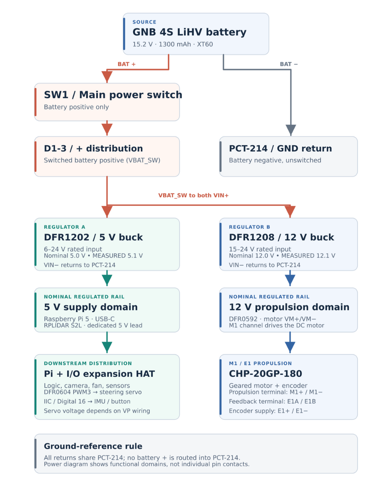
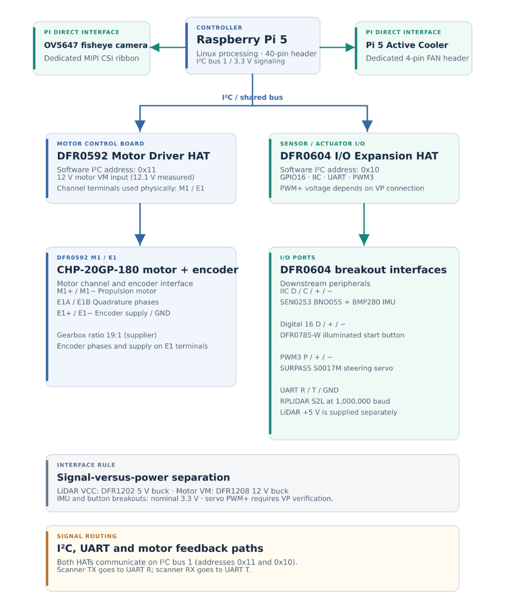
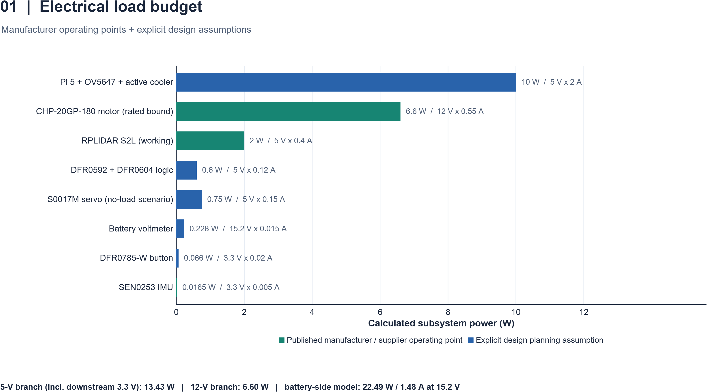
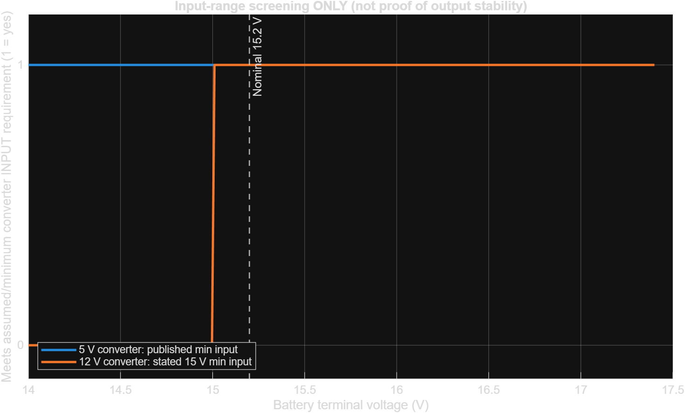
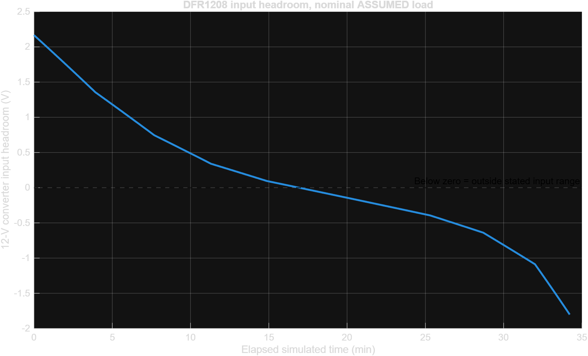
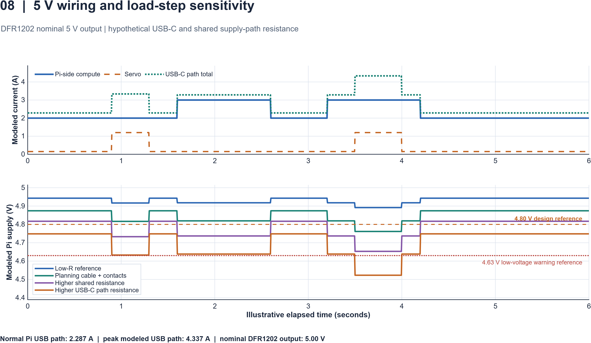
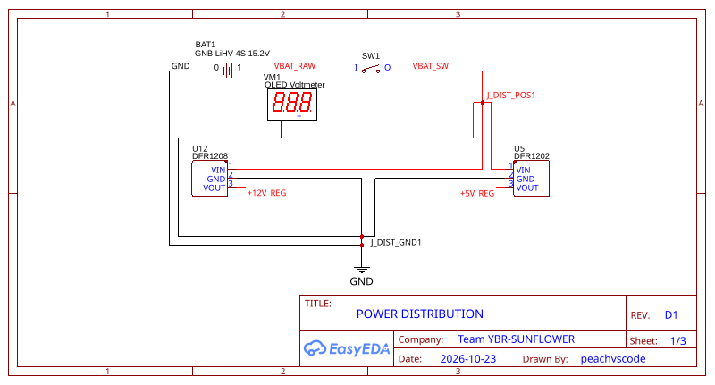
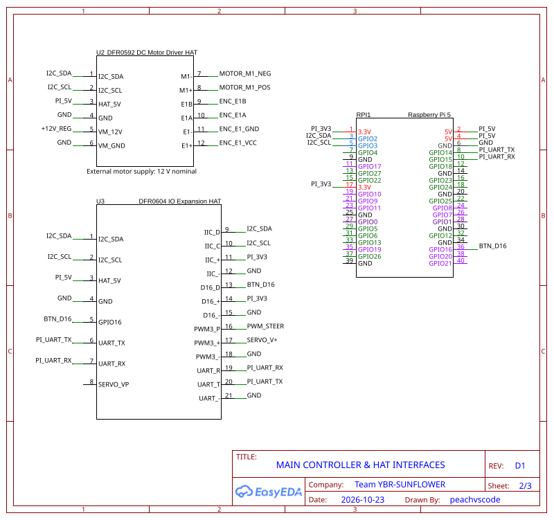
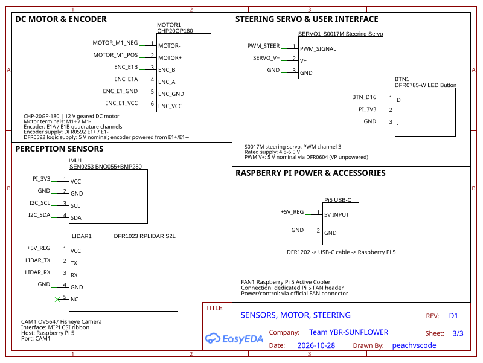
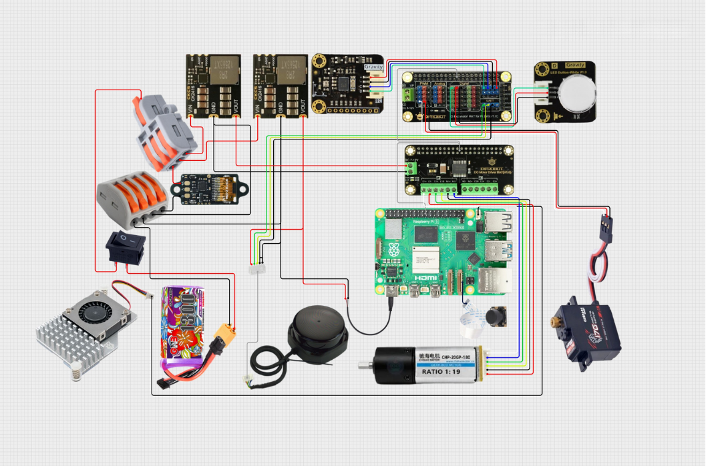

# Power and Sensor Architecture

> **YBR-SUNFLOWER · World Robot Olympiad 2026 · Future Engineers · Engineering Journal 02**  
> **Scope:** Power distribution, controller interfaces, sensing electronics, propulsion and steering circuits, engineering calculations, measured supply voltages, schematics, and MATLAB modeling.  
> **Implementation:** Modular Raspberry Pi HATs and independent regulated power supplies, with commercial wiring/distribution hardware rather than a custom printed circuit board.

[← Project README](../README.md) 
[← Engineering Overview](0-overview.md)
[← Mobility and Mechanical Design](1-mech.md)
[← Software Architecture and Obstacle Strategy](3-software.md)
[← Build and Reproduction Guide](4-build.md)

---

## Contents

1. [Electrical design objectives and evidence policy](#1-electrical-design-objectives-and-evidence-policy)
2. [System architecture](#2-system-architecture)
3. [Component inventory and technical specifications](#3-component-inventory-and-technical-specifications)
4. [Battery selection and nominal energy](#4-battery-selection-and-nominal-energy)
5. [Physical power distribution](#5-physical-power-distribution)
6. [Regulated rails, input headroom and servo power](#6-regulated-rails-input-headroom-and-servo-power)
7. [Electrical calculations and evidence-labeled load budget](#7-electrical-calculations-and-evidence-labeled-load-budget)
8. [MATLAB evidence selected for the electrical chapter](#8-matlab-evidence-selected-for-the-electrical-chapter)
9. [Schematic and pictorial wiring documentation](#9-schematic-and-pictorial-wiring-documentation)
10. [Complete team-reported electrical connections](#10-complete-team-reported-electrical-connections)
11. [Raspberry Pi, HATs and communication buses](#11-raspberry-pi-hats-and-communication-buses)
12. [RPLIDAR S2L](#12-rplidar-s2l)
13. [OV5647 camera and active cooler](#13-ov5647-camera-and-active-cooler)
14. [SEN0253 IMU and DFR0785-W button](#14-sen0253-imu-and-dfr0785-w-button)
15. [Motor driver, geared motor and encoder](#15-motor-driver-geared-motor-and-encoder)
16. [Steering-servo interface](#16-steering-servo-interface)
17. [Electrical reliability and design trade-offs](#17-electrical-reliability-and-design-trade-offs)
18. [Reproducibility and engineering verification](#18-reproducibility-and-engineering-verification)
19. [Technical references](#19-technical-references)

---

## 1. Electrical design objectives and evidence policy

### 1.1 Engineering problem

The robot must supply a Linux computer, sensing modules, communication interfaces, a steering actuator and a geared propulsion motor from **one removable 4S LiHV battery**. Unlike a commercial car ECU, the robot integrates individual off-the-shelf modules and therefore requires deliberate electrical partitioning:

- A switched **battery-voltage input domain** for the two buck converters and the battery display.
- A nominal **5 V domain** for the Raspberry Pi 5 (via USB-C) and RPLIDAR S2L. The Pi and I/O HAT distribute logic and sensor supply to additional modules.
- A nominal **12 V motor domain** for the DFR0592 motor-driver input, not a general 12 V rail for the servo or Raspberry Pi.
- **3.3 V signal/sensor interfaces** on the DFR0604 digital and I²C breakouts, plus separately identified encoder and servo power connections.
- A **common negative/ground reference**, with attention to return-current routing, connector polarity, motor transients and the constraints of a 5 V Raspberry Pi input.

The main architectural decision was to use **commercial Raspberry Pi HATs and external buck modules instead of a custom PCB**. This reduces PCB-design and fabrication work and allows the team to replace modules separately. In return, the design depends on external wiring, connectors, module pinouts and voltage compatibility. These dependencies are explicitly documented in the electrical figures.

### 1.2 Evidence classification

| Evidence label | Meaning | Example in this chapter |
|---|---|---|
| **Manufacturer / supplier specification** | Published rating for a named product or module; may depend on stated test conditions | DFR1202 5 V output, S2L 400 mA working current |
| **Physical installation** | Installed module interface and harness connection identified by the team | DFR0592 **M1/E1**, D1-3 positive splitter and PCT-214 common-ground connector |
| **Calculated** | Deterministic result of a documented equation and inputs | 19.76 Wh nominal battery energy, 0.2 V nominal 12 V-converter headroom |
| **Assumption-based MATLAB simulation** | Synthetic scenario generated by team source code; **not measured telemetry** | Power budget, hypothetical battery-discharge curves, 5 V wiring sensitivity |
| **Team-measured voltage** | Multimeter reading taken at a specified module output | **5.1 V** at the DFR1202 output and **12.1 V** at the DFR1208 output |

A published **maximum** current is not a measured operating current. An assumed current used for a plot is not a new component specification. The two converter-output readings are point measurements, while the current-budget and time-dependent graphs are calculated models rather than sampled telemetry. We do not infer hardware protection, cable cross-section or software state from an EasyEDA symbol alone.

Component ratings are attributed to published specifications; circuit connections follow the assembled-robot wiring record in [`4-build.md`](4-build.md) and the schematic. Software settings are cited to the corresponding Raspberry Pi implementation files.

## 2. System architecture

### 2.1 Power-flow architecture — Figure E-01



**Figure E-01.** Modular power architecture. The 4S LiHV battery positive passes through the main rocker switch to the **D1-3 positive distributor**. Battery negative connects directly to the **PCT-214 common-ground distributor**. The DFR1202 and DFR1208 produce separate nominal 5 V and 12 V supply domains. The team measured **5.1 V** at the 5 V converter output and **12.1 V** at the 12 V converter output. The 12 V domain supplies the DFR0592 motor driver, whose **M1** motor output drives the propulsion motor; **E1** supplies and reads the encoder. The 5 V domain powers the Raspberry Pi via USB-C and the LiDAR through its dedicated power lead. This is a functional power diagram; individual connector contacts are documented in Section 10 and Figure E-03.

The EasyEDA schematic uses `VBAT_RAW` (battery positive before the switch), `VBAT_SW` (switched battery positive), `+5V_REG`, `+12V_REG`, `PI_5V`, `PI_3V3` and `GND`. The Pi's 3.3 V logic supply is not a separate battery converter. Neither the 5 V nor the 12 V converter output is tied to the other's positive output.

### 2.2 Controller and signal architecture — Figure E-02



**Figure E-02.** Controller and signal interfaces. The Raspberry Pi 5 exchanges I²C commands with the DFR0592 motor-driver HAT (software-configured address `0x11` on bus 1) and DFR0604 I/O Expansion HAT (`0x10` on bus 1). The DFR0592 **M1/E1** terminals form the propulsion and encoder interface. DFR0604 provides I²C for SEN0253, Digital 16 for the illuminated start button, PWM3 for the steering servo, and UART for the RPLIDAR S2L. The fisheye camera uses the Pi's CSI ribbon interface; the official active cooler uses its dedicated fan header. The drawing illustrates functional connections and power-domain separation rather than assigning custom connector contact numbers.

## 3. Component inventory and technical specifications

Values in the following tables are **datasheet or supplier ratings**, unless explicitly marked **team-reported**. They are not independently measured installed-unit performance.

### 3.1 Computing, power and actuation

| Component / quantity | Published or team-specified values | Electrical role |
|---|---|---|
| **Raspberry Pi 5, 8 GB — 1** | BCM2712 quad Cortex-A76 2.4 GHz; 40-pin GPIO, two 4-lane MIPI camera/display interfaces; recommended **5 V / 5 A-capable USB-C supply** | High-level perception, decision-making and peripheral host [R1] |
| **GNB13004S120AHV 4S LiHV — 1** | 15.2 V nominal, 1,300 mAh, 4S1P, 120C label, XT60; 129 ± 4 g supplier value | Battery supply [R2] |
| **DFR1202 5 V buck — 1** | DC **6–24 V input**; **5 V ±1%** output; **16 A advertised maximum**; published efficiency >90% at 12 V input under stated loads; output ripple <20 mV under stated conditions | Raspberry Pi USB-C and LiDAR 5 V supply [R3] |
| **DFR1208 12 V buck — 1** | DC **15–24 V input**; **12 V ±1%** output; **12 A advertised maximum**; >95% efficiency *at 24 V input* under stated load conditions; output ripple <50 mV under stated conditions | DFR0592 motor input [R4] |
| **DFR0592 motor-driver HAT V1.0 — 1** | STM32 + TB6612FNG; **7–12 V** rated external motor input; 5 V HAT logic; I²C factory default `0x10`; two channels | **Team-confirmed M1 drive / E1 encoder**; team-reported buck reading **12.1 V**, motor-VM voltage under load not recorded; input-limit review required [R5] |
| **DFR0604 I/O-expansion HAT — 1** | STM32F030, 5 V board supply, nominal 3.3 V sensor breakout supply; GPIO, I²C, UART and PWM; default `0x10`; optional external PWM/servo rail **6–12 V** | Interface to servo, IMU, button and LiDAR UART [R6] |
| **CHP-20GP-180 geared DC motor with encoder — 1** | 12 V; *internal gearbox* ratio **19:1**; no-load output speed 780 rpm; rated output speed 680 rpm; ≤280 mA no-load, ≤550 mA rated, ≤2.7 A stall; 0.40 kgf·cm rated torque, ≥2.0 kgf·cm stall torque | Rear propulsion and quadrature encoder [R7] |
| **SURPASS Hobby S0017M servo — 1** | 4.8–6.0 V operating supply; 0.23 s/60° at 4.8 V and 0.20 s/60° at 6 V; seller-advertised stall torque 1.5 and 1.8 kgf·cm respectively. **0.10–0.20 A no-load and 0.8–1.2 A stall are team-supplied generic planning ranges, not authenticated S0017M ratings** | Steering via PWM3 [R8] |
| **Raspberry Pi 5 Active Cooler — 1** | 5 V via dedicated 4-pin fan header; PWM/tachometer support; published maximum fan speed 8000 rpm ±15% | Computing thermal management [R9] |

**DFR0592 current-rating caution:** DFRobot's specification table lists **2 A continuous**, while its descriptive driver documentation states **1.2 A continuous and 2 A peak** per TB6612FNG channel. The CHP motor supplier states **up to 2.7 A stall current**. This documentation inconsistency and potential stall mismatch remain an engineering design risk; the advertised **12 A converter output** does not remove the driver's channel limit. [R5, R7]

### 3.2 Perception, display and user controls

| Component / quantity | Published specification | Function |
|---|---|---|
| **DFR1023 RPLIDAR S2L — 1** | 5 V, **400 mA working**, 40 mA sleep, TTL UART at **1 Mbps**; 360°; about 10 Hz scan; 32 kHz sample rate; up to 18 m on stated white targets; accuracy ±30 mm | 2D ranging/obstacle perception [R10] |
| **OV5647 5 MP fisheye camera — 1** | OV5647 sensor; seller-advertised 222° lens FoV and 2.1 mm focal length; ribbon-based camera connection | Wide-angle visual perception [R11] |
| **SEN0253 BNO055 + BMP280 — 1** | 3.3–5 V, approximately 5 mA; Gravity-I²C; BNO055 IMU plus BMP280 pressure/temperature | Orientation and environmental sensing [R12] |
| **DFR0785-W LED pushbutton — 1** | 3.3–5 V, **3.3 V recommended**; PH2.0 three-pin digital output; pressed state reported HIGH in vendor example | Human/start control [R13] |
| **0–30 V mini voltmeter — 1** | 3.5–30 V supply, 0–30 V measurement range, <20 mA specified; approximately 0.7% seller accuracy | Observes switched battery voltage [R14] |

**FoV clarification:** 222° is a **seller-stated lens specification**, not a measured usable field of view on the team's Pi 5 and not a calibrated mapping from pixels to bearings. The camera's software calibration belongs to the software journal; the electrical chapter documents only the CSI attachment and hardware interface.

### 3.3 Distribution and cabling

| Device | Team-reported role | Specification/documentation boundary |
|---|---|---|
| **XT60 battery connector** | Main removable battery pair | Polarity must match the actual harness [R2] |
| **KCD5-101-style SPST rocker switch** | Main switch in positive battery lead | Published example **6 A at 125 VAC / 3 A at 250 VAC** are **AC ratings**, not evidence of an equivalent DC/inrush rating [R15] |
| **D1-3 push-type splitter** | Battery-switched **positive-only** distribution | Commercial three-way splitter; supplier listing gives dimensions but no substantiated DC load-current rating for this particular item [R16] |
| **PCT-214 ground-distribution connector** | Common **negative/ground-only** distribution | Commercial 1-in/3-out lever splicing connector; observe the supplier-stated conductor and electrical ratings and the actual installation conditions [R17] |
| **USB-C power lead** | DFR1202 output to Pi 5 USB-C port | Functional two-wire depiction in EasyEDA is **not** a complete USB-C pin/CC circuit |
| **XH2.54 5-position LiDAR breakout** | Custom LiDAR power and UART cable | Team-specific leads and connector orientation are documented in Section 10; no new custom PCB |
| **Camera CSI ribbon, Pi 5 FAN connector, HAT header** | Dedicated commercial interconnects | Not generic GPIO signal wires |

## 4. Battery selection and nominal energy

The single GNB pack supplies **15.2 V nominal** at **1.30 Ah**. The manufacturer's label supports a nominal stored-energy calculation:

```math
E_{\mathrm{nom}} = V_{\mathrm{nom}} C_{\mathrm{Ah}} = (15.2\ \mathrm{V})(1.30\ \mathrm{Ah}) = 19.76\ \mathrm{Wh}.
```

This is a **nameplate-based nominal energy estimate**; it is not a measured usable energy capacity or verified competition runtime. Usable output depends on load, temperature, cell balance, resistance, converter operation and the team's safe operating window.

The published **120C** label is an advertised battery discharge-rate designation, **not** a safe continuous-current rating for the rocker switch, connectors, wire, 5 V USB-C cable or motor driver. Those components must be assessed individually.

Battery voltage changes as the pack discharges and under load. A useful illustrative lumped-resistance relation is:

```math
V_{\mathrm{terminal}}(t) = V_{\mathrm{OC}}\!\left(SOC(t)\right) - I_{\mathrm{battery}}(t)R_{\mathrm{pack}}.
```

Here `V_OC(SOC)` and `R_pack` are **model inputs**, not measured battery data. The model explains why the battery's nominal voltage must not be substituted for its guaranteed terminal voltage at every instant. See Section 8 and the currently published [headroom-model script (Figure 07)](../other/matlab/figure07_12v_input_headroom.m).

## 5. Physical power distribution

The assembled power circuit uses separate positive and return distribution components, with the main switch placed in the battery-positive line.

1. Battery positive `BAT+` passes through **SW1**. Its switched output `VBAT_SW` enters the **D1-3 positive distribution connector**.
2. Battery negative `BAT−` enters the **PCT-214 ground distribution connector directly**, without passing through SW1.
3. The D1-3 distributes positive input to the **DFR1202 VIN**, **DFR1208 VIN** and **voltmeter +**.
4. The PCT-214 provides the corresponding **input GND** branches and the voltmeter return. The buck output grounds and the rest of the robot share the common reference specified by the team's wiring.
5. DFR1202 **VOUT 5 V** supplies the Pi 5 through USB-C and the RPLIDAR power cable.
6. DFR1208 **VOUT 12 V** supplies the DFR0592 external motor supply. Its **M1 channel** drives the CHP motor; the encoder uses **E1**.

The different buck converters are **not** connected output-to-output. The 12 V motor rail is not a steering-servo supply rail. The Pi's 3.3 V GPIO is not a 5 V-tolerant general-purpose input domain.

The voltmeter is connected between `VBAT_SW` and `GND`: it shows the **switched battery input**, not the 5 V or 12 V regulated outputs. The display's approximate 0.7% accuracy is a seller claim, not an individually calibrated measurement.

### 5.1 Distribution-connector limits

The team uses commercially available distribution connectors instead of a custom PDB. This is a valid modular design decision, but the **D1-3 connector's current capacity cannot be established from the dimensions alone**. The PCT-214 supplier reference describes the connector family; installed conductor size, termination and temperature limits must still be respected. Likewise, the rocker switch's published **AC** current rating is not automatically its **DC switching** rating. Battery-side protection should be evaluated independently from the converters' internal output protections.

## 6. Regulated rails, input headroom and servo power

### 6.1 DFR1202 — computing and LiDAR 5 V rail

The DFR1202's manufacturer specifications are **6–24 V input**, **5 V ±1% output** and **16 A advertised maximum** output. This comfortably covers a **nominal 15.2 V pack input range check**, but does not prove the voltage delivered through the Pi USB-C cable under sudden load.

The Raspberry Pi 5 is intended for a **5 V, 5 A-capable power supply**. This is the official *supply recommendation*, not a claim that the Pi consumes 5 A continuously. The team's use of a 5 V buck and custom USB-C lead must distinguish **converter capacity** from **Pi-side voltage and USB-C supply identification behavior**. [R1, R3]

### 6.2 DFR1208 — 12 V motor rail and the headroom limitation

The DFR1208's stated input range is **15–24 V**, while the battery's nominal rating is **15.2 V**. Hence:

```math
M_{12,\mathrm{nom}} = V_{\mathrm{battery,nom}} - V_{\mathrm{DFR1208,min}} = 15.2 - 15.0 = 0.2\ \mathrm{V}.
```

For a loaded pack the applicable relation is:

```math
M_{12}(t) = V_{\mathrm{terminal}}(t) - 15.0\ \mathrm{V}.
```

If this margin is negative, the converter input is **outside its manufacturer's stated operating input range**. It does **not** follow that the output instantly falls to zero, and we cannot claim that the installed converter maintains 12 V outside its specified range.

**Engineering finding:** The nominal 0.2 V headroom is intrinsically small. The DFR1208 may encounter an out-of-spec input condition during discharge or current-related voltage sag. This is a published-specification **architecture limitation**, not an experimental failure claim. DFRobot's stated **>95% efficiency at 24 V input** cannot be applied as a guaranteed efficiency at 15.2 V. [R4]

### 6.3 Steering-servo rail — distinct from 12 V propulsion

The S0017M's supplier specifies **4.8–6.0 V** operation. DFRobot documents the DFR0604 PWM `+` rail as **5 V nominal when external VP is unpowered**; when VP is externally supplied, PWM `+` follows that external **6–12 V** source. [R6, R8]

The drawing therefore records `SERVO_V+` as a separate functional servo supply, with **5 V nominal under the manufacturer's *VP-unpowered configuration***. A 12 V motor converter output must **never** be shown as connected to the S0017M supply. The physical VP wiring state remains a team-configuration fact rather than a datasheet fact (Section 18).

### 6.4 Multimeter observations at the converter outputs

The team measured the following converter output voltages using a multimeter. Both readings are operating observations of the converter outputs, separate from nominal manufacturer specifications and separate from the voltage delivered to a remote load through its cable.

| Measured location (as described by team) | Manufacturer nominal value | Team-reported reading | Interpretation |
|---|---:|---:|---|
| DFR1202 **5 V buck output** | 5.00 V | **5.1 V measured** | Approximately **+2.0%** relative to nominal 5.00 V; above the converter's advertised ±1% nominal tolerance band. Point measurement, subject to meter accuracy and the loading/test conditions |
| DFR1208 **12 V buck output** | 12.00 V | **12.1 V measured** | Approximately **+0.83%** relative to nominal; within a ±1% converter-output tolerance, but **12.1 V is 0.1 V above the stated DFR0592 supply range; the robot is reported to operate at this output reading** |

These are measurements at the converters, not measurements of voltage at the Pi USB-C receptacle or the motor-driver VM terminals under dynamic loading. Converter output tolerance, conductor voltage drop and the downstream module input range are distinct engineering quantities (Section 17). [DFRobot DFR0592 rated input](https://www.dfrobot.com/product-1911.html), [DFRobot DFR1202](https://www.dfrobot.com/product-2907.html), [DFRobot DFR1208](https://www.dfrobot.com/product-2908.html).

### 6.5 Supply-domain summary

| Domain | Nominal value | Distribution and consumers | Status |
|---|---:|---|---|
| `VBAT_RAW` | 15.2 V nameplate | Battery positive → SW1 input | Team-reported |
| `VBAT_SW` | Battery terminal voltage after switch | D1-3 → both buck inputs, voltmeter | Team-reported |
| `+12V_REG` | 12 V | DFR1208 → DFR0592 motor supply | Manufacturer nominal; **team measured 12.1 V**, additional motor HAT input-limit warning |
| `+5V_REG` | 5 V nominal (**5.1 V measured at buck**) | DFR1202 → Pi USB-C and RPLIDAR | Published nominal plus team-reported converter measurement |
| `PI_5V` | Pi 5 V header domain | Logic/HAT interfaces fed through Pi's power system | Functional schematic abstraction |
| `PI_3V3` | 3.3 V | DFR0604 IIC+ and D16+ → SEN0253/DFR0785 | Manufacturer breakout specification; team-reported |
| `SERVO_V+` | **5 V conditional** | DFR0604 PWM3+ → S0017M | Manufacturer VP-unpowered mode; team state in Section 18 |
| `GND` | 0 V reference | PCT-214, converter returns, Pi and other peripherals | Shared reference |

## 7. Electrical calculations and evidence-labeled load budget

The load model was revised to match the selected [Figure 01 MATLAB source](../other/matlab/figure01_electrical_load_budget.m). It uses **published operating points where available** and identifies every other current as a **scenario assumption**, not an instrument reading. Component input power is calculated from each supply domain using:

```math
P_k=V_k I_k,\qquad P_{\mathrm{branch}}=\sum_k P_k.
```

**Model-versus-measurement clarification.** The load budget treats the small downstream 3.3 V loads as output-power allocations on the 5 V branch and does **not** characterize Pi onboard 3.3 V conversion efficiency. Figures 01, 02, 07 and 08 were generated using nominal **5.00 V / 12.00 V** design rails, explicit load-current assumptions and assumed efficiencies. They were **not refit or rerendered** using the newly reported **5.1 V / 12.1 V buck measurements**. The difference is intentional: two static converter readings do not establish the power consumed by the Pi, motor or servo under competition load.

### 7.1 Component-by-component current allocation

| Electrical load | Nominal modeled voltage | Current used | Calculated load power | Evidence class |
|---|---:|---:|---:|---|
| Raspberry Pi 5 + OV5647 + active cooler | 5.0 V | 2.00 A | **10.00 W** | **Assumed** aggregate operating demand; not the Pi 5 PSU's 5 A capacity |
| RPLIDAR S2L | 5.0 V | 0.400 A | **2.00 W** | DFRobot published **working** current |
| DFR0592 + DFR0604 HAT logic | 5.0 V | 0.120 A | **0.600 W** | **Assumed** electronic-logic demand |
| S0017M steering servo (normal scenario) | 5.0 V | 0.150 A | **0.750 W** | **Assumed** representative no-load point; valid as a 5 V rail allocation **only if external VP is unpowered** |
| DFR0785-W button | 3.3 V | 0.020 A | **0.066 W** | **Assumed** illuminated-button consumption |
| SEN0253 IMU | 3.3 V | 0.005 A | **0.0165 W** | DFRobot published operating current |
| CHP-20GP-180 motor (rated-current upper bound) | 12.0 V | ≤0.550 A | **≤6.60 W** | Supplier upper bound at rated condition, **not a measured running demand** |
| Mini voltmeter | 15.2 V switched battery | 0.015 A | **0.228 W** | **Assumed** consumption; direct pack branch |

The 3.3 V subloads draw from the Pi/logic supply, which itself is ultimately fed by the 5 V buck. Their **output-load** powers are included once in a lossless first-order upstream budget; the model does not characterize the Pi's 3.3 V internal-conversion loss. The motor rated current is an upper bound and therefore **not** a guaranteed operational point.

```math
P_{5,\mathrm{model}}=(5)(2.00+0.400+0.120+0.150)+(3.3)(0.020+0.005)=13.4325\ \mathrm{W}.
```

```math
P_{12,\mathrm{model}}=(12)(0.550)=6.60\ \mathrm{W}.
```

Both buck converters are modeled at **90% constant efficiency as a planning assumption**; DFR1208's higher published efficiency at a specified **24 V test input** must not be substituted as its efficiency on this 15.2 V battery.

```math
P_{\mathrm{battery,model}}=\frac{13.4325}{0.90}+\frac{6.60}{0.90}+0.228
\approx22.49\ \mathrm{W}.
```

```math
I_{\mathrm{battery,nom\ scenario}}=\frac{22.4863}{15.2}\approx1.48\ \mathrm{A}.
```

The user-provided **generic S0017M servo planning envelope** is approximately 0.10–0.20 A no-load and 0.8–1.2 A stall; these are **not verified model-specific specifications or robot measurements**. Substituting **1.20 A** for the modeled **0.15 A** servo normal current increases the 5 V branch by 5.25 W, and increases estimated battery power to approximately **28.32 W** (1.86 A at 15.2 V) if all other assumptions and converter efficiencies remain unchanged. The servo-current upper scenario is not a continuous-duty recommendation.

### 7.2 Wiring voltage drop and resistive dissipation

```math
\Delta V=I R_{\mathrm{path}},\qquad P_{\mathrm{loss}}=I^2 R_{\mathrm{path}}.
```

In Figure 08's separate **USB-C branch** model, the RPLIDAR is **not** counted in the Pi power cable current: it receives a distinct branch from the DFR1202. The modeled USB-C current is:

```math
I_{\mathrm{USB,normal}}=2.00+0.120+\frac{3.3}{5.0}(0.005+0.020)+0.150=2.2865\ \mathrm{A}.
```

A simultaneous additional **1.00 A assumed Pi processing load** and increase of the servo from **0.15 A to 1.20 A** gives a peak modeled USB-C path current of **4.3365 A**. This is an *illustrative coincidence of independent assumed load events*, not a measured Pi 5 current.

### 7.3 Why nameplate energy is not competition runtime

For the 4S LiHV pack, nominal label energy is:

```math
E_{\mathrm{nom}}=15.2\ \mathrm{V}\times 1.30\ \mathrm{Ah}=19.76\ \mathrm{Wh}.
```

An energy-over-average-power quotient is only an idealized arithmetic comparison. It does **not** establish usable energy, battery voltage trajectory, output regulation or the duration of a WRO run. In particular, DFR1208 may leave its specified **15–24 V input window** while the pack still has charge; MATLAB Figure 07 analyzes that design constraint.

## 8. MATLAB evidence selected for the electrical chapter

The four embedded MATLAB graphics support complementary engineering questions: component load allocation, regulator input compatibility, 12 V converter headroom and Raspberry Pi power-path voltage drop. **MATLAB figures use their own 01–08 sequence**; E-01 through E-04 identify architecture, schematic and wiring drawings. Source code is provided as standalone MATLAB scripts in [`other/matlab/`](../other/matlab/). Calculated and synthetic results are not physical telemetry.

### 8.1 MATLAB Figure 01 — Electrical load budget



**MATLAB Figure 01.** Calculated load allocations based on manufacturer/supplier operating points and clearly identified design assumptions. The CHP-20GP-180 motor is represented at its supplier's rated-current bound, not at a measured driving current. The calculated output-power allocations are **13.4325 W on the nominal 5 V branch** (including downstream 3.3 V subloads) and **6.60 W for the 12 V motor branch**. With illustrative 90% converter efficiencies, the model gives approximately **22.49 W** and **1.48 A** at a nominal 15.2 V battery voltage. The output voltage readings in Section 6.4 are independent of this model. [MATLAB source](../other/matlab/figure01_electrical_load_budget.m).

### 8.2 MATLAB Figure 02 — Converter input-range screening



**MATLAB Figure 02.** Manufacturer input ranges: DFR1202 **6–24 V** and DFR1208 **15–24 V**. The 4S LiHV battery is **15.2 V nominal**; **17.4 V** is a full-charge chemistry reference based on 4 × 4.35 V/cell. The DFR1208's nominal input headroom is only **0.20 V**. This is a compatibility screen, not a measurement of converter regulation; the sweep's lower plotting bound is not a battery cutoff. [MATLAB source](../other/matlab/figure02_converter_input_range.m).

### 8.3 MATLAB Figure 07 — Simulated DFR1208 input headroom

The battery screening model uses an illustrative LiHV open-circuit-voltage function, an assumed **0.12 Ω** equivalent battery resistance, constant converter-efficiency assumptions and **0.5× / 1.0× / 1.5×** load scenarios:

```math
V_{\mathrm{terminal}}=V_{\mathrm{OC}}(SOC)-I_{\mathrm{battery}}R_{\mathrm{pack}},\qquad
M_{12}(t)=V_{\mathrm{terminal}}(t)-15\ \mathrm{V}.
```



**MATLAB Figure 07.** The synthetic examples reach the DFR1208's published **15 V input minimum** at approximately **61.5 min (light)**, **28.0 min (planning)** and **16.6 min (heavy)**. These are neither measured battery endurance nor predicted usable robot runtime. Dotted portions show mathematical extrapolation below the published regulator input limit. [MATLAB source](../other/matlab/figure07_12v_input_headroom.m).

### 8.4 MATLAB Figure 08 — 5 V USB-C path and load-step sensitivity



**MATLAB Figure 08.** A resistive wiring sensitivity analysis for a hypothetical 5.00 V supply, not a recorded oscilloscope trace or switching-converter transient model. The assumed source voltage is intentionally separate from the **5.1 V converter output reading**. The LiDAR is supplied by its own 5 V branch and is not counted in the Pi USB-C cable current:

```math
V_{\mathrm{Pi}}(t)=5.00\ \mathrm{V}-I_{\mathrm{USB}}(t)
\left(R_{\mathrm{USB}}+R_{\mathrm{shared}}\right).
```

| Modeled path condition | Assumed total resistance | Minimum modeled Pi voltage |
|---|---:|---:|
| Low-resistance reference | 0.025 Ω | **4.892 V** |
| Planning cable and contacts | 0.055 Ω | **4.761 V** |
| Higher shared resistance | 0.080 Ω | **4.653 V** |
| Higher USB-C path resistance | 0.110 Ω | **4.523 V** |

The **4.80 V** design reference and **4.63 V** nominal undervoltage-warning reference are illustrative comparisons rather than exact trip thresholds. Actual cable resistance, USB-C power-source recognition, switching-regulator response and Pi input waveform are separate measurements. The simulated servo-current branch assumes DFR0604 VP is unpowered; that assumption does not establish installed VP wiring. [MATLAB source](../other/matlab/figure08_5v_wiring_sensitivity.m).

### 8.5 Simulation reproducibility

| Embedded visualization | Standalone MATLAB program | Analytical role |
|---|---|---|
| MATLAB 01 | [`figure01_electrical_load_budget.m`](../other/matlab/figure01_electrical_load_budget.m) | Component load-budget arithmetic |
| MATLAB 02 | [`figure02_converter_input_range.m`](../other/matlab/figure02_converter_input_range.m) | Published input-voltage limits |
| MATLAB 07 | [`figure07_12v_input_headroom.m`](../other/matlab/figure07_12v_input_headroom.m) | Battery equivalent-circuit scenario |
| MATLAB 08 | [`figure08_5v_wiring_sensitivity.m`](../other/matlab/figure08_5v_wiring_sensitivity.m) | Pi supply-path resistance sensitivity |

To reproduce a plot, execute its full `.m` program in MATLAB and use the generated PNG in `engineering_journal/visualization/`. Other exploratory electrical simulations are available in the same script directory, but the four shown here directly support the design and reliability discussion.

## 9. Schematic and pictorial wiring documentation

### 9.1 Figure E-03 — Three-sheet EasyEDA electrical schematic

The electrical schematic uses commercial-module symbols and named nets to document power distribution, controller interfaces and peripheral connections. It is a **module-level schematic**, not the internal design of a custom printed circuit board.

**Figure E-03A — Sheet 1/3: Power Distribution**



**Figure E-03B — Sheet 2/3: Main Controller and HAT Interfaces**



**Figure E-03C — Sheet 3/3: Sensors, Motor and Steering**



**[View the combined E-03 three-page EasyEDA schematic (PDF)](../schemes/schematic_diagram.pdf).** The sheet titles above identify the three functional groups and their order. The separate SVG files provide detailed, scalable renderings on GitHub.

**Schematic interpretation.** Custom module-symbol pin numbers are logical EasyEDA symbols and should not be mistaken for verified manufacturer connector-contact positions. A common net name denotes electrical continuity across sheets. The Raspberry Pi 40-pin header uses documented physical GPIO numbering. The USB-C power symbol is a simplified connection abstraction rather than a full USB-C CC-pin circuit.

### 9.2 Figure E-04 — Pictorial physical wiring



**Figure E-04.** Wiring illustration of the assembled modular electrical system, including power, motor and encoder groups, I²C, UART and servo connections. The DFR0592 propulsion harness uses **M1/E1** and the battery ground distributor is **PCT-214**. The detailed terminal and conductor functions are recorded in Section 10, while the schematic in Figure E-03 supplies the named electrical nets.

### 9.3 Constructed-robot electrical assembly

The [`Build and Reproduction Guide`](4-build.md) documents cable and connector assembly with photographs. In particular, the [converter harness](../other/Pic/Build/04.png), [custom LiDAR connector](../other/Pic/Build/06.png), and [installed electronics](../other/Pic/Build/18.png) illustrate the physical realization of the power and signal architecture. Component selection and electrical design rationale are kept in this journal; the build guide records the corresponding assembly procedure.

### 9.4 Documentation scope and electrical drawing identifiers

Figures **E-01** and **E-02** describe functional power and controller architecture. **E-03A/B/C** are the three sheets of the same EasyEDA electrical schematic, and **E-04** is the pictorial harness. The MATLAB plots retain their standalone numbering **01–08**. Detailed cable tables in Section 10 complement these drawings without requiring a duplicate connector-map figure.

## 10. Complete team-reported electrical connections

The following records use the wiring description supplied by the team for its redesigned robot and the matching EasyEDA module nets. **Wire colors are physical cable colors as reported; EasyEDA's default green wires are drawing objects, not a cable-color specification.** Connector pin *numbers* are omitted unless directly supported by the Pi's published physical header map.

### 10.1 Battery, regulator and return wiring

| From / terminal | To / terminal | Net or function | Team-reported cable |
|---|---|---|---|
| GNB battery `+` (XT60 positive) | SW1 rocker input | `VBAT_RAW` | Red / positive |
| SW1 switched output | D1-3 positive splitter | `VBAT_SW` | Red / positive |
| GNB battery `−` (XT60 negative) | PCT-214 common-ground splitter | `GND` | Black / negative |
| D1-3 output | Mini voltmeter `+` | Switched battery reading | Positive lead |
| PCT-214 output | Mini voltmeter `−` | Common return | Black |
| D1-3 output | DFR1208 `VIN` | Switched input to 12 V buck | Positive lead |
| PCT-214 output | DFR1208 `GND` | 12 V buck input return | Black |
| D1-3 output | DFR1202 `VIN` | Switched input to 5 V buck | Positive lead |
| PCT-214 output | DFR1202 `GND` | 5 V buck input return | Black |
| DFR1208 `VOUT` / `GND` | DFR0592 `VM+` / `VM−` | `+12V_REG` / `GND` | Positive / black return |
| DFR1202 `VOUT` / `GND` | Raspberry Pi 5 USB-C power lead | `+5V_REG` / `GND` | Positive / black return |
| DFR1202 `VOUT` / `GND` | RPLIDAR S2L 5 V / power-ground leads | `+5V_REG` / `GND` | Red / black |

The team's drawing shows both buck output negatives referenced to common ground, and the LiDAR's additional ground lead tied into the custom breakout. There is **no battery-positive connection to PCT-214** and **no battery-negative connection to D1-3**.

### 10.2 DFR0592 M1 motor and E1 encoder harness

The DFR0592 terminal group used for propulsion consists of **M1+ / M1−** for motor drive and **E1A / E1B / E1+ / E1−** for the quadrature encoder. Section 6.7 of the [`Build and Reproduction Guide`](4-build.md#67-connect-to-other-components) identifies the motor and Hall/encoder lead names.

| Installed DFR0592 terminal | As-built cable function | Evidence / caveat |
|---|---|---|
| `M1+` | Motor lead called **`M1 MOTOR`** in build guide | Motor polarity and commanded forward direction are defined consistently by hardware and motor-control software |
| `M1−` | Motor lead called **`M2 MOTOR`** in build guide | `M2 MOTOR` here is the **motor's second lead label**, **not** the HAT M2 channel |
| `E1−` | Encoder/Hall `GND HALL` | Encoder ground return |
| `E1B` | Encoder/Hall `C2 HALL` | Channel B per current assembly instructions |
| `E1A` | Encoder/Hall `C1 HALL` | Encoder phase A |
| `E1+` | Encoder/Hall `VCC HALL` | Encoder positive supply, not the motor VM voltage |

**Terminal identification:** M1 and E1 refer to the selected DFR0592 channel, while `M1 MOTOR` and `M2 MOTOR` are the two conductors named on the motor assembly. The motor conductor called `M2 MOTOR` does **not** indicate that the DFR0592 M2 output is used. The six-contact encoder supply/phase group is separate from motor supply `VM+ / VM−`.

The HAT motor outputs are controlled over I²C; the software channel selection and encoder channel selection must use the same physical M1/E1 channel documented in this wiring table. The motor-control implementation is maintained in [`motor_manager.py`](../src/Raspberrypi/classes/motor_manager.py).

### 10.3 DFR0604 I²C, button, servo and UART breakouts

| DFR0604 connector | External module and terminal | Wire color | Schematic net / function |
|---|---|---|---|
| `IIC D` | SEN0253 `SDA` | Green | `I2C_SDA` |
| `IIC C` | SEN0253 `SCL` | Blue | `I2C_SCL` |
| `IIC +` | SEN0253 `VCC` | Red | `PI_3V3` |
| `IIC −` | SEN0253 `GND` | Black | `GND` |
| `Digital 16 D` | DFR0785-W `D` | Green | `BTN_D16` / GPIO16 |
| `Digital 16 +` | DFR0785-W `+` | Red | `PI_3V3` |
| `Digital 16 −` | DFR0785-W `−` | Black | `GND` |
| `PWM3 P` | S0017M PWM/signal | White | `PWM_STEER` |
| `PWM3 +` | S0017M positive | Red | `SERVO_V+` |
| `PWM3 −` | S0017M ground | Black | `GND` |
| `UART R` | Custom RPLIDAR breakout **green lead** | Green | Pi UART receive terminal, team-reported destination |
| `UART T` | Custom RPLIDAR breakout **yellow lead** | Yellow | Pi UART transmit terminal, team-reported destination |
| `UART −` | RPLIDAR ground via custom breakout | Black | `GND` |
| `UART +` | Not used in team's LiDAR power connection | — | **Unconnected**; LiDAR 5 V comes directly from DFR1202 |

**LiDAR custom cable note:** The team reported **two black ground conductors joined at its XH2.54 five-position breakout**. The spare lead is documented as the team's cable modification, not automatically as a fifth ground pin inside the manufacturer's scanner. The actual **scanner-side TX/RX identities** of the green and yellow leads are not proven by wire colors; the team-reported HAT terminal connections are preserved without making an unsupported assertion about the internal scanner pin order.

### 10.4 Pi interface, camera and cooling

| Physical host interface | External connection | Function |
|---|---|---|
| Pi 5 USB-C power port | DFR1202 regulated 5 V supply via custom cable | Processor/board supply |
| Raspberry Pi 40-pin header: physical 3, GPIO2 | I²C SDA of HATs / SEN0253 breakout | `I2C_SDA` |
| Raspberry Pi 40-pin header: physical 5, GPIO3 | I²C SCL of HATs / SEN0253 breakout | `I2C_SCL` |
| Raspberry Pi 40-pin header: physical 36, GPIO16 | DFR0604 Digital 16 signal / LED button | `BTN_D16` |
| Raspberry Pi 40-pin header: physical 8, GPIO14 | DFR0604 UART T / TX | `PI_UART_TX` |
| Raspberry Pi 40-pin header: physical 10, GPIO15 | DFR0604 UART R / RX | `PI_UART_RX` |
| Raspberry Pi 40-pin header: physical 2/4 | HAT 5 V logic domain | `PI_5V` |
| Raspberry Pi 40-pin header: physical 1/17 | 3.3 V reference / breakout supply | `PI_3V3` |
| A Raspberry Pi 40-pin GND contact | Both HAT logic grounds | `GND` |
| Raspberry Pi 5 CAM/DSI ribbon connector | OV5647 fisheye camera | MIPI CSI interface; camera port as team installed |
| Raspberry Pi 5 dedicated FAN header | Official Raspberry Pi Active Cooler | 5 V, PWM fan control and tachometer via official connector |

The DFR0592 and DFR0604 share the Raspberry Pi's I²C interface *as represented by the team's schematic*. Their internal MCU functions are not reconstructed into fictional individual Raspberry Pi control lines.

## 11. Raspberry Pi, HATs and communication buses

### 11.1 Controller choice

The Raspberry Pi 5 (8 GB) is used as the main Linux computing platform. The Pi's two MIPI camera/display connectors, 40-pin GPIO header and ability to interface with I²C/UART modules support the robot's chosen camera, motor driver, IMU, LiDAR and start-button arrangement. The active cooler uses the **Pi 5 dedicated fan connector**, not an ad-hoc motor-driver output. [R1, R9]

### 11.2 I²C address map and the two HATs

The two HATs share the Raspberry Pi I²C bus with different configured addresses. DFRobot supplies both boards with the same factory-default address, so an address change is required when both are connected on one I²C bus.

| Device | Published default | Configured software address | Source |
|---|---|---|---|
| DFR0592 motor HAT | `0x10` | **`0x11`, I²C bus 1** | [`motor_manager.py`](../src/Raspberrypi/classes/motor_manager.py), `MOTOR_BOARD_ADDRESS` |
| DFR0604 expansion HAT | `0x10` | **`0x10`, I²C bus 1** | [`board_manager.py`](../src/Raspberrypi/classes/board_manager.py), `BOARD_ADDRESS` |
| SEN0253 BNO055 | `0x28` | Default sensor address | Module reference [R12] |
| SEN0253 BMP280 | `0x76` | Default sensor address | Module reference [R12] |

The DFR0592 address is assigned with `set_addr(0x11)` and takes effect after a power cycle; the expansion HAT remains at `0x10`. The implementation includes an address-collision guard. A Raspberry Pi `i2cdetect -y 1` scan provides a reproducible check of the addresses visible on the running bus. The values above describe software configuration, whereas the scan would be direct connected-hardware evidence.

### 11.3 GPIO and UART

The DFR0604 Digital 16 signal connects to Raspberry Pi **BCM GPIO16**. The UART expansion breakout exposes Raspberry Pi UART transmit and receive, nominally Pi physical GPIO header pins **8 (TXD0/GPIO14)** and **10 (RXD0/GPIO15)** in the team drawing. **A UART transmitter must be received by a receiver at the other device**, but the exact manufacturer TX/RX identity of the team's customized LiDAR cable cannot be safely inferred from conductor color alone.

### 11.4 Logic-voltage separation

The DFR0604 sensor `+` breakout nominally supplies **3.3 V**; this is the preferred rail for the LED button and an allowed supply for SEN0253. The LiDAR receives its **separate regulated 5 V**, not power from the UART `+` contact. The motor driver receives its **separate 12 V motor supply**, while the servo uses the **PWM+ rail** subject to the VP condition discussed above. Do not interpret the presence of a common ground as permission to join these positive rails.

## 12. RPLIDAR S2L

The DFR1023 RPLIDAR S2L is a 360° direct time-of-flight ranging sensor. DFRobot lists **5 V**, **400 mA operating**, **40 mA sleep**, **10 Hz scan frequency**, **32 kHz sampling**, a stated **0.05–18 m** white-target range and **±30 mm** ranging accuracy. The host interface is **TTL UART at 1 Mbps**; these are manufacturer specifications, not YBR-SUNFLOWER field measurements. [R10]

The team's electrical design powers the scanner directly from the **DFR1202** rather than from the DFR0604 UART `+` breakout. Its UART data goes through the DFR0604 breakout to the Pi. The custom cable uses an XH2.54 five-position connector and the conductor colors described in Section 10.3. The host software's packet parsing, coordinate transformations and pillar-detection algorithm are outside the scope of this chapter.

Electrical integration considerations are stable 5 V supply, common UART return and correct TX/RX signal pairing. The published maximum range is not a guarantee for every dark, transparent or highly reflective competition object.

**Software interface note:** [`lidar_manager.py`](../src/Raspberrypi/classes/lidar_manager.py) currently configures `/dev/ttyAMA0`, **1,000,000 baud**, for the Pi's UART breakout. This is implementation evidence, not a measurement of packet error rate; the team’s scanner-side TX/RX wire colors remain a separate physical-harness check.

## 13. OV5647 camera and active cooler

### 13.1 Fisheye camera

The team's camera is an **OV5647 5 MP fisheye module** advertised by its seller as approximately **222° FoV** with a **2.1 mm lens**. It uses a ribbon connection to one of the Raspberry Pi 5's MIPI CSI interfaces. This wide-angle claim is a **vendor assertion**; actual pixel-to-bearing calibration and usable corner coverage are not established by this electrical documentation. [R11]

The camera module is **not** shown as a Pi GPIO pin group. The physical camera port and flex-ribbon adapter are part of the Pi's separate CAM/DSI interface. Camera exposure, image calibration and parking perception are software/mechanical integration topics.

### 13.2 Raspberry Pi 5 Active Cooler

The official Active Cooler connects to the Pi 5 **dedicated four-pin FAN header**, receives **5 V from the Pi** and supports fan PWM/tachometer operation. The manufacturer describes a temperature-controlled fan and aluminium heatsink. [R9]

The cooler is documented as a native Pi accessory; it does **not** require an independent hand-wired fan supply from either buck converter.

## 14. SEN0253 IMU and DFR0785-W button

### 14.1 SEN0253 BNO055 + BMP280

The SEN0253 combines the BNO055 accelerometer, gyroscope and magnetometer with a BMP280 pressure/temperature sensor. DFRobot specifies **3.3–5 V**, about **5 mA**, and a Gravity-I²C connector. The module provides fused orientation and environmental readings; the datasheet's accuracy and range statements depend on sensor mode and calibration, and are **not** measured pose accuracy of the vehicle. [R12]

The team's connection uses the DFR0604 IIC `D/C/+/-` terminals with green SDA, blue SCL, red 3.3 V and black GND leads. The BNO055 (`0x28`) and BMP280 (`0x76`) defaults are recorded in Section 11. Magnetic disturbance from the motor, current conductors or nearby ferrous materials can affect magnetometer readings; such effects should not be labeled as tested or eliminated without evidence.

**Software configuration:** [`compass_manager.py`](../src/Raspberrypi/classes/compass_manager.py) sets `USE_MAGNETOMETER = False` and selects the BNO055 **IMUPLUS** fusion mode (gyroscope and accelerometer). This avoids reliance on a magnetometer susceptible to nearby motor/metal magnetic fields, but does not prove heading accuracy or eliminate gyro drift. The actual mounting-frame and calibration procedure remain team-specific.

### 14.2 DFR0785-W illuminated button

The DFR0785-W is a **digital-output, illuminated pushbutton** using a three-pin PH2.0 interface. DFRobot specifies **3.3–5 V** and recommends **3.3 V**. The team's Digital 16 connection is signal **D** (green), positive **+** (red) and ground **−** (black), mapped to `BTN_D16`, `PI_3V3` and `GND`. [R13]

The button is part of the human/start interface; its software debounce, start-state logic and competition behavior belong to the software journal.


### 14.3 Sensor selection, placement geometry and calibration method — rubric evidence boundary

The LiDAR provides planar 360° range observations, the camera supplies a wide-angle visual view for colored objects/parking, and the IMU provides short-term orientation estimates. These **functional selection reasons** complement the interconnect schematic but do not determine physical sensor pose or calibration from a product listing. The wide-angle fisheye vendor claim and S2L's target-dependent ranging limits are discussed in Sections 12 and 13.

#### Sensor choice rationale and geometric constraints

The three sensors are **complementary, not interchangeable**. The following matrix states defensible engineering reasons for the selected sensor types; it is a functional analysis, **not** an invented record of alternatives that the team physically tested.

| Installed sensor | Reason it contributes | Important limitation / design trade-off |
|---|---|---|
| RPLIDAR S2L (planar 360° dToF) | Range returns can support wall proximity and planar obstacle geometry, including directions outside a forward-facing camera image | Only one scanning plane; chassis/servo mounting can occlude beams; reported range/accuracy depend on target material and environment |
| OV5647 fisheye camera | Image color and texture can distinguish red/green markers and provide visual context for parking | Seller-stated 222° does **not** establish calibrated usable FoV; lens distortion, lighting and image exposure affect detection |
| SEN0253 BNO055/BMP280 | Short-term angular/orientation information complements range and image observations | Magnetometer disturbance and orientation biases require placement-aware calibration; orientation alone cannot locate field walls |

The **WRO 2026 General Rules** specify track-border spacing that may vary between approximately **600 mm and 1000 mm in the Open Challenge**, with a nominal **1000 mm** spacing in the Obstacle Challenge; the parking-space width is **200 mm**. These field dimensions motivate checking side coverage, near-wall blind spots, and camera visibility near the parking area. They **do not** prove coverage without the team's actual sensor coordinates, yaw/pitch and occlusion geometry.

A valid calibration record would include the camera lens model and its frame transform, LiDAR scan-plane origin/heading relative to the chassis, and IMU mounting-frame orientation/heading treatment. These are **documentation requirements, not claims that such calibration has been completed**.

For reproducibility and the **2026 WRO Power & Sensor Architecture rubric**, sensor-frame locations and calibration methods should be documented with the same evidence discipline as wiring. In particular, a camera's 222° seller claim is not usable angle-per-pixel calibration; the 360° LiDAR coverage does not by itself establish unoccluded coverage after mounting. The motor/metal hardware may also bias the IMU magnetometer.

**Sensor reference frame.** The robot's localization model uses the rear-axle midpoint as its planar pose reference. In the current [`final/config.toml`](../src/Raspberrypi/tasks/final/config.toml), `lidar_ahead_mm = 65.0` defines a **65 mm forward offset from the rear axle to the LiDAR reference center**. The configured kinematic wheelbase is 165 mm. These are software-model parameters; they should not be mistaken for independent measurements of sensor height, tilt or field-of-view occlusion.

**Calibration and orientation interface.** The camera's wide-angle projection requires an intrinsic/fisheye mapping when quantitative image bearings are used. The LiDAR scan azimuth is mapped to the robot heading through a configured angular offset and possible mirroring, while the BNO055 provides an initial heading reference. The project's [`lidar_manager.py`](../src/Raspberrypi/classes/lidar_manager.py) documents the LiDAR bearing convention, and [`compass_manager.py`](../src/Raspberrypi/classes/compass_manager.py) configures the BNO055 in IMUPLUS mode with magnetometer-based heading disabled to reduce sensitivity to local magnetic disturbances.

A geometric field-coverage claim requires installed sensor origin, pitch/yaw, scan-plane height and chassis occlusion geometry. The component datasheets alone do not determine those quantities. This is a defined evidence boundary, not an assumed calibration result.

## 15. Motor driver, geared motor and encoder

### 15.1 DFR0592 motor and encoder channel assignment

The DFR0592 contains an STM32 I²C controller and TB6612FNG H-bridge stage. In the vehicle circuit, **M1+ / M1−** drive the CHP motor while **E1A / E1B / E1+ / E1−** provide the encoder interface. The motor's 19:1 reduction is **inside the purchased gearbox**; multiplying speed or torque by 19 a second time would be a modeling error. [R5, R7]

### 15.2 Motor rated points and torque conversion

Manufacturer/supplier figures at 12 V are **780 rpm no-load**, **680 rpm rated**, **≤550 mA rated current**, **0.40 kgf·cm rated torque**, **≤2.7 A stall current** and **≥2.0 kgf·cm stall torque**. These are not measurements of the installed vehicle.

Using `1 kgf·cm = 0.0980665 N·m`:

```math
\tau_{\mathrm{rated}} = 0.40\ \mathrm{kgf\!\cdot\!cm}\times 0.0980665 \approx 0.0392\ \mathrm{N\!\cdot\!m}.
```

```math
\tau_{\mathrm{stall,supplier}} \ge 2.0\times 0.0980665 \approx 0.196\ \mathrm{N\!\cdot\!m}.
```

The supplier's rated current upper bound implies a **rated-point electrical input of at most 12 × 0.55 = 6.6 W** under the stated rating conditions; this is not motor shaft output or combined vehicle power. Stall behavior can demand substantially more current and impose a larger load on the TB6612FNG channel. The difference between the motor's stall-current limit and the DFR0592's published current figures is a real design constraint, not a task that can be cleared by a larger buck converter.

**Software trace:** The existing motor controller uses `GEAR_RATIO = 19`, `ENCODER_PPR = 11`, an effective ×4 phase-edge convention according to its comments, `ENCODER_SIGN = -1`, and `ENCODER_CALIBRATION = 1.0`. Their mathematical nominal combined count is **11 × 4 × 19 = 836 quadrature edge counts per gearbox output revolution** *under that interpretation*. The controller calls a DFR0592 speed-reporting API and applies its own scaling; **836 is not a measured wheel count or direct report of the HAT library output**. The *external* 18T-to-28T gear pair described in the build guide changes wheel rotation relative to gearbox-output rotation, so effective counts per wheel revolution require documenting which shaft the observation represents and validating the scale. [Motor control source](../src/Raspberrypi/classes/motor_manager.py) · [Build gearing](4-build.md#84-assemble-drivetrain).

### 15.3 Encoder counting and software calibration

Let `N` be counted encoder events over sampling time `Delta_t`, and let `C_w` be **the effective encoder counts per wheel-output revolution for the team's selected decoding mode**. Then:

```math
n_{\mathrm{wheel}} = \frac{60N}{C_{w}\,\Delta t},\qquad
v_{\mathrm{wheel}} = \frac{2\pi r\,N}{C_{w}\,\Delta t}.
```

No **measured wheel counts-per-revolution** are claimed: the nominal 836 gearbox-output edge count above is **derived from software parameters**, while an observed and calibrated `C_w` depends on the encoder pulse definition, quadrature decoding (×1, ×2 or ×4), gearbox, external gearing and software configuration. **No `encoder_calibration.m` script exists in the current public `other/matlab/` directory**; consequently the electrical journal does not link to an obsolete path or present an unrelated battery-current script as an encoder study. Keep `C_w` symbolic until the installed motor/encoder configuration supplies a defensible value.

## 16. Steering-servo interface

The S0017M is driven by the DFR0604 onboard STM32-generated PWM channel **3**, not by applying 12 V motor power to a Raspberry Pi GPIO output. The team reports:

- `PWM3 P` → servo PWM signal, white.
- `PWM3 +` → servo supply, red.
- `PWM3 −` → servo return, black.

The supplier's **4.8–6 V** rating and advertised 0.20 s/60° at **6 V** are referenced values, not a measured steering-wheel response. The DFR0604's VP-unpowered supply configuration makes PWM+ **5 V nominal**; externally powering VP at 6–12 V would instead pass that voltage to PWM+, potentially exceeding the servo rating. The servo's output-shaft angle is not automatically equal to the road-wheel angle because of the steering linkage. For planning plots only, the team supplied approximately **0.10–0.20 A no-load current** and **0.8–1.2 A possible stall current** as generic 17 g digital-servo ranges. Their precision and applicability to this exact S0017M revision are **not authenticated by the cited seller specification**; Figure E-03 assumes 0.15 A and MATLAB Figure 08 assumes a transient 1.20 A scenario. These are electrical/mechanical interface facts, not a claimed servo calibration. [R6, R8]

## 17. Electrical reliability and design trade-offs

### 17.1 Risk register — findings supported without invented measurements

| Topic | Supported engineering conclusion | What the figure/specification cannot prove |
|---|---|---|
| **DFR1208 input headroom** | 15.2 V pack nominal minus 15.0 V minimum input = **0.2 V nominal margin**; battery sag/discharge can remove it | Actual shutdown point or delivered output under out-of-spec input |
| **Motor-driver current capacity** | DFR0592 documentation contains a 1.2 A continuous/2 A peak statement alongside a 2 A table figure; motor supplier gives ≤2.7 A stall | That the real vehicle stalls, that the driver survives every stall, or the actual channel current |
| **Servo VP and PWM+** | Servo requires 4.8–6 V; DFR0604 gives PWM+ = 5 V when VP unpowered | Which VP terminal wiring is present on this assembled robot |
| **USB-C / Pi 5 V** | Official Pi 5 supply recommendation is 5 V/5 A capable; DFR1202 is rated 5 V up to 16 A | That the custom lead identifies as a 5 A source or stays above Pi input limits under load |
| **Battery switch / connectors** | Switch seller lists AC ratings; installed splitter/contact rating is not established | An equivalent DC interrupt rating or correctly specified crimp/wire capacity |
| **I²C defaults** | Both HATs default to `0x10`; collision is possible on one bus | Physical confirmation of current bus-1 addresses `0x11` and `0x10` |
| **LiDAR UART / cable** | Scanner uses TTL UART; team provided destination R/T terminals and conductor colors | Scanner-side TX/RX identity based on cable color alone |
| **Motor and IMU interference** | Motor currents, return-path resistance and magnetic fields can affect electrical or sensor performance | Actual interference magnitude in the assembled chassis |

### 17.2 Electrical operating limits and protection considerations

The installed two-regulator arrangement is practical for a modular robot but introduces several coupled operating limits:

| Design element | Electrical reasoning | Practical design implication |
|---|---|---|
| DFR1208 input versus 4S battery | DFR1208 is specified for 15–24 V input; 4S LiHV is 15.2 V nominal | Battery discharge and internal resistance can reduce its input below the published range even while the pack retains charge |
| 12 V motor supply | The team measured 12.1 V at the DFR1208 output; DFR0592 publishes a 7–12 V motor-supply range | The team reports successful operation at this setting, but the measured converter output is 0.1 V above the stated driver range; this does not establish a new manufacturer limit |
| DFR1202 output | DFRobot publishes 5 V ±1%; team measured 5.1 V | The measured point is about 2% above nominal and should be interpreted in light of meter accuracy and the loading/test point; the Pi-side USB-C voltage may differ |
| Motor stall and drive limits | CHP motor supplier lists ≤2.7 A stall; DFR0592 motor-driver documentation describes 1.2 A continuous / 2 A peak per channel in its product text | Driver thermal and overcurrent exposure require attention to stalled-wheel and steering conditions; regulator output capacity is not an H-bridge current guarantee |
| Servo VP power domain | S0017M operates over 4.8–6.0 V; DFR0604 PWM+ depends on its VP connection | External VP must be compatible with the servo, and 12 V propulsion power must not be applied to the servo connector |
| Modular battery distribution | Switch, XT60, D1-3 and PCT-214 form the upstream power circuit | Connector conductor limits, DC switching suitability, cable insulation and upstream fault protection remain separate from the converters' internal protections |
| Pi USB-C wiring | Buck voltage does not equal Pi receptacle voltage during load steps | Wiring resistance and USB-C supply recognition must be considered when assessing undervoltage behavior |

The observation that the robot operates from a **12.1 V converter output** is a legitimate team observation. It does not alter the DFR0592 manufacturer's specified voltage range, and it does not imply that the driver has experienced a fault. Likewise, a reported buck-output voltage is distinct from a regulated output measured at the load during acceleration.

### 17.3 Design choices and trade-offs

The power system uses two regulator modules to separate the Raspberry Pi and LiDAR supply from the propulsion supply. This limits direct coupling between positive power rails and simplifies module replacement. The trade-off is additional cables and connectors, shared return-current paths and the requirement to match each regulator's *input range* to the battery voltage across the intended operating window.

The commercial DFR0592 and DFR0604 HATs offer compact modular actuation and peripheral interfaces through I²C, avoiding custom board fabrication. Their two factory-default addresses both start at `0x10`; the controller configuration uses `0x11` for DFR0592 and `0x10` for DFR0604 on bus 1. This retains both functions on one software-visible I²C bus. The servo PWM channel uses its own positive-supply convention, independently of the 12 V propulsion supply.

A future regulator replacement, an alternative power topology or a custom PDB would require its own actual design rationale and comparison evidence. The existing design is documented through the installed commercial modules and published ratings rather than fictional alternatives or fabricated bench tests.

### 17.4 Scope of simulation and electrical evidence

The physical circuit, manufacturer ratings, two multimeter readings and MATLAB results describe **different levels of evidence**. E-01 through E-04 explain connection topology; manufacturer tables state allowable operating conditions; the voltage readings show two sampled regulator output values; and the MATLAB figures are deterministic calculations or simulations at specified assumptions. None of these in isolation measures motor transients, LiDAR startup inrush, actual battery internal resistance, calibrated camera coverage or full-run energy consumption.

### 17.5 WRO 2026 Power and Sensor Architecture evidence map

The WRO 2026 documentation rubric emphasizes explainable system design, sensor choice and placement, calibration, wiring, failure-point awareness and engineering iteration. The corresponding evidence in this repository is organized as follows:

| Engineering criterion | Published technical evidence |
|---|---|
| Power distribution and component budget | E-01, Sections 3–7, MATLAB 01 and 02 |
| Converter input-range and voltage-drop analysis | Sections 6–8, MATLAB 07 and 08, Section 17.2 |
| Schematic, signal flow and electrical reproduction | E-02, E-03A/B/C, E-04, terminal tables in Sections 9–11 and [`4-build.md`](4-build.md) |
| Sensor selection and physical limitations | Sections 12–14 and sensor comparison table |
| Sensor coordinate conventions and software interfaces | Section 14.3 and the linked Pi configuration/source files |
| Actuator choice, encoder model and steering supply | Sections 15–16 and the cited motor/servo specifications |
| Failure-point reasoning and design trade-offs | Section 17.1–17.4, supported by the converter and driver manufacturers' limits |

The architecture is evaluated as a connected system: the power budget relates to the battery and regulator ratings; motor-drive electrical limits relate to mechanical loading; and sensor mounting, image processing and localization assumptions affect control performance. Physical observations and calibration data should be attributed to the experiment or source file where they were obtained.

## 18. Reproducibility and engineering verification

### 18.1 Repository resources

| Resource | GitHub path |
|---|---|
| E-01 — Modular power architecture | [`schemes/modular_power_architecture.png`](../schemes/modular_power_architecture.png) |
| E-02 — Controller and signal interfaces | [`schemes/control_sensor_interfaces.png`](../schemes/control_sensor_interfaces.png) |
| E-03A — Power Distribution | [`schemes/power_distribution.svg`](../schemes/power_distribution.svg) |
| E-03B — Main Controller and HAT Interfaces | [`schemes/main_controller_hat_interfaces.svg`](../schemes/main_controller_hat_interfaces.svg) |
| E-03C — Sensors, Motor and Steering | [`schemes/sensors_motor_steering.svg`](../schemes/sensors_motor_steering.svg) |
| E-03 — Combined three-sheet EasyEDA schematic | [`schemes/schematic_diagram.pdf`](../schemes/schematic_diagram.pdf) |
| E-04 — Pictorial wiring diagram | [`schemes/wiring_diagram.png`](../schemes/wiring_diagram.png) |
| MATLAB Figures 01, 02, 07 and 08 | [`visualization/`](visualization/) |
| Electrical MATLAB source code | [`other/matlab/`](../other/matlab/) |
| Completed-robot construction photos | [`4-build.md`](4-build.md) and [`other/Pic/Build/`](../other/Pic/Build/) |
| Current Raspberry Pi interfaces and motor-control code | [`src/Raspberrypi/`](../src/Raspberrypi/) |

The EasyEDA SVG/PDF exports are suitable for reviewing module terminals and named nets. Native EasyEDA project sources retain additional editing information not carried by a graphical PDF or SVG export.

### 18.2 Verification and calibration reference

| Subsystem | Verification quantity or reference method | Source of the stated information |
|---|---|---|
| Buck supplies | Measure DC voltage at each output and at its attached load under defined idle and actuation conditions; record input voltage, instrument and load state | Team-reported point readings: **5.1 V** (DFR1202) and **12.1 V** (DFR1208) at converter outputs |
| I²C HATs | Read addresses on bus 1 and compare device response to the source configuration | [`motor_manager.py`](../src/Raspberrypi/classes/motor_manager.py) (`0x11`); [`board_manager.py`](../src/Raspberrypi/classes/board_manager.py) (`0x10`) |
| Motor and encoder | Check motor polarity and matching selected drive/encoder channel; verify positive/negative motor command direction with wheels lifted | Electrical harness M1/E1, Section 10.2; encoder scaling in Section 15 |
| Servo PWM3 | Confirm signal, supply and GND terminals; check VP-dependent positive supply before applying steering load | DFR0604 and S0017M specifications, Section 16 |
| LiDAR UART | Match scanner transmit to UART receive; ensure separate regulated 5 V and common ground | E-02/E-03, Section 10.3; [`lidar_manager.py`](../src/Raspberrypi/classes/lidar_manager.py) |
| Camera and IMU | Relate sensor frame orientation, camera projection and scan-bearing convention to the chassis pose reference | Section 14.3 and Raspberry Pi source files |
| Upstream protection | Determine switch DC suitability, conductor rating and presence or absence of an actual battery-side protective device | The installed power harness and component markings; no nonexistent protection device is depicted |

Reproducibility depends on preserving both the schematic's named electrical nets and the software's selected peripheral channels. A physical terminal group and the corresponding software controller channel must agree for motor and encoder behavior to follow the documented circuit.

## 19. Technical references

### 19.1 WRO documentation and engineering methods

- [WRO Association — 2026 season rules](https://wro-association.org/competition/2026-season/) — use the **Future Engineers General Rules**, especially **Appendix C** (documentation rubric) and the game-field geometry
- [WRO Association — official questions and answers](https://wro-association.org/competition/questions-answers/)
- [GitHub documentation — mathematical expressions](https://docs.github.com/en/get-started/writing-on-github/working-with-advanced-formatting/writing-mathematical-expressions) — this chapter uses fenced `math` blocks to render equations on GitHub.

### 19.2 Computing, power and actuation

- **[R1]** [Raspberry Pi 5 hardware documentation](https://www.raspberrypi.com/documentation/computers/raspberry-pi.html) and [Raspberry Pi 5 product specifications](https://www.raspberrypi.com/products/raspberry-pi-5/).
- **[R2]** [GNB LiHV 4S 15.2 V 1300 mAh battery](https://www.gaoneng.shop/products/gaoneng-gnb-lihv-4s-15.2v-1300mah-120c-xt60-lipo-battery).
- **[R3]** [DFR1202 DC-DC 5 V / 16 A buck converter](https://www.dfrobot.com/product-2907.html).
- **[R4]** [DFR1208 DC-DC 12 V / 12 A buck converter](https://www.dfrobot.com/product-2908.html).
- **[R5]** [DFR0592 motor-driver HAT reference and pinout](https://wiki.dfrobot.com/dfr0592/) and [driver protocol documentation](https://wiki.dfrobot.com/dfr0592/docs/19834).
- **[R6]** [DFR0604 I/O Expansion HAT reference](https://wiki.dfrobot.com/dfr0604/) and [PWM supply / board interface](https://wiki.dfrobot.com/dfr0604/docs/19728).
- **[R7]** [CHP-20GP-180 geared DC motor with encoder — supplier specifications](https://www.airsoftmotor.com/micro-dc-reduction-motor/planetary-gear-motor/chp-20gp-180-dc-planetary-gear-motor.html).
- **[R8]** [SURPASS S0017M steering servo — seller specification](https://www.amazon.sa/-/en/S0017M-Transmission-Digital-Servo-Suitable/dp/B0CP78SS71).
- **[R9]** [Raspberry Pi 5 Active Cooler](https://www.raspberrypi.com/products/active-cooler/).

### 19.3 Sensors, cables and distribution

- **[R10]** [DFR1023 RPLIDAR S2L — manufacturer/distributor specifications](https://www.dfrobot.com/product-2617.html).
- **[R11]** [OV5647 fisheye camera — vendor lens/FoV listing](https://www.amazon.com/dp/B07JPXBF3X).
- **[R12]** [DFRobot SEN0253 BNO055 + BMP280 IMU](https://wiki.dfrobot.com/sen0253/).
- **[R13]** [DFRobot DFR0785-W LED button](https://www.dfrobot.com/product-2362.html).
- **[R14]** [0–30 V mini OLED voltmeter supplier manual](https://manuals.plus/m/ab6837e825d941ff9cac34b823e7b44b2a35dc1b08c44d02f8004d9824bb13e7).
- **[R15]** [KCD5-101 rocker switch supplier specification](https://www.chinadaier.com/kcd5-101-small-black-on-off-rocker-switch/).
- **[R16]** [D1-3 positive splitter supplier listing](https://garmade.com/products/5pcs-d1-3-push-type-mini-wire-connection-splitter-quick-connect-terminal-blockorange).
- **[R17]** [PCT-214 lever splicing connector — 1-in/3-out commercial terminal](https://evelta.com/pct-214-splicing-connector-terminal-1-in-3-out-lever-splicing-connector/).

---

