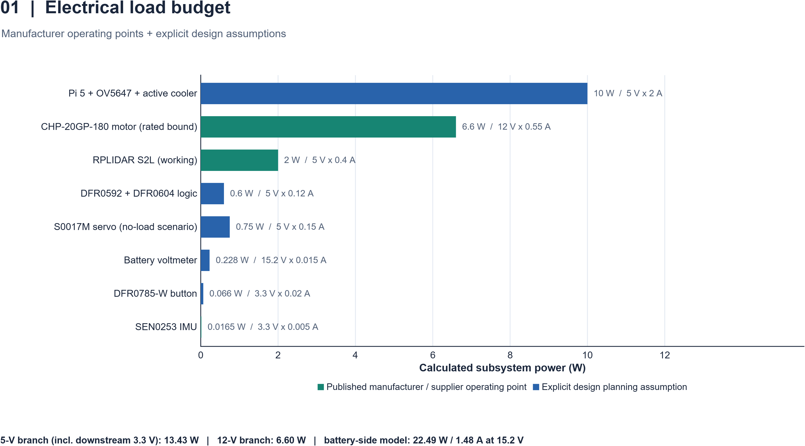
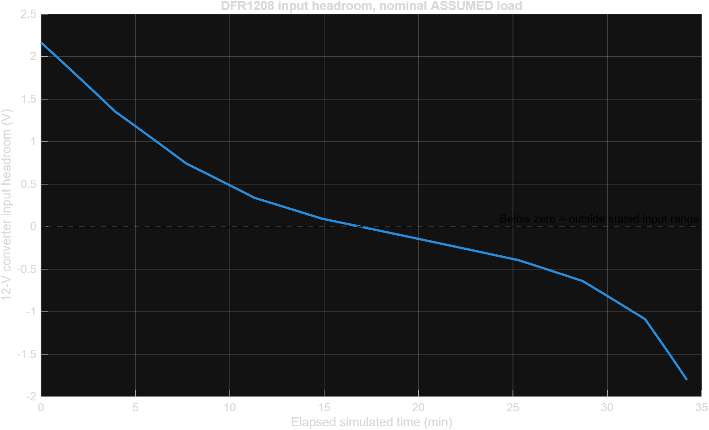
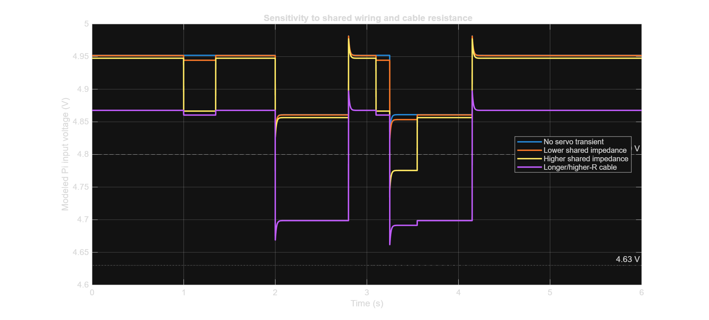

# Power and Sensor Architecture

> **YBR-SUNFLOWER · WRO 2026 Future Engineers · Engineering Journal 02**
> **Scope:**

> **Evidence policy:** **Team-reported** means supplied by the team; **Datasheet** means a published part specification; **Model / MATLAB** means a calculation or simulation with stated assumptions; **Measured** means an observed value with test conditions, instruments and a repeatable procedure. No simulated value below is presented as a physical measurement. `[TODO]` identifies information or evidence not yet supplied.

[← Project README](../README.md) · [← Engineering Overview](0-overview.md)

[← Mobility and Mechanical Design](1-mech.md) · [Software Architecture and Obstacle Strategy →](3-software.md)

# บนนี้อย่าแก้นะพีท แก้แค่ล่างจากนี้นะ!!!

---

## Contents

1. [The electrical design problem](#1-the-electrical-design-problem)
2. [System architecture](#2-system-architecture)
3. [Component inventory and specifications](#3-component-inventory-and-specifications)
4. [Power-source selection: 4S LiHV battery](#4-power-source-selection-4s-lihv-battery)
5. [5 V, 12 V and servo power domains](#5-5-v-12-v-and-servo-power-domains)
6. [Engineering calculations and power budget](#6-engineering-calculations-and-power-budget)
7. [MATLAB evidence: three electrical investigations](#7-matlab-evidence-three-electrical-investigations)
8. [Schematics, wiring and harness design](#8-schematics-wiring-and-harness-design)
9. [Communication buses, pinout and I2C configuration](#9-communication-buses-pinout-and-i2c-configuration)
10. [RPLIDAR S2L range sensing](#10-rplidar-s2l-range-sensing)
11. [OV5647 fisheye camera](#11-ov5647-fisheye-camera)
12. [SEN0253 inertial and pressure sensing](#12-sen0253-inertial-and-pressure-sensing)
13. [Motor driver, encoder and steering interfaces](#13-motor-driver-encoder-and-steering-interfaces)
14. [Interference, thermal behavior and failure prevention](#14-interference-thermal-behavior-and-failure-prevention)
15. [Calibration and electrical validation](#15-calibration-and-electrical-validation)
16. [Engineering choices, trade-offs and revisions](#16-engineering-choices-trade-offs-and-revisions)
17. [Reproduction requirements and outstanding work](#17-reproduction-requirements-and-outstanding-work)
18. [Technical references](#18-technical-references)

---

## 1. The electrical design problem

YBR-SUNFLOWER's electrical system must power an autonomous car using a compact, removable battery, deliver stable power to the Raspberry Pi 5 and sensors, provide sufficient power for the drive motor and steering servo, and maintain accurate perception under varying lighting conditions.

### 1.1 Constraints we designed around

| Constraint | Electrical consequence | Evidence required |
|---|---|---|
| Self-contained autonomous power | A LiHV battery must supply computing, sensing and actuation | Battery specifications, energy/current budget, voltage tests |
| Compact vehicle | Components, harnesses and cooling must fit inside the body | Mounting dimensions and completed assembly photos |
| Variable WRO field and red/green pillars | Range, visual and inertial sensors must retain useful observations | Sensor-placement geometry and calibration |
| Sudden steering/motor changes | Supply voltage and grounds may be disturbed by changing current | Loaded rail-voltage and current measurements |
| Clear start procedure | One power switch and one start button must have documented behavior | Button circuit and start-state validation |
| Reproducible GitHub submission | Another team must be able to follow the exact supply and signal connections | Schematic, connection tables and software configuration |

**Current mechanical context (team-reported):** wheelbase 161 mm, front/rear track 117 mm, provisional length 211 mm, width 135 mm and height 100 mm. These are useful for describing sensor placement; their full installed-device coordinates are still **[TODO]**. The front camera mounting is not yet final. See [Mechanical Engineering](1-mech.md).

### 1.2 Evidence status

- **Team-reported hardware:** the component models in Section 3, including the **SEN0253 BNO055 + BMP280 IMU**, which was added after the original wiring diagram was drafted.
- **Team-reported integration:** the DFR0592/DFR0604 I²C conflict has been resolved. The method and observed addresses are not yet documented.
- **MATLAB studies completed as demonstrations:** Steps 01–03; **11 figures**, all based in whole or part on illustrative parameters.
- **Not yet supplied:** verified netlist, actual servo voltage/rail, battery and regulator operating traces, final sensor mounting coordinates, measured current budget and calibration records.

---

## 2. System architecture

### 2.1 Energy and information paths

The design currently identifies these **intended** domains:

| Domain | Main source / interface | Intended consumers | Verification status |
|---|---|---|---|
| Battery input | GNB 4S LiHV battery → XT60, rocker switch and distribution connectors | Inputs to buck converters; battery-voltage display as wired | Physical wiring and switch/fuse rating **[TODO]** |
| Nominal 5 V | DFR1202, 6–24 V in → 5 V out | Raspberry Pi 5; possibly some 5 V peripherals, depending on final wiring | Pi voltage, USB-C connection, exact branches **[TODO]** |
| Nominal 12 V | DFR1208, 15–24 V in → 12 V out | DFR0592 motor-driver external input / CHP motor as wired | Converter headroom and connected terminals **[TODO]** |
| Steering-servo supply | **[TODO — must determine]** | S0017M servo, whose advertised supply range is **4.8–6 V** | **Critical: do not assume PWM VP = safe servo voltage** |
| Low-voltage logic | Raspberry Pi GPIO, HATs, I²C / CSI / USB | Sensors, buttons and motor/servo commands | Bus, voltage levels, pinout **[TODO]** |

**[TODO — Figure E-01]** Create a **power distribution block diagram** showing individual paths from battery through switching, connectors and regulators to each consumer. Use separate colors or line conventions for **power**, **return/ground**, **control**, and **data**. Include wire/connector IDs and fuse/protection arrangements if actually present. Store the finished drawing in `../schemes/`.

**[TODO — Figure E-02]** Create a **signal architecture diagram** covering Raspberry Pi, DFR0592, DFR0604, SEN0253, camera, RPLIDAR, encoder, start button and servo. Do **not** combine this with the power diagram into an unreadable cable bundle.

### 2.2 Integration philosophy

The modular architecture reduces the need to manufacture and debug a custom PCB, but transfers responsibility to **inter-module interfaces**: external power polarity, common-ground layout, cable ratings, control-voltage compatibility, HAT addressing and connector identification. These deserve the same engineering rigor as a custom board's schematic.

**[TODO — Engineering decision E-D01]** Document why the team selected a Raspberry Pi 5 with the DFR0592 and DFR0604 rather than a single custom controller or other motor/control electronics. Record competing options, cost, implementation effort and testing evidence.

---

## 3. Component inventory and specifications

The following list is based on the team's `All_Hardwares_YBR-SUNFLOWER.txt` and cited product pages. Listed operating ratings are **not measurements of this assembled car**. Quantities, board revisions and actual supply branches should be checked before a final schematic is released.

### 3.1 Computing, power and actuation

| ID | Installed/intended component | Published or team-supplied technical details | Role / verification |
|---|---|---|---|
| E01 | **Raspberry Pi 5 (8 GB)** | BCM2712, quad Cortex-A76 at 2.4 GHz; 40-pin GPIO, USB 3.0/2.0, dual MIPI connectors; 5 V USB-C supply | Perception and control; actual current and USB-C supply behavior **[TODO]** |
| E02 | **GNB GNB13004S120AHV LiHV battery** | 4S1P; 15.2 V nominal, 1300 mAh, 120C label; XT60; 23.5 × 38 × 80 mm; 129 ± 4 g claimed | Main electrical energy store; voltage/current tests **[TODO]** |
| E03 | **DFR1202 buck converter** | 6–24 V input; 5 V ±1% output; 16 A *maximum advertised* output; >90% at stated test conditions; <20 mV rated ripple under stated loads | Nominal 5 V branch; actual regulation and temperature **[TODO]** |
| E04 | **DFR1208 buck converter** | 15–24 V input; 12 V ±1% output; 12 A *maximum advertised* output; >95% at a 24 V input test point; <50 mV rated ripple under stated loads | Nominal 12 V branch; input-headroom problem **open** |
| E05 | **DFR0592 motor-driver HAT v1.0** | STM32 + TB6612FNG, I²C, default address `0x10`, 7–12 V motor input; driver current specifications require revision-specific review | Motor power and encoder input; exact terminals **[TODO]** |
| E06 | **DFR0604 IO Expansion HAT** | STM32F030; 5 V board supply; 4 PWM outputs, analog/digital and bus breakout; default I²C address `0x10`; VP external servo supply option specified for 6–12 V | Servo PWM and I/O; actual VP configuration **[TODO]** |
| E07 | **CHP-20GP-180 12 V geared DC motor** | Internal reduction 19:1; 780 rpm no-load, 680 rpm rated, 0.40 kgf·cm rated torque; ≤550 mA rated current, ≤2.7 A stall current (supplier values) | Drive propulsion; driver-current margin **[TODO]** |
| E08 | **CHP-20GP-180 encoder** | Encoder associated with motor; pulses-per-revolution and output electrical levels not yet independently established | Feedback; A/B wiring and counting convention **[TODO]** |
| E09 | **SURPASS Hobby S0017M servo** | Advertised 4.8–6 V operating range; ~0.23 s/60° at 4.8 V, ~0.20 s/60° at 6 V; 1.5–1.8 kgf·cm stall-torque ratings | Front steering; servo power, ground, pulse range and peak current **[TODO]** |
| E10 | **Raspberry Pi Active Cooler** | Pi 5 fan-header powered, PWM fan control and tachometer, advertised max 8000 rpm ±15% | Processor cooling; fan current and thermal measurements **[TODO]** |

**Motor-driver current caution:** One DFRobot documentation section lists a 2 A driver-current figure, while its driver-description text discusses a lower continuous channel rating and a 2 A peak. The motor supplier gives a **≤2.7 A stall-current specification**. These are not automatically compatible. **[TODO]** Verify the actual board's continuous/peak capability, startup and stall behavior, protection and supply current. Do not use converter maximum current as evidence that the driver can safely deliver it.

### 3.2 Perception and user interface

| ID | Component | Supplied / published details | Verification |
|---|---|---|---|
| E11 | **DFRobot DFR1023 RPLIDAR S2L** | 5 V; 400 mA *working* specification, 40 mA sleep; 360° scan; ~10 Hz scan; up to 18 m on stated targets; native TTL UART (vendor kit includes USB adapter) | Real bus/adapter, scan height, accuracy **[TODO]** |
| E12 | **OV5647 5 MP fisheye camera** | OV5647 image sensor; supplier listing advertises 222° field of view and 2.1 mm lens | Lens FOV definition, distortion calibration, CSI wiring **[TODO]** |
| E13 | **DFRobot SEN0253 Gravity 10-DOF IMU** | BNO055 accelerometer/gyro/magnetometer + BMP280 pressure/temperature; 3.3–5 V, approximately 5 mA per DFRobot; I²C | Actual bus/address, orientation and magnetic calibration **[TODO]** |
| E14 | **DFR0785-W LED button** | 3.3–5 V, 3.3 V recommended; PH2.0 3-pin digital signal; pressed output High per vendor | Single start command; wiring, debounce and wait-state **[TODO]** |
| E15 | **0–30 V mini OLED voltmeter** | 3.5–30 V supply, advertised <20 mA, ~0.7% accuracy, 5 Hz refresh | Which rail it reads, wiring and meter comparison **[TODO]** |
| E16 | **KCD5-101 rocker switch** | SPST ON/OFF; vendor lists AC switching ratings (6 A/125 VAC, 3 A/250 VAC) | **DC switching suitability unverified**; test label and inrush rating |

**Camera caution:** The camera retailer's product page contains generic and potentially inconsistent listing fields. **222° is a supplier-stated lens specification, not a measured horizontal FOV**. Do not assume 222° horizontal field of view or use it directly as a calibrated projection parameter.

### 3.3 Wiring and distribution components

| ID | Part / feature | Planned role | Missing information |
|---|---|---|---|
| E17 | D1-3 (team previously called it D1-2) push-type splitter | Distribution junction | Confirm exact printed part, permitted wire gauge, DC current and polarity; name discrepancy **[TODO]** |
| E18 | PCT-214 four-terminal connector | Distribution junction | Exact net assignment, vendor authenticity and conductor specification **[TODO]** |
| E19 | XT60 battery lead | Battery connection | Polarity, cable size and strain relief **[TODO]** |
| E20 | USB-C-to-two-wire Pi supply lead | Feed Raspberry Pi via USB-C | Power-pin wiring, gauge, cable drop and 5 A power-supply recognition **[TODO]** |
| E21 | XH2.54-5P LiDAR connector / cable | LiDAR interface | Pin order, power supply, host interface and ground **[TODO]** |
| E22 | Camera ribbon and miscellaneous connectors | Camera/board signals | Connector orientation, cable routing and strain relief **[TODO]** |

**[TODO]** Include installed component quantities, manufacturer revision, mass and cost in the final bill of materials. Commercial distribution blocks are acceptable for a modular robot; their actual electrical ratings and mechanical security still require verification.

---

## 4. Power-source selection: 4S LiHV battery

### 4.1 Nominal electrical energy

The battery label states a nominal capacity of **1.30 Ah** at **15.2 V**. Its nominal stored-energy estimate is

$$
E_{\mathrm{nom}}=V_{\mathrm{nom}}C_{\mathrm{Ah}}
=15.2\,\mathrm{V}\times1.30\,\mathrm{Ah}
=19.76\,\mathrm{Wh}.
$$

This is a **nameplate-based calculation**, not delivered usable energy during a competition run. Actual capacity and voltage depend on discharge rate, temperature, battery condition and protection limits. A **120C** label must not be used by itself to justify the robot's connector, wire, switch or motor-driver current rating.

### 4.2 Battery terminal voltage under load

For a simple lumped-resistance model:

$$
V_{\mathrm{terminal}}(t)
=V_{\mathrm{OC}}\bigl(SOC(t)\bigr)
-I_{\mathrm{battery}}(t)R_{\mathrm{pack}}.
$$

Here `V_OC(SOC)` is the assumed open-circuit voltage function and `R_pack` is an equivalent battery-plus-connection resistance. **Neither has yet been measured for YBR-SUNFLOWER.** This is a modeling relation, not the precise behavior of the real LiHV cells.

### 4.3 The 12 V regulator's limited input headroom

The DFR1208 is specified for **15–24 V** input. The LiHV pack is labeled **15.2 V nominal**; its nominal numerical headroom is only

$$
M_{12\mathrm{V},\,\mathrm{nom}}
=15.2-15.0=0.2\,\mathrm{V}.
$$

The relevant loaded condition is

$$
M_{12\mathrm{V}}(t)=V_{\mathrm{terminal}}(t)-15.0\,\mathrm{V}.
$$

If `M_12V < 0`, the source is outside the manufacturer's stated input operating range. This **does not establish the exact 12 V output voltage** or the converter's shutdown point. That requires a physical test under representative current, or a verified circuit model.

**[TODO — High-priority verification]** Record battery terminal voltage, DFR1208 input and output voltage, 12 V load current, and any motor response variation at several safe battery states of charge. Use battery-manufacturer safety rules; **do not** select a charging or discharge cutoff from our MATLAB demonstration values.

### 4.4 Battery operating practice

- [TODO] Identify the exact battery and charger settings and manufacturer-specified cell limits.
- [TODO] Provide the main battery connector and polarity check photograph.
- [TODO] Record how battery voltage is observed before a run and how a low-battery condition is handled.
- [TODO] Determine whether an inline fuse or other upstream protection is fitted; document location and rating if so.
- [TODO] Keep loose XT60 contacts insulated during development; physically secure the battery and heavy conductors.

---

## 5. 5 V, 12 V and servo power domains

### 5.1 DFR1202 — 5 V logic/computing branch

DFR1202 is rated for **6–24 V input** and nominal **5 V output**. Its advertised 16 A is an upper output capability under specified conditions, **not a claim that the Pi consumes 16 A**. The manufacturer's efficiency statement applies only to the stated test operating points; it is not a fixed efficiency across all battery voltages and loads.

**Raspberry Pi 5 power issue:** Raspberry Pi recommends a **5 V / 5 A capable USB-C power supply** for unrestricted downstream USB-peripheral current. Supplying the Pi through a simple two-wire USB-C lead from a 5 V regulator may not communicate the same available-current capability as a compatible negotiated supply. The Pi's actual USB current limit and power-input voltage must be checked in the assembled configuration.

**[TODO]** Measure voltage at (a) the DFR1202 output terminals and (b) the Raspberry Pi input under idle, compute load, sensor startup and combined operation. Record load current and check for Pi undervoltage warnings.

### 5.2 DFR1208 — motor-driver branch

DFR1208 is rated for **15–24 V input** and **12 V output**. The CHP-20GP-180 motor is specified at 12 V; the motor is operated through the DFR0592 driver. The electrical behavior of the actual motor-driver terminals must be measured under load.

**[TODO]** Verify what is connected to the converter's 12 V rail: motor driver input, any other modules, distribution terminals and monitoring circuits. It is incorrect to infer a 12 V servo power connection merely from a nearby PWM header.

### 5.3 Servo supply — must be traced separately

The S0017M seller advertises **4.8–6 V DC** operation. DFR0604's PWM connectors may draw their positive supply from the Pi-side 5 V domain or from its **external VP** supply. DFRobot describes an external servo-power range of **6–12 V**, but that is a **board-input option**, not permission to apply 12 V to a 6 V-rated servo.

**Before operating the servo**, complete:

- [TODO] Identify the DFR0604's VP jumper/terminal state and trace the PWM-header power pin electrically.
- [TODO] Measure the actual servo supply **between its power and ground pins** while connected as installed, with the servo idle and under controlled steering load.
- [TODO] Confirm actual PWM signal source, signal-level reference and common ground.
- [TODO] Confirm allowable servo command pulse range and mechanical stops before sweeping endpoints.

### 5.4 Power-path acceptance table

| Test point | State | Measured voltage (V) | Measured current (A) | Temperature (°C) | Pass criterion / note |
|---|---|---|---|---|---|
| Battery XT60 output | Idle / running | [TODO] | [TODO] | [TODO] | Individual cell status also recorded |
| DFR1202 VIN | Idle / heavy load | [TODO] | [TODO] | [TODO] | 6–24 V published range |
| DFR1202 VOUT | Idle / heavy load | [TODO] | [TODO] | [TODO] | Compare with 5 V nominal and allowable Pi input |
| Raspberry Pi USB-C input | Idle / heavy load | [TODO] | [TODO] | [TODO] | Capture cable drop and undervoltage status |
| DFR1208 VIN | Fresh / partly discharged | [TODO] | [TODO] | [TODO] | **15 V minimum specified input** |
| DFR1208 VOUT | Motor idle / moving | [TODO] | [TODO] | [TODO] | Compare with 12 V target |
| DFR0592 motor input | Motor idle / moving | [TODO] | [TODO] | [TODO] | Driver and wire limits |
| Servo +/GND terminals | Idle / commanded turn | [TODO] | [TODO] | [TODO] | **4.8–6 V servo rating** |
| LiDAR 5 V input | Scanning | [TODO] | [TODO] | [TODO] | Verify proper 5 V path |
| SEN0253 VCC/GND | Logging IMU | [TODO] | [TODO] | [TODO] | 3.3–5 V module rating |

---

## 6. Engineering calculations and power budget

### 6.1 Basic power equation

$$
\boxed{P_{\mathrm{load}}=VI}
$$

For each subsystem, use the **voltage measured at that subsystem** and its measured or otherwise explicitly specified current. Nameplate current alone is not a run-level average.

### 6.2 Converter losses and battery demand

For two independent regulated branches:

$$
\boxed{P_{\mathrm{battery}}\approx
\frac{P_{5\mathrm{V}}}{\eta_{5\mathrm{V}}}
+\frac{P_{12\mathrm{V}}}{\eta_{12\mathrm{V}}}}
$$

$$
\boxed{I_{\mathrm{battery}}\approx
\frac{P_{\mathrm{battery}}}{V_{\mathrm{battery}}}}
$$

Where `η` denotes a converter's conversion efficiency at a **particular** input voltage, load and temperature. The simplified expression excludes any independently supplied branches and detailed time-dependent transients.

An individual converter's approximate dissipation is

$$
P_{\mathrm{loss}}=P_{\mathrm{out}}
\left(\frac{1}{\eta}-1\right).
$$

This is useful for **initial thermal reasoning**; physical converter temperature must still be checked.

### 6.3 Current/power inventory

Do not add rated peaks to claim a measured operating budget. A final table should report **idle, typical, peak/short duration**, conditions and measurement method.

| Device or branch | Rated/specified information | Idle current | Typical current | Peak/short-duration current | Supply actually used |
|---|---|---|---|---|---|
| Raspberry Pi 5 (8 GB) + cooler | 5 V / 5 A **recommended supply capability**, not consumption | [TODO] | [TODO] | [TODO] | 5 V intended |
| RPLIDAR S2L | 5 V, 0.4 A working spec | [TODO] | [TODO] | [TODO] | [TODO — verify] |
| OV5647 camera | CSI-attached, current not supplied | [TODO] | [TODO] | [TODO] | Pi CSI / internal rails |
| SEN0253 IMU | 3.3–5 V, ~5 mA per DFRobot | [TODO] | [TODO] | [TODO] | [TODO] |
| DFR0592 + motor | Motor 12 V, ≤0.55 A rated / ≤2.7 A stall supplier figures | [TODO] | [TODO] | [TODO] | 12 V intended |
| DFR0604 + S0017M | Servo 4.8–6 V; actual dynamic current unknown | [TODO] | [TODO] | [TODO] | **[TODO — critical]** |
| LED button | 3.3–5 V | [TODO] | [TODO] | [TODO] | [TODO] |
| OLED voltmeter | Supply 3.5–30 V, <20 mA listing | [TODO] | [TODO] | [TODO] | [TODO] |
| Regulators + cables | Loss depends on load and temperature | [TODO] | [TODO] | [TODO] | Battery-side losses |

**[TODO]** Distinguish the Pi's own board current from external USB loads and avoid double-counting the LiDAR if USB-powered through the Pi. Distinguish motor electrical input from DFR0592 logic consumption, and the servo's supply current from its PWM-control signal.

### 6.4 Time-integrated runtime (estimate only)

A crude average-power estimate is

$$
t_{\mathrm{ideal}}\approx\frac{E_{\mathrm{usable}}}{\overline{P}_{\mathrm{battery}}}.
$$

`E_usable` is **not** automatically equal to the calculated 19.76 Wh nameplate energy. Actual runtime may be limited earlier by battery voltage, the 12 V converter's operating range, heat or control-system behavior.

### 6.5 Resistive wiring loss

$$
\Delta V_{\mathrm{cable}}=IR_{\mathrm{path}},\qquad
P_{\mathrm{path}}=I^2R_{\mathrm{path}}.
$$

`R_path` includes the full outgoing and return path, including connectors. Keep electrical leads short, secured and correctly rated; verify using **actual measured voltage drop under load**.

---

## 7. MATLAB evidence: three electrical investigations

YBR-SUNFLOWER has developed **Steps 01–03**, producing **11 candidate electrical figures**. These studies are **assumption-based simulations**, not recorded waveforms from the new car. A graph's value depends on the question it answers and whether the model can later be checked experimentally. We select **three principal figures** for this chapter and retain links to the remaining supporting images.

**Placement and reproducibility:** your current folder is `journal/visualization/` (singular). All image links below are relative to `journal/2-elec.md`. The scripts and their individual step READMEs should be retained as source material in `other/` or another existing suitable project directory; `[TODO]` insert exact repository links once the scripts are committed.

### 7.1 Step 01 — Power load allocation and source-current screening

**Question:** How are hypothetical computing, sensing and actuation loads distributed across the rails, and how might battery current change as voltage changes?

**Model:** Basic `P = VI`, approximate converter efficiencies and steady-state branch loads. Early example load currents are **illustrative**, not bench-tested, and may omit the SEN0253 and correct final rail wiring.

*Figure E-03 — MATLAB Step 01. Assumption-based power allocation, not a measured current budget. Must be regenerated or interpreted after the SEN0253 and real servo-supply branch have been confirmed.*

**Main calculations:** `P_load = VI`; `P_battery ≈ P_5V/η_5V + P_12V/η_12V`; `I_battery ≈ P_battery/V_battery` (Section 6).

**Supporting studies:** [converter input-range screen](visualization/02_input_range_screen.png) and [estimated battery current](visualization/03_estimated_input_current.png).

**[TODO]** Replace synthetic values with branch measurements, regenerate the graph and state whether the electrical distribution is adequate. Keep original simulation output clearly identifiable if retained for comparison.

### 7.2 Step 02 — Battery discharge and 12 V input headroom

**Question:** Under what modeled battery-voltage conditions does the input fall below DFR1208's 15 V published minimum?

**Model:** Hypothetical open-circuit voltage versus state of charge, internal resistance and constant-power loads. Example inputs used in the tutorial included **0.12 Ω resistance, 12 W at 5 V, 18 W at 12 V, and 90% assumed efficiencies**; these numbers are **not measured YBR-SUNFLOWER values**. The tutorial's voltage limits are not approved battery-safety cutoffs.

The model combines

$$
V_{\mathrm{terminal}}=V_{\mathrm{OC}}(SOC)-I_{\mathrm{battery}}R_{\mathrm{pack}},
$$

$$
SOC(t+\Delta t)=SOC(t)-
\frac{I_{\mathrm{battery}}(t)\,\Delta t}{3600C_{\mathrm{Ah}}},
$$

and the headroom equation in Section 4.3. For constant power in the simplified equivalent-circuit model,

$$
I_{\mathrm{battery}}=
\frac{2P_{\mathrm{battery}}}
{V_{\mathrm{OC}}+\sqrt{V_{\mathrm{OC}}^2-4R_{\mathrm{pack}}P_{\mathrm{battery}}}},
$$

when the square-root discriminant is nonnegative.

*Figure E-04 — MATLAB Step 02. Modeled input margin relative to the published 15 V limit. A negative margin indicates operation outside the specified input range **in the simulation**; it does not predict exact DFR1208 output behavior.*

**Supporting studies:** [assumed voltage versus SOC](visualization/04_assumed_voltage_vs_soc.png), [hypothetical discharge scenarios](visualization/05_voltage_vs_time_scenarios.png), and [SOC/current estimate](visualization/06_soc_and_current.png).

**[TODO]** Replace the illustrative voltage–SOC curve and internal resistance with verified source data/measurements. Measure actual 12 V output regulation as the pack discharges safely. Record any redesign decision and its evidence.

### 7.3 Step 03 — Raspberry Pi 5 V supply and electrical transient sensitivity

**Question:** Could cable resistance, shared current paths or changing motor/servo-related loads lower the Pi's local input voltage?

**Model:** Synthetic current pulses, lumped cable resistance, hypothetical shared-impedance coupling and a first-order response. This model **does not replicate the internal switching regulator circuit** or prove the servo shares a 5 V power rail with the Pi.

The illustrative voltage relation is

$$
V_{\mathrm{Pi}}(t)
=V_0-I_{\mathrm{Pi}}R_c-I_fR_{\mathrm{reg}}
-(I_{\mathrm{Pi}}-I_f)R_{\mathrm{transient}}
-I_{\mathrm{servo}}R_{\mathrm{common}},
$$

where the filtered-current state obeys

$$
\tau\frac{dI_f}{dt}+I_f=I_{\mathrm{Pi}}.
$$

A possible discrete-time implementation under held input is

$$
\alpha=1-e^{-\Delta t/\tau},\qquad
I_f[k]=I_f[k-1]+\alpha\bigl(I_{\mathrm{Pi}}[k]-I_f[k-1]\bigr).
$$

*Figure E-05 — MATLAB Step 03. Hypothetical coupling/cable cases. These traces are not oscilloscope measurements and must not be used to assert that the assembled robot experiences the displayed dips.*

**Supporting studies:** [illustrative transient timing](visualization/08_transient_timeline.png), [modeled 5 V headroom](visualization/10_voltage_headroom.png), and [load/resistance sensitivity](visualization/11_resistance_load_sweep.png).

A chosen **4.80 V** engineering comparison level in the tutorial is not a manufacturer trip threshold. The tutorial also references a nominal Pi undervoltage-detection value near **4.63 V**; actual undervoltage behavior and detector tolerances must be checked in Raspberry Pi documentation and observed system diagnostics.

**[TODO]** Trace servo supply wiring, measure Pi USB-C input during overlapping computing/actuator events, check power/undervoltage diagnostics, and if possible capture transients with an appropriately connected oscilloscope. Only then draw conclusions about the power architecture.

### 7.4 Figure and script ledger

| Study | Existing figures | Primary publication candidate | Actual measurement status |
|---|---|---|---|
| Step 01 | `01`–`03` | `01_assumed_load_budget.png` | Simulated only |
| Step 02 | `04`–`07` | `07_12v_input_headroom.png` | Simulated only |
| Step 03 | `08`–`11` | `09_wiring_scenarios.png` | Simulated only |

**[TODO — Traceability]** For each step, link the exact `.m` script, step README, MATLAB version, execution date, inputs, and any changes made after generating the displayed PNG. **Do not invent test results or create CSV directories simply for appearance.** Publish only evidence that supports a useful design question.

---

## 8. Schematics, wiring and harness design

### 8.1 Why we need both a wiring drawing and a schematic

A pictorial wiring diagram communicates **physical cable routing and connector locations**. An electrical schematic communicates **electrical nets, supply rails, polarity, protection and connector pin functions**. A photograph communicates **what was actually assembled**. We need all three because a polished drawing can still be wrong.

The team has already created an initial pictorial wiring diagram. It is a draft and **must not be certified as correct solely by appearance**. The current robot also includes the SEN0253 IMU, so any old figure that omits it is incomplete.

**[TODO — Figure E-06]** Add the current pictorial wiring drawing to `schemes/`, with a visible revision and the word **DRAFT** until checked. Reference the actual filename here when finalized.

**[TODO — Figure E-07]** Produce a complete, editable **EasyEDA or KiCad electrical schematic** for the **assembled modular system**, not a fictitious custom PCB. Use module-level symbols with labeled real connector pins. Export a clean PNG/PDF and retain the native project file under `schemes/`.

**[TODO — Figure E-08]** Make a **connector and cable map** with harness IDs, pin numbers, orientation, wire colors, actual electrical net names, conductor sizes, mating part types and continuity-check status.

### 8.2 Schematic rules for the team

1. Draw and name the battery positive and return path explicitly. Include switch and any actual protection device.
2. Use separate nets for `VBAT`, `+5V_REG`, `+12V_REG`, `SERVO_V+` and `GND` until their real connectivity is proven.
3. Draw **every regulator VIN/GND/VOUT and enable connection** used in the vehicle. Do not copy the module silhouette instead of documenting the pins.
4. Use the **printed connector terminal order**, not an assumed order from a picture.
5. Show I²C `SDA`, `SCL`, each module's supply and common ground. Name all actual bus segments and addresses.
6. For the motor driver, show motor A/B terminals and encoder supply/A/B terminals independently.
7. For the DFR0604 PWM header, separate **servo signal**, **servo voltage** and **servo ground**; confirm VP/jumper behavior.
8. Show camera CSI ribbon and LiDAR power/data interface as distinct connectors, with pin numbering when the cable is custom.
9. Add component IDs matching Section 3 so every schematic module can be found in the hardware table.
10. Perform an independent physical wire trace and electrical continuity/polarity check before changing the diagram to **VERIFIED**.

### 8.3 Wiring verification register

| Connection | Drawing pin/net | Physical terminal verified? | Electrical measurement | Software configuration | Result |
|---|---|---|---|---|---|
| Battery → main switch | [TODO] | [TODO] | [TODO] | Not applicable | [TODO] |
| Switch → 5 V buck VIN | [TODO] | [TODO] | [TODO] | Not applicable | [TODO] |
| Switch → 12 V buck VIN | [TODO] | [TODO] | [TODO] | Not applicable | [TODO] |
| 5 V buck → Pi USB-C | [TODO] | [TODO] | [TODO] | Pi power diagnostics [TODO] | [TODO] |
| 12 V buck → DFR0592 | [TODO] | [TODO] | [TODO] | Motor port [TODO] | [TODO] |
| DFR0592 → motor +/− | [TODO] | [TODO] | [TODO] | Polarity [TODO] | [TODO] |
| DFR0592 → encoder | [TODO] | [TODO] | [TODO] | PPR and direction [TODO] | [TODO] |
| DFR0604 → servo | [TODO] | [TODO] | [TODO] | PWM port and pulse limits [TODO] | [TODO] |
| I²C devices and pull-ups | [TODO] | [TODO] | [TODO] | Bus/address [TODO] | [TODO] |
| SEN0253 → host bus | [TODO] | [TODO] | [TODO] | Drivers [TODO] | [TODO] |
| LiDAR → host | [TODO] | [TODO] | [TODO] | Serial/USB port [TODO] | [TODO] |
| Camera → CSI port | [TODO] | [TODO] | [TODO] | Camera configuration [TODO] | [TODO] |
| LED button → input | [TODO] | [TODO] | [TODO] | Waiting/start behavior [TODO] | [TODO] |
| OLED voltmeter → monitored rail | [TODO] | [TODO] | [TODO] | Not applicable | [TODO] |

### 8.4 Electrical hardware safety checks

- [TODO] Check the actual **DC** rating and inrush/interrupting suitability of the rocker switch; the supplied vendor listing emphasizes AC ratings.
- [TODO] Verify wire gauge, insulation, strain relief and connector current limits; avoid relying on generic marketplace ampere ratings without proper verification.
- [TODO] Confirm polarity before connecting sensitive boards, including USB-C adapter, motor driver and servo.
- [TODO] Evaluate whether the battery has appropriate short-circuit protection and document what is actually installed.
- [TODO] Confirm no exposed connector or XT60 lead can short against the chassis or tools.

---

## 9. Communication buses, pinout and I2C configuration

### 9.1 Raspberry Pi communication overview

| Device | Intended transport | Verification work |
|---|---|---|
| DFR0592 motor HAT | I²C | Bus number, actual 7-bit address, library/driver |
| DFR0604 expansion HAT | I²C | Bus number, actual 7-bit address, PWM configuration |
| SEN0253 BNO055/BMP280 | I²C | Scan bus, confirm `0x28`/`0x29` and `0x76`/other actual addresses |
| OV5647 camera | MIPI CSI | Which Pi 5 camera port and connector/cable orientation |
| RPLIDAR S2L | UART via selected interface / USB adapter | Exact host port, baud/link and 5 V supply |
| DFR0785-W start button | Digital input | GPIO number, 3.3 V compatibility, debounce |
| S0017M | PWM signal via DFR0604 | Exact PWM port, pulse configuration, separate power/ground |

### 9.2 DFR0592–DFR0604 address collision: resolved, method pending

Both DFR0592 and DFR0604 advertise a **default I²C address `0x10`**. The team has reported that their conflict is **resolved**, but the exact mechanism must be documented before this issue can count as reproducibly solved.

**[TODO] Record:** (a) Pi I²C bus numbers; (b) actual 7-bit address of each HAT; (c) hardware jumpers, software remapping or separate bus configuration; (d) a labeled bus-scan output; (e) exact initialization code and startup test. Do not invent the new address or method.

### 9.3 SEN0253 expected sensor addresses

DFRobot documents the BNO055 address **`0x28` by default** (selectable `0x29`) and the BMP280 address **`0x76`** on the SEN0253. These are **published defaults**; the actual bus/device scan still needs verification. Other hardware on the same bus can affect signal levels, capacitance and addressing.

**[TODO]** Include an `i2cdetect` or equivalent scan with the running vehicle configuration, bus map and operating-mode settings. Check that no device is inadvertently probed in an unsafe or unsupported manner.

### 9.4 Raspberry Pi logic-level discipline

Do not equate DFR0592's or DFR0604's supply rating with the Raspberry Pi's GPIO signal tolerance. The team's final schematic must identify which interfaces are **3.3 V logic**, which are powered from 5 V, and any level adaptation present. Check sensor output levels before connecting directly to Pi GPIO.

---

## 10. RPLIDAR S2L range sensing

### 10.1 Why LiDAR is part of the design

LiDAR supplies angular range samples that can support wall and obstacle geometry estimation. This complements the fisheye camera, which provides appearance/color information but requires a lens calibration and lighting-dependent detection.

The DFRobot S2L page specifies a **5 V supply**, approximately **400 mA while operating**, nominal **360° scanning**, **10 Hz scan frequency**, and **0.05–18 m** ranging for white targets under the specified conditions. It also lists **±30 mm ranging accuracy** under vendor test conditions. These are **not bench-calibrated accuracies for the WRO mat, dark walls or colored pillars**.

### 10.2 Mounting and electrical interface

The robot photographs show an elevated top-mounted cylindrical LiDAR unit. The final scanner center height, angular zero direction and mounting tilt have not been measured for this journal.

- [TODO] Record `(x, y, z)` scan origin and yaw relative to the vehicle reference frame in **mm and degrees**.
- [TODO] Identify whether the LiDAR is connected using the supplied USB adapter or a custom XH2.54-5P harness; document pinout and power route.
- [TODO] Check cable strain relief, vibration, occlusion from the vehicle body and physical scan-plane height.
- [TODO] Test ranging against field-like black and light surfaces at measured distances and angles.
- [TODO] Document scan startup, power current, dropouts and timestamp uncertainty under motor and servo activity.

### 10.3 Sensor accuracy and failure cases

A calibration/error experiment should compare known target distance `d_ref` with reported distance `d_LiDAR`:

$$
e_d=d_{\mathrm{LiDAR}}-d_{\mathrm{ref}},\qquad
\mathrm{MAE}_d=\frac{1}{N}\sum_{i=1}^N|e_{d,i}|.
$$

These error metrics require **measured readings** to carry an experimental result. Do not infer LiDAR performance from MATLAB vehicle-path geometry plots.

---

## 11. OV5647 fisheye camera

### 11.1 Hardware and lens claim

The camera uses a **5 MP OV5647** sensor with a fisheye lens advertised at **222° field of view**. The exact supplier's definition of this angle (horizontal, vertical or diagonal) and its calibration against the mounted camera are **[TODO]**. Its optical axis, mount height and final pitch/yaw/roll are also **[TODO]**.

### 11.2 Why camera calibration matters

A wide-angle lens increases visible area but produces substantial image distortion. Pixel distance from the image center is not linearly proportional to bearing angle under a generic pinhole model; the correct mapping requires an appropriate calibrated camera model.

**[TODO — Lens calibration]** Record target images from multiple known bearings and distances; estimate principal point, distortion/intrinsic parameters and an experimentally validated pixel-to-bearing conversion. Identify camera resolution, frame rate, exposure mode and image-processing version.

**[TODO — Lighting evaluation]** Capture repeated observations of green/red pillars under bright, shaded and reflected-light conditions. Record classification success/failure and whether black walls or the LiDAR housing block portions of the camera's view.

**[TODO — Electrical test]** Confirm CSI cable and Pi 5 camera port, reliable startup, camera availability after reboot and compute-load/power changes while streaming.

---

## 12. SEN0253 inertial and pressure sensing

### 12.1 Module contents and electrical ratings

The newly identified **DFRobot Gravity SEN0253** combines **BNO055** accelerometer, gyroscope and magnetometer functions with a **BMP280** temperature/pressure sensor. DFRobot specifies **3.3–5 V supply**, about **5 mA module current**, Gravity-I²C interface and a board footprint of **32 × 27 mm**.

The module can provide inertial/orientation-related observations. Whether the vehicle actually uses fusion output, heading, angular rate, acceleration or barometric data in its current Raspberry Pi software remains **[TODO]**; the electrical journal must not imply a software feature has been implemented merely because a device is installed.

### 12.2 Orientation and magnetic disturbances

- [TODO] Document axis orientation `(X,Y,Z)` relative to the vehicle axes and exact mount position.
- [TODO] Record BNO055 operating mode, sensor ranges, output rate and calibration-status values.
- [TODO] Assess yaw/compass readings with **motor off/on**, during acceleration, near the battery and with cable routing changes. Nearby magnets and motor currents can corrupt magnetometer data.
- [TODO] Investigate whether vibrations and acceleration introduce unacceptable heading or motion-estimation errors.
- [TODO] Record BMP280 measurements only if they have a defined purpose; ambient pressure is not by itself a useful indication of planar robot localization.

### 12.3 Calibration and diagnostics

A repeatable IMU log should record physical test orientation, commanded motion, angular rate (°/s), reported heading (°), elapsed time (s), calibration state, and test conditions. Use a stationary test, known-angle turns and a motor-on interference test. **[TODO]** Decide which metrics will be published after the relevant software team confirms its actual IMU use.

---

## 13. Motor driver, encoder and steering interfaces

### 13.1 Drive motor and driver

The supplied CHP-20GP-180 motor reference identifies **12 V**, **19:1 internal gearbox**, **780 rpm no-load** and **680 rpm rated** (interpreted provisionally as output-shaft figures), and a **≤2.7 A stall-current specification**. The DFR0592's operating supply is **7–12 V** and it uses a TB6612FNG power stage. Exact channel mapping and board current limits require physical confirmation.

**[TODO]** Draw separate nets for motor terminals and encoder supply/signal terminals. Measure motor-input polarity, no-load and working currents, startup transients and driver temperature. A theoretical motor speed/current specification cannot substitute for a real current/thermal test.

### 13.2 Encoder electrical timing

For a measured interval `Δt` and effective counts-per-wheel-revolution `C_w`, the driven-wheel RPM is

$$
n_w=\frac{60N}{C_w\Delta t}.
$$

`C_w` must reflect encoder mounting point, gear ratio, additional drivetrain reduction and the firmware's x1/x2/x4 counting convention. **[TODO]** Record signal voltage, A/B polarity, missed-count tests and direction reversal behavior. See [Mechanical Engineering](1-mech.md) for drivetrain geometry and calibration.

### 13.3 Steering servo commands

The S0017M seller lists transit times of approximately **0.20 s/60° at 6 V** and **0.23 s/60° at 4.8 V**, but these figures are not the measured response of the road wheels under load. The servo voltage, PWM frequency and command pulse endpoints require checking on the actual car.

**[TODO]** Measure servo-supply current during center, left and right steering, including short transients. Record wheel-angle mapping and steering limits in the mechanical journal. Do not use the supplier's servo horn speed as the actual wheel-angle response without testing the linkage.

---

## 14. Interference, thermal behavior and failure prevention

### 14.1 Interference pathways

Potential interference sources include motor switching edges, servo current steps, shared power/ground impedance, long sensor wires, magnetic fields near the IMU and camera frame-rate changes under computational load. These are **risks to test**, not observed failures.

**[TODO]** Test combinations systematically: Pi+camera only; Pi+LiDAR+IMU; motor only; servo only; simultaneous sensing and actuation. Observe Pi voltage, driver behavior, I²C reliability, LiDAR dropouts and IMU heading stability.

### 14.2 Thermal behavior

Record ambient temperature, Raspberry Pi reported temperature, converter package/board temperature, motor-driver temperature and any sustained loads. Use safe measurement techniques and manufacturer limits. Step 01's converter-loss estimate and Step 03's cable-loss equations provide **reasons to measure heat**, not proof of the actual thermal state.

### 14.3 Risk and response register

| Risk / failure mechanism | Potential consequence | Current evidence | Required mitigation or test |
|---|---|---|---|
| DFR1208 input falls below 15 V | Uncertain 12 V regulation and propulsion consistency | Supplier input specification + battery nominal label | Measure loaded 12 V output across intended battery window; evaluate design if needed |
| Servo supply exceeds 6 V | Possible servo damage or unreliable behavior | Unverified VP power routing | Physically trace and meter-check the servo supply before use |
| Motor start/stall exceeds HAT drive limits | Driver overload or heat | Motor stall specification versus board ratings | Check peak/continuous limits; instrument current safely |
| Pi undervoltage via two-wire USB-C lead | Reduced reliability or USB peripheral limits | Pi official power guidance; wiring unverified | Verify Pi local voltage, recognition and diagnostics |
| I²C address collision | Loss of one or more devices | Team reports conflict resolved | Publish exact bus/address/method and confirm repeatable startup |
| IMU magnetometer interference | Biased heading observations | Physical proximity to motor/wiring may matter | Motor on/off and mount-orientation trials |
| LiDAR cable pinout or undervoltage | Scan startup failure/dropouts | Connector type supplied; final pinout absent | Verify pin numbering, supply and test scan stream |
| Reverse polarity or harness short | Device damage/thermal risk | No documented protection/sign-off | Formal pre-power polarity, insulation and DC-rated protection checks |
| Loose 3D-printed mounting or cable stress | Intermittent sensor/connector behavior | Assembly photos show developing wiring | Strain relief, vibration, fastener and continuity inspection |

**[TODO — Review outcome]** For every risk closed, include the test date, revision, observation, measured value and whether the mitigation was actually implemented. Never replace a risk item with “solved” without supporting evidence.

---

## 15. Calibration and electrical validation

### 15.1 Bench-test sequence

1. **Unpowered inspection:** inventory, all connector orientations, cable strain relief, polarity, insulation and physically identified supply nets.
2. **Battery and distribution check:** measure available pack voltage, confirm the power switch isolates intended loads, check the actual protection arrangement.
3. **Buck converters tested individually:** verify input/output polarity and loaded output with appropriate separate loads **before** connecting sensitive Pi/servo devices.
4. **Raspberry Pi supply test:** confirm local 5 V input, stable boot, USB behavior, fan and sensor detection.
5. **Bus and sensor test:** verify I²C addresses (including resolved HAT conflict and SEN0253), LiDAR port/rate, camera detection and button response.
6. **Actuator wiring check:** confirm S0017M supply is within its voltage rating, then safely test limited steering commands and motor drive at appropriate load.
7. **Combined operation:** collect voltages/currents, temperature, error logs and intermittent communication faults under defined test cases.
8. **Document actual status:** record instrument make/model, uncertainty, wiring revision, config/commit, operator, date and exact results.

Tests involving unknown connections, high currents or battery faults require suitable supervision and instrumentation. **This checklist does not validate the current wiring or authorize unsafe energizing.**

### 15.2 Evidence record template

| Field | Entry |
|---|---|
| Test ID | `ELEC-[TODO]` |
| Objective | [TODO] |
| Date and operator | [TODO] |
| Vehicle/harness revision | [TODO] |
| Source code/config revision | [TODO] |
| Battery state and ambient conditions | [TODO] |
| Instrument and precision | [TODO] |
| Setup and method | [TODO] |
| Expected threshold (and origin) | [TODO] |
| Actual observations (units) | [TODO] |
| Repeated trial count | [TODO] |
| Result, interpretation, limitations | [TODO] |
| Evidence link (photo/plot/log) | [TODO] |
| Action and retest | [TODO] |

### 15.3 Calibration matrix

| Device | Calibration or verification | Measured error / result |
|---|---|---|
| DFR1202 5 V rail | Meter comparison, regulation vs load, Pi local voltage | [TODO] |
| DFR1208 12 V rail | Regulation vs input voltage, start/loaded behavior | [TODO] |
| OLED voltage meter | Compare display to calibrated multimeter | [TODO] |
| S2L LiDAR | Known-distance/ranging checks on relevant surfaces | [TODO] |
| OV5647 camera | Lens distortion, angular bearing and image alignment | [TODO] |
| SEN0253 IMU | Axes, stationary offset, calibration state, magnetic interference | [TODO] |
| Motor encoder | Counts/revolution, direction, timing, missed counts | [TODO] |
| S0017M steering | Supply voltage, command-vs-wheel-angle and electrical transients | [TODO] |
| DFR0785 start button | Voltage levels, pressed/unpressed behavior, debounce | [TODO] |

---

## 16. Engineering choices, trade-offs and revisions

Each entry should follow YBR-SUNFLOWER's own engineering narrative: **problem → constraints → alternatives → calculation/test → decision → consequence → remaining uncertainty**.

| Record | Decision being documented | Alternatives and evidence still needed | Status |
|---|---|---|---|
| `E-D01` | Modular Pi + commercial HAT architecture | Controller/driver alternatives, cost, compatibility, reliability | [TODO] |
| `E-D02` | 4S LiHV with independent 5 V/12 V regulators | Input-range requirements, battery energy/mass, measurement | Open; 12 V headroom concern |
| `E-D03` | S2L + fisheye camera + SEN0253 | Sensor advantages, blind zones, geometry and calibration | [TODO] |
| `E-D04` | Resolution of DFR0592/DFR0604 default I²C conflict | Actual method and verification | Team reports resolved; explanation [TODO] |
| `E-D05` | Servo supply routing and steering command interface | VP options, servo voltage rating and noise tests | [TODO — critical] |
| `E-D06` | Cable routing, protection and regulator placement | Voltage drop, wire ratings, cooling and repairability | [TODO] |

**[TODO]** Write the team's first genuine decision record with dated evidence. MATLAB Step 02 could support a decision about the 12 V supply, but only after reality checks; it must not be written as an implemented redesign without a corresponding actual change.

---

## 17. Reproduction requirements and outstanding work

### 17.1 Minimum electrical reproduction package

To reproduce our electrical system, another team should be able to locate the exact components, identify every connector and net, assemble the harness without relying on photographs alone, verify supply voltages, configure the actual I²C buses and start button, run sensor diagnostics, and repeat the electrical checks. The relevant files should belong to one identified vehicle revision.

- [TODO] Exact complete electrical schematic and **native editor file** in `schemes/`.
- [TODO] Current pictorial wiring illustration and completed-robot wiring photographs.
- [TODO] Connector pin map and manufacturer references.
- [TODO] Actual I²C bus/address table and reproducible setup commands.
- [TODO] Final 5 V / 12 V / servo rail diagram and measured voltages.
- [TODO] Sensor mounting coordinates, calibration process and results.
- [TODO] Current budget with real measurements and instrument information.
- [TODO] Motor-driver and servo electrical-load verification.
- [TODO] Link MATLAB `.m` scripts and exact parameters that generated published figures.
- [TODO] Hardware/wiring revision, code SHA and documented electrical acceptance tests.

The complete build sequence and clean-checkout test belong in [Build and Verification](5-reproducibility.md). The reasons behind cross-subsystem compromises belong in [System Integration](4-system.md).

### 17.2 Highest-priority evidence still missing

| Order | Task | Why it matters |
|---|---|---|
| **1** | Measure S0017M terminal voltage and identify the actual power path | Prevent possible overvoltage and make PWM wiring reproducible |
| **2** | Measure DFR1208 input/output during safe representative battery/load conditions | Evaluate the 15 V input requirement |
| **3** | Check motor-driver current/thermal limits versus CHP motor's working/stall demands | Verify component suitability |
| **4** | Trace all physical wire/net connections and create an electrical schematic | Avoid inconsistent wiring instructions |
| **5** | Record HAT I²C resolution and SEN0253 bus addresses | Reproducibility and functional interface evidence |
| **6** | Measure Pi-side 5 V voltage, supply current and USB-C behavior | Reliability under computation and sensor loads |
| **7** | Measure component currents and select final MATLAB evidence | Replace simulated assumptions with physical evidence |
| **8** | Calibrate camera, LiDAR, IMU, encoder and steering-related signals | Establish actual sensor precision and operating limits |

---

## 18. Technical references

### WRO requirements

- [World Robot Olympiad Association — Official competition resources](https://wro-association.org/competition/)
- [WRO 2026 season](https://wro-association.org/competition/2026-season/)
- [WRO official Questions & Answers](https://wro-association.org/competition/questions-answers/)
- [WRO 2026 season — official competition resources](https://wro-association.org/competition/2026-season/) — *Future Engineers General Rules*, Section 7 and Appendix C, especially **Criterion 2: Power and Sensor Architecture**. Check the current rules PDF and Q&A linked from the season page.

### Primary hardware references

- [Raspberry Pi 5 hardware documentation and power requirements](https://www.raspberrypi.com/documentation/computers/raspberry-pi.html)
- [Raspberry Pi Active Cooler](https://www.raspberrypi.com/products/active-cooler/)
- [DFR0592 DC Motor Driver HAT](https://wiki.dfrobot.com/dfr0592/)
- [DFR0604 IO Expansion HAT](https://wiki.dfrobot.com/dfr0604/)
- [DFR1202 5 V buck converter](https://www.dfrobot.com/product-2907.html)
- [DFR1208 12 V buck converter](https://www.dfrobot.com/product-2908.html)
- [DFRobot DFR1023 RPLIDAR S2L](https://www.dfrobot.com/product-2617.html)
- [DFRobot SEN0253 BNO055 + BMP280](https://wiki.dfrobot.com/sen0253/)
- [DFRobot DFR0785 LED Button](https://www.dfrobot.com/product-2362.html)
- [CHP-20GP-180 manufacturer/seller motor specifications](https://www.airsoftmotor.com/micro-dc-reduction-motor/planetary-gear-motor/chp-20gp-180-dc-planetary-gear-motor.html)
- [GAONENG GNB 4S LiHV battery listing](https://www.gaoneng.shop/products/gaoneng-gnb-lihv-4s-15.2v-1300mah-120c-xt60-lipo-battery)
- [OV5647 fisheye camera retail listing](https://www.amazon.com/dp/B07JPXBF3X)
- [S0017M servo retail specification](https://www.amazon.sa/-/en/S0017M-Transmission-Digital-Servo-Suitable/dp/B0CP78SS71)
- [OLED mini-voltmeter reference](https://manuals.plus/m/ab6837e825d941ff9cac34b823e7b44b2a35dc1b08c44d02f8004d9824bb13e7)
- [KCD5-101 switch vendor reference](https://www.chinadaier.com/kcd5-101-small-black-on-off-rocker-switch/)
- [PCT-214 connector vendor reference](https://evelta.com/pct-214-splicing-connector-terminal-1-in-3-out-lever-splicing-connector/)
- [D1-3 push-type splitter listing](https://garmade.com/products/5pcs-d1-3-push-type-mini-wire-connection-splitter-quick-connect-terminal-blockorange)

### Team's engineering evidence

- `All_Hardwares_YBR-SUNFLOWER.txt` — team-supplied part register; `[TODO]` commit its final form to a stable repository location if desired.
- MATLAB Steps **01, 02 and 03** — assumption-based electrical analyses, step READMEs and selected images in `journal/visualization/`; **not measured bench data**.
- Current wiring illustration — `[TODO]` commit revision-labeled original, then verified EasyEDA/KiCad schematic and physical net map under `schemes/`.
- Final electrical measurement report — **[TODO] not yet supplied**.

---

*This journal is a living engineering record. Its purpose is to make the power and sensing design inspectable, experimentally accountable and reproducible—not to claim that an unfinished vehicle has already passed tests.*
