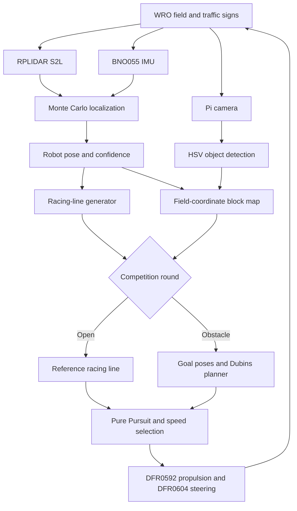
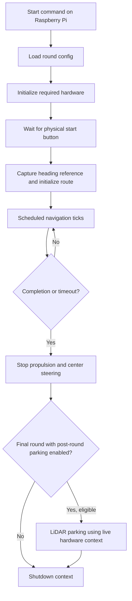
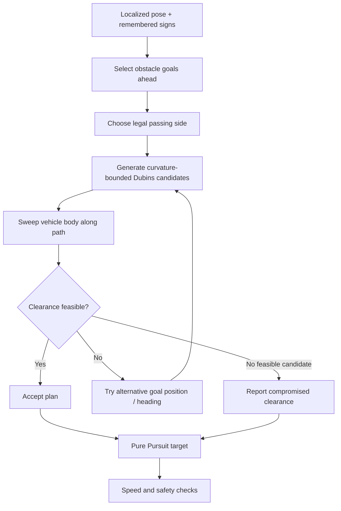
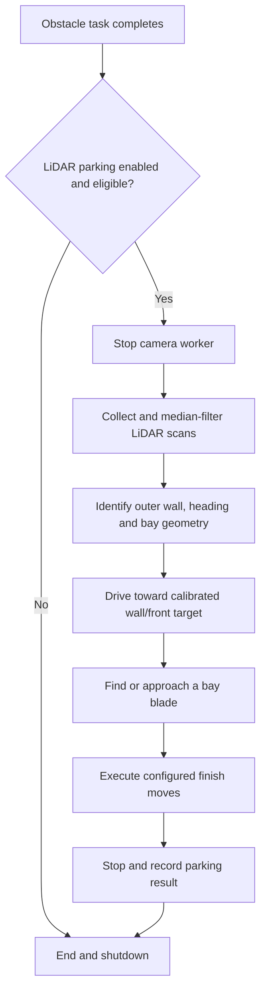

# Software Architecture and Obstacle Strategy

The YBR-SUNFLOWER autonomous vehicle was designed for the **World Robot Olympiad 2026 — Future Engineers** category. Its international-round software combines field-relative localization, geometric path tracking, color-based traffic-sign perception, curvature-constrained obstacle avoidance, controlled departure from the starting parking bay, and a separate LiDAR-based final parking sequence.

The central design decision is to treat navigation as a **pose–plan–control** problem: estimate the vehicle's location, construct a feasible path through the known course, and follow that path with a common steering controller. This chapter documents the implementation, mathematical assumptions, algorithmic choices, operating procedures, test tools and failure mechanisms represented in the repository's Python code.

> **Terminology.** In the software, `qualification` is the WRO **Open Challenge**, and `final` is the **Obstacle Challenge**. The term *simulation* denotes results produced without an actual competition attempt; implementation details do not, by themselves, demonstrate a successful physical run.

[← Project README](../README.md)

[← Engineering Overview](0-overview.md)

[← Mobility and Mechanical Design](1-mech.md)

[← Power and Sensor Architecture](2-elec.md)

[← Build and Reproduction Guide](4-build.md)

---

## Contents

1. [Software engineering overview](#1-software-engineering-overview)
2. [Requirements, constraints and design philosophy](#2-requirements-constraints-and-design-philosophy)
3. [Codebase architecture](#3-codebase-architecture)
4. [Competition runtime and control flow](#4-competition-runtime-and-control-flow)
5. [Raspberry Pi hardware communication and actuation](#5-raspberry-pi-hardware-communication-and-actuation)
6. [Localization — estimating the robot pose](#6-localization--estimating-the-robot-pose)
7. [Racing-line generation and Pure Pursuit](#7-racing-line-generation-and-pure-pursuit)
8. [Computer vision and obstacle planning](#8-computer-vision-and-obstacle-planning)
9. [Unparking, parking and final-round integration](#9-unparking-parking-and-final-round-integration)
10. [Sensor fusion and information management](#10-sensor-fusion-and-information-management)
11. [Fault handling and safety](#11-fault-handling-and-safety)
12. [Testing, simulation and calibration](#12-testing-simulation-and-calibration)
13. [Software metrics and validation evidence](#13-software-metrics-and-validation-evidence)
14. [Engineering development and trade-offs](#14-engineering-development-and-trade-offs)
15. [Implementation boundaries and engineering limitations](#15-implementation-boundaries-and-engineering-limitations)
16. [Installation, operation and reproducibility](#16-installation-operation-and-reproducibility)
17. [Architecture summary and references](#17-architecture-summary-and-references)

---

# 1. Software engineering overview

The field has a defined perimeter, central obstacle and legal traffic-sign positions. Rather than reacting independently to every visible object, the vehicle estimates its location on that field and derives steering commands from a planned route. This permits navigation decisions to remain meaningful when a colored sign temporarily leaves the camera frame.

The system answers three questions continuously:

| Question | Implementation | Output |
|---|---|---|
| **Where am I?** | RPLIDAR S2L, BNO055, motion model and Monte Carlo localization | Field pose `(x, y, heading)` and confidence |
| **Where should I go?** | `RacingLine` for the Open Challenge; `GoalPlanner` plus remembered traffic signs for the Obstacle Challenge | Ordered, geometrically constrained path |
| **How should I steer?** | `PurePursuit` and actuator controls in `MotorManager` | Steering command and propulsion speed |

The software is written in Python and runs on a **Raspberry Pi 5**. The earlier national-round Arduino UNO R4 controller was removed: its propulsion and steering functions were replaced by the **DFR0592 DC motor-driver HAT** and **DFR0604 I/O expansion HAT**, each with its own I²C address. The Raspberry Pi performs perception, localization, planning, control, lap tracking and competition sequencing.

## 1.1 System-level signal flow



*Figure S-01. Functional software architecture. The arrows describe information flow and control responsibilities, not direct electrical wiring. Hardware connections are detailed in [Power and Sensor Architecture](2-elec.md).*

## 1.2 The two competition tasks

**Open Challenge (`qualification`).** The robot localizes against the field, selects a route direction, follows a rounded closed racing line with Pure Pursuit, counts lap progress and stops when its configured distance goal is reached. Its active configuration specifies **three laps**.

**Obstacle Challenge (`final`).** The same driving framework also tracks colored traffic signs, maintains persistent sign memory and invokes a goal-based planner to generate feasible passing paths. The round supports starting inside a parking bay, departing it autonomously and, after the laps, running the dedicated LiDAR parking procedure selected in the final-round configuration. Its active configuration also specifies **three laps**.

The same underlying localization and steering architecture is used in both tasks. This reduces duplication and makes the difference between the two challenges explicit in the planner and task logic rather than in completely separate low-level control code.

## 1.3 Evidence and reproducibility

Descriptions of algorithms and constants in this chapter are grounded in the repository source files, notably [`main.py`](../src/Raspberrypi/main.py), [`tasks/path_task.py`](../src/Raspberrypi/tasks/path_task.py), [`tasks/final/task.py`](../src/Raspberrypi/tasks/final/task.py), and the round-specific TOML configuration files. Explicitly reported measurements in code comments are differentiated from **configuration values**, **mathematical derivations**, and **simulation output**. Physical performance is to be established by actual competition recordings and logged tests, not by the presence of a source-code feature.

---

# 2. Requirements, constraints and design philosophy

## 2.1 Functional requirements

The control system must initialize its interfaces; respond to the competition start button; estimate pose and travel direction; generate a path that fits the known field; maintain safe separation from walls and traffic signs; execute legal passing sides; count laps; manage start-bay departure and end-of-round parking; and terminate actuator output after completion, timeout or interruption.

| Constraint | Design response |
|---|---|
| Starting position and orientation vary | Particle-filter localization and field-relative route selection |
| Repeated 90° field geometry creates ambiguity | BNO055 coarse heading combined with LiDAR geometry |
| Traffic-sign arrangement is unknown until the run | Camera detection, field-coordinate block map and dynamic planning |
| Camera visibility is intermittent | Asynchronous acquisition and persistent object memory |
| Steering has finite travel and response time | Curvature bounds, steering-rate limiting and lag modeling |
| Narrow corridor limits lateral obstacle clearance | Swept-body feasibility checking and explicit compromised-plan reporting |
| Parking-bay walls interfere with ordinary field mapping | Dedicated unparking and LiDAR parking phases |
| Onboard computation is finite | Scheduled control loop, independent sensor workers and bounded planner search |
| A failed sensor or software task must not leave drive output active | Fault checks, task cleanup and hardware shutdown |

## 2.2 Engineering principles

1. **Separate hardware drivers from competition logic.** The task layer calls a shared `TaskContext`; individual modules own device transactions.
2. **Use one field coordinate system.** Robot pose, planned path, obstacle coordinates, parking walls and geometric clearance calculations are expressed in millimeters and degrees with documented frame conventions.
3. **Plan before steering.** The obstacle strategy generates reachable goal poses and checks the robot's swept envelope before passing a path to Pure Pursuit.
4. **Keep high-rate control independent of image acquisition.** Camera capture and color detection run in `VisionManager` rather than blocking individual steering ticks.
5. **Treat confidence as a control input.** A plausible-looking pose is not automatically a trustworthy pose, particularly close to a wall or bay.
6. **Keep adjustments reproducible.** The round-specific `config.toml` files separate calibration and competition tuning from algorithm implementations.

## 2.3 Coordinate and sign conventions

The navigation pose refers to the **center of the rear driving axle**. In the field frame, +Y points in the zero-heading direction; heading increases clockwise, so 90° points toward +X. Distances are normally in **millimeters**. Robot-frame sensor offsets are `(forward, right)` from the rear-axle reference. Motor and steering commands have their own documented scales; a steering *command* is not automatically an equal physical road-wheel angle.

A robot-frame offset `(f,r)` is projected to field coordinates by:

```math
\begin{aligned}
x_s &= x + f\sin\psi + r\cos\psi,\\
y_s &= y + f\cos\psi - r\sin\psi.
\end{aligned}
```

Here `(x,y)` is the rear-axle pose and `\psi` is its heading. This transform is implemented in [`classes/robot_geometry.py`](../src/Raspberrypi/classes/robot_geometry.py), and is used to locate LiDAR and camera observations relative to the same vehicle pose.

---

# 3. Codebase architecture

## 3.1 Source organization

```text
src/Raspberrypi/
├── main.py                       # Qualification/final dispatcher
├── camera_manager.py             # Picamera2 capture and image transforms
├── tasks/
│   ├── base_task.py               # Competition lifetime and tick scheduler
│   ├── cli.py                     # Options, configuration and hardware context
│   ├── path_task.py               # Shared navigation and driving loop
│   ├── qualification/             # Open Challenge task and config
│   ├── final/                     # Obstacle Challenge task and config
│   └── parking_test/              # Isolated parking test task
├── classes/
│   ├── task_context.py            # Device startup, ownership and cleanup
│   ├── board_manager.py           # DFR0604 I²C, ADC and servo interface
│   ├── motor_manager.py           # DFR0592 drive, steering and shaft estimate
│   ├── start_button.py            # Raspberry Pi GPIO start trigger
│   ├── lidar_manager.py           # S2L UART and rolling 360° scan
│   ├── compass_manager.py         # BNO055 relative heading
│   ├── navigation_manager.py      # Particle filter and field pose
│   ├── field_map.py               # WRO wall and island geometry
│   ├── racing_line.py             # Rounded-square reference route
│   ├── pure_pursuit.py            # Geometric steering controller
│   ├── object_solver.py           # Red/green and parking-color detection
│   ├── vision_manager.py          # Asynchronous camera mapping
│   ├── block_map.py               # Tracked sign observations
│   ├── goal_planner.py            # Goal-based clearance-aware planner
│   ├── dubins.py                  # Curvature-bounded path primitives
│   ├── parking.py                 # BayFinder and UnparkController
│   ├── bay_park.py                # Alternative in-round parking sequence
│   └── veloz_parking.py           # Separate parking-test algorithm
├── lidar_park/
│   ├── run.py                     # Dedicated after-round LiDAR parking
│   ├── scan_analysis.py           # Wall/bay extraction from scans
│   ├── scan_match.py              # Scan-based travel and alignment
│   ├── stop_button.py             # Stop-request handling
│   └── config.toml                # Final parking calibration and move sequence
├── test_driving.py               # Virtual field and task integration
├── test_navigation.py            # Localization simulation/hardware tests
├── test_goal_planner.py          # Planner experiments
├── test_plan_view.py             # Route visualization
├── test_object_solver.py         # Camera geometry and object-ranging tests
├── test_steering.py              # Travel-distance and steering tests
├── test_step_response.py         # Steering dynamics
├── test_motor_rotation.py        # Encoder and finite-rotation tests
├── test_parking.py               # Parking tests
├── pyproject.toml                # Python dependencies
└── uv.lock                       # Locked package versions
```

The directory includes compatibility modules, debugging utilities and alternative control implementations. The active competition entry points and configuration determine the algorithms used for an official round; not every module present in `classes/` runs in every task.

## 3.2 Layered responsibility table

| Layer | Principal files | Responsibility |
|---|---|---|
| Entry and scheduling | `main.py`, `tasks/cli.py`, `tasks/base_task.py` | Parse options, build task context, enforce runtime, call completion hooks |
| Device management | `TaskContext`, `BoardManager`, `MotorManager`, `LidarManager`, `CompassManager` | Device communication, startup and safe shutdown |
| Perception | `CameraManager`, `ObjectSolver`, `VisionManager` | Capture image, classify color, infer object bearing/range |
| Localization | `NavigationManager`, `FieldMap`, `BlockMap` | Estimate rear-axle pose and store environmental information |
| Planning | `RacingLine`, `GoalPlanner`, `dubins.py` | Construct reference route and obstacle-passing path |
| Motion control | `PurePursuit`, `PathDrivingTask` | Compute steering, speed and lap progress |
| Competition phases | `QualificationTask`, `FinalTask`, `UnparkController` | Open/Obstacle behavior and maneuver handoffs |
| End-of-round parking | `lidar_park/run.py` and support modules | Scan geometry, reposition to bay and execute final moves |
| Validation | `test_*.py` utilities | Simulation, geometry checks and hardware-specific tuning |

## 3.3 Runtime initialization

`main.py` dispatches either `QualificationTask` or `FinalTask`. The shared CLI loads the corresponding `config.toml`, configures the optional LiDAR and camera devices, and creates a `TaskContext`. The context is a Python context manager: entering it starts the required hardware, and leaving it closes interfaces and stops actuation. `FinalTask` can also execute an `after_round()` parking hook **before the shared context is closed**.

## 3.4 Configuration boundaries

The software uses separate [Open Challenge configuration](../src/Raspberrypi/tasks/qualification/config.toml) and [Obstacle Challenge configuration](../src/Raspberrypi/tasks/final/config.toml). The LiDAR-only parking routine has [its own configuration](../src/Raspberrypi/lidar_park/config.toml). Settings are read by key through `TaskConfig`, with defaults provided by shared task code. This separation matters: a configuration value for one round is not automatically the value used in the other round.

---

# 4. Competition runtime and control flow

## 4.1 Task lifecycle



*Figure S-02. Task execution and the final-round post-processing hook. Parking eligibility is governed by configuration and round outcome.*

`tasks/base_task.py` runs the physical start-button wait, captures the initial IMU heading, invokes task setup and repeatedly calls the task's `step()` method. The default maximum runtime for the normal task is **180 s**. The loop has a **target period of 20 ms** rather than a fixed sleep added after processing, giving a nominal control cadence of 50 Hz. If execution falls more than one period behind, the scheduler resynchronizes rather than issuing back-to-back catch-up commands.

```math
f_{\mathrm{target}}=\frac{1}{T_{\mathrm{loop}}}=\frac{1}{0.020\ \mathrm{s}}=50\ \mathrm{Hz}.
```

This is a *target*, not a measured guarantee. Actual timing depends on computation, hardware I/O, Linux scheduling and sensor availability. The base task records deadline overruns and worst observed tick duration for diagnostic reporting.

## 4.2 One shared navigation tick

`PathDrivingTask` obtains the recent robot pose, updates lap progress, chooses a lookahead target, computes steering and selects a speed subject to the current safety conditions. It estimates travelled distance between observations, advances the steering-lag model and reports motion to the localizer. The task then applies a single drive/steering command through `MotorManager`.

```text
Motor/speed-based motion estimate
       ↓
Particle-filter pose and confidence
       ↓
Progress along racing line / lap count
       ↓
Target path (Open) or planned route (Obstacle)
       ↓
Pure Pursuit + steering rate/lag handling
       ↓
Speed profile + front-LiDAR backstop
       ↓
DFR0592 propulsion / DFR0604 steering
```

The Obstacle Challenge can temporarily hand control to its **unparking controller**, **relocalization walk**, or **parking controller**. These handoffs are explicit, so Pure Pursuit does not issue competing commands during a maneuver.

## 4.3 Asynchronous camera processing

`VisionManager` captures and analyzes frames independently of the main tick loop, with a default minimum frame period of `1/15 s` (nominally up to 15 Hz, subject to actual processing). It publishes the resulting mapped objects to `NavigationManager`/`BlockMap`. The steering loop reads persisted objects rather than waiting for a new camera frame. This arrangement avoids letting image capture time directly extend the 20 ms steering interval.

The camera worker can be paused or resumed. The final parking hook stops it before running the LiDAR-only parking routine, reducing competition for CPU resources.

## 4.4 Task completion and continued parking

The default round finishes after reaching its configured lap-distance target. In the active final-round configuration, the internal `BayPark` feature is disabled and a distinct **post-round LiDAR parking stage** is enabled. The shared runner calls `FinalTask.after_round(ok)` while the context still has access to the LiDAR, motor driver and start button. The post-round park is attempted only under the conditions selected by `lidar_park.enabled` and `lidar_park.even_if_round_failed`.

The normal task's 180 s timeout must not be confused with the independent timeouts of individual parking legs. An additional post-round procedure can therefore have different timing from the main driving loop.

---

# 5. Raspberry Pi hardware communication and actuation

## 5.1 Controller topology

The current international vehicle uses Raspberry Pi 5 as the main programmable host. It communicates with the DFRobot boards on **I²C bus 1**:

| Peripheral | Bus/interface | Published code setting | Function |
|---|---|---|---|
| DFR0592 DC Motor Driver HAT | I²C bus 1 | `0x11` | Drive motor and encoder-speed reading |
| DFR0604 I/O Expansion HAT | I²C bus 1 | `0x10` | Steering servo PWM and auxiliary I/O |
| RPLIDAR S2L | Pi UART (`/dev/ttyAMA0`) | `1,000,000` baud | Rolling 360° range data |
| BNO055 IMU | Pi I²C | Configured through its Python library | Relative orientation |
| OV5647 fisheye camera | Pi CSI | Picamera2 | Color and bearing observations |
| Competition start button | Pi BCM GPIO 16 | `START_BUTTON_PIN = 16` | Start signal |

The I²C addresses are specified explicitly to avoid the default-address conflict between the two DFRobot HATs. The steering servo uses **DFR0604 PWM channel 3**. Wiring, regulated supply domains and measured rail voltages are documented in [the electrical journal](2-elec.md).

## 5.2 Drive command scaling and motor feedback

`MotorManager` accepts the historical **0–255 speed-command scale** inherited from the previous low-level controller, then converts it to the percentage format expected by the DFR0592 driver library. Consequently, a speed configuration such as `125` is **not 125% of full motor output**.

```math
D_{\%}=100\frac{|u|}{255},\qquad 0\le |u|\le255,
```

where `u` is a signed drive command and `D_%` is the requested PWM duty in percent before hardware dynamics and supply effects. Motor direction is selected separately. Code calibration still distinguishes the geared motor's internal **19:1** reduction from the external drivetrain gearing documented in [Mobility and Mechanical Design](1-mech.md).

The motor-driver library reports encoder-derived rotational **speed**, not raw accumulated quadrature edges. `MotorManager` polls that information in a worker and integrates it into an output-shaft position estimate for finite rotations and distance moves. Its constants include `ENCODER_PPR = 11`, `GEAR_RATIO = 19`, a sign convention and a calibration multiplier. This shaft-angle estimate is a software integration and is not equivalent to a separate hardware counter with lossless edge history.

## 5.3 Steering interface

`MotorManager` maps a signed steering command to servo pulse width and sends it through DFR0604 PWM3. The steering assembly's actual wheel angle depends on horn position, linkage geometry, mechanical stops, backlash and the commanded servo pulse. The path follower therefore uses an explicit road-wheel-angle calibration parameter rather than assuming the steering command and wheel angle are identical.

The code provides `steer()`, `steer_center()`, `steer_smooth()` and coordinated `drive(angle,speed)` interfaces. Physical steering geometry and mechanism design are covered in [the mechanical journal](1-mech.md).

## 5.4 Start button and device ownership

The start-button handler uses `lgpio` on the Raspberry Pi 5 and includes input-level configuration, debounce and a release delay. It is a Pi GPIO function, not an Arduino USB-serial message. `TaskContext` owns device startup and shutdown and supports a `--no-drive` mode that leaves sensing and steering active while inhibiting propulsion.

## 5.5 UART LiDAR acquisition

`LidarManager` reads S2L serial packets and maintains a per-degree rolling array of recent distance observations. Its array is **not one simultaneous 360° photograph**: a sample at one bearing may be older than a sample at another bearing. Old readings are discarded, and a no-data timeout can stop the scanner thread. The time and age of observations therefore matter for both localization and collision avoidance.

---

# 6. Localization — estimating the robot pose

## 6.1 Field geometry and the localization problem

The WRO field model contains the outer perimeter and a square central island. `FieldMap` computes expected ray distances for hypothetical robot positions. Given an actual scan, the system seeks poses whose predicted distances best fit the measurements.

```math
\mathbf{q}=\begin{bmatrix}x&y&\psi\end{bmatrix}^{\mathsf T},
\qquad
\hat r_i(\mathbf q)=\operatorname{Raycast}(\mathbf q,\theta_i,\mathcal M),
```

where `\mathcal M` is the field geometry, `\theta_i` is an observed scan bearing, and `\hat r_i` is the corresponding predicted range. This is a model-based estimate, not recognition of a colored floor line.

## 6.2 Monte Carlo localization

`NavigationManager` uses a **particle filter** with `PARTICLE_COUNT = 500`. Particles represent candidate vehicle poses. The implementation selects up to **48 scan beams per update**, applies a noise/outlier model, scores candidates against map raycasts and resamples when effective particle count falls sufficiently. Cloud spread and map-match error inform the confidence estimate.

A simplified measurement-weighting model is:

```math
w_j\ \propto\ p\left(\{r_i\}\mid\mathbf q_j,\mathcal M\right),
\qquad
N_{\mathrm{eff}}=\frac{1}{\sum_j \bar w_j^2},
```

where `\bar w_j` denotes normalized particle weight. The actual implementation also includes outlier handling, recovery scattering and a dominant-cluster pose estimate; the expression above illustrates the probabilistic mechanism rather than reproducing every numerical step.

The software reports pose reliability using a confidence threshold of **0.35**. Low confidence is handled as a distinct navigation condition rather than being accepted as a precise position.

## 6.3 LiDAR and IMU heading fusion

Because the field repeats after a 90° rotation, LiDAR ranges alone can leave a quadrant ambiguity. The BNO055 gives a coarse heading reference while line orientations measured from the LiDAR refine the angle relative to field walls. The heading procedure resolves fine orientation modulo 90° and uses the coarse reference to select the correct quadrant.

The BNO055 is operated in **IMUPLUS** mode (`USE_MAGNETOMETER = False`) so the motor and nearby ferromagnetic material do not introduce a continually recalibrated magnetic-heading reference. This does not remove gyro drift; field geometry is part of the correction mechanism.

## 6.4 Motion model and reference point

The rear axle is the vehicle's pose origin. The LiDAR is configured **65 mm forward** of that origin in the round configuration. The camera offset is computed relative to the LiDAR through `robot_geometry.py`.

An idealized kinematic bicycle model predicts:

```math
\begin{aligned}
\dot x &= v\sin\psi,\\
\dot y &= v\cos\psi,\\
\dot\psi &= \frac{v}{L}\tan\delta,
\end{aligned}
```

where `v` is rear-axle speed, `L` is wheelbase and `\delta` is the effective front road-wheel angle. Steering response, tire scrub and finite sensor update rates cause deviations from this model in practice.

The path-driving motion estimate uses configured speed-to-distance calibration and steering state between LiDAR observations. The drivetrain module separately estimates shaft rotation from encoder-derived speed. These two pipelines must not be described as automatically identical to direct encoder-count odometry in the particle filter.

## 6.5 Pose output and debugging

`get_pose()` returns field coordinates, heading, confidence and reliability. The navigation debug renderer can display field geometry, particles, LiDAR points, robot pose, known blocks and available error statistics. The same visualization can be exercised against a simulated ground-truth pose when actual hardware is not present.

---

# 7. Racing-line generation and Pure Pursuit

## 7.1 Rounded-square racing line

`RacingLine` builds a closed route between the outer wall and central island, with straight segments joined by rounded corners. The reference can be sampled at the configured **20 mm resolution**. Each sampled path position has an arc-length progress coordinate and corresponding heading/curvature. The same representation supports nearest-path projection, progress tracking, lap counting and lookahead selection.

The active round configurations are **not identical**:

| Setting | Open Challenge | Obstacle Challenge |
|---|---:|---:|
| Lap goal | 3 | 3 |
| Reference wall margin | 290 mm | 550 mm |
| Corner radius | 630 mm | 650 mm |
| Wheelbase parameter | 165 mm | 165 mm |
| Maximum modeled road-wheel angle | 22.0° | 38.8° |
| Path sample resolution | 20 mm | 20 mm |
| Base speed command | 150 | 125 |
| Corner speed command | 150 | 115 |

These are **software configuration values**, not independent measurements of physical steering angle or vehicle speed. The differing modeled steering limits are therefore important when interpreting simulated turning radii and planned clearances.

## 7.2 Lookahead point

The reference-point search uses a lookahead distance that varies with speed and is bounded by configurable limits. A simplified expression is:

```math
L_d=\operatorname{clip}\left(L_0+k_v|u|,\ L_{d,\min},\ L_{d,\max}\right).
```

Additional corner-dependent caps prevent the controller from targeting too far beyond a tight bend. Short lookahead tends to increase tracking sensitivity; long lookahead can smooth steering but may cut a corner. Neither is universally optimal without accounting for speed, steering lag and track clearance.

## 7.3 Pure Pursuit steering law

A target point is selected ahead of the rear axle in the vehicle's direction of travel. If the target is at angular offset `\alpha` and distance `L_d`, the geometric curvature and idealized road-wheel angle are:

```math
\kappa=\frac{2\sin\alpha}{L_d},\qquad
\delta=\arctan(L\kappa).
```

The calculated physical angle is converted into a calibrated signed steering-command range:

```math
u_{\mathrm{steer}}=\operatorname{clip}\left(
\frac{\delta}{\delta_{\max}}u_{\max},-u_{\max},u_{\max}\right).
```

`PurePursuit` contains the implementation, including steering-lag representation. `PathDrivingTask` adds rate handling, speed selection and safety checks around the requested command.

## 7.4 Turning-radius feasibility

A bicycle-model estimate for the minimum rear-axle turning radius is:

```math
R_{\min}=\frac{L}{\tan|\delta_{\max}|}.
```

For `L=165 mm`, a **38.8°** model angle gives approximately **205 mm**; a **22.0°** model angle gives approximately **408 mm**. These are *model outputs* based on different task settings, not proof that the physical chassis has two different steering mechanisms. A real corner must also account for front overhang, the vehicle's width, collision margin and speed-dependent tire effects.

## 7.5 Lap progress and speed control

Lap progress is found by projecting the current pose onto the closed route, then accounting for wrap-around and travel direction. Speed is selected from straight/corner settings and reduced under specific conditions, including low pose confidence and a LiDAR front-clearance backstop. For the Obstacle Challenge, a plan flagged as *compromised* can cap speed at `speed.compromised`.

The localization system and physical sensors are not interchangeable with a virtual path: the path tells the robot where it should go, while the obstacle checks and live distance readings constrain whether that action is safe.

---

# 8. Computer vision and obstacle planning

## 8.1 Traffic-sign detection

The OV5647 fisheye camera is accessed through Picamera2. `CameraManager` prepares images for `ObjectSolver`, which uses HSV color segmentation and contour filtering to identify **red** and **green** traffic signs. Each accepted detection carries a color and an estimated bearing/range. The same detector also supports **pink/magenta parking-wall marks** for parking-related implementations.

HSV segmentation separates hue from saturation and brightness, making it more practical than a single raw-RGB threshold for objects photographed under varying illumination. It does not remove dependence on exposure, white balance, shadows or lens calibration; these are checked through the color and object-solver test tools.

## 8.2 Fisheye image geometry and range estimation

`ObjectSolver` explicitly distinguishes the **lens's advertised 222° field of view** from the effective image-processing calibration. Its code defines `CAPTURED_HORIZONTAL_FOV_DEG = 230.0` and `CAMERA_YAW_DEG = 6.6`. The former is a fitted pixel-angle calibration parameter for the delivered image geometry, not an assertion that the physical lens has a 230° manufacturer FoV. Resizing and cropping mean that the angular span used by the detector can differ from the lens specification.

For an approximately equidistant fisheye projection, the angular size of an object is approximated by:

```math
\theta_h\approx h_{\mathrm{px}}\,s_{\mathrm{deg/px}},\qquad
r\approx\frac{H}{2\tan(\theta_h/2)},
```

where `H` is the assumed sign height, `h_px` is its detected pixel height and `s` is the calibrated angular scale. The active conventional traffic-sign height constant is **10 cm**, and the detector rejects very small contours or ranges outside its configured validity bounds. Wide-angle distortion, segmentation errors and altered sign heights can introduce substantial range bias.

## 8.3 Field-coordinate block map

`BlockMap` combines a camera observation with a reliable rear-axle pose and sensor offsets, then transforms it into field coordinates. Repeated sightings within an association radius are merged into persistent objects. `BlockMap` uses confidence, hit counts, out-of-map checks and visibility-aware miss tracking to avoid treating every detection as an independent, permanent obstacle.

Conceptually:

```text
Image pixels and HSV mask
          ↓
Color, bearing, approximate range
          ↓
Camera position derived from rear-axle pose
          ↓
Field-coordinate detection
          ↓
Association with known pillar / confirmation
          ↓
Block map and round-level memory
```

The Obstacle Challenge adds `RememberedPillar` storage in `FinalTask`. Instead of forgetting a pillar once its current camera track expires, the round can retain information across subsequent laps and plan earlier on return passes. The code also snaps detections toward legal traffic-sign seat geometry, within configured tolerances, to reduce the effect of visual ranging errors.

## 8.4 Passing-side rule

In the task's travel-relative lateral convention:

| Sign color | Required vehicle passing side | Planner sign |
|---|---|---:|
| Green | **Left** of the sign | `-1` |
| Red | **Right** of the sign | `+1` |

This rule is implemented through `SIDE_FOR_COLOR` in [`tasks/final/task.py`](../src/Raspberrypi/tasks/final/task.py). The sign refers to lateral position relative to the vehicle's direction of travel, so left/right remains consistent for clockwise and counter-clockwise routes.

## 8.5 Why the planner changed

An earlier obstacle strategy shifted the racing line sideways with a smooth lateral offset. Although continuity was preserved, the requested offset could exceed the actual corridor width. Clamping the shift made an unsafe pass look like a successful plan unless the reduced clearance was explicitly detected downstream.

The international-round planner instead defines **goal poses** beside each obstacle, including orientation. `GoalPlanner` connects those poses with **Dubins paths** that respect a minimum curvature radius. It checks the vehicle's swept footprint along candidate routes against walls, the central island, the traffic signs and parking-bay keep-out geometry.



*Figure S-03. Traffic-sign goal planning and feasibility screening. A compromised plan is reported to the controller rather than silently presented as a fully clear route.*

## 8.6 Dubins paths and robot-body clearance

A Dubins path is formed from combinations of maximum-curvature left/right arcs and straight segments. The six canonical families are **LSL, RSR, LSR, RSL, RLR and LRL**. The path solver provides a drivable geometric connection between a starting **pose** and target **pose** for forward travel; it does not itself know about walls or traffic signs. `GoalPlanner` supplies collision checking, alternate-goal search and the final route.

Collision screening must consider the robot's entire footprint, not only the rear-axle curve. The active configuration defines the modeled width and fore/aft extents, a minimum wall margin, requested sign clearance and separate compromised-plan thresholds. The implementation samples path positions to evaluate clearance and reports `Plan.compromised` and `Plan.reason` when the requested margin could not be achieved.

## 8.7 Planner parameters from the final-round configuration

| Parameter | Configured value | Meaning |
|---|---:|---|
| `blocks.clearance_mm` | 110 mm | Desired obstacle-body gap parameter |
| `blocks.robot_half_width_mm` | 90 mm | Body half-width used by planner |
| `blocks.remember_min_hits` | 7 | Evidence gate for remembered sign |
| `blocks.map_range_mm` | 1800 mm | Mapping range setting |
| `goals.horizon_mm` | 2200 mm | Planning horizon |
| `goals.max_gates` | 3 | Number of obstacle gates considered |
| `goals.replan_interval_s` | 0.1 s | Periodic replanning interval |
| `goals.min_clearance_mm` | 60 mm | Planner's minimum acceptable margin setting |
| `speed.compromised` | 105 | Speed cap for a compromised plan |

These settings are **requests and limits**, not measured clearances achieved by the robot. The true margin is affected by pose uncertainty, obstacle-range error, vehicle dynamics and path-tracking error.

## 8.8 Perception/planning edge conditions

The implementation separates several hazards: insufficient localization confidence, a sign mapped inside an impossible wall region, a sign track disappearing before passage, a physically unreachable passing gate, a nearby parking-wall exclusion, a lidar-observed obstruction without a corresponding color observation, and a candidate path requiring more steering curvature than the vehicle model permits. The control loop may slow or replan; it cannot guarantee a safe solution for every randomized arrangement.

---

# 9. Unparking, parking and final-round integration

The international-round source contains several parking controllers. **The final-round configuration determines which one is actually executed.** In the checked configuration, **unparking is enabled**, the final task's internal `BayPark` is **disabled**, and the separate **post-round LiDAR parking module is enabled**. These are distinct stages with different sensors, state logic and tuning files.

## 9.1 Parking system map

| Component | Source | Use in the active configuration |
|---|---|---|
| `UnparkController` | `classes/parking.py` | **Enabled** for starting inside a bay |
| `RelocaliseWalk` | `classes/parking.py` | **Enabled** after departure |
| `BayFinder` | `classes/parking.py` | Provides bay/field geometry functions where invoked |
| `BayPark` | `classes/bay_park.py` | Alternative in-round parking; **not selected** by `parking.enabled = false` |
| `VelozParking` | `classes/veloz_parking.py` | Used by the isolated `tasks/parking_test/` task |
| `lidar_park` | `lidar_park/run.py`, `scan_analysis.py`, `scan_match.py` | **Selected after a completed Obstacle Challenge** |

This distinction is important: a state machine can be implemented and tested in a repository without being the one selected in the competition task.

## 9.2 Starting-bay departure: UnparkController

The Obstacle Challenge can start with the robot placed in a parking bay bounded by projecting magenta walls. Those walls complicate initial localization because ordinary field geometry alone does not account for the nearby bay. The starting maneuver therefore has its own controller and uses local LiDAR side-clearance observations rather than relying immediately on the main field pose.

The active `[unpark]` configuration specifies a brief observation period, steering-servo settling time, a **70 mm reverse** setting, and a **230 mm forward** setting, together with direction selection from the left/right LiDAR sectors. The side with more available space determines the departure orientation, with a configured fallback for ties. The controller's local safety and timeout conditions constrain its execution.

A subsequent `RelocaliseWalk` provides an opportunity to regain a reliable field pose before normal path following resumes. Its configuration specifies a short motion, a settling interval and a **0.6 minimum-confidence goal** for that phase. The source also includes map re-reading and route-rejoining logic so the normal lap tracker can resume from a well-defined starting reference.

## 9.3 Final-round handoff after the laps

The active final-round settings are:

```toml
[lidar_park]
enabled = true
side = "auto"
even_if_round_failed = false

[parking]
enabled = false

[unpark]
enabled = true
```

When the normal obstacle-driving task finishes, `FinalTask.after_round()` may invoke `lidar_park.run_parking(...)` using the LiDAR, motor driver and start-button objects that are already running. The camera worker is stopped beforehand. If the normal round does not finish and `even_if_round_failed` remains false, the post-round parking routine is not selected.

The flag `parking.enabled` refers only to the **in-round `BayPark` route**, not to the post-round `lidar_park` routine. Therefore, `parking.enabled = false` does **not** mean that all autonomous parking is disabled.

## 9.4 Active LiDAR-only parking algorithm

The post-round module does not require camera detections or the particle-filter pose. It analyzes a LiDAR scan to infer nearby field structure, outer-wall orientation and the bay blades. It then performs a staged relocation and alignment maneuver using its own TOML settings.



*Figure S-04. Active post-round LiDAR parking sequence selected by `lidar_park.enabled = true`.*

### Phase A — Scan and geometric interpretation

`take_scan()` gathers **five** rolling scan snapshots, separated by **0.1 s**, and calculates a median range for each angle while retaining invalid sectors as missing readings. `scan_analysis.py` identifies wall structure and candidate bay blades. The outer-wall side can be determined automatically (`side = "auto"`) or specified for a controlled experiment. The analysis uses point-count, wall-line, blade-depth, blade-spacing and range-validity settings rather than the camera's color labels.

### Phase B — Forward approach and wall alignment

The configured target is **300 mm forward clearance** and **330 mm from the outer wall**. Distance and heading corrections are applied while the robot advances at a configured speed command of **70**. A limit on approach angle and a front-obstacle stop guard reduce the risk of oversteering toward the wall. The leg has its own forward-distance bound and timeout.

### Phase C — Position relative to the bay blade

The `to_bay` phase uses detected blade position and scan-based travel estimation to approach a configured stopping position. Its active `blade_stop_x_mm` is **−150 mm**, with a speed setting of **50**. Scan matching and distance consistency checks help separate actual translation from changing visibility of wall or sign returns. If the bay geometry cannot be established, behavior is governed by the module's `park.require_bay`, search and timeout settings; no assumption of successful bay detection is implicit.

### Phase D — Configured finish movement sequence

The final phase executes explicit steering-and-distance instructions from `[[finish.moves]]`. In the active file, they are:

| Move | Steering **command** | Distance | Direction |
|---|---:|---:|---|
| 1 | +83 | 150 mm | Reverse |
| 2 | +50 | 60 mm | Reverse |
| 3 | −100 | 250 mm | Reverse |
| 4 | +60 | 40 mm | Forward |

Positive steering points **toward the detected bay side** in this parking module's convention; these values are command units, not direct road-wheel angles. The configuration also includes a **25 mm finish obstacle-stop setting**, a **5 s finish-stage timeout**, and scan-matching quality thresholds. These numbers define the programmed maneuver, not a claim that the final parked pose passed judging checks.

## 9.5 Why parking uses a separate control mode

Ordinary racing-line following assumes a reasonably localized car traveling through the main corridor. Parking places the robot near projecting bay walls, may require reversing, and depends on the geometry of a confined opening. Dubins forward-only obstacle paths and lookahead steering do not solve this final placement problem by themselves. A parking-specific procedure can therefore use scans, short measured moves and independent stopping conditions without mixing those commands into normal lap navigation.

## 9.6 Alternative parking implementations and experimental tests

`classes/bay_park.py` implements a **FIND → SETTLE → BACK → TURN_IN → DRIVE_IN → optional WIGGLE → DONE** sequence. It follows the outer wall, detects a bay blade and then uses staged reverse and forward maneuvers. This is a code-supported alternative but is not the final-round method selected by the present TOML flags.

`classes/veloz_parking.py` implements a different **SEARCHING → APPROACH → REVERSING → STRAIGHTENING → CENTERING → DONE** sequence. The dedicated `tasks/parking_test/` entry point exercises this algorithm in isolation. Its presence and test harness do not establish that it is the algorithm used after the competition laps.

## 9.7 Parking observation and stop conditions

The LiDAR parking subsystem includes stop-request monitoring, invalid-distance treatment, wall/bay confidence conditions, motion limits and leg-level timeouts. An external stop command can terminate the parking routine. Its diagnostic output can write a last-run CSV log under the parking module's log directory; a source-code path for a log does not imply a particular competition result is already stored in the repository.

---

# 10. Sensor fusion and information management

## 10.1 Separation of sensor roles

| Source | Primary information | Limitations |
|---|---|---|
| RPLIDAR S2L | Ranges, wall orientation, geometry for localization and parking | Does not directly identify red/green color; rolling scan is time-distributed |
| BNO055 | Coarse orientation and relative heading | Drift and startup-heading ambiguity |
| Camera | Color, image bearing and approximate traffic-sign distance | Illumination, crop/FoV and apparent-height uncertainty |
| Motor encoder | Gearbox rotational-speed-derived displacement estimate | Board reports speed; calibration and slip affect physical distance |
| Field geometry | Expected walls, track layout and legal sign seats | May not contain a particular temporary object until it is mapped |

The system does **not** fuse every sensor into a single uniform signal. Each source supplies the information it can observe reliably. LiDAR and IMU support the pose estimate; camera observations are transformed into that pose's field frame; and the resulting map supports path planning. Live LiDAR front-range checks remain a separate safety input that can override a theoretically acceptable path.

## 10.2 Asynchronous information lifetimes

LiDAR stores recent per-degree ranges, the camera worker updates sign detections, `BlockMap` associates individual observations, and the obstacle round maintains additional remembered pillars across laps. Each lifetime is different. Reusing stale observations indiscriminately would make a planner react to objects that are no longer where the software believes them to be.

The implementation addresses this with timestamps or freshness windows, hit/miss gating, confidence thresholds, explicit mapping bounds and replan conditions. The reasoning is to distinguish *a sign not visible right now* from *a sign confirmed to be absent*.

## 10.3 Camera observations depend on pose quality

If robot pose is incorrect by a translation or heading error, a visually correct sign bearing may still be placed at the wrong field coordinate. `BlockMap` therefore filters observations using pose reliability before assigning them to the global map. The round's sign memory can be used for earlier planning on later laps, but its accuracy remains dependent on the quality of the original observation and the legal-seat constraints used to refine it.

## 10.4 Information arbitration

A geometric route does not guarantee immediate physical clearance. If a planned turn and a live close-range LiDAR observation disagree, the front-clearance guard can slow or stop propulsion. If a sign becomes uncertain, the planner can re-evaluate remembered positions. If localization confidence collapses, the task enters a low-confidence behavior instead of treating a drifting pose as exact.

---

# 11. Fault handling and safety

## 11.1 Task-level shutdown

`Task.run()` surrounds the control loop with cleanup logic and calls `finish()` in its `finally` branch. The task's `finish()` requests propulsion stop and centered steering. The `TaskContext` context manager also closes device resources after the competition and any eligible post-round hook. This implements software-level shutdown, although no software mechanism can substitute for an independent electrical power-disconnect device.

## 11.2 Timeouts and missed deadlines

The ordinary competition task defaults to a **180 s** software time limit. The scheduler records tick overruns and corrects timing drift; it does not simply issue extra ticks to compensate for a pause. The separate LiDAR parking routine and its stages have dedicated timeouts and stop conditions.

## 11.3 Localization confidence loss

If the particle-filter pose is insufficiently reliable, the task adjusts motion according to its confidence/lost-state logic. The final-round configuration includes a **0.35 minimum pose-confidence threshold** and a **4.0 s lost timeout**. A recovery behavior must be interpreted in conjunction with live obstacle clearance and current geometric uncertainty; a low confidence value cannot be treated as permission to continue at normal speed.

## 11.4 Front-LiDAR backstop

The Obstacle Challenge defines a slow zone at **350 mm** and a stop threshold at **250 mm** for a front sector set to **25°**. These are software thresholds measured from the LiDAR's observation origin and sector, not guaranteed clearances from the car's outermost front bumper. Their effectiveness depends on sensor mounting, scan validity, braking distance and steering state.

## 11.5 Motor and encoder fault monitoring

`MotorManager` supports motor-start timeouts, finite-move timeouts, speed polling and detection of commanded-versus-observed behavior anomalies. Position regulation uses integrated encoder-derived speed with proportional/derivative correction and a coast estimate. Physical testing with wheels clear of the ground is required when changing motor wiring, direction or encoder sign.

## 11.6 Camera and LiDAR failures

The independent camera worker has failure accounting and retry/backoff behavior rather than crashing the high-rate control loop for a single bad frame. The LiDAR interface drops stale bearing slots and detects prolonged missing serial data. Parking procedures include guards for invalid or absent range sectors and stop-request handling.

## 11.7 Planner and parking boundaries

A curvature-bounded goal may be unreachable because the corridor is too narrow, even when color detection is correct. `GoalPlanner` reports compromised clearances, and the task can reduce speed. The parking subsystem separately handles missed bay geometry, motion-budget limits and stop conditions. None of these checks guarantees collision-free operation for all combinations of faulty sensing, actuator behavior and randomized field geometry.

---

# 12. Testing, simulation and calibration

## 12.1 Tests without energized propulsion

The codebase supports several levels of checking before a live run:

| Level | Example | What is tested |
|---|---|---|
| Configuration-only | `main.py qualification --dry-run` | Path construction, selected parameters and geometric warnings |
| Virtual-field simulation | `test_driving.py` | Navigation/controller/planner integration against simulated conditions |
| Localization simulation | `test_navigation.py` | Particle-filter convergence and estimated-vs-truth pose |
| Planner geometry | `test_goal_planner.py`, `test_plan_view.py` | Goal poses, Dubins routes, body sweep and clearance logic |
| Sensor/actuator bench tests | `test_lidar.py`, `test_motor_rotation.py` | Hardware communication and rotation feedback |
| Physical steering/distance calibration | `test_steering.py`, `test_step_response.py`, `test_circle.py` | Motion calibration, lag and turning geometry |
| Vision calibration | `test_object_solver.py`, `test_color_picker.py` | Fisheye bearing/ranging and HSV thresholds |
| Parking-specific | `lidar_park.run --scan-only`, `test_parking.py`, `tasks.parking_test` | Bay geometry and selected parking controllers |

A passing simulator test verifies the chosen model and software path; it is not evidence that the robot completed the same obstacle arrangement on a physical field.

## 12.2 Simulation interfaces

The source provides the same task logic with simulated hardware and field observations for many of its tests. In this setting, path tracking can be analyzed against a known true trajectory, and obstacle configuration can be varied systematically. `test_driving.py` includes trial-based scenarios; `test_plan_view.py` renders planned routes and can show clearance geometry. Using the actual code in simulation reduces the risk that an entirely separate conceptual simulator silently disagrees with the competition planner.

The simulator still depends on assumptions about tire grip, steering dynamics, motor response, sensor noise and field geometry. Only physical tests establish how well those assumptions hold on the finished chassis.

## 12.3 Steering-lag and geometric calibration

The steering model includes a first-order response time constant in the round configuration. The current files use `servo_lag_s = 0.35 s`, and code comments describe measurements of the time required to reach about 63% of a requested change. In the ideal first-order model:

```math
\delta(t)=\delta_{\mathrm{target}}+\bigl(\delta(0)-\delta_{\mathrm{target}}\bigr)e^{-t/\tau}.
```

Here `\tau` is the assumed response-time constant. A separate `lag_compensation_s` parameter can help predict where the vehicle will be when the steering response takes effect, but aggressive compensation may increase overshoot.

The relevant physical test is to record **command angle**, **observed wheel angle**, **elapsed time**, **vehicle speed** and **steering direction**. Motor-calibration tests should also distinguish gearbox-output angle from actual rear-wheel travel through the external gear pair and differential.

## 12.4 Fisheye and traffic-sign calibration

The camera's nominal optical FoV cannot simply be pasted into the object solver. Relevant experiments include a known-distance sign centered in the actual delivered image, lateral-angle placements, repeated frame measurements and tests under the venue's lighting. `test_object_solver.py` documents a procedure for bearing and FoV checks, and `make_color_spec.py`/`test_color_picker.py` support HSV range selection. A height-based distance estimate must be reinterpreted if the observed traffic-sign height changes.

## 12.5 Hardware-free and partial-hardware options

The CLI provides `--dry-run` for configuration construction, and `--no-drive` for exercising live sensing and steering while the drive motor is disabled. Flags such as `--debug` and `--ascii` support graphical or text-only diagnostics. These modes serve different purposes: `--dry-run` does not confirm hardware is connected, while `--no-drive` can confirm sensor data paths without commanding propulsion.

## 12.6 Parking-specific testing

The LiDAR parking module supports a **scan-only** mode, recorded scan images, and save/load of scan arrays for repeatable geometry analysis. `scan_analysis.py` and `scan_match.py` can be studied separately from wheel motion. Controlled tests should use one bay location and one verified chassis orientation, then vary only one parameter at a time: wall-distance target, bay-blade stop position, steering-command sequence, or stopping threshold.

The isolated `tasks/parking_test` task tests `VelozParking`, not the active post-round `lidar_park` sequence; therefore its success or failure must not be attributed automatically to the selected final parking implementation.

## 12.7 Evidence provenance

Configuration comments include numerical results from simulated trial sweeps and some physical steering, tape-distance and parking experiments. Their provenance remains the corresponding code comments and test utilities unless separate run logs or videos are provided. Numbers from these sources should be labeled **simulated**, **code-reported physical observation**, or **derived** rather than presented as independently audited competition statistics.

---

# 13. Software metrics and validation evidence

## 13.1 Useful engineering metrics

| Metric | Definition | Suitable evidence |
|---|---|---|
| Localization position error | Distance between estimated and known physical/reference pose | Marked field points or simulated truth |
| Heading error | Difference between estimated and reference orientation | Protractor/field-line reference or simulated truth |
| Pose confidence | Localizer's internal confidence score | Recorded diagnostics and recovery behavior |
| Cross-track error | Perpendicular deviation from planned route | Localization logs and track references |
| Minimum geometric clearance | Model-estimated nearest obstacle/body separation | Planner sweep diagnostics |
| Actual physical clearance | Measured gap between robot body and sign/wall | Field video with measurable scale |
| Controller timing | Tick overrun count and worst tick time | `Task.run()` status data |
| Camera detection consistency | Confirmed observations, misses and false positives | Saved frames and color-mask overlay |
| Lap completion | Progress around configured closed course | Continuous run video and status log |
| Parking outcome | Final pose, bay contact and stop state | Overhead/side video and bay dimensions |

Clearance estimates based on the planner footprint are not equivalent to actual measured margins: both localization and motor dynamics can contribute to error.

## 13.2 Code-reported physical calibration examples

The active code documents a **165 mm wheelbase configuration**, a **0.35 s** steering time constant, a **6.6° camera-yaw correction** fitted from image observations, and travel-distance calibration examples in the competition TOML files. These values refer to specific test conditions and code revisions. They should be reproduced or cross-checked when the mechanical gear ratio, steering linkage, camera mount or motor driver changes.

## 13.3 Simulated evidence

Examples recorded in the source include configuration sweeps of wall margin and corner radius, localization recovery experiments and multi-trial obstacle-passing simulations. Such results are useful for selecting parameters and rejecting obviously infeasible routes. They are not an official WRO run score or a statistically measured physical success rate.

## 13.4 Recommended physical test record

For a comparable test, preserve: source commit, round name, field layout, sign positions/colors, start heading, battery state or voltage, tuning-file snapshot, start and finish time, lap count, contacts, minimum observed clearance, parking outcome and camera/LiDAR diagnostic output if available. A single recorded competition attempt can establish what occurred in that attempt; repeated tests are needed to characterize reliability.

---

# 14. Engineering development and trade-offs

## 14.1 From camera-reactive steering to field-localized navigation

A reactive camera strategy directly adjusts steering from visible obstacles or wall features. It is simple but cannot fully reason about objects that are outside the current image. The adopted architecture uses LiDAR/IMU localization against a known field and an explicit reference path. The extra computational cost is exchanged for a more persistent environmental representation.

## 14.2 From Raspberry Pi/Arduino separation to Raspberry Pi/HAT control

The national-round system used an Arduino for actuator commands and encoder measurements, with text commands over USB serial. The international-round system uses I²C motor/expansion boards and a Pi GPIO start input. This removes the separate USB command protocol and transfers more timing, command scaling and fault handling to Raspberry Pi software. The trade-off is tighter coupling between onboard Linux scheduling and low-level actuator-control requests.

## 14.3 From racing-line deformation to pose-goal planning

The early obstacle strategy eased in a lateral racing-line offset. On tight corners or when pillars were close to a boundary, the requested lateral position could be clamped to an unsafe value. The final planner formulates legal passing as a **pose-constrained geometric problem**, enumerates curvature-bounded candidates and checks the swept chassis footprint before commanding motion. The result is more computationally involved but gives the controller an explicit compromised-clearance signal.

## 14.4 Camera execution moved to a worker

Running camera capture synchronously in the steering tick introduces latency exactly when the control system needs regular pose and speed updates. `VisionManager` isolates acquisition/detection and updates the field map asynchronously. The trade-off is that the consumer must reason about observation age, object persistence and occasional missed frames.

## 14.5 Steering calibration and motion-model reference

The physical steering mechanism does not jump instantaneously to a requested road-wheel angle. The software therefore represents steering lag and controls command rate. Changing the pose origin from an offset sensor position to the rear axle also makes the bicycle model, planned path and swept-body geometry refer to the same point, avoiding artificial lateral motion caused by the LiDAR moving around the axle during turns.

## 14.6 Parking as a dedicated subsystem

A competition run and a parking maneuver have different geometric and sensing requirements. The codebase includes in-round and post-round approaches, with the active selection made through configuration rather than through code presence. The enabled LiDAR parking mode uses a scan-geometric procedure and calibrated short moves after the driving task has ended. This makes the parking phase independently testable and permits stop/detection parameters different from ordinary lap following.

## 14.7 Why simulation and physical tests are both needed

Simulation is useful for varying corner radius, sign placement and steering response over many controlled cases, but robot slip, imperfect sensor mounting and short-distance parking geometry must be checked on the physical field. The software includes dedicated tests for both kinds of evidence so that parameters can be calibrated without mixing mathematical feasibility and actual measured performance.

---

# 15. Implementation boundaries and engineering limitations

## 15.1 What an implemented feature proves

The source verifies that the described algorithms, configuration keys and safety checks exist in the examined commit. It does not by itself prove that the robot completed every randomized field, met all clearance criteria, or parked successfully within an official time limit. Actual testing supplies those claims.

## 15.2 Localization limits

The map's rotational symmetry creates a real heading ambiguity. A wrong start-heading anchor can rotate an otherwise confident pose into the wrong field section. Missing scan sectors, reflections, blocked LiDAR angles and incorrect sensor-offset calibration can further degrade position estimates. The localizer monitors confidence and recovery, but the score cannot establish absolute pose accuracy without a reference.

## 15.3 Vision and traffic-sign limits

HSV thresholding depends on illumination and color reproduction. Fisheye ranging assumes a calibrated angular mapping and a sign of known physical height. The standard 100 mm-height model does not automatically identify the original color or true distance of an altered-height/altered-color competition object. The public code does not establish a general solution to all possible altered-sign cases.

## 15.4 Vehicle-model limits

The geometric steering and collision model assumes a wheelbase, effective maximum steering angle, body envelope and finite response time. Tire scrub, axle play, drivetrain slip and steering asymmetry can change the actual trajectory. The two round configurations contain different modeled maximum road-wheel angles, so each must be validated against the installed steering system before comparing curvature-based results.

## 15.5 Parking limits

The post-round parking routine can analyze walls and blades and carry out the programmed finish movement sequence; it is still sensitive to the initial car position, scan classification, servo behavior, motor distance calibration and available free space. Its configured `require_bay` setting and distance/time bounds determine how it behaves when bay evidence is incomplete. A final pose must be judged from physical evidence rather than inferred from a `DONE` software state alone.

## 15.6 Runtime and recovery limits

Linux is not a hard real-time operating system, and the target 50 Hz cadence can be missed. The loop contains overrun diagnostics and safety checks, but low sensor confidence, stale camera observations, or an impossible obstacle corridor can still require slowing, stopping or abandoning an idealized path. A software-controlled stop does not substitute for the physical main power switch.

---

# 16. Installation, operation and reproducibility

## 16.1 Host and software environment

The target computer is a Raspberry Pi 5 with a 64-bit Raspberry Pi OS environment, camera support, I²C access, UART configured for the S2L and permissions for relevant devices. The Python project declares **Python 3.11 or newer** in [`pyproject.toml`](../src/Raspberrypi/pyproject.toml), while exact resolved package versions are recorded in [`uv.lock`](../src/Raspberrypi/uv.lock). Raspberry Pi-specific libraries, camera drivers and OS interfaces must be configured on the physical host; running a dry-run command alone does not validate those peripherals.

The repository contains a Pi initialization helper at [`setup_pi.sh`](../src/Raspberrypi/setup_pi.sh). Its comments and device-check examples must be reconciled with the present Pi-only/HAT-plus-S2L architecture before using every historical instruction literally; the authoritative hardware connections are the [electrical](2-elec.md) and [build](4-build.md) chapters.

## 16.2 Repository location and dependency management

After cloning the repository, the active Python project directory is:

```bash
cd WRO-FE-YBR-SUNFLOWER/src/Raspberrypi
```

The project uses **uv** for environment/package management. On a correctly provisioned Pi with the required camera and device libraries installed, its locked dependencies are managed through `uv sync --frozen`. The official camera package may depend on system-installed Picamera2 access, so virtual-environment system-site visibility is part of the Pi setup.

## 16.3 Open Challenge

```bash
uv run python main.py qualification
```

Before a live run, inspect the selected settings without opening hardware:

```bash
uv run python main.py qualification --dry-run
```

The task is configured in [`tasks/qualification/config.toml`](../src/Raspberrypi/tasks/qualification/config.toml). It localizes on the empty course, tracks the reference route and completes its configured lap distance.

## 16.4 Obstacle Challenge

```bash
uv run python main.py final
```

The task is configured in [`tasks/final/config.toml`](../src/Raspberrypi/tasks/final/config.toml). Its default path includes the enabled bay-departure configuration, goal-based traffic-sign avoidance and eligible post-round LiDAR parking. A successful program return and a successful official competition score are different observations.

## 16.5 Debugging and controlled operation

```bash
# Inspect the selected round geometry without starting hardware:
uv run python main.py final --dry-run

# Run live sensor/control logic while disabling drive propulsion:
uv run python main.py final --no-drive --debug

# Log navigation information in a plain SSH terminal:
uv run python main.py final --ascii --no-drive

# Run a simulated competition task with no robot:
uv run python test_driving.py --trials 24
```

`--no-drive` is a deliberate partial-hardware test mode, not proof that steering and navigation are safe at competition speed. Use wheel-off-ground checks for motor-direction or channel changes and a clear area for any command that can rotate wheels.

## 16.6 LiDAR parking diagnostics

```bash
# Analyze parking-related LiDAR geometry without driving:
uv run python -m lidar_park.run --scan-only

# Save an observed scan and a corresponding image for review:
uv run python -m lidar_park.run --scan-only --save-scan parking_scan.npy --image parking_scan.png

# Analyze a saved scan again without hardware:
uv run python -m lidar_park.run --load-scan parking_scan.npy --image parking_scan.png
```

The standalone executable also supports a drive-inhibited mode and start/stop-button handling. Its independent settings live in [`lidar_park/config.toml`](../src/Raspberrypi/lidar_park/config.toml). The enabled final-round hook invokes the parking function directly against the existing hardware context; it does not require a separate shell command between laps and parking.

## 16.7 Reproduction and identification

A reproducible record consists of the exact Git commit, the hardware layout, both round configurations, the LiDAR parking configuration, camera calibration, motor/steering calibration, and documented observations from physical testing. For the source snapshot used in this chapter, the repository identifies commit:

```text
e1890a8b293351e0f7f433588c72bb3bb83e2d70
```

Reproduction should use that commit or a deliberately recorded successor rather than relying on whichever files happen to be on `main` at a later date.

---

# 17. Architecture summary and references

## 17.1 Full system and competition responsibilities

The software implements a consistent high-level architecture:

```text
                      Raspberry Pi 5
                            │
         ┌──────────────────┼────────────────────┐
         │                  │                    │
     RPLIDAR S2L         BNO055              Pi Camera
       UART              I²C                  CSI
         │                  │                    │
         └─────────┬────────┘              VisionManager
                   │                             │
         NavigationManager                 ObjectSolver
       (pose + confidence)                      │
                   │                         BlockMap
                   │                             │
                   ├───────────┬─────────────────┤
                   │           │                 │
             RacingLine    Qualification     FinalTask
                   │       (open route)     (goal planning)
                   │           │                 │
                   └───────────┴────────┬────────┘
                                        │
                                    PurePursuit
                                        │
                              Speed / safety arbitration
                                        │
                             DFR0592 drive / DFR0604 PWM
                                        │
                              DC motor / steering servo

        FinalTask after-round: LiDAR scan → bay geometry
                              → parking move sequence → stop
```

*Figure S-05. Consolidated software architecture. The parking hook operates after the driving task and before the shared hardware context is released.*

## 17.2 Software decisions in one table

| Design decision | Technical rationale | Primary implementation |
|---|---|---|
| Pose-based navigation | Known WRO field geometry supports geometric localization | `navigation_manager.py`, `field_map.py` |
| Rear-axle reference frame | Aligns localization, bicycle kinematics and path tracking | `robot_geometry.py` |
| Shared Pure Pursuit | Uses one route follower for both challenges | `pure_pursuit.py`, `path_task.py` |
| Goal-based Dubins planning | Rejects unreachable or colliding obstacle-passing paths | `goal_planner.py`, `dubins.py` |
| Persistent traffic-sign map | Retains information beyond a single camera frame | `block_map.py`, `final/task.py` |
| Separate camera worker | Protects control-loop timing from capture latency | `vision_manager.py` |
| Pi + I²C HAT architecture | Centralizes control without the former Arduino serial layer | `motor_manager.py`, `board_manager.py` |
| Dedicated LiDAR parking | Allows scan-based close-range parking after the normal laps | `lidar_park/` |

## 17.3 Primary source references

- [Repository root](../README.md) and [Build and Reproduction Guide](4-build.md).
- [Main task dispatcher](../src/Raspberrypi/main.py), [shared task lifecycle](../src/Raspberrypi/tasks/base_task.py) and [CLI](../src/Raspberrypi/tasks/cli.py).
- [Open Challenge](../src/Raspberrypi/tasks/qualification/task.py) and its [configuration](../src/Raspberrypi/tasks/qualification/config.toml).
- [Obstacle Challenge](../src/Raspberrypi/tasks/final/task.py) and its [configuration](../src/Raspberrypi/tasks/final/config.toml).
- [Navigation](../src/Raspberrypi/classes/navigation_manager.py), [field model](../src/Raspberrypi/classes/field_map.py), [racing line](../src/Raspberrypi/classes/racing_line.py) and [Pure Pursuit](../src/Raspberrypi/classes/pure_pursuit.py).
- [Vision worker](../src/Raspberrypi/classes/vision_manager.py), [object solver](../src/Raspberrypi/classes/object_solver.py), [block map](../src/Raspberrypi/classes/block_map.py), [goal planner](../src/Raspberrypi/classes/goal_planner.py) and [Dubins primitive](../src/Raspberrypi/classes/dubins.py).
- [Unparking controller](../src/Raspberrypi/classes/parking.py), [BayPark alternative](../src/Raspberrypi/classes/bay_park.py), [VelozParking test controller](../src/Raspberrypi/classes/veloz_parking.py), [LiDAR parking module](../src/Raspberrypi/lidar_park/run.py) and [LiDAR parking configuration](../src/Raspberrypi/lidar_park/config.toml).
- [Motor/HAT control](../src/Raspberrypi/classes/motor_manager.py), [expansion HAT](../src/Raspberrypi/classes/board_manager.py), [LiDAR driver](../src/Raspberrypi/classes/lidar_manager.py), and [start button](../src/Raspberrypi/classes/start_button.py).
- [Simulation/testing code](../src/Raspberrypi/test_driving.py), [steering tests](../src/Raspberrypi/test_steering.py), [vision tests](../src/Raspberrypi/test_object_solver.py) and [parking tests](../src/Raspberrypi/test_parking.py).
- [WRO Association — competition regulations and season resources](https://wro-association.org/competition/2026-season/).
- [PythonRobotics / Atsushi Sakai — Dubins path-planning reference](https://github.com/AtsushiSakai/PythonRobotics), acknowledged in the repository's `dubins.py` license comments.

The source, geometric assumptions, configuration and test evidence together define how YBR-SUNFLOWER's software makes autonomous decisions on the WRO Future Engineers field.
