# Build and Reproduction Guide

This document is the complete reproduction guide for the **YBR-SUNFLOWER WRO 2026 Future Engineers robot**.

Its purpose is different from the subsystem engineering documentation.

The subsystem documents explain **why** the robot was designed as it is:

- [`mech.md`](1-mech.md) — mechanical design and mobility
- [`elec.md`](2-elec.md) — power, electrical and sensor architecture
- [`software.md`](3-software.md) — software and autonomous navigation

This document explains **how to reproduce the final robot**.

---

[← Project README](../README.md) · [← Engineering Overview](0-overview.md)

[← Software Architecture and Obstacle Strategy](3-software.md)


---

# Contents

1. [Reproduction Overview](#1-reproduction-overview)
2. [Before You Start](#2-before-you-start)
3. [Bill of Materials](#3-bill-of-materials)
4. [Tools and Manufacturing Equipment](#4-tools-and-manufacturing-equipment)
5. [3D Printing and Mechanical Preparation](#5-3d-printing-and-mechanical-preparation)
6. [Electrical Assembly and Wiring](#6-electrical-assembly-and-wiring)
7. [Electrical Pre-Power Verification](#7-electrical-pre-power-verification)
8. [Mechanical Assembly](#8-mechanical-assembly)
9. [Raspberry Pi Software Setup](#9-raspberry-pi-software-setup)
10. [Arduino Setup and Firmware Upload](#10-arduino-setup-and-firmware-upload)
11. [Final Software Configuration](#11-final-software-configuration)
12. [Subsystem Verification](#12-subsystem-verification)
13. [First Autonomous Run](#13-first-autonomous-run)
14. [Testing Workflow](#14-testing-workflow)
15. [Troubleshooting](#15-troubleshooting)
16. [Competition Startup Procedure](#16-competition-startup-procedure)
17. [Version Lock and Competition Release](#17-version-lock-and-competition-release)
18. [Reproducibility Checklist](#18-reproducibility-checklist)
19. [Related Documentation](#19-related-documentation)

---

# 1. Reproduction Overview

The recommended reproduction order is:

```text
Obtain Components
       |
       v
Print Mechanical Parts
       |
       v
Complete Power Wiring
       |
       v
Verify Converter Voltages
       |
       v
Assemble Steering
       |
       v
Assemble Electrical Base
       |
       v
Assemble Top Base
       |
       v
Assemble Drivetrain
       |
       v
Assemble The Robot
       |
       v
Complete Signal Wiring
       |
       v
Install Raspberry Pi Software
       |
       v
Verify Individual Subsystems
       |
       v
Perform Low-Speed Test
       |
       v
Run Localization Test
       |
       v
Run Competition Software
```

Do not connect sensitive electronics to an unverified power converter.

The recommended workflow is:

> **Assemble → Inspect → Measure → Connect → Test**

rather than powering the complete robot immediately after wiring.

---

## 1.1 Reproduction Evidence Map

| Reproduction Requirement | Primary Resource |
|---|---|
| Mechanical design | [`mech/mech_README.md`](mech/mech_README.md) |
| CAD / STL files | [`mech/models/`](mech/models/) |
| Mechanical assembly | This document — Sections 5–6 |
| Electrical architecture | [`elec/elec_README.md`](elec/elec_README.md) |
| Schematic | [`schemes/Schematic Diagram.png`](schemes/Schematic%20Diagram.png) |
| Physical wiring | [`schemes/Wiring Diagram.png`](schemes/Wiring%20Diagram.png) |
| Electrical assembly | This document — Sections 7–8 |
| Raspberry Pi software | [`src/Raspberrypi/`](src/Raspberrypi/) |
| Software architecture | [`software/software_README.md`](software/software_README.md) |
| Testing workflow | Section 14 |
| Competition version | GitHub Release / tag |

---

# 2. Before You Start

## 2.1 Required Skills

The build requires basic experience with:

- FDM 3D printing,
- mechanical assembly,
- soldering,
- crimping / wire preparation,
- multimeter use,
- Raspberry Pi OS,
- Linux terminal commands,
- and basic Git usage.

---

## 2.2 Important Safety Notes

### LiPo Battery

A 4S LiPo battery can supply high current.

Before wiring:

- inspect the battery for swelling or damage,
- avoid short circuits,
- check polarity before connection,
- and disconnect the battery while modifying wiring.

### Power Converters

Always measure converter outputs with a multimeter **before connecting the Raspberry Pi, servo, sensors, or motor electronics**.

### Mechanical Testing

During the first motor test **Lift the driven wheels off the ground.**

This prevents an incorrect motor direction or steering command from causing the robot to move unexpectedly.

---

## 2.3 Recommended Build Order

Do not start by connecting every electronic component.

Recommended sequence:

```text
Mechanical Chassis
       ↓
Drivetrain
       ↓
Steering
       ↓
Structural Layers
       ↓
Electronics Mounting
       ↓
Power Wiring
       ↓
Voltage Verification
       ↓
Signal Wiring
       ↓
Software Installation
       ↓
Subsystem Tests
       ↓
Autonomous Testing
```

---

# 3. Bill of Materials

This section lists the main components required to reproduce the final **YBR-SUNFLOWER Version 2.4 robot**.

Where possible, the exact model used by our team is listed together with the original purchasing link used during development.

> Some purchasing links may become unavailable over time. The important reproduction information is the component model and specification.

---

## 3.1 Main Electronic Components

| Category | Component | Qty | Notes | Purchase Link |
|---|---|---:|---|---|
| Compute | Raspberry Pi 5 | 1 | 8 GB version used by our team | [Cytron](https://th.cytron.io/p-raspberry-pi-5)  |
| Compute | Raspberry Pi 5 Cooler | 1 | To Cool down the Pi 5  | [Cytron](https://th.cytron.io/p-raspberry-pi-5-heatsink-and-active-cooler)  |
| Motor | CHP-20GP-180 DC geared motor with encoder | 1 | 19:1 gear ratio | [Shopee](https://th.shp.ee/dcTw6X4o)  |
| Steering | Servo Surpass Hobby DigitalS0017M | 1 |  | [Shopee](https://th.shp.ee/yB8DtF9t)  |
| Sensing | Raspberry Pi Night Vision Camera | 1 | 222 Degree FOV | [Shopee](https://th.shp.ee/4812zdL3)  |
| Sensing | RPLiDAR S2L | 1 | Other LiDAR also works | [DFRobot](https://www.dfrobot.com/product-2617.html)  |
| Sensing | Gravity BNO055 IMU | 1 | DFRobot SEN0253 | [DFRobot](https://www.dfrobot.com/product-1793.html)  |
| Sensing | Gravity: LED Button | 1 | DFR0785 | [DFRobot](https://www.dfrobot.com/product-2363.html) |
| Control | DC Motor Driver HAT(V1.0) for Raspberry Pi | 1 | DFR0592 | [DFRobot](https://www.dfrobot.com/product-1911.html) |
| Control | IO Expansion HAT for Raspberry Pi 5 | 1 | DFR0604 | [DFRobot](https://www.dfrobot.com/product-1943.html) |
| Power | GAONENG GNB LiHV 4S 15.2V 1300mAh 120C XT60 LiPo Battery | 1 |  | [PrinceBot](https://www.princebotshop.com/product/%E0%B9%81%E0%B8%9A%E0%B8%95%E0%B9%80%E0%B8%95%E0%B8%AD%E0%B8%A3%E0%B8%B5%E0%B9%88-15-2-v-1300-mah-xt60/11000585830000944) |
| Power | Step Down Buck Converter (6~24V to 5V/16A) | 1 | DFR1202 | [DFRobot](https://www.dfrobot.com/product-2907.html)  |
| Power | Step Down Buck Converter  (15~24V to 12V/12A) | 1 | DFR1208 | [DFRobot](https://www.dfrobot.com/product-2908.html)  |
| Power | Quick Wire Connectors | 2 | D4 and D1-30 | [Shopee](https://th.shp.ee/pKZ9582e)  |
| Power | Oled Voltmeter | 1 |  | [Shopee](https://th.shp.ee/GocziV4p)  |


---

## 3.2 Mechanical Components

| Component | Qty | Notes | Purchase / File Reference |
|---|---:|---|---|
| LEGO Technic 28T Differential | 1 |  | [LEGO](https://www.lego.com/en-us/product/robot-inventor-51515) |
| LEGO Tire  | 4 | 30.4mm D. x 20mm | [LEGO](https://www.bricklink.com/v2/catalog/catalogitem.page?P=56145c05#T=C) |
| LEGO Wheel Rim | 4 |  | [LEGO](https://www.bricklink.com/v2/catalog/catalogitem.page?P=56145c05#T=C) |
| Front Bearings | 2 | 8x14x4mm | [Shopee](https://th.shp.ee/6UK8voGj) |
| Rear Bearings | 3 | 8x16x5mm | [Shopee](https://th.shp.ee/6UK8voGj) |
| Rear Axles | 1| LEGO Technic Axle 11 | [LEGO](https://www.lego.com/en-us/product/robot-inventor-51515) |
| Structural Pillars | 7 | M3x30 | [Shopee](https://th.shp.ee/fPzjk2dR) |
| Custom 3D-Printed Parts | 1 set | See mechanical CAD files | [`mech/models/`](mech/models/) |

---

## 3.3 Wiring and Consumables

| Item | Qty / Length | Notes | Purchase Link |
|---|---|---|---|
| Raspberry Pi CSI Camera Cable | 1 | 20cm | [Cytron](https://th.cytron.io/p-fpc-22-way-to-15-way-for-camera-20cm?srsltid=AfmBOor3ugG8ZzgVzqswMLIZwMEmnHumaQoeX4VZsRKsL-_xYs4fENHY) |
| Power Wire | As required | Add wire gauge and approximate length |  |
| Heat-Shrink Tubing | As required | Electrical insulation |  |
| Solder | As required | Electrical assembly |  |

---

## 3.4 3D Printing Materials

| Material | Purpose | Purchase Link |
|---|---|---|
| Polymaker™ ABS Pro | General structural and impact-tolerant parts | [Polymaker](https://shop.polymaker.com/products/polymaker-abs-pro?variant=45547885559865) |
| Bambu Lab ABS-GF | Parts requiring greater stiffness and dimensional stability | [Bambulab](https://asia.store.bambulab.com/products/abs-gf?id=41652562329715) |

The detailed reason for selecting ABS and ABS-GF is documented in:

[`mech.md`](mech.md)

---

# 4. Tools and Manufacturing Equipment

Recommended tools:

- FDM 3D printer
- Bambu Studio or compatible slicer
- soldering iron
- solder
- wire cutter
- wire stripper
- multimeter
- screwdrivers
- pliers
- computer for Raspberry Pi
- microSD card reader

---

# 5. 3D Printing and Mechanical Preparation

The final custom mechanical parts are stored in:

[`mech/models/`](mech/models/)

The team manufactured the robot primarily using:

- Bambu Lab H2D
- Polymaker™ ABS Pro
- ABS-GF

Detailed material reasoning is documented in:

[`mech.md`](mech.md)

---

## 5.1 Final Printed-Part Preparation

Before printing:

1. identify only the **final 2.4 parts**,
2. inspect STL orientation,
3. select ABS or ABS-GF according to the final part configuration,
4. slice the models,
5. inspect support placement,
6. print,
7. remove supports,
8. clean mounting holes,
9. test-fit mating parts before final assembly.

---

## 5.2 Final Printed Parts

The final mechanical documentation contains the complete CAD list.

Important final components include:
- [ ] Main Base
- [ ] Electrical Plate
- [ ] Buck (Top & Bottom)
- [ ] Buck Spacer
- [ ] Top Plate
- [ ] Motor Bracket 
- [ ] 18T Driver Gear
- [ ] Bearing Mounts (3)
- [ ] Axle Sleeves (5)
- [ ] Servo Base
- [ ] Wheel Connectors (2)
- [ ] Top Knuckles (Left & Right)
- [ ] Steering Hub (Left & Right)
- [ ] Bottom Knuckles (Left & Right)
- [ ] Steering Support
- [ ] Steering Arm
- [ ] Cam Holder
- [ ] Cam Plate
- [ ] IMU Plate
- [ ] Bumper
- [ ] Cap


---

## 5.3 Final Printing Settings


| Setting | ABS | ABS-GF |
|---|---|---|
| Wall loops | 4 | 4 |
| Infill | 15% | 15% |
| Support | Enable(Auto) | Enable(Auto) |
| Nozzle | 0.4mm | 0.4mm |
| Build plate | Textured PEI plate | Textured PEI plate |

---

# 6. Electrical Assembly and Wiring

Use both:

- [`schemes/Schematic Diagram.png`](schemes/Schematic%20Diagram.png)
- [`schemes/Wiring Diagram.png`](schemes/Wiring%20Diagram.png)

The schematic explains the **electrical relationship**.

The wiring diagram explains the **physical connections**.

Do not reproduce the electrical system only from photographs.

---

## 6.1 Main Power Distribution

Current final architecture:

```text
4S LiPo Battery
       |
       v
Power Switch
       |
       v
D1-30 Positive Distribution
       |
       +--------------------+
       |                    |
       v                    v
    Buck 5V              Buck 12V
       |                    |
       v                    v
Raspberry Pi Branch    DC Motor Driver HAT
```

Negative / ground distribution uses:

```text
D4
```

---

## 6.2 Wire the Main Switch

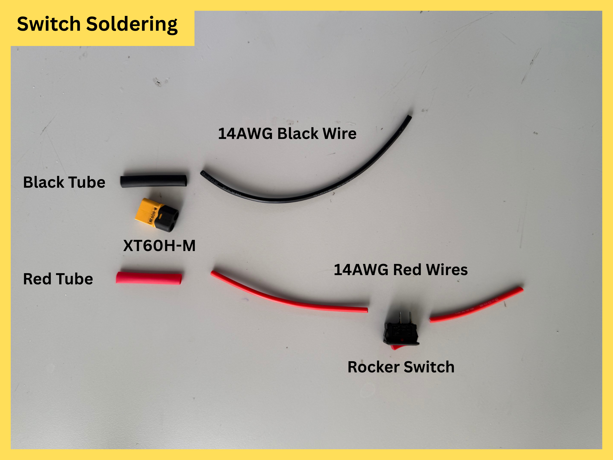 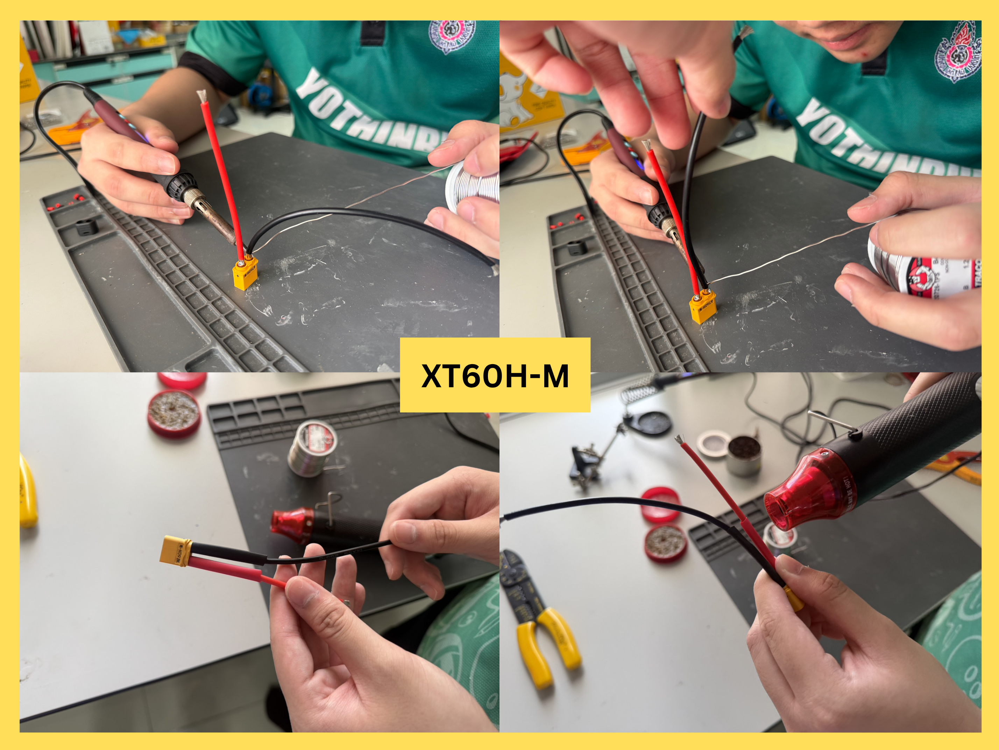 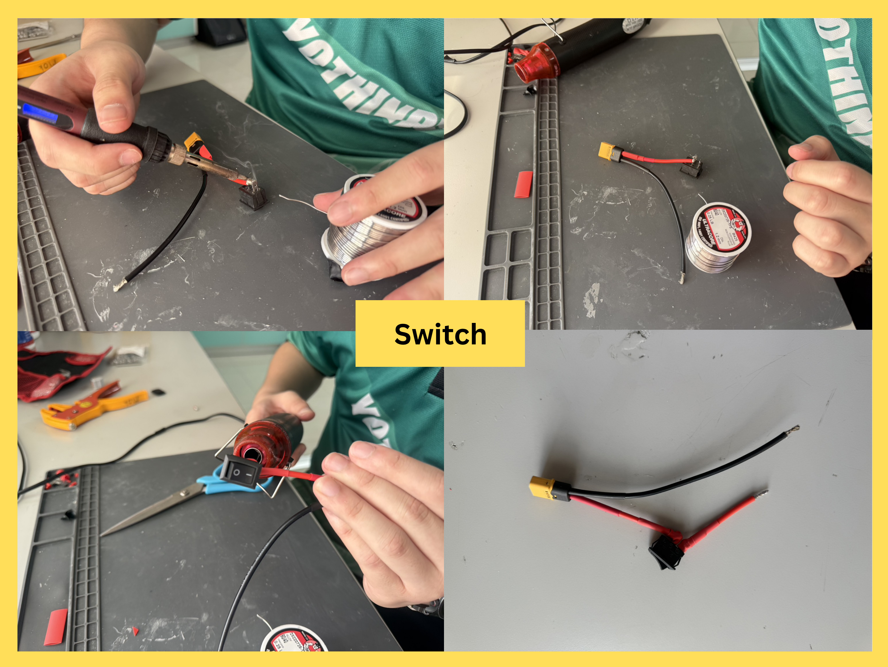 


Soder the XT60H-M to a 14AWG wire and soder the positive wire to the power switch and use a shrinking tube to short circuit

---

## 6.3 Soder the Buck converter

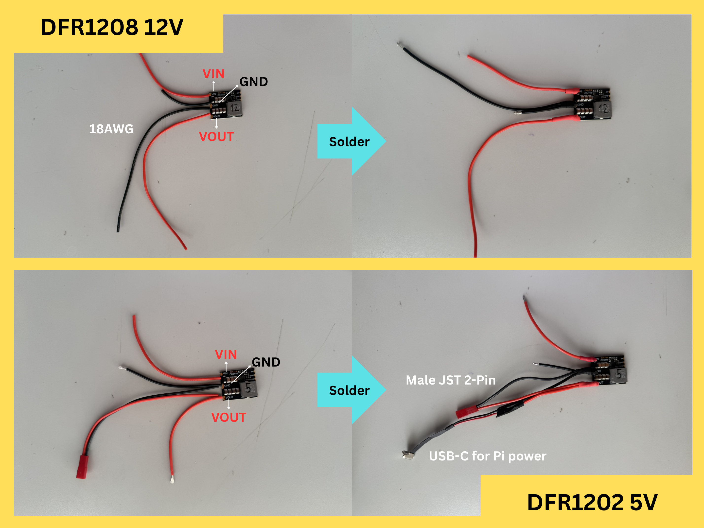

Soder the 12V buck to a one output to the DC Motor Driver HAT
Soder the 5V buck to a USB-C 2P(Pi 5) and Mae JST 2-P(LiDAR)

---

## 6.4 OLED Voltmeter

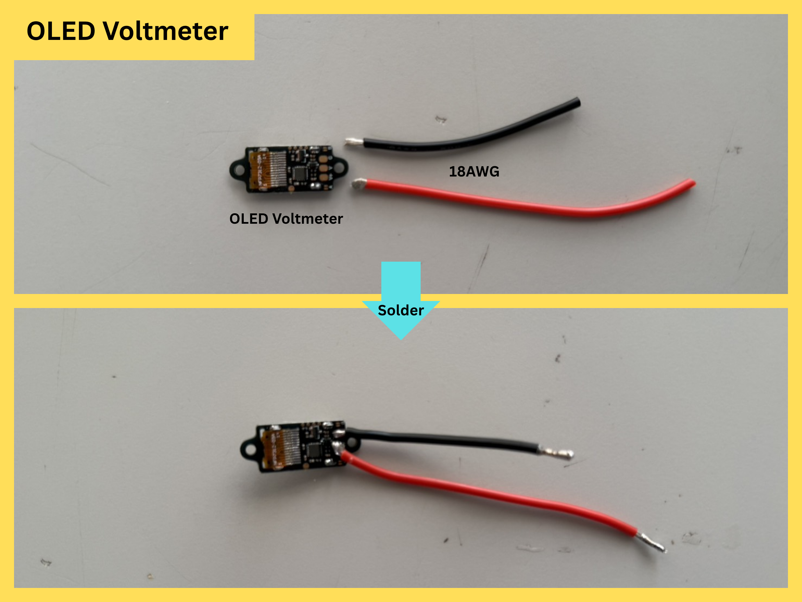

Soder the positive wire to the **V** and **V+** and the negative to the **G**

---

## 6.5 Ground Distribution

Connect the required negative / ground paths to the D4 distribution. Maintain a common electrical reference for signals shared between subsystems. Before powering the system, use a multimeter to check the ground connections for continuity.

---

## 6.6 LiDAR UART port

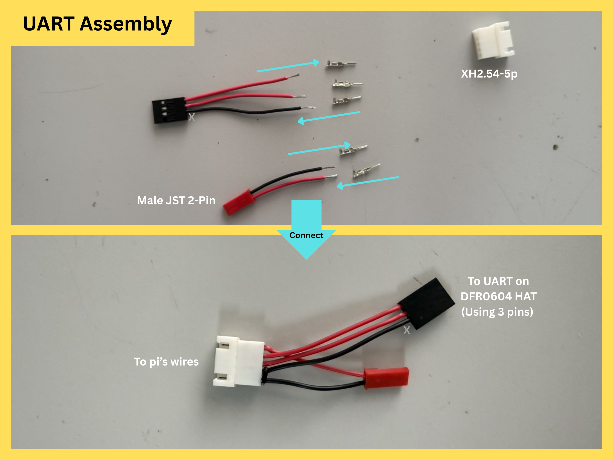

Connect the XH2.54-5P to the Female JST 2-Pin and DuPont Connector 4-Pin like in the [wiring diagram](../schemes/wiring_diagram.png)

---

## 6.7 Connect to other components

1. Connect the camera through the Raspberry Pi CSI interface.
       Check:
       - CSI connector orientation,
       - ribbon-cable direction,
       - locking tab.
       Do not insert or remove the CSI cable while the Raspberry Pi is powered.


2. Connect the motor and encoder
       
       M1 MOTOR      -> M1+
       GND HALL      -> E1-
       C2 HALL       -> E1B
       C1 HALL       -> E2A
       VCC HALL      -> E1+
       M2 MOTOR      -> M1-
   
   
   

4. Connect Steering Servo
   
       PWM 3

5. Connect Start Button

       Digital 16

6. Connect RPLiDAR S2l

       UART


---

## 6.8 Cable Management

After all wiring is complete:

- secure loose wires,
- prevent cables from touching wheels,
- prevent cables from touching drivetrain gears,
- keep wires away from steering movement,
- prevent wires from entering the LiDAR scan / rotating area,
- provide strain relief near connectors.

Do not permanently secure all cables until the electrical verification tests pass.

---

# 7. Electrical Pre-Power Verification

This is one of the most important stages of reproduction.

Do **not** connect the Raspberry Pi or other sensitive loads until converter voltages are verified.

---

## 7.1 Power Verification Sequence

```text
Complete Power Wiring
       |
       v
Disconnect Sensitive Electronics
       |
       v
 Inspect Polarity
       |
       v
 Connect Battery
       |
       v
Turn Main Switch ON
       |
       v
  Measure Buck 5V
       |
       v
  Confirm ~5.1 V
       |
       v
 Measure Buck 12V
       |
       v
 Confirm ~12.1 V
       |
       v
  Turn Power OFF
       |
       v
Connect Electronics
```

---

## 7.2 Multimeter Checklist

Before connecting electronics:

- [ ] battery polarity correct
- [ ] no short between positive and ground
- [ ] Buck 5V input correct
- [ ] Buck 5V output approximately 5.1 V
- [ ] Buck 12V input correct
- [ ] Buck 12V output = 12.1
- [ ] common ground continuity verified
- [ ] no exposed conductor contacting chassis / PCB
- [ ] connectors mechanically secure

---

## 7.3 First Powered Electrical Test

After converter verification:

1. power off
2. connect Raspberry Pi / control electronics
3. power on
4. observe for unexpected heat, smell, sound or resets
5. power off immediately if abnormal behavior occurs


---

# 8. Mechanical Assembly

The recommended mechanical assembly order is:

```text
Steering System
      ↓
Electrical Plate
      ↓
  Top Plate
      ↓
  Drivetrain
      ↓
   Assemble 
      
```


Relevant CAD files are documented in:

[`1-mech.md`](1-mech.md)


Sensor-placement reasoning is documented in:

[`2-elec.md`](2-elec.md)


---

## 8.1 Assemble Steerng System

   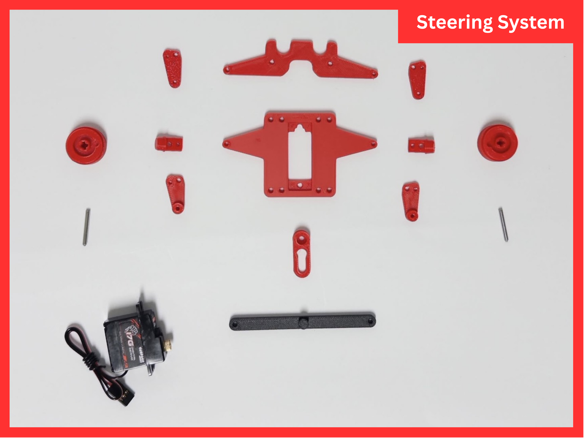
   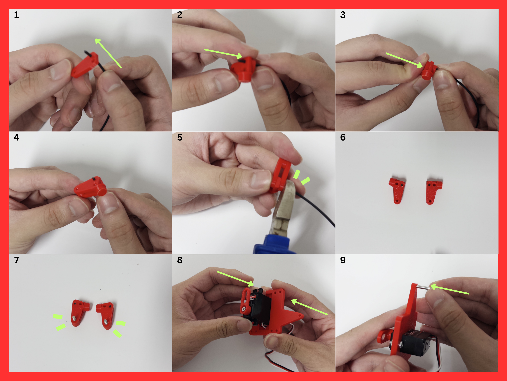       
   
   First we use a 1.75 mm filament as a pin to hold the steering and use a M2.5 screw to lock it in place
   
   And install the servo and the king pin to the servo base
   
   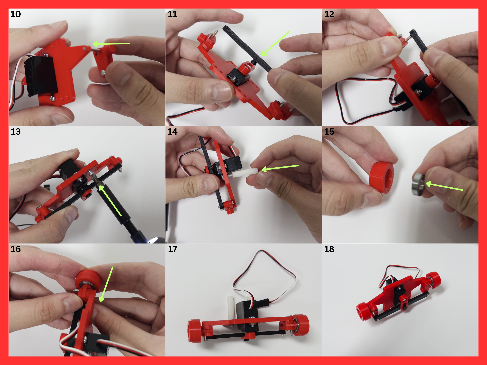
   
   Then install the left and right knuckles to the kingpin and install the Steering Rack 
   After that connect the Wheel Connectors to the Steering Hub with the front bearing
   
After assembly:

- [ ] move the steering manually,
- [ ] verify both wheels rotate freely,
- [ ] check for mechanical binding,
- [ ] verify the linkage does not contact the chassis.


## 8.2 Assemble Electrical Plate

   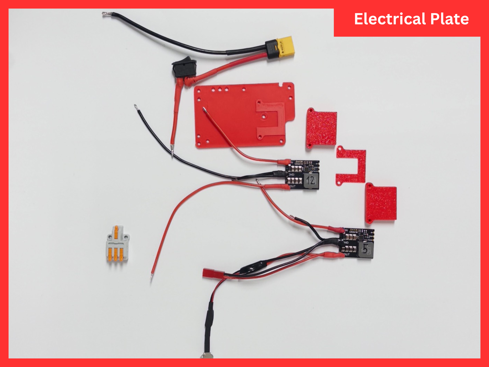
   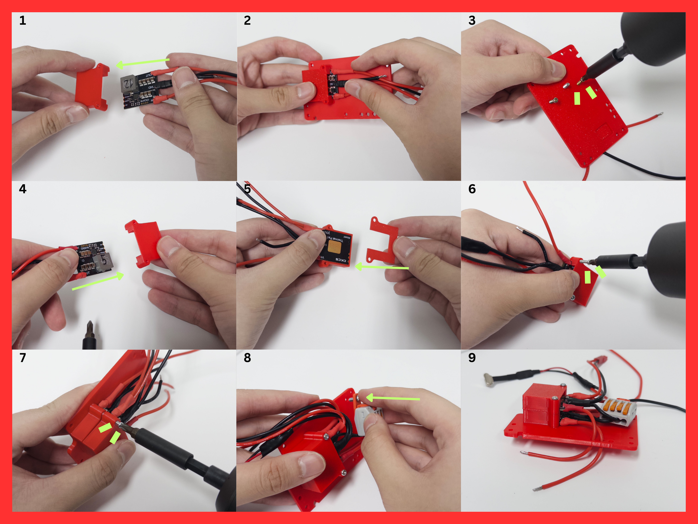       

   First screw in the 12V buck to the Elec Plate and the 5V buck on top with the spacer

   Then install the D4 Quick Connector in the Elec Plate

---

## 8.3 Assemble Top Plate

   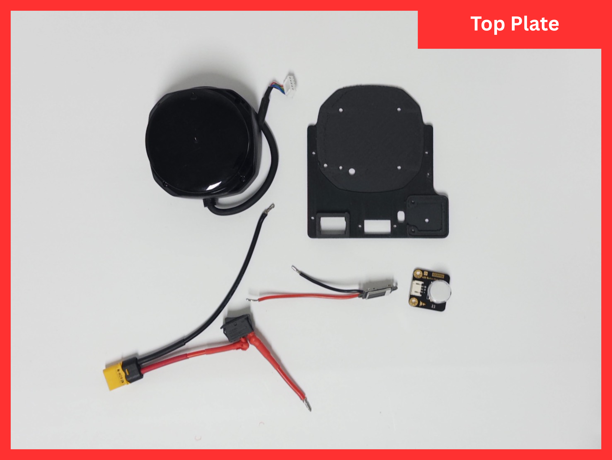
   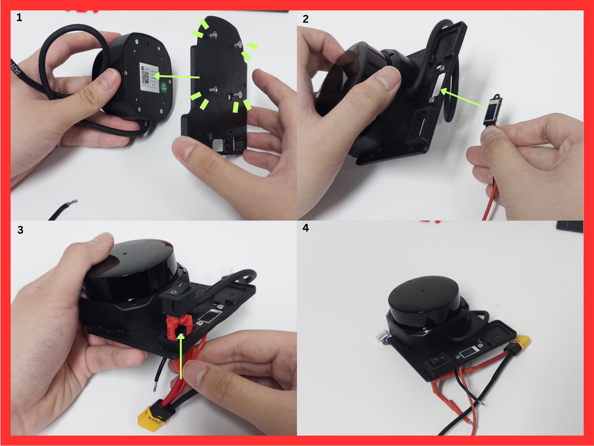       

   First install the LiDAR, Oled Voltmeter, and the Power Switch (the Start Button will be install later)
   

---

## 8.4 Assemble Drivetrain

   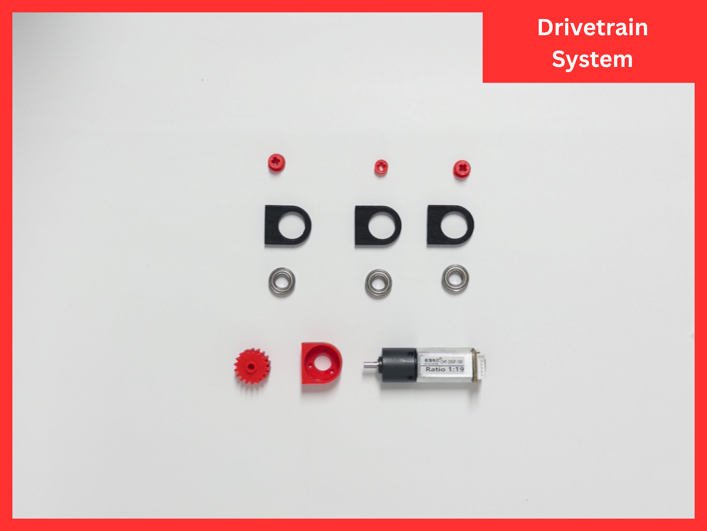
   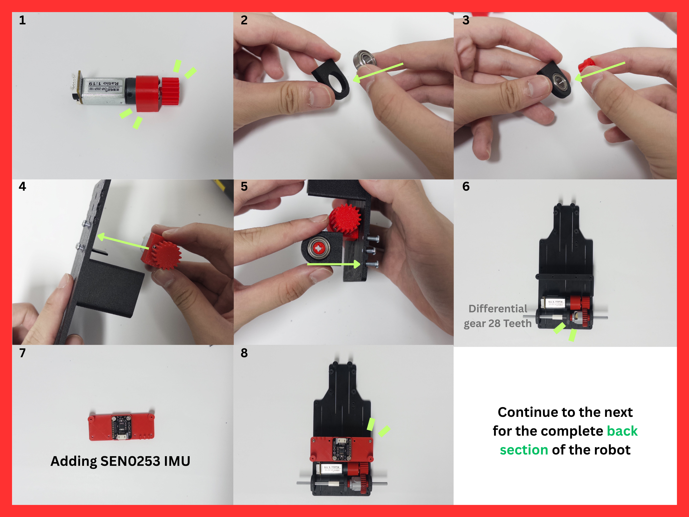       

   Install the Motor Backet and the Gear on the CHP-20GP-180 motor

   Next connect the Rear Bearings with the Bearing Mount and Axel Sleeves then connect the LEGO Axel and Differential
   
Before continuing:

- [ ] rotate the drivetrain manually,
- [ ] verify the gear teeth mesh correctly,
- [ ] confirm the differential rotates freely,
- [ ] check that the axle does not bind,
- [ ] verify both wheels rotate without excessive friction.

### Gear-Mesh Check

The 18T and 28T gears should:

- engage fully,
- rotate without skipping,
- not be forced tightly together.

Incorrect gear mesh can cause excessive current draw, increased drivetrain noise, gear wear, and reduced speed.

---

## 8.5 Assemble Everything

We recommend assembling from the top to bottm

```text
  Top Plate
      ↓
Electrical Plate
      ↓
    Base

```

   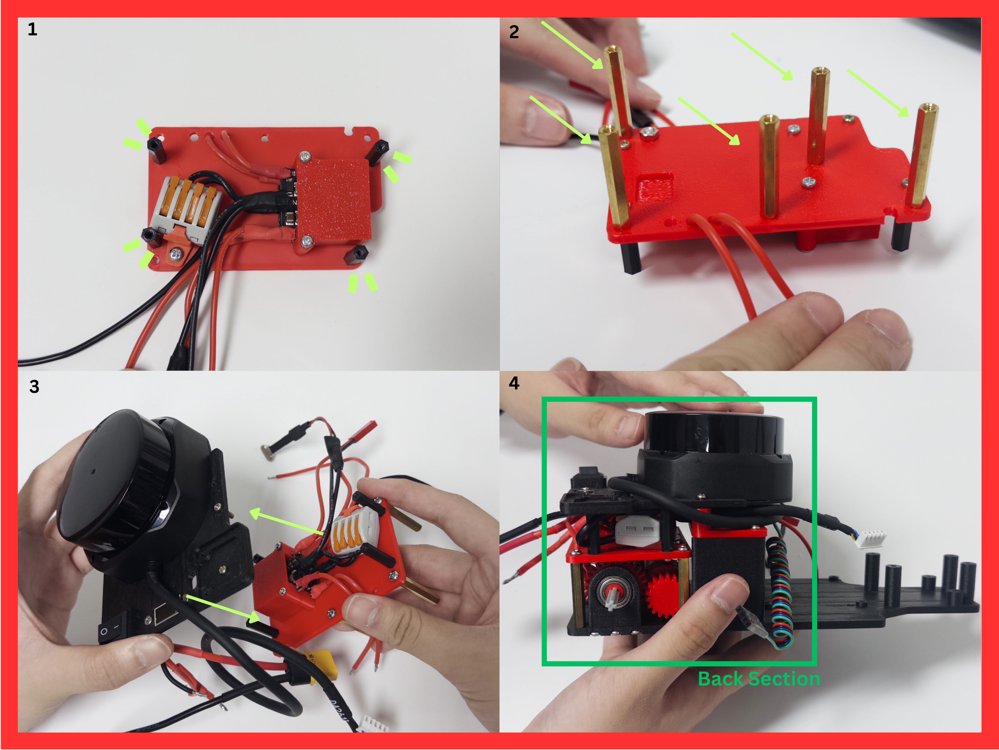

   Mount 4 **M2.5 x 25mm** spacer on top and 5 **M3 x 30mm** at the bottom of the Elec Plate

   After mounting the spacer, install the Top Plate on the Elec Base, and them the Elec Base on the Mian Base completing the Back Section
   
   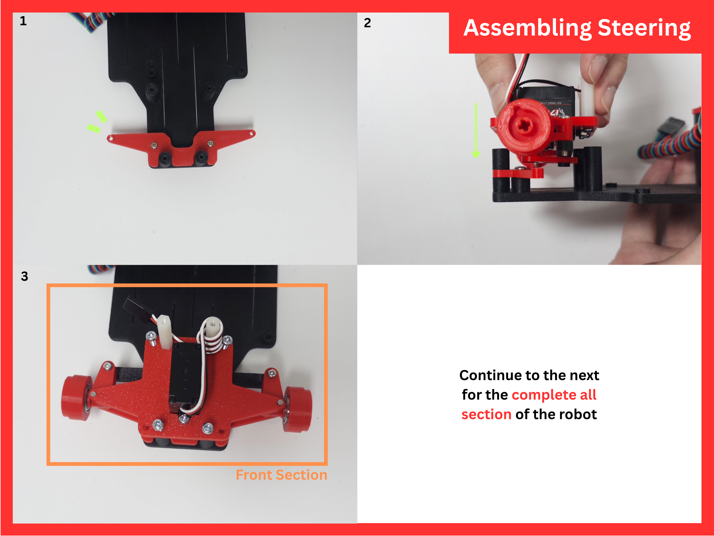  

   Mount the Steering Support on the base and install the Steering System on top completing the Front Section
   

   Next **Install Raspberry Pi, DFR0592, and DFR0604**
   
   Install the Raspberry Pi 5 onto its mounting position on the Main Base. Then, mount the DFR0592 DC Motor Driver HAT, and the DFR0604 I/O Expansion HAT directly onto the Raspberry Pi header according to the board orientation.
   
Before finishing:

- [ ] confirm no pin is misaligned,
- [ ] confirm no metal part can short the Raspberry Pi,
   
   
   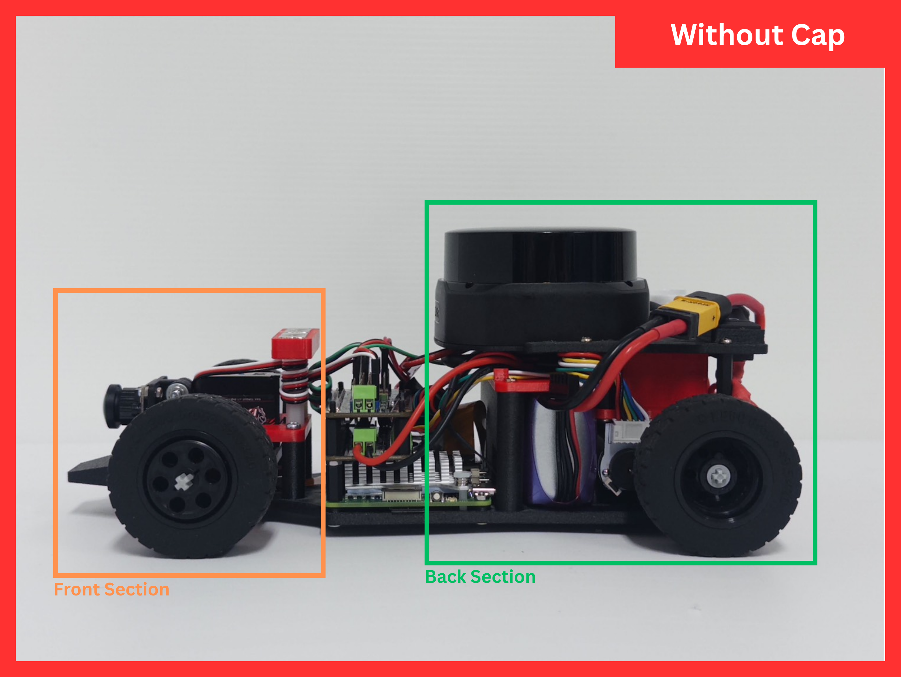  
   
---

## 8.6 Mechanical Inspection

- [ ] all wheels rotate freely
- [ ] differential rotates freely
- [ ] drive gears mesh correctly
- [ ] motor is rigidly mounted
- [ ] steering does not bind
- [ ] front wheels can turn left and right
- [ ] bearings remain seated
- [ ] camera assembly is secure
- [ ] LiDAR structure is rigid
- [ ] electronics plates are secure
- [ ] no screw contacts an exposed circuit board
- [ ] no loose printed component remains
- [ ] LiDAR should be approximately parallel with the field,
- [ ] LiDAR rotation must not be physically obstructed,
- [ ] cables must not enter the LiDAR scanning area.


---


# 9. Raspberry Pi Software Setup

The final software targets:

```text
Raspberry Pi 5
Raspberry Pi OS 64-bit
Python 3.11+
```

Python packages are managed with:

```text
uv
```

---

## 9.1 Prepare Raspberry Pi OS

Using Raspberry [Pi Imager](https://www.raspberrypi.com/software/):

1. install Raspberry Pi OS 64-bit,
2. configure username / password,
3. configure network access if required,
4. enable SSH,
5. boot the Raspberry Pi.

---

## 9.2 Clone the Repository

Open a terminal on the Raspberry Pi:

```bash
cd ~
git clone https://github.com/chankrrn/WRO-FE-YBR-SUNFLOWER.git
cd WRO-FE-YBR-SUNFLOWER/src/Raspberrypi
```

For exact competition reproduction, the final tagged release should eventually be used instead of following the changing `main` branch.

See Section 16.

---

## 9.3 Run Setup Script

The repository contains:

```text
setup_pi.sh
```

Run:

```bash
bash setup_pi.sh
```

The setup script is intended to configure the required Linux packages, interfaces, permissions, `uv`, and Python environment.

When completed:

```bash
sudo reboot
```

The reboot is important because changes to group permissions, I²C configuration, and other system settings may not take effect until the system is restarted or the user logs in again.

---

## 9.4 Verify Raspberry Pi Interfaces

After reboot:

```bash
cd ~/WRO-FE-YBR-SUNFLOWER/src/Raspberrypi
```

Check I²C:

```bash
i2cdetect -y 1
```

Check UART serial devices:

```bash
ls -l /dev/serial*
```


---

## 9.5 Install Python Environment

If `setup_pi.sh` already completed this successfully, no additional dependency installation should normally be necessary.

To verify:

```bash
uv sync
```

The environment is defined by:

```text
pyproject.toml
uv.lock
```

The lock file is important because it records reproducible Python dependency versions.

---

## 9.6 Dry Run

Before accessing the physical actuators:

```bash
uv run python main.py qualification --dry-run
```

Expected behavior:

- configuration loads,
- task plan is created,
- software exits without attempting normal hardware-driving behavior.


---


# 10. Final Software Configuration

Competition parameters are stored primarily in:

```text
src/Raspberrypi/tasks/qualification/config.toml
```

and:

```text
src/Raspberrypi/tasks/final/config.toml
```

These configuration files contain adjustable values for the robot, including speed settings, clearance distances, Pure Pursuit lookahead, obstacle behavior, and path-planning parameters.

---

## 10.1 Do Not Re-Tune During Reproduction Unless Necessary

For exact reproduction:

1. use the final tagged repository version,
2. use its included configuration files,
3. first reproduce the robot behavior,
4. only then change tuning values if the reproduced mechanical platform differs.


---

# 11. Subsystem Verification

Do not immediately run the full autonomous challenge. Instead, test the system step by step.

---

## 11.1 Stage 1 — Electrical Verification

- [ ] main switch works
- [ ] Raspberry Pi supply measured correctly
- [ ] motor/control supply measured correctly
- [ ] common ground verified
- [ ] Raspberry Pi boots normally
- [ ] no unexpected component heating
- [ ] no undervoltage / reset behavior during idle operation

---

## 11.3 Stage 2 — Steering Test

With drive wheels off the ground:

- [ ] servo centers
- [ ] left command moves left
- [ ] right command moves right
- [ ] linkage does not bind
- [ ] wheels do not exceed mechanical steering limits

After centering, connect / adjust the steering linkage mechanically if required.

---

## 11.4 Stage 3 — Drive Motor Test

With wheels lifted:

- [ ] positive command rotates wheels in forward direction
- [ ] negative command rotates wheels in reverse direction
- [ ] zero command stops motor
- [ ] gears do not skip
- [ ] drivetrain does not bind

---

## 11.5 Stage 4 — Encoder Test

Rotate / drive the drivetrain slowly.

Verify:

- [ ] Encoder A responds
- [ ] Encoder B responds
- [ ] count changes in expected direction
- [ ] reversing changes direction correctly
- [ ] count is repeatable over several rotations

---

## 11.6 Stage 5 — IMU Test

Run the IMU/software initialization, then rotate the robot by hand.

Verify:

- [ ] heading updates
- [ ] heading changes continuously
- [ ] sensor initializes through I²C
- [ ] no intermittent connection

---

## 11.7 Stage 6 — LiDAR Test

Verify that the LiDAR:

- [ ] rotates normally
- [ ] is detected by Linux
- [ ] returns scan data
- [ ] sees nearby walls / objects
- [ ] has no cable obstruction

The debug view can be used to verify whether the scan matches the surrounding geometry.

---

# 11.8 Stage 7 — Camera Test

Verify:

- [ ] camera stream opens
- [ ] image orientation is correct
- [ ] red pillar is detected as red
- [ ] green pillar is detected as green
- [ ] camera does not move mechanically during driving

Use:

```text
test_color_picker.py
```

if color thresholds require validation.

---

## 11.9 Stage 8 — Start Button

Verify:

- [ ] robot can remain powered while waiting
- [ ] pressing start button produces the start event
- [ ] autonomous timer begins after start
- [ ] main power switch and start switch remain independent

---

# 12. First Autonomous Run

The first autonomous test should be performed at reduced risk.

---

## 12.1 Pre-Run Inspection

Before placing the robot on the track:

- [ ] battery adequately charged
- [ ] no loose connectors
- [ ] LiDAR unobstructed
- [ ] camera secure
- [ ] wheels secure
- [ ] correct configuration selected
- [ ] debug mode available if required

---

## 12.2 Localization Test

Before completing full laps:

```bash
uv run python test_navigation.py
```

Verify that localization particles converge toward a reasonable robot pose. Do not proceed to high-speed testing if localization does not converge reliably.

---

## 12.3 Low-Speed Driving Test

Perform:

1. short straight drive
2. left turn
3. right turn
4. stop
5. repeat

Confirm:

- steering direction
- motor direction
- vehicle clearance
- drivetrain stability

---

## 12.4 Qualification / Open Challenge

Run:

```bash
uv run python main.py qualification
```

The robot should:

1. initialize,
2. wait for physical start,
3. capture its heading reference,
4. localize,
5. follow the racing line,
6. complete the task according to qualification logic,
7. stop safely.

---

## 12.5 Obstacle Challenge

Run:

```bash
uv run python main.py final
```

Debug mode:

```bash
uv run python main.py final --debug
```

The final task adds:

- traffic-pillar detection,
- obstacle map,
- racing-line deformation,
- obstacle passing,
- parking behavior.

---

# 13. Testing Workflow

Testing is an important part of the reproducible engineering workflow. The repository contains dedicated tools instead of requiring every change to be tested through a full competition run.

---

## 13.1 Recommended Development Workflow

```text
Change Code / Config
        |
        v
Dry Run
        |
        v
Simulation
        |
        v
Specific Subsystem Test
        |
        v
Low-Speed Physical Test
        |
        v
Full Track Test
        |
        v
Record Result
```

---

# 13.2 Software Test Tools

### Localization

```bash
uv run python test_navigation.py
```

### Repeated Driving Simulation

```bash
uv run python test_driving.py --trials 24
```

### Steering Parameter Sweep

```bash
uv run python test_steering.py --sweep speed.corner 40,50,60,70
```

### Color Calibration

```bash
uv run python test_color_picker.py
```

---


# 14. Troubleshooting

Follow the troubleshooting steps in order. Avoid changing multiple configuration values at the same time, as this makes it more difficult to identify the cause of a problem.

---

## 14.1 Raspberry Pi Does Not Detect LiDAR

### Check

```bash
ls -l /dev/serial*
```

Then inspect:

- LiDAR power
- UART adapter
- UART cable
- connector seating

If the device exists but permission is denied, inspect:

```bash
ls -l /dev/ttyAMA0
groups
```

---

## 14.2 BNO055 Not Detected

Run:

```bash
i2cdetect -y 1
```

Check:

- I²C enabled
- DFR0566 seated correctly
- I²C cable
- SDA / SCL connection
- power and ground

---

## 14.3 Camera Not Available

Check:

- CSI ribbon orientation
- CSI locking connector
- camera cable damage
- camera configuration
- Raspberry Pi reboot after setup

Then test camera functionality before running competition software.

---

## 14.4 Servo Jitters or Resets

Possible causes:

- unstable servo supply,
- voltage drop,
- mechanical binding,
- poor ground connection,
- excessive load.

Check:

1. supply voltage
2. common ground
3. steering mechanism by hand
4. servo behavior with drivetrain stopped

---

## 14.5 Raspberry Pi Resets During Acceleration

Possible cause: actuator-related power disturbance or Pi supply voltage drop.

Check:

1. Raspberry Pi branch voltage while motor starts
2. 12V Buck output under load
3. connectors
4. common ground
5. battery state


---

## 14.6 Motor Rotates in Wrong Direction

Do not change several software signs simultaneously.

First verify:

- motor wiring polarity
- DC Motor Driver HAT direction convention
- software forward command

Document the final convention after correcting it.

---

## 14.7 Encoder Counts in Wrong Direction

Check:

- Encoder A / B wiring
- E1A / E1B assignment
- motor rotation direction

Swapping encoder A and B changes quadrature direction.

---

## 14.8 LiDAR Map Looks Distorted

Check the physical mounting first. The LiDAR scan plane should be approximately parallel to the field surface. A tilted LiDAR can produce incorrect 2D geometry even when communication is working correctly.

---

## 14.9 Robot Localizes Incorrectly

Check:

1. LiDAR data
2. LiDAR physical orientation
3. IMU heading
4. field-map configuration
5. start pose / configuration
6. particle convergence

Use:

```bash
uv run python test_navigation.py
```

and debug visualization before changing path-following parameters.

---

## 14.10 Camera Detects Wrong Pillar Color

Use:

```bash
uv run python test_color_picker.py
```

Check:

- lighting
- exposure
- final camera FOV
- HSV thresholds

Do not increase threshold ranges without checking real camera values.

---

# 15. Competition Startup Procedure

Once the robot has passed the reproduction tests, use the following competition startup sequence.

```text
Inspect Robot
      |
      v
Check Battery
      |
      v
Place Robot
      |
      v
Main Power ON
      |
      v
Wait for Pi Initialization
      |
      v
Confirm Sensors
      |
      v
Start Correct Competition Task
      |
      v
Robot Waits for Start Button
      |
      v
Press Start Button
      |
      v
Initial Heading Captured
      |
      v
Autonomous Run Begins
```

---

## 15.1 Open Challenge

```bash
cd ~/WRO-FE-YBR-SUNFLOWER/src/Raspberrypi
uv run python main.py qualification
```

---

## 15.2 Obstacle Challenge

```bash
cd ~/WRO-FE-YBR-SUNFLOWER/src/Raspberrypi
uv run python main.py final
```

---

# 16. Version Lock and Competition Release

A reproducible robot requires more than the latest `main` branch. The exact competition version should be permanently identifiable.

---

## 16.1 Reproduce the Exact Competition Version

After cloning:

```bash
cd ~/WRO-FE-YBR-SUNFLOWER
```

Verify:

```bash
git rev-parse HEAD
```

The returned commit should match the final documented competition SHA.

---

# 17. Reproducibility Checklist

## 17.1 Documentation

- [ ] Main README available
- [ ] Mechanical README available
- [ ] Electrical README available
- [ ] Software README available
- [ ] BUILD guide available
- [ ] Schematic available
- [ ] Wiring diagram available
- [ ] CAD / STL files available
- [ ] Source code available
- [ ] Final release / tag documented
- [ ] CHANGELOG available

---

## 17.2 Mechanical

- [ ] all required printed parts identified
- [ ] final V2.4 parts separated from prototypes
- [ ] drivetrain assembled
- [ ] differential works
- [ ] bearings installed
- [ ] steering works freely
- [ ] servo installed
- [ ] wheels installed
- [ ] electronics layers installed
- [ ] camera mounted
- [ ] LiDAR / IMU mounted

---

## 17.3 Electrical

- [ ] battery polarity documented
- [ ] LM2596 output documented
- [ ] XL4015 output documented
- [ ] common ground verified
- [ ] Raspberry Pi powered correctly
- [ ] Arduino powered correctly
- [ ] motor wired
- [ ] servo wired
- [ ] encoder wired
- [ ] IMU connected
- [ ] camera connected
- [ ] LiDAR connected
- [ ] start button connected
- [ ] wiring matches schematic

---

## 17.4 Software

- [ ] Raspberry Pi OS version documented
- [ ] repository cloned
- [ ] final release checked out
- [ ] `setup_pi.sh` completed
- [ ] `uv sync` succeeds
- [ ] dry run succeeds

---

## 17.5 Subsystem Tests

- [ ] LiDAR detected
- [ ] IMU detected
- [ ] camera works
- [ ] motor direction correct
- [ ] steering direction correct
- [ ] steering center correct
- [ ] encoder works
- [ ] start switch works
- [ ] localization converges
- [ ] low-speed drive succeeds

---

## 17.6 Competition Functions

- [ ] Open Challenge task starts correctly
- [ ] robot follows racing line
- [ ] red pillar detected
- [ ] green pillar detected
- [ ] red pillar passed on correct side
- [ ] green pillar passed on correct side
- [ ] parking sequence operates
- [ ] timeout stops run
- [ ] software exception cleanup stops drivetrain

---


# 18. Related Documentation

For design reasoning, use:

### Mechanical

[`1-mech.md`](1-mech.md)

### Electrical and Sensors

[`2-elec.md`](2-elec.md)

### Software

[`3-software.md`](`3-software.md)

### Electrical Schematic

[`schemes/Schematic Diagram.png`](schemes/Schematic_Diagram.png)

### Physical Wiring Diagram

[`schemes/Wiring Diagram.png`](schemes/Wiring_Diagram.png)

### Source Code

[`src/`](src/)

---

# Final Reproduction Principle

A robot is not reproducible simply because its source code and CAD files are public.

Reproduction requires enough information to answer:

```text
What parts are required?
How are they manufactured?
How are they assembled?
How are they wired?
What voltage should each rail have?
What software version should be installed?
How is the firmware uploaded?
How is each subsystem verified?
What tests must pass before autonomous driving?
Which exact repository version produced the competition robot?
```

The objective of this guide is therefore:

> **Another builder should not need to reverse-engineer YBR-SUNFLOWER from photographs or guess undocumented settings.**

The final reproduction process is:

> **Manufacture → Assemble → Wire → Measure → Configure → Verify → Test → Run**

and should lead to the same Version 2.4 hardware and competition software documented throughout this repository.
