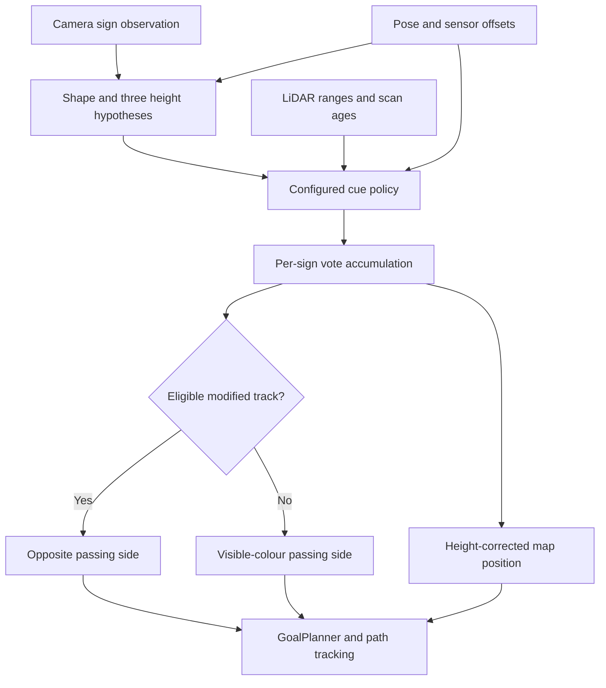

# Surprise Rule — Sign Interpretation and Obstacle Strategy

[← Project README](../README.md)

[← Engineering Overview](0-overview.md)

[← Mobility and Mechanical Design](1-mech.md)

[← Power and Sensor Architecture](2-elec.md)

[← Software Architecture and Obstacle Strategy](3-software.md)

[← Build and Reproduction Guide](4-build.md)

This guide connects the official extra task to the team's implemented perception and planning logic. Configuration values describe software settings; the test procedures describe how to evaluate them. They are not measured success rates.

---

## Contents

1. [Official task and passing-side rule](#1-official-task-and-passing-side-rule)
2. [Engineering challenge](#2-engineering-challenge)
3. [Implementation and information flow](#3-implementation-and-information-flow)
4. [Geometry and sensor evidence](#4-geometry-and-sensor-evidence)
5. [Voting and round-level safeguards](#5-voting-and-round-level-safeguards)
6. [Configuration reference](#6-configuration-reference)
7. [Operating procedure](#7-operating-procedure)
8. [Verification method](#8-verification-method)
9. [Evidence and engineering interpretation](#9-evidence-and-engineering-interpretation)
10. [Sources](#10-sources)

---

## 1. Official task and passing-side rule

The [official Extra Task PDF](https://wro-association.org/wp-content/uploads/WRO-2026-Future-Engineers-Extra-Task.pdf) makes participation optional: declare it before each attempt; it cannot change after starting. Judges replace one sign, excluding the first encountered in the required direction, with the opposite colour and a height of 50 or 150 mm instead of 100 mm. Its 50 × 50 mm base position is unchanged. The selected position and height are shared across teams within the round.

The robot must follow the sign's **original colour**. Thus, a modified visible green sign requires passing on its right; a modified visible red sign requires passing on its left. Ordinary signs keep their normal meaning. Wrong-side passage ends the attempt.

Each correct passage of the modified sign earns five extra points, up to fifteen over three laps; earned passage points survive an early finish. Repair halves the total including this bonus. The three-minute limit and other standard rules remain. Maximum totals become 77 for Obstacle and 137 overall. These are rule limits, not team results.

---

## 2. Engineering challenge

The existing detector estimates range from an assumed sign height. A shorter sign and a more distant normal sign can occupy the same image height. Colour alone therefore cannot identify the extra-task sign, and a height change affects both the passing-side decision and the sign's mapped location.

The implemented approach separates three quantities:

| Quantity | Meaning | Consumer |
|---|---|---|
| Visible colour | What the camera actually observes | Detection and sign tracking |
| Estimated height and position | Which size/range hypothesis is supported | BlockMap and map coordinates |
| Effective passing side | Which side the route should use after eligibility checks | GoalPlanner |

The colour observation remains meaningful even when the planner uses the opposite passing side. Localization, curvature-constrained planning and Pure Pursuit remain the underlying navigation system.

A false modified-sign classification can be as consequential as missing the real one. The design therefore combines restricted shape bands, range consistency, repeated observations and round-level eligibility rules. These controls reduce specific failure mechanisms; their existence does not establish a numerical reliability level.

---

## 3. Implementation and information flow

| Responsibility | Source | Relevant behavior |
|---|---|---|
| Mode selection | [tasks/cli.py](../src/Raspberrypi/tasks/cli.py) | Applies the `--surprise` override |
| Camera detection | [object_solver.py](../src/Raspberrypi/classes/object_solver.py) | Visible colour, bounding geometry, bearing and height-based range |
| Size interpretation | [sign_sizer.py](../src/Raspberrypi/classes/sign_sizer.py) | Shape hypothesis, LiDAR comparison, voting evidence and placement height |
| Evidence accumulation | [block_map.py](../src/Raspberrypi/classes/block_map.py) | Per-track votes, height latch and normal-height recovery |
| Round policy | [final/task.py](../src/Raspberrypi/tasks/final/task.py) | First-sign protection, one selected modified location and replanning |
| Path construction | [goal_planner.py](../src/Raspberrypi/classes/goal_planner.py) | Passing goals, turning constraints and body clearance |
| Parameter profile | [final/config.toml](../src/Raspberrypi/tasks/final/config.toml) | Cue policy, thresholds, vote settings and speed request |



*Figure SR-01. Implemented decision flow. A height used for position estimation is distinct from authorization to invert a passing side.*

---

## 4. Geometry and sensor evidence

### 4.1 Three range hypotheses

For image height `h_px`, a pinhole-style approximation relates sign height `H`, effective focal calibration `f_y` and camera-to-face distance `d_H`:

$$
d_H \approx \frac{f_y H}{h_{px}},
\qquad
d_H = d_{100}\frac{H}{100},
\qquad H\in\{50,100,150\}\ \mathrm{mm}.
$$

The second expression shows the scaling when the original detector assumed 100 mm. The implementation uses the detection's own `assumed_height_cm` when rescaling. A normal-height assumption overestimates the distance to a 50 mm sign and underestimates the distance to a 150 mm sign.

These camera distances cannot be compared directly with LiDAR distances from a different origin. SignSizer converts the hypothesized face distance into a sign centre, applies the sensor offsets and pose, then evaluates the expected LiDAR-facing range. [robot_geometry.py](../src/Raspberrypi/classes/robot_geometry.py) contains the shared offsets.

The camera's `CAMERA_YAW_DEG = -6.4` and `CAPTURED_HORIZONTAL_FOV_DEG = 230.0` are code calibration parameters. The latter is not the lens seller's advertised 222° specification. Changing camera mounting or image geometry changes the applicability of the calibration.

### 4.2 Corrected image shape

A square-based sign appears wider when viewed diagonally. The code uses the field-relative viewing angle to compensate its apparent width. With bounding-box height `h`, width `w`, edge correction `p` and viewing angle `alpha`:

$$
h' = h-p,
\qquad
w' = \frac{w-p}{|\cos\alpha|+|\sin\alpha|},
\qquad
\rho = \frac{h'}{w'}.
$$

The field-relative angle is reduced modulo 90° because the base is square. Nominal corrected ratios are approximately 1, 2 and 3 for the three height hypotheses. The actual decision bands deliberately leave gaps:

| Corrected ratio | Shape vote |
|---|---|
| At most 1.35 | 50 mm |
| 1.60 through 2.40 | 100 mm |
| At least 2.65 | 150 mm |
| Between the bands | No shape decision |

A usable shape also needs valid pose information, an unclipped detection, positive dimensions, a candidate range within 200–800 mm and an off-axis angle within 50°. These gates limit where the approximation is trusted.

### 4.3 LiDAR comparison

The LiDAR search uses the sign bearing **from the LiDAR**, not from the camera. Returns are checked within ±6°, with tolerance:

$$
\epsilon(d)=60\ \mathrm{mm}+0.08d,
$$

where `d` is the candidate LiDAR range in millimetres. Measurements older than 0.3 s are ignored, and motion compensation uses the available speed and scan age. Returns close to a predicted wall are not treated as independent sign evidence.

The profile sets `lidar_sees_short = false`: the scan plane is modeled as passing above a 50 mm sign. A suitable clear-through pattern can therefore support a short-sign interpretation. Absence of a return by itself is not proof of a short sign. The configured minimum of two readings applies to interpreting beam passage.

### 4.4 Veto versus confirm

| Cue policy | Modified-height vote |
|---|---|
| `"veto"` — selected profile | Shape proposes 50 or 150 mm; the vote is allowed if LiDAR agrees or has no usable opinion, and rejected if LiDAR contradicts it |
| `"confirm"` | Shape and LiDAR must agree on the same modified height |

Veto mode trades a less restrictive decision condition for greater dependence on the camera's shape calibration. A missing LiDAR opinion does **not** automatically disable a modified-height vote in this mode.

The source also separates `place_height` from `vote`. For example, LiDAR can support a 150 mm range correction without sufficient shape evidence for a modified-sign vote. Correcting placement alone must not be described as an instruction to invert the passing side.

---

## 5. Voting and round-level safeguards

**Tracked evidence.** BlockMap accumulates height votes for each sign. A modified height needs at least four supporting votes and at least 70% of the track's accumulated size votes. Four normal-height votes with the same fraction criterion settle a sign as normal. Unknown observations are not automatically counted as normal.

**Recovery.** A modified latch can be removed when later normal-height evidence meets the normal decision criterion. The mapped position can be recomputed using the selected height, and the final task can clear the corresponding passing-side inversion.

**First-sign protection.** FinalTask identifies the first passed sign from the driving observations and excludes that location from inversion. The starting-bay departure phase is handled separately. This is a software estimate of the first sign, not access to the judges' selection record. Missing the actual first sign can make this protection conservative for a later sign.

**One selected location.** At most one location receives the inverted interpretation. If another candidate has stronger evidence, the selected candidate can change. This is not a permanent latch on whichever unusual blob happened to appear first.

**Replanning.** A changed inversion signature triggers route reconsideration. Sign memory retains previously mapped obstacles when a camera view is briefly lost; size changes must update the remembered position instead of leaving a duplicate obstacle behind.

**Decision distance.** The task requests a speed cap near undecided signs and holds a suspect-sign request briefly after unusual evidence. In the published profile, `surprise.slow_speed` is absent, so its fallback is `speed.compromised = 105`. That equals `speed.minimum`; a vehicle already at that request does not slow further. These are controller request values, not metres per second.

---

## 6. Configuration reference

All values below come from the `[surprise]` table in [final/config.toml](../src/Raspberrypi/tasks/final/config.toml).

| Setting | Value | Engineering role |
|---|---:|---|
| `enabled` | `false` | Standard mode unless explicitly enabled |
| `lidar_role` | `"veto"` | Require no contradictory LiDAR cue |
| `lidar_sees_short` | `false` | Scan-plane model for the short sign |
| `min_area_px` | 30 | Retain small colour contours for size evaluation |
| `max_squat_ratio` | 1.6 | Limit accepted width-to-height ratio |
| `lidar_window_deg` | 6 | Search half-width around predicted LiDAR bearing |
| `lidar_tolerance_mm` / `lidar_tolerance_fraction` | 60 / 0.08 | Fixed and distance-scaled range tolerance |
| `lidar_min_readings` | 2 | Evidence count for clear-through interpretation |
| `lidar_max_age_s` | 0.3 | Maximum accepted scan age |
| `wall_margin_mm` | 150 | Separate wall context from sign evidence |
| `shape_min_range_mm` / `shape_max_range_mm` | 200 / 800 | Shape-use distance band |
| `shape_max_off_axis_deg` | 50 | Shape-use angular band |
| `blob_pad_px` | 0 | Image-mask edge correction |
| `short_max_ratio` | 1.35 | Upper short-sign ratio |
| `standard_min_ratio` / `standard_max_ratio` | 1.6 / 2.4 | Normal-sign ratio band |
| `tall_min_ratio` | 2.65 | Lower tall-sign ratio |
| `latch_votes` / `latch_fraction` | 4 / 0.7 | Modified-height evidence threshold |
| `settle_votes` | 4 | Normal-height evidence threshold |
| `slow_within_mm` | 1,300 | Along-route decision-distance trigger |
| `suspect_hold_s` | 0.8 | Duration of the early suspect-sign speed request |

The configured diagnostic path is `logs/surprise_sizer.csv`, relative to `src/Raspberrypi/`. It is a local runtime output overwritten by the implementation, not a published evidence file or a required input dataset. Setting `log_path = ""` disables it. No CSV is added by this documentation.

---

## 7. Operating procedure

1. Prepare the vehicle and field using the [build guide](4-build.md). Confirm the selected configuration, camera alignment, scan-plane model and physical start control.
2. Select standard or Surprise mode during preparation. For an official attempt, follow the declaration and start procedure in the rules.
3. From `src/Raspberrypi/`, launch the corresponding task:

```bash
# Standard obstacle mode with the published surprise.enabled = false setting
uv run python main.py final

# Surprise mode for this invocation
uv run python main.py final --surprise
```

4. Use the physical start sequence. Perception, size interpretation and passing-side decisions run onboard.
5. Evaluate the sign passages and parking from the physical attempt, together with diagnostic output when available.

Omitting `--surprise` preserves the TOML value; it does not forcibly set the feature to false. If the configuration has been edited to `enabled = true`, restore false when selecting standard mode. Diagnostic options and parameter changes belong to preparation and testing.

---

## 8. Verification method

### 8.1 Camera/LiDAR bench checks

Use [test_sign_sizer.py](../src/Raspberrypi/test_sign_sizer.py) to compare known sign placements with the reported cues. Secure the vehicle for a stationary sensor test. The script's `--place`, `--height`, `--side` and `--wall` distances use **centimetres**; `--facing` uses degrees.

```bash
uv run python test_sign_sizer.py --place 40 --height 10
uv run python test_sign_sizer.py --place 70 --height 15
uv run python test_sign_sizer.py --place 70 --height 5
uv run python test_sign_sizer.py --place 70 --height 10 --facing 45
uv run python test_sign_sizer.py --place 70 --height 10 --side -20
uv run python test_sign_sizer.py --place 70 --height 10 --wall 150
```

Use the script's calibration mode with a known normal-height sign to examine bearing alignment:

```bash
uv run python test_sign_sizer.py --calibrate --height 10
```

Repeat the placement checks with both visible colours, central and peripheral views, face-on and diagonal orientations, and the lighting used on the field. A 100 cm placement is a useful range diagnostic, but lies outside the configured 80 cm maximum for shape voting; absence of a modified shape vote there is expected.

Observe the corrected ratio, camera/LiDAR bearing agreement, hypothesis ranges, cue verdict and mapped location. Evaluate both false inversion of normal signs and missed/late interpretation of modified signs.

### 8.2 Synthetic and driving simulations

The source provides separate synthetic sensor and multi-trial driving interfaces:

```bash
uv run python test_sign_sizer.py --synthetic --place 70 --height 15
uv run python test_driving.py --round final --trials 24 --surprise 15
uv run python test_driving.py --round final --trials 24 --surprise 5
uv run python test_driving.py --round final --trials 24 --surprise none
```

The height arguments here use centimetres. Use `--lidar-sees-short` only for a simulated scan plane intended to intersect the short sign. Synthetic geometry and detector behavior cannot establish real-camera performance.

These commands describe the source tools' interfaces. Their execution depends on a complete software installation and the imports described in the build guide. A test count in a command is a requested experiment size, not a published result.

### 8.3 Field evaluation matrix

| Case | What to observe |
|---|---|
| Ordinary red and green signs | Visible-colour interpretation remains correct; no false inversion |
| Short red / short green | Correct height evidence, corrected position and intended side |
| Tall red / tall green | Same checks without confusing wall returns with the sign |
| Clockwise / counterclockwise | Travel-relative passing side and first-sign identification |
| First sign and later candidate | First-sign protection excludes only the appropriate track |
| Distractor or second unusual candidate | At most one selected inversion location |
| Occlusion, peripheral view or weak colour mask | Unknown evidence does not masquerade as a confident normal vote |
| Strong later normal evidence | An erroneous height latch can recover |
| Three passes of the selected sign | Track memory and side choice remain coherent across laps |
| Full obstacle run and parking | Perception changes do not disrupt task transitions |

For each attempt, report the source/configuration identity, direction, sign setup, lighting, correct or wrong passages, contact events, decision distance, completion/parking outcome and video reference. A compact Markdown result table is sufficient; no new data-directory structure is necessary.

Useful metrics are modified-sign detection rate, normal-sign false-inversion rate, distance remaining when the side decision becomes usable, and whole-run completion rate. Keep denominators visible and separate bench frames from field attempts. The repository's field recording is not a substitute for those repeated-trial denominators.

---

## 9. Evidence and engineering interpretation

The [team's Surprise-mode field recording](https://youtu.be/SZ7-qe57g4k) provides physical footage for the team's stated altered-sign scenario. The [standard obstacle recording](https://youtu.be/5n_M14UXSpM) provides complementary context. Neither link is an official scoring record.

The source establishes that the mode, height hypotheses, cue policy, tracking, guards and planner integration are implemented. The configuration establishes the selected thresholds. The bench and simulation tools make the hypotheses inspectable. These evidence types answer different questions and should be interpreted together.

The central tradeoff is decision timing versus false inversion: stricter cue agreement and more votes can delay action, while looser conditions increase dependence on calibration and tracking. Sensor alignment, scan height, vehicle speed and route geometry all affect that tradeoff. This connects the extra task to the team's broader systems-engineering decisions rather than treating it as a colour-swap shortcut.

---

## 10. Sources

- [WRO 2026 Future Engineers Extra Task](https://wro-association.org/wp-content/uploads/WRO-2026-Future-Engineers-Extra-Task.pdf)
- [WRO 2026 Future Engineers general rules](https://wro-association.org/wp-content/uploads/WRO-2026-Future-Engineers-Self-Driving-Cars-General-Rules.pdf)
- [Official WRO Q&A](https://wro-association.org/competition/questions-answers/)
- [WRO 2026 documentation rubric](https://wro-association.org/wp-content/uploads/WRO-2026-Future-Engineers-Documentation-Rubric.pdf)
- [Final task source and configuration](../src/Raspberrypi/tasks/final/)
- [SignSizer implementation](../src/Raspberrypi/classes/sign_sizer.py)
- [Tracked-sign voting](../src/Raspberrypi/classes/block_map.py)

---