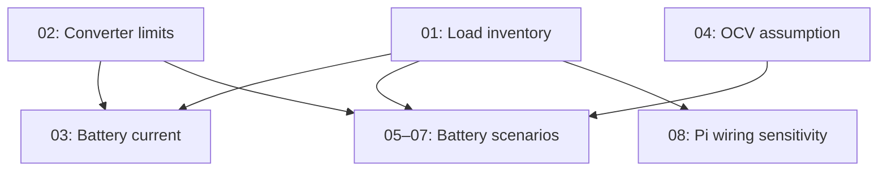
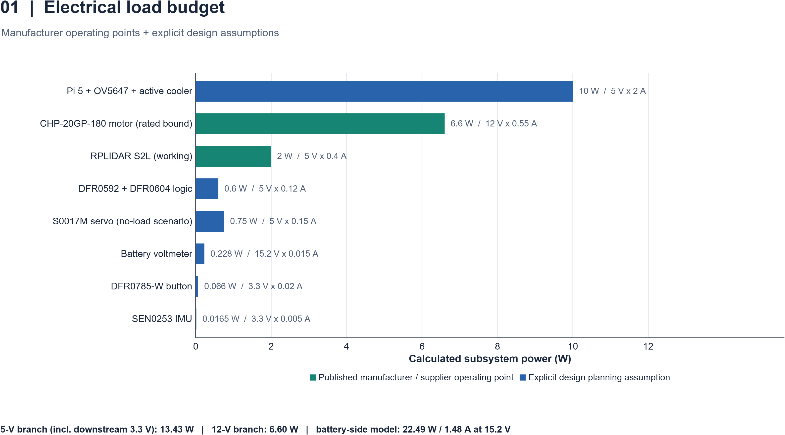
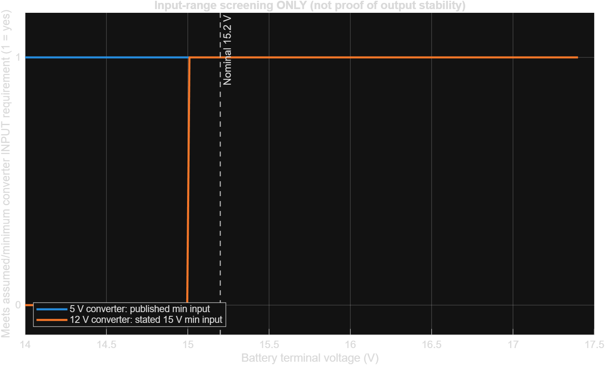
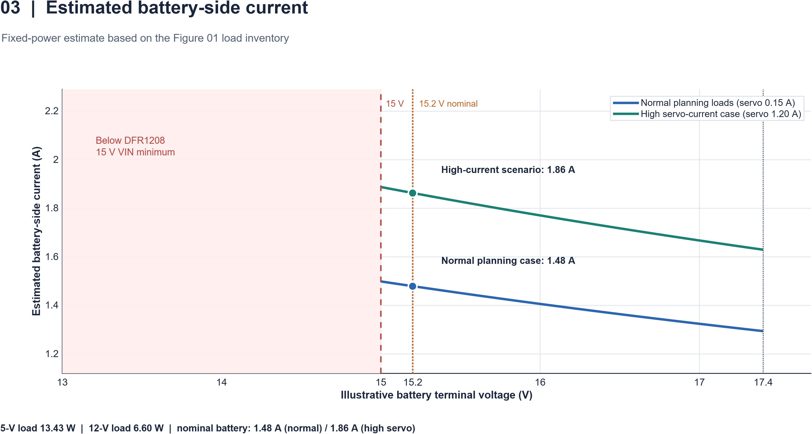
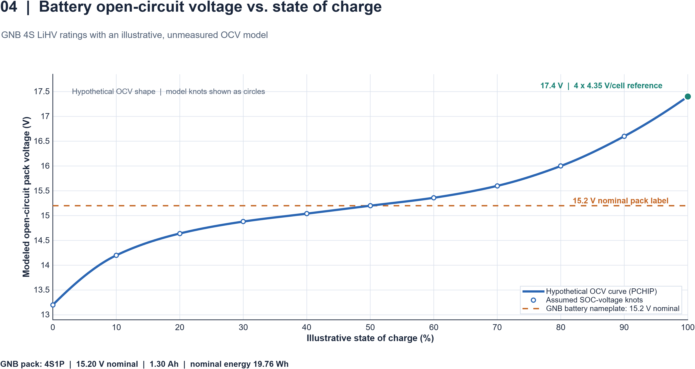
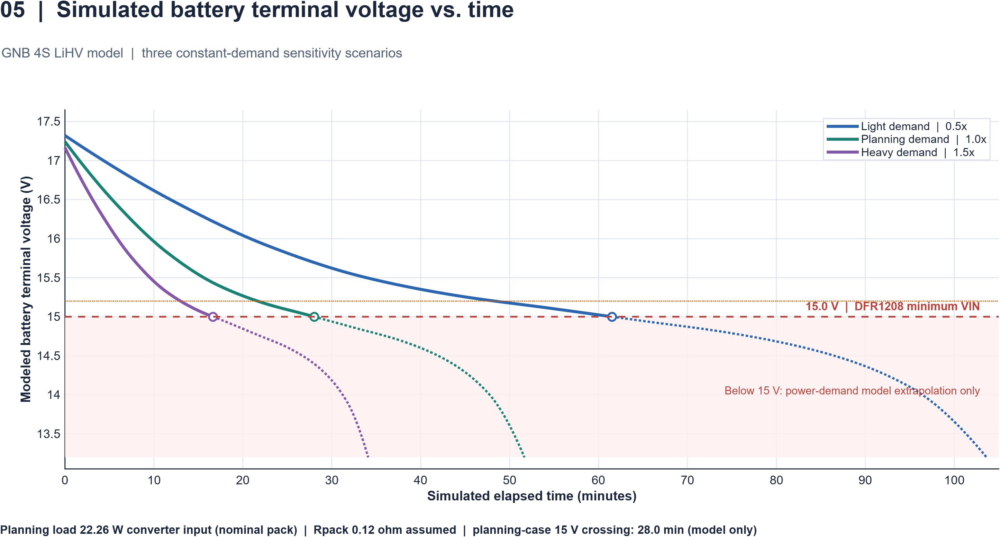
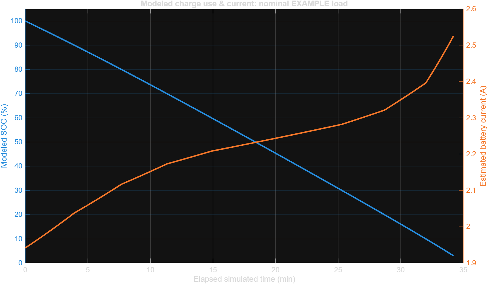
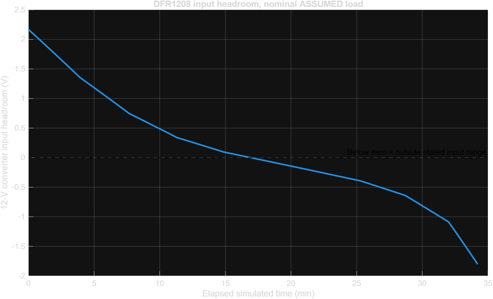
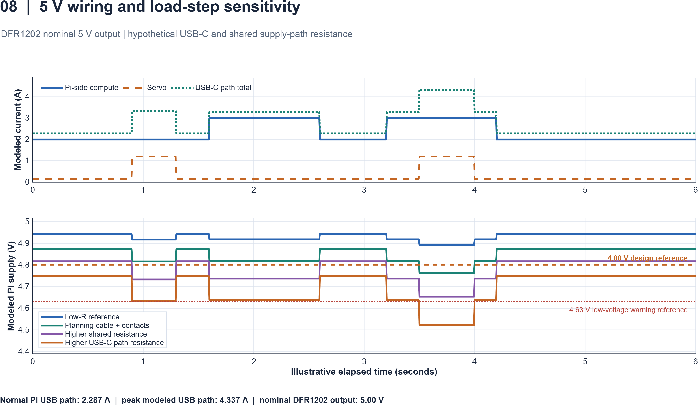

# MATLAB Electrical Modeling Guide

**YBR-SUNFLOWER · WRO 2026 Future Engineers · MathWorks Modeling Award**

[Project README](../../README.md) · [Power and Sensor Architecture](../../engineering_journal/2-elec.md) · [Software Architecture](../../engineering_journal/3-software.md) · [Published figures](../../engineering_journal/visualization/)

This folder contains **eight standalone MATLAB scripts** for investigating the robot's electrical power system. This guide explains their engineering purpose, equations, input assumptions, execution steps, outputs, and connection to the engineering journal.

**Main finding:** the battery's **15.2 V nominal label** is only **0.20 V above the DFR1208 converter's published 15 V minimum input**. The models examine how load, discharge, and wiring resistance could affect the electrical system. They identify questions for hardware verification; they do not establish measured endurance or successful operation under every load.

## Contents

- [1. Engineering problem and MATLAB's role](#1-engineering-problem-and-matlabs-role)
- [2. Model and figure index](#2-model-and-figure-index)
- [3. Reproducing the figures](#3-reproducing-the-figures)
- [4. Shared assumptions and model relationships](#4-shared-assumptions-and-model-relationships)
- [5. Model 01 — Electrical load budget](#5-model-01--electrical-load-budget)
- [6. Model 02 — Converter input-range screening](#6-model-02--converter-input-range-screening)
- [7. Model 03 — Battery-side current](#7-model-03--battery-side-current)
- [8. Model 04 — Battery OCV and state of charge](#8-model-04--battery-ocv-and-state-of-charge)
- [9. Model 05 — Battery terminal voltage over time](#9-model-05--battery-terminal-voltage-over-time)
- [10. Model 06 — State of charge and current over time](#10-model-06--state-of-charge-and-current-over-time)
- [11. Model 07 — 12 V converter input headroom](#11-model-07--12-v-converter-input-headroom)
- [12. Model 08 — 5 V wiring and load-step sensitivity](#12-model-08--5-v-wiring-and-load-step-sensitivity)
- [13. Verification, engineering decisions, and deployment](#13-verification-engineering-decisions-and-deployment)
- [14. Source limitations and troubleshooting](#14-source-limitations-and-troubleshooting)
- [15. Lessons, MathWorks feedback, and AI disclosure](#15-lessons-mathworks-feedback-and-ai-disclosure)
- [16. References](#16-references)

## 1. Engineering problem and MATLAB's role

The car combines a Raspberry Pi 5, RPLIDAR S2L, OV5647 camera, SEN0253 IMU, motor and encoder, and steering servo. The Pi runs the sensing, navigation, planning, and control software described in the [software journal](../../engineering_journal/3-software.md). Reliable electrical supply is therefore relevant to both perception and motion.

The modeled power architecture is:

| Supply path | Modeled consumers | Main question |
|---|---|---|
| 4S LiHV battery → DFR1202 nominal 5 V output | Pi, camera, cooler, HAT electronics, LiDAR; downstream 3.3 V loads | What demand is plausible, and how much voltage can be lost before it reaches the Pi? |
| 4S LiHV battery → DFR1208 nominal 12 V output | DFR0592 motor supply and drive motor | Does battery input remain within the converter's published range? |
| Switched battery → voltmeter | Battery-voltage display | How should a direct battery load be counted separately from regulated loads? |
| Pi-side 5 V → DFR0604 PWM supply | Steering servo, **conditional on external VP being unpowered** | How could an assumed servo load affect the shared Pi supply path? |

Actual wiring, sensor interfaces, and mounting considerations are documented in the [electrical journal](../../engineering_journal/2-elec.md). The servo-supply assumption is a model condition, not evidence that the installed VP connection has been verified.

We use **base MATLAB** for component power arithmetic, voltage-range comparisons, `interp1(...,'pchip')` interpolation, time-stepped battery simulation, scenario comparison, and annotated figure export with `exportgraphics`. These functions make assumptions visible and allow the same equations to be evaluated across several cases. The models remain deliberately simple because measured battery characteristics, converter efficiency maps, and dynamic load traces are not supplied as model inputs.

**Execution and deployment:** these are offline engineering studies. They do not communicate with the robot or deploy control code. No Simulink `.slx` model, Simscape circuit, or generated embedded code is included in this collection.

## 2. Model and figure index

Each image filename below is also the PNG produced in the script's local `results/` folder. The image links open the versions published in the electrical journal's visualization folder.

| Model | Source script | Published PNG | Evidence and purpose |
|:---:|---|---|---|
| 01 | [figure01_electrical_load_budget.m](figure01_electrical_load_budget.m) | [01_assumed_load_budget.png](../../engineering_journal/visualization/01_assumed_load_budget.png) | Published operating points plus assumed loads; component power allocation |
| 02 | [figure02_converter_input_range.m](figure02_converter_input_range.m) | [02_input_range_screen.png](../../engineering_journal/visualization/02_input_range_screen.png) | Published input limits; compatibility screening |
| 03 | [figure03_battery_side_current.m](figure03_battery_side_current.m) | [03_estimated_input_current.png](../../engineering_journal/visualization/03_estimated_input_current.png) | Calculated current versus battery voltage |
| 04 | [figure04_battery_ocv_soc.m](figure04_battery_ocv_soc.m) | [04_assumed_voltage_vs_soc.png](../../engineering_journal/visualization/04_assumed_voltage_vs_soc.png) | Illustrative, unmeasured open-circuit-voltage curve |
| 05 | [figure05_battery_voltage_time.m](figure05_battery_voltage_time.m) | [05_voltage_vs_time_scenarios.png](../../engineering_journal/visualization/05_voltage_vs_time_scenarios.png) | Simulated battery terminal voltage under three constant-demand cases |
| 06 | [figure06_soc_and_current.m](figure06_soc_and_current.m) | [06_soc_and_current.png](../../engineering_journal/visualization/06_soc_and_current.png) | The same battery simulation viewed as SOC and current |
| 07 | [figure07_12v_input_headroom.m](figure07_12v_input_headroom.m) | [07_12v_input_headroom.png](../../engineering_journal/visualization/07_12v_input_headroom.png) | Simulated margin above the DFR1208 minimum input |
| 08 | [figure08_5v_wiring_sensitivity.m](figure08_5v_wiring_sensitivity.m) | [08_transient_timeline.png](../../engineering_journal/visualization/08_transient_timeline.png) | Quasi-static resistive sensitivity to hypothetical load steps |

For a short review, read **01 → 02 → 07 → 08**. Models **03–06** explain the calculations and battery assumptions behind that story. MATLAB figure numbers **01–08** are separate from the journal's architecture and wiring drawing numbers **E-01–E-04**.

## 3. Reproducing the figures

### 3.1 Requirements and execution status

- The scripts specify **MATLAB R2020a or newer** as their intended environment; `exportgraphics` was introduced in R2020a. No additional toolbox is explicitly required by the inspected source.
- Use a writable local checkout or downloaded copy of the repository. No robot connection, external dataset, CSV, or earlier script output is required.
- Run each **complete script**, including its input definitions and, for Models 05–07, its local simulation function.
- Every script starts with `clearvars; close all; clc;`. Save unrelated workspace variables and figures before running. Parameters assigned in the Command Window beforehand will be cleared; edit the script's input section instead.
- The exact MATLAB release and platform used for the published PNGs are not recorded in these scripts. The source and representative numerical results were checked while preparing this guide, but **the scripts were not executed in MATLAB during that check**. Record a real MATLAB run before treating release compatibility and rendering as verified.

### 3.2 Run one model

1. Open MATLAB and set **Current Folder** to the repository root.
2. Open the selected script and read its `USER INPUTS` or parameter section. Keep the default values for an initial reproduction.
3. Run these commands, for example for Model 01:

```matlab
cd(fullfile('other','matlab'))
run('figure01_electrical_load_budget.m')
copyfile(fullfile('results','simulation_inputs.mat'), ...
         fullfile('results','figure01_inputs.mat'))
```

4. Inspect `results/01_assumed_load_budget.png`, the Command Window summary, and the saved inputs. Compare numerical values with this guide before changing assumptions.
5. For another model, run its filename from the same folder and immediately preserve its `.mat` output under the corresponding model number.

The scripts determine the output directory from their own file location, so their PNGs normally go to **`other/matlab/results/`**. They **do not automatically update** `engineering_journal/visualization/`. Copy a reviewed PNG there only when intentionally publishing that result.

### 3.3 Run all eight and preserve each model's inputs

With MATLAB's Current Folder set to `other/matlab`, execute the following commands. They deliberately avoid a caller-workspace loop: the scripts' `clearvars` would erase loop variables and a filename list stored in that workspace.

```matlab
run('figure01_electrical_load_budget.m')
copyfile('results/simulation_inputs.mat','results/figure01_inputs.mat')

run('figure02_converter_input_range.m')
copyfile('results/simulation_inputs.mat','results/figure02_inputs.mat')

run('figure03_battery_side_current.m')
copyfile('results/simulation_inputs.mat','results/figure03_inputs.mat')

run('figure04_battery_ocv_soc.m')
copyfile('results/simulation_inputs.mat','results/figure04_inputs.mat')

run('figure05_battery_voltage_time.m')
copyfile('results/simulation_inputs.mat','results/figure05_inputs.mat')

run('figure06_soc_and_current.m')
copyfile('results/simulation_inputs.mat','results/figure06_inputs.mat')

run('figure07_12v_input_headroom.m')
copyfile('results/simulation_inputs.mat','results/figure07_inputs.mat')

run('figure08_5v_wiring_sensitivity.m')
copyfile('results/simulation_inputs.mat','results/figure08_inputs.mat')
```

Stop and resolve any error before proceeding; otherwise an old `simulation_inputs.mat` could be copied under a new model's name. After successful execution, there should be eight distinct PNGs and eight model-specific input snapshots. The shared `simulation_inputs.mat` will still contain only the last run. Repeating this sequence overwrites the named PNGs and snapshots, so preserve earlier versions before a comparison run.

Each script exports a white-background PNG at **240 DPI** and prints a numerical summary. The `.mat` files contain input structures and selected calculated arrays; their contents differ between models. They are not robot telemetry. For example:

```matlab
whos('-file','results/figure07_inputs.mat')
headroomRun = load('results/figure07_inputs.mat');
headroomRun.firstCrossingMinutes
```

### 3.4 Record and publish a reproducible run

Record the date, source Git SHA, MATLAB release (`version`), platform (`computer`), changed parameters and their sources, numerical results, and figure/log links in the journal. If parameters were edited locally, retain the edited source or commit it so the SHA describes the actual run.

For changed results, update the source script, published PNG, this guide's relevant values, and the journal caption together. Confirm that all labels remain readable. A plotting run demonstrates software execution; measured hardware validation is a separate step described in [Section 13](#13-verification-engineering-decisions-and-deployment).

## 4. Shared assumptions and model relationships

### 4.1 Evidence classes

| Class | Meaning in this collection |
|---|---|
| **Published specification** | Manufacturer/supplier nameplate or operating point, as identified in the source and journal; it is not an installed-robot measurement |
| **Chemistry reference** | The 4 × 4.35 V = 17.4 V LiHV reference used by the scripts; it is not a measured pack voltage or charging instruction |
| **Assumed scenario** | A chosen load, efficiency, resistance, OCV/SOC point, initial condition, or event time |
| **Calculated / simulated result** | An output produced from those inputs and equations |
| **Team-reported measurement** | The journal's separate multimeter observations: 5.1 V and 12.1 V at the converter outputs |

The eight plots are calculations, specification comparisons, or synthetic simulations. None is a measured battery-discharge or oscilloscope trace.

### 4.2 Shared electrical inputs

| Quantity | Default | Source status / modeling condition |
|---|---:|---|
| Battery | 4S, 15.2 V nominal, 1.30 Ah | GNB nameplate values |
| 5 V converter | DFR1202; 6–24 V input, nominal 5 V output | Published specification |
| 12 V converter | DFR1208; 15–24 V input, nominal 12 V output | Published specification |
| Pi + OV5647 + active cooler | 2.00 A at 5 V | Assumed combined load, not the Pi power-supply recommendation |
| RPLIDAR S2L | 0.400 A at 5 V | Published working-current point |
| Both HATs' logic | 0.120 A at 5 V | Assumed combined electronics load |
| Servo, baseline | 0.150 A at 5 V | Assumed representative no-load case |
| Servo, high case | 1.200 A at 5 V | Generic planning envelope; not a verified S0017M stall-current specification |
| LED button | 0.020 A at 3.3 V | Assumed load |
| SEN0253 IMU | 0.005 A at 3.3 V | Published current used at the modeled supply voltage |
| Motor | 0.550 A at 12 V | Supplier rated-current upper-bound point, not measured driving or stall current |
| Voltmeter | 0.015 A from the battery | Assumed constant current |
| Converter efficiencies | `eta5 = eta12 = 0.90` | Constant scenario values, not measured efficiency maps |
| Downstream 5 V → 3.3 V conversion | Ideal, lossless | First-order simplification |

The component inputs combine different kinds of evidence; their sum is a **planning load**, not a measured simultaneous operating state. Upstream wiring, motor-driver losses, and other unmodeled losses are not separately resolved in the load budget. If replacing the Pi estimate with measured total input current, account for what that measurement already includes to avoid counting HATs or downstream loads twice.

### 4.3 Connections between studies



These arrows show **shared assumptions and engineering relationships**, not file imports. Every script contains its own inputs. Model 04 does not write a lookup table that Models 05–07 automatically load, and Model 06 does not read Model 05's results.

| Change | Files to keep consistent |
|---|---|
| Component inventory or converter efficiency | 01, 03, 05, 06, 07; update relevant Pi-path loads in 08 |
| OCV/SOC knots or interpolation | 04, 05, 06, 07 |
| Battery resistance, capacity, initial SOC, load multipliers, or time step | 05, 06, 07; update 04's capacity/nameplate labels if applicable |
| Converter voltage limits | 02, 03, 05, 06, 07 and relevant annotations/assertions |
| Servo supply architecture | 01, 03, 05, 06, 07, 08 and the electrical journal |

Models 05–07 contain hard-coded consistency checks for the baseline branch powers. Model 07 also checks the 0.20 V nominal margin. After a justified change, recalculate and update these checks; do not remove them merely to make a changed model run.

## 5. Model 01 — Electrical load budget

[Source](figure01_electrical_load_budget.m) · [Published figure](../../engineering_journal/visualization/01_assumed_load_budget.png)

**Question:** how are the selected loads distributed across the supply rails, and what battery-side power do they imply under the stated assumptions?

### Equations and assumptions

For each component, power is voltage multiplied by current. Downstream 3.3 V power is included once in the upstream 5 V branch:

```math
P_i=V_i I_i,\qquad
P_5=\sum_{i\in 5V}P_i+\sum_{i\in 3.3V}P_i.
```

```math
P_{\mathrm{battery}}=\frac{P_5}{\eta_5}+\frac{P_{12}}{\eta_{12}}
+V_{\mathrm{nom}}I_{\mathrm{meter}},\qquad
I_{\mathrm{battery,nom}}=\frac{P_{\mathrm{battery}}}{V_{\mathrm{nom}}}.
```

The model uses the shared inventory in Section 4. It assumes the servo is on the 5 V HAT supply (`inputs.servoUses5VviaHAT = true`). Setting that flag to false intentionally triggers an assertion; it does not create an alternative power architecture.

### Parameters and steps

1. Inspect `inputs.piCameraCoolerCurrentA`, `hatElectronicsCurrentA`, `servoCurrentA`, the published operating-point currents, and `eta5`/`eta12`.
2. Run `figure01_electrical_load_budget.m` and preserve `figure01_inputs.mat` as in Section 3.
3. Compare `power5OutputW`, `power12OutputW`, `powerBatteryApproxW`, and `batteryCurrentApproxA` with the baseline below.
4. For a sensitivity comparison, change one justified load or efficiency, rerun, and record the resulting difference. The separate high-servo calculation substitutes `servoHighScenarioA = 1.20 A` for the baseline `0.15 A`.

### Outputs and interpretation

| Baseline calculation | Value |
|---|---:|
| 5 V branch, including idealized 3.3 V subloads | 13.4325 W |
| 12 V motor branch | 6.6000 W |
| Direct voltmeter power at 15.2 V | 0.2280 W |
| Battery-side power with 90% converter efficiencies | 22.4863 W |
| Battery current at 15.2 V | 1.4794 A |
| Separate high-servo battery-power scenario | 28.3197 W |



The Pi group and motor dominate this allocation. The high-servo result is printed in the summary; it is not a measured peak or a simultaneous worst-case motor-and-servo load test. The motor uses its rated-current bound, so this model does not establish starting-current, stall, protection, or wire-current margins.

**Journal integration:** use the branch powers and evidence labels in electrical-journal **Sections 7.1 and 8.1**. If a load estimate is replaced by a measurement, record its operating condition and propagate the change to Models 03 and 05–07.

## 6. Model 02 — Converter input-range screening

[Source](figure02_converter_input_range.m) · [Published figure](../../engineering_journal/visualization/02_input_range_screen.png)

**Question:** how do the battery voltage references compare with each converter's published input limits?

### Equations and assumptions

```math
\mathrm{withinRange}=(V_{\mathrm{in}}\geq V_{\min})\land(V_{\mathrm{in}}\leq V_{\max}),
\qquad M=V_{\mathrm{in}}-V_{\min}.
```

DFR1202 uses **6–24 V**; DFR1208 uses **15–24 V**. The default sweep is **13.0–17.4 V**, sampled at **750 points**. This is a viewing interval, not a discharge trajectory, time axis, or allowed operating range for the battery.

### Parameters and steps

1. Check `inputs.buck5MinV`, `buck5MaxV`, `buck12MinV`, `buck12MaxV`, and `packNominalV` against the component versions being evaluated.
2. Run `figure02_converter_input_range.m`; inspect the range diagram and headroom panel.
3. Compare `nominalMargin5V`, `nominalMargin12V`, and `fullReferenceMargin12V` with the table below. Change `sweepMinV`, `sweepMaxV`, or `sweepPoints` only to explore the presentation; doing so does not change a manufacturer's limit.

| Calculated margin | Value |
|---|---:|
| DFR1202 at nominal 15.2 V | +9.20 V |
| DFR1208 at nominal 15.2 V | **+0.20 V** |
| DFR1208 at the illustrative 17.4 V reference | +2.40 V |



This result establishes a small nominal margin for the selected 12 V converter. It does not simulate the converter's output, switching behavior, dropout curve, or failure time. A voltage below 15 V is outside the stated input range; it does not mean the real output necessarily becomes zero immediately.

**Journal integration:** connect the **0.20 V** result to **Sections 6.2 and 8.2** and the **Section 17.1 risk register**. Keep this specification-based finding separate from the time-dependent assumptions introduced by Models 04–07.

## 7. Model 03 — Battery-side current

[Source](figure03_battery_side_current.m) · [Published figure](../../engineering_journal/visualization/03_estimated_input_current.png)

**Question:** for fixed regulated-load power, how does battery current change with input voltage and an assumed increase in servo demand?

### Equations and assumptions

```math
P_{\mathrm{conv}}=\frac{P_5}{\eta_5}+\frac{P_{12}}{\eta_{12}},\qquad
I_{\mathrm{battery}}(V)=\frac{P_{\mathrm{conv}}}{V}+I_{\mathrm{meter}}.
```

The voltmeter is a **constant-current** direct battery load, so its power varies with voltage. The two scenarios use servo currents of **0.15 A** and **1.20 A**, with the other Model 01 loads unchanged. Normal converter input power is **22.2583 W**, excluding the direct voltmeter.

The current curves are filled only where both converters satisfy their input-voltage limits. With the default 13.0–17.4 V viewing window, the combined-system curve below **15 V** is left undefined (`NaN`). That missing curve is deliberate.

### Parameters and steps

1. Review `p.servoNormalA`, `servoHighA`, `eta5`, `eta12`, and the shared inventory. The default sweep has `p.samples = 500`.
2. Run `figure03_battery_side_current.m`; inspect the normal and high-servo curves and the shaded out-of-range region.
3. Check `InomNormalA`, `InomHighA`, `IfullNormalA`, and `IfullHighA` against the calculated reference values:

| Battery input | Normal scenario | High-servo scenario |
|---|---:|---:|
| 15.2 V nominal | 1.4794 A | 1.8631 A |
| 17.4 V reference | 1.2942 A | 1.6295 A |



Current rises as voltage falls because the regulated-load power is held constant. These battery currents are different from the currents on the 5 V or 12 V branches. The model does not resolve cable loss, switching ripple, thermal effects, or changing efficiency.

**Journal integration:** use this as supporting evidence for **Section 7's load-budget discussion**, explaining why output-rail current cannot be used directly as battery current. Preserve the 15 V validity boundary when publishing a revised plot.

## 8. Model 04 — Battery OCV and state of charge

[Source](figure04_battery_ocv_soc.m) · [Published figure](../../engineering_journal/visualization/04_assumed_voltage_vs_soc.png)

**Question:** what explicit open-circuit-voltage assumption will the battery sensitivity studies use?

### Equations and input table

Open-circuit voltage (OCV) is the modeled no-load voltage. State of charge (SOC) is represented by a fraction from 0 to 1:

```math
V_{\mathrm{OC}}(s)=4\,\mathrm{PCHIP}\bigl(s;\{s_i,V_{\mathrm{cell},i}\}\bigr).
```

| SOC fraction | Assumed cell OCV (V) | Assumed 4S pack OCV (V) |
|---:|---:|---:|
| 0.00 | 3.30 | 13.20 |
| 0.10 | 3.55 | 14.20 |
| 0.20 | 3.66 | 14.64 |
| 0.30 | 3.72 | 14.88 |
| 0.40 | 3.76 | 15.04 |
| 0.50 | 3.80 | 15.20 |
| 0.60 | 3.84 | 15.36 |
| 0.70 | 3.90 | 15.60 |
| 0.80 | 4.00 | 16.00 |
| 0.90 | 4.15 | 16.60 |
| 1.00 | 4.35 | 17.40 |

**Every OCV/SOC pair in this table is illustrative.** The model's 15.2 V point at 50% SOC follows from the chosen table; it is not a measured battery calibration. The endpoints do not define safe charge/discharge settings.

### Parameters and steps

1. Inspect `p.socKnots`, `ocvPerCellV`, `cells`, and `interpolationMethod = 'pchip'`. The default display uses `p.samples = 700`.
2. Run `figure04_battery_ocv_soc.m`; compare the curve with the knot markers and the nominal-voltage reference.
3. Check the **13.2 V** and **17.4 V** modeled endpoints and the nameplate-energy calculation **15.2 × 1.30 = 19.76 Wh**.
4. If measured OCV data become available, document the measurement conditions before replacing the knots. Copy the same revised knots and interpolation method into Models 05–07.



The output is a continuous assumption curve, not a fitted electrochemical model. Temperature, aging, cell imbalance, hysteresis, relaxation, and dynamic polarization are not represented. Nameplate energy does not establish usable energy or competition runtime.

**Journal integration:** use this figure to expose the battery assumptions behind **Sections 7.3 and 8.3**. Label it as illustrative whenever it accompanies a voltage-versus-time or headroom result.

## 9. Model 05 — Battery terminal voltage over time

[Source](figure05_battery_voltage_time.m) · [Published figure](../../engineering_journal/visualization/05_voltage_vs_time_scenarios.png)

**Question:** under a simple equivalent circuit, how do three constant-demand scenarios affect battery terminal voltage and the point where it reaches the 12 V converter's input limit?

### Equations and solution method

The model combines Model 04's OCV curve with series resistance and constant converter input power:

```math
V=V_{\mathrm{OC}}(s)-IR,\qquad
I=\frac{P}{V}+I_{\mathrm{meter}},\qquad
P=\alpha\left(\frac{P_5}{\eta_5}+\frac{P_{12}}{\eta_{12}}\right).
```

Substitution gives a quadratic. The code selects its higher-voltage root:

```math
A=V_{\mathrm{OC}}(s)-RI_{\mathrm{meter}},\qquad
D=A^2-4RP,\qquad
V=\frac{A+\sqrt{D}}{2}.
```

The battery's charge state is updated by explicit time stepping:

```math
s_{k+1}=\max\left(0,\ s_k-\frac{I_k\Delta t}{3600Q_{\mathrm{Ah}}}\right).
```

This is a simple charge-balance calculation with fixed capacity. It assumes the terminal voltage is also the converter input node; a separately distributed input-wiring model is not included.

### Adjustable parameters

| MATLAB parameter | Default | Meaning |
|---|---:|---|
| `p.packSeriesResistanceOhm` | 0.12 Ω | Assumed lumped pack/contact resistance |
| `p.capacityAh` | 1.30 Ah | Nameplate capacity used in charge balance |
| `p.initialSOC` | 1.00 | Hypothetical initial full charge |
| `p.scenarioScale` | `[0.5 1.0 1.5]` | Multiplier on total regulated-load demand; direct voltmeter current remains unchanged |
| `p.stepSeconds` | 1.0 s | Integration step |
| `p.maxSimMinutes` | 120 min | Maximum simulation horizon |
| `p.demoStopTerminalV` | 13.2 V | Mathematical demonstration endpoint, not an operating cutoff |
| `p.OCV_SOC_knots`, `p.OCV_cell_V` | Section 8 table | Unmeasured battery characteristic |
| `p.eta5`, `p.eta12` | 0.90 each | Constant assumed efficiencies |

### Steps and outputs

1. Review the shared load values, OCV table, resistance, and three multipliers. A multiplier of 1.5 changes the entire regulated demand; it is not the same scenario as Model 03's isolated servo increase.
2. Run `figure05_battery_voltage_time.m` and preserve its `.mat` output. Each element of `runs` contains `timeMinutes`, `SOC`, `OCV_V`, `terminalV`, `batteryCurrentA`, `requestedPowerW`, `firstBelow15Min`, and `stopReason`.
3. Inspect voltage versus time, the solid/dotted distinction around 15 V, and the reported stopping reasons.
4. To study sensitivity, change one parameter and rerun; keep Models 06 and 07 synchronized. To check time-step sensitivity, compare the crossing result at 1.0 s and a smaller step and report the difference.

| Default scenario | Converter input power, excluding voltmeter | Calculated 15 V crossing |
|---|---:|---:|
| Light, 0.5× | 11.1292 W | 61.52 min |
| Planning, 1.0× | 22.2583 W | 28.03 min |
| Heavy, 1.5× | 33.3875 W | 16.64 min |

The crossing is found from the first sample below 15 V, with linear interpolation between surrounding samples. Displayed precision describes the numerical calculation, not physical accuracy.



The simulation stops at its demonstration endpoint, zero hypothetical SOC, maximum horizon, or an infeasible quadratic (`D < 0`). Continuing the equations below 15 V is an illustrative extrapolation: actual DFR1208 output and resulting load behavior are not modeled there. These times are **not measured endurance or predicted usable robot runtime**.

**Journal integration:** use the scenario trend and assumptions to support **Section 8.3**, and use **Section 7.3** to explain why capacity alone does not determine useful operation. Do not present the 28.03-minute planning result as a competition-runtime claim.

## 10. Model 06 — State of charge and current over time

[Source](figure06_soc_and_current.m) · [Published figure](../../engineering_journal/visualization/06_soc_and_current.png)

**Question:** what happens to modeled SOC and battery current during the voltage trajectories in Model 05?

### Equations, parameters, and steps

This script independently repeats the equivalent-circuit and charge-balance equations in **Section 9** with the same default inputs. It adds a second view of the same scenarios, rather than an independent battery model or validation dataset:

```math
SOC_{\%}(t)=100s(t),\qquad I(t)=\frac{P}{V(t)}+I_{\mathrm{meter}}.
```

1. Check that capacity, OCV knots, resistance, efficiencies, demand multipliers, initial SOC, and time step match Model 05.
2. Run `figure06_soc_and_current.m`. Inspect both panels and preserve `figure06_inputs.mat` before running another script.
3. Compare `runs` with Model 05: voltage, SOC, battery current, and crossing times should agree numerically when the inputs match. The current begins at approximately **0.6575 / 1.3058 / 1.9601 A** for the light/planning/heavy cases because their initial terminal voltages differ under load.
4. If a scenario is changed, update Models 05 and 07 as well. The default crossing times remain **61.52 / 28.03 / 16.64 min**, as in Model 05.



The upper panel shows charge depletion; the lower panel shows increasing current as voltage falls under constant-power demand. Solid portions satisfy the model's 15 V lower-input comparison. Dotted portions continue below that limit and do not establish converter operation. SOC here is an integrated model state, not a battery-gauge reading.

**Journal integration:** pair this with Model 05 in the supporting explanation for **Sections 7.3 and 8.3**. Use it to distinguish battery charge remaining from voltage compatibility. Do not count agreement between Models 05 and 06 as independent hardware validation; they duplicate the same equations.

## 11. Model 07 — 12 V converter input headroom

[Source](figure07_12v_input_headroom.m) · [Published figure](../../engineering_journal/visualization/07_12v_input_headroom.png)

**Question:** how much margin remains above the DFR1208's published minimum input during each synthetic battery scenario?

### Equations and parameters

This script repeats Model 05's battery simulation and transforms terminal voltage into input margin:

```math
M_{12}(t)=V_{\mathrm{terminal}}(t)-15.0\ \mathrm{V},\qquad
M_{12,\mathrm{nom}}=15.2-15.0=0.20\ \mathrm{V}.
```

The physical-model parameters are those in Section 9. `p.converter12MinInputV = 15.0` sets the comparison threshold, and `p.minutesAfterCrossingDisplayed = 8` controls the plot's time window. That display setting does not change the simulated discharge. The default battery trajectories remain below the published 24 V upper input limit; the plotted margin focuses on the lower limit.

### Steps and outputs

1. Confirm that Models 05–07 share the same parameters and that the threshold still matches the installed converter's published range.
2. Run `figure07_12v_input_headroom.m`. Inspect the zero-margin line, the negative-margin region, and `firstCrossingMinutes`.
3. Compare crossings with Models 05 and 06: **61.52 / 28.03 / 16.64 min** for the three default scenarios. Verify that `headroomV` equals `terminalV - 15`.
4. When exploring a different battery or converter, revise the corresponding input limits, assertions, labels, and related scripts together.



Positive margin means the modeled input is above the lower published limit; it does not prove output regulation. Negative margin identifies a condition outside that range. The actual time at which the installed robot reaches it requires measured voltage and load data.

**Journal integration:** this is the main time-dependent figure for **Section 8.3** and the **Section 17.1** risk discussion. Link the finding to a loaded-input-voltage verification record. Any claim that the risk was resolved must identify the actual change and subsequent test evidence.

## 12. Model 08 — 5 V wiring and load-step sensitivity

[Source](figure08_5v_wiring_sensitivity.m) · [Published figure](../../engineering_journal/visualization/08_transient_timeline.png)

**Question:** how could effective supply-path resistance and coincident hypothetical Pi/servo loads reduce voltage at the Pi-side supply node?

### Equations and architecture assumptions

```math
I_{3.3\rightarrow5}=\frac{3.3}{5.0}(I_{\mathrm{IMU}}+I_{\mathrm{button}})
=0.0165\ \mathrm{A}.
```

```math
I_{\mathrm{USB}}(t)=I_{\mathrm{Pi}}(t)+I_{\mathrm{HAT}}+I_{3.3\rightarrow5}+I_{\mathrm{servo}}(t),
\qquad
V_{\mathrm{Pi}}(t)=V_{\mathrm{source}}-I_{\mathrm{USB}}(t)(R_{\mathrm{USB}}+R_{\mathrm{common}}).
```

The baseline USB-path current is **2.2865 A**. A **1.00 A** assumed compute increment and servo increase from **0.15 A to 1.20 A** produce a coincident peak of **4.3365 A**. The separately supplied LiDAR is excluded from USB cable current. The model assumes `p.servoViaPi5VRail = true`; changing the hardware topology requires changing the equations, not only the Boolean flag.

### Parameters, events, and expected results

The source is fixed at `p.converterNominalOutputV = 5.00 V`. This is independent of the journal's separate **5.1 V** multimeter observation. The script stores a published tolerance reference of **±0.05 V**, but does **not** sweep that tolerance, add ripple, or model converter dynamics.

| Event | Default interval (s) | Effect |
|---|---|---|
| Compute event 1 | 1.60 ≤ t < 2.60 | Add 1.00 A to the Pi group |
| Compute event 2 | 3.20 ≤ t < 4.20 | Add 1.00 A to the Pi group |
| Servo event 1 | 0.90 ≤ t < 1.30 | Substitute 1.20 A for 0.15 A servo current |
| Servo event 2 | 3.50 ≤ t < 4.00 | Same servo substitution; overlaps compute event 2 |

The duration is **6.0 s**, sampled at **0.005 s**. Event times are chosen examples, not measured scheduling or control latency.

| Scenario | `scenarioUSBohm` | `scenarioCommonOhm` | Total resistance | Calculated minimum Pi voltage |
|---|---:|---:|---:|---:|
| Low-R reference | 0.020 Ω | 0.005 Ω | 0.025 Ω | 4.892 V |
| Planning cable + contacts | 0.045 Ω | 0.010 Ω | 0.055 Ω | 4.761 V |
| Higher shared resistance | 0.045 Ω | 0.035 Ω | 0.080 Ω | 4.653 V |
| Higher USB-C path resistance | 0.100 Ω | 0.010 Ω | 0.110 Ω | 4.523 V |

These are assumed effective round-trip/path resistances. In the implemented equation, `R_common` is multiplied only by `I_USB`; a real common segment carrying additional branch current would need a branch-aware extension. The separately supplied LiDAR is not included in such an additional common-segment drop here.

### Steps and interpretation

1. Review `p.servoViaPi5VRail`, the current assumptions, `scenarioUSBohm`, `scenarioCommonOhm`, and the event intervals.
2. Run `figure08_5v_wiring_sensitivity.m`; inspect the upper load panel and lower voltage panel. Preserve `figure08_inputs.mat`.
3. Check `IusbA`, `Vpi`, and `minimumV`. The peak-current interval should occur during the compute/servo overlap at **3.50–4.00 s**.
4. Change one resistance or load assumption at a time. Keep a record of whether the new input is assumed or measured, and verify that the current paths still match the installed architecture.



The plot uses **4.80 V** as a design comparison and **4.63 V** as a nominal warning reference. Raspberry Pi's published low-voltage reference includes **±5%** tolerance; these horizontal lines are not exact measured trip thresholds or universal pass/fail tests for the assembled car.

Despite the filename `08_transient_timeline.png`, this is a **quasi-static resistor calculation**. The sharp steps do not represent actual rise time, converter bandwidth, USB-C negotiation, Pi throttling, capacitance, inductance, or an observed servo transient.

**Journal integration:** use the resistance table and the distinction between converter-output and Pi-input voltage in **Sections 7.2 and 8.4**. Compare a future test at the Pi input with the modeled node, recording simultaneous load and wiring conditions.

## 13. Verification, engineering decisions, and deployment

### 13.1 What has been checked

For this guide, the published source equations, input definitions, output names, and representative numerical values were reviewed. Independent arithmetic and a Python/SciPy implementation of the stated PCHIP/equivalent-circuit equations reproduced the rounded power, current, voltage-drop, and 15 V crossing values reported here. This is a numerical consistency check; it does not verify MATLAB execution, image rendering, or the physical model's accuracy.

The journal reports **5.1 V at the DFR1202 output** and **12.1 V at the DFR1208 output** from multimeter observations. Those measurements neither calibrate the OCV curve nor validate battery resistance, converter efficiency, load assumptions, USB-C voltage drop, or discharge runtime. Their measurement locations and limitations are discussed in [electrical-journal Section 6.4](../../engineering_journal/2-elec.md#64-multimeter-observations-at-the-converter-outputs).

### 13.2 Findings and decision status

| Problem | Model result / insight | Engineering consequence | Current verification boundary |
|---|---|---|---|
| Loads operate on different rails | 13.4325 W on the 5 V branch and 6.6000 W on the motor branch in the baseline | Separate rail power from battery current; prioritize measurement of dominant loads | Simultaneous installed-robot demand is not measured by these scripts |
| Nominal battery voltage is close to the 12 V converter minimum | +0.20 V nominal input margin | Check converter input under representative load and discharge; evaluate the architecture if the required margin is not maintained | No completed mitigation or verified full operating envelope is established here |
| Capacity does not guarantee usable regulated operation | Synthetic voltage reaches 15 V before the simulation's charge/endpoint termination | Evaluate voltage compatibility as well as charge remaining | OCV, resistance, and crossing times remain uncalibrated |
| Converter voltage differs from load-side voltage | Higher assumed resistance reduces modeled Pi voltage | Evaluate the installed supply path at the load and under concurrent demand | No measured resistance or dynamic Pi-input trace is supplied to Model 08 |

The present documented outcome is **identification and explanation of electrical risks**. A completed hardware change, improved lap result, or measured reliability improvement should be recorded only when supported by a dated test and corresponding configuration.

### 13.3 Next verification steps

These are proposed checks, not completed results:

1. **MATLAB reproduction:** run all eight scripts on a recorded release/platform, preserve input snapshots, compare the values above, and inspect exported labels and annotations.
2. **Cross-model consistency:** compare Models 01/03 at 15.2 V and Models 05/06/07 using identical inputs. Check that Model 07's headroom equals Model 05's terminal voltage minus 15 V.
3. **Battery-model refinement:** obtain appropriately controlled OCV/capacity/resistance evidence before replacing illustrative inputs. Do not operate the real pack down to a plotted demonstration endpoint merely to reproduce the simulation.
4. **Loaded power checks:** record battery/converter-input voltages, converter-output voltages, and relevant load currents under stated robot conditions. Compare equivalent measurement nodes with model nodes.
5. **Pi supply-path checks:** record Pi-input voltage during representative compute and steering loads, along with wiring state and observed Pi warnings. A converter-output multimeter reading alone cannot capture the modeled load-side behavior.

Integrate each result using **problem → alternatives → actual change → test conditions → result → decision**. Include the date, Git SHA, model parameters, hardware configuration, instrumentation, and links to the plot, log, or video. The [electrical verification reference](../../engineering_journal/2-elec.md#182-verification-and-calibration-reference) provides the wider context.

MATLAB remains an **offline analysis tool** in this work. The onboard Python implementation is linked separately; no MATLAB deployment or model-generated controller is claimed.

## 14. Source limitations and troubleshooting

This guide describes the inspected scripts as they exist. It does not silently correct their source metadata or output behavior.

| Issue or symptom | Explanation and action |
|---|---|
| Several comments or console headings say `/11` | Historical numbering remains in the source. This published collection has eight figures. Use the filenames and index in this guide to identify them. |
| Model 06 stores `p.figureID = '05/11'` | A metadata mismatch in the inspected source. Its file, plotted subject, and PNG belong to Model 06. Correct the field in a future source revision; do not use it alone to identify archived results. |
| Earlier `.mat` output disappears | All scripts write `results/simulation_inputs.mat`. Copy it immediately to a model-specific filename as in Section 3, or deliberately revise the source save names. |
| Figures or workspace variables vanish | The next script runs `clearvars`, `close all`, and `clc`. Read exported images and saved snapshots when comparing multiple runs. |
| Changing `p` before execution has no effect | The script clears and redefines its inputs. Edit the parameter section in the script, retaining a traceable copy. |
| An assertion fails after changing a load | Models 05–07 explicitly check baseline power totals. Recalculate and update justified checks across related models; also review scenario labels and fixed plot limits. |
| A changed battery or converter is rejected | Some assertions intentionally constrain this 4S architecture and its voltage relationships. Adapting the model requires revising those constraints and interpretation, not bypassing the error. |
| Variables or a local function are missing | Run the full saved `.m` file. Models 05–07 include `simulateBattery` at the end of their respective scripts. |
| `exportgraphics` is unavailable or export fails | Check MATLAB release, graphics support, and write permission. The source targets R2020a+. Record any export adaptation and verify the complete figure, including annotations and multiple axes. |
| A changed curve is clipped | Several plot ranges are fixed for the defaults. Inspect axes limits after changing loads, voltages, or resistances. |
| No current curve appears below 15 V in Model 03 | Intentional validity mask: the combined regulated-load model is not plotted outside the DFR1208's stated input range. |
| Curves continue below 15 V in Models 05–07 | Intentional mathematical continuation, identified by dotted styling. Real converter output and load behavior outside the range are not modeled. |

## 15. Lessons, MathWorks feedback, and AI disclosure

### Lessons from the modeling work

The most useful result is the distinction between a component's nominal operating point and its acceptable operating range. A 15.2 V label initially appears compatible with a 12 V output converter, but checking the converter's **input** specification exposes the small 0.20 V margin. The battery scenarios then illustrate why both loading and changing charge state matter.

The supply-path model also separates voltage produced at a regulator from voltage delivered to the computing load. Across the collection, explicit assumptions help identify the next measurements needed. Repeated source values require care: consistent equations and figures are easier to review when each published result can be traced to its exact inputs.

### Potential MathWorks product enhancement

For this workflow, a useful enhancement would be an optional figure-export package containing the plot, input values and units, evidence labels, source-script reference, and software version. Such a feature could reduce manual duplication when sharing engineering analyses on GitHub. This suggestion concerns traceability; it does not claim that MATLAB lacks existing facilities for saving variables, publishing scripts, or exporting figures.

### AI assistance and team responsibility

Generative AI assisted with creating or refining MATLAB scripts, figures, and technical explanations. This assistance is disclosed in the [project AI-use statement](../../README.md#use-of-artificial-intelligence). The team remains responsible for understanding the equations, checking sources and assumptions, testing the implementation, and ensuring that published claims match the evidence. AI assistance does not validate the model or establish real robot performance.

### MathWorks review navigation

| Review topic | Evidence in this guide |
|---|---|
| Problem context and strategy | Section 1: robot context, power paths, software role, and reasons for using MATLAB |
| Modeling approach | Sections 4–12: relationships, equations, input provenance, scripts, and figures |
| Testing and verification | Section 13: numerical checks, existing measurements, deployment boundary, and remaining tests |
| Code quality and readability | Sections 2–3 and 14: file map, reproduction steps, consistent input handling, and known source issues |
| Report quality and product feedback | Linked explanations throughout; lessons and product suggestion in Section 15 |

## 16. References

The [electrical journal's reference list](../../engineering_journal/2-elec.md#19-technical-references) records the wider hardware sources. The following are the main references for this modeling guide:

- [DFRobot DFR1202](https://www.dfrobot.com/product-2907.html) — published 5 V converter input/output specifications; performance claims have stated test conditions.
- [DFRobot DFR1208](https://www.dfrobot.com/product-2908.html) — published 12 V converter input/output specifications; its advertised efficiency at 24 V is not a guaranteed value at 15.2 V.
- [GNB 4S 15.2 V 1300 mAh LiHV pack](https://www.gaoneng.shop/products/gaoneng-gnb-lihv-4s-15.2v-1300mah-120c-xt60-lipo-battery) — nameplate values used by the scripts.
- [Raspberry Pi hardware documentation](https://www.raspberrypi.com/documentation/computers/raspberry-pi.html#power-supply-warnings) — power-supply and low-voltage-warning context.
- [DFRobot DFR0604](https://wiki.dfrobot.com/dfr0604/) — HAT interfaces and servo-supply context; installed VP wiring must be checked separately.
- [MathWorks: `exportgraphics`](https://www.mathworks.com/help/matlab/ref/exportgraphics.html) — figure export and release history.
- [MathWorks: `run`](https://www.mathworks.com/help/matlab/ref/run.html) — script execution and workspace behavior.
- [MathWorks: World Robot Olympiad resources](https://www.mathworks.com/academia/student-competitions/world-robot-olympiad.html) — competition software and learning resources. The review-navigation topics above follow the team-provided **MathWorks-Modeling-Award-Scoring-Rubric_20260312.pdf**; they are an evidence map, not a predicted award score.

